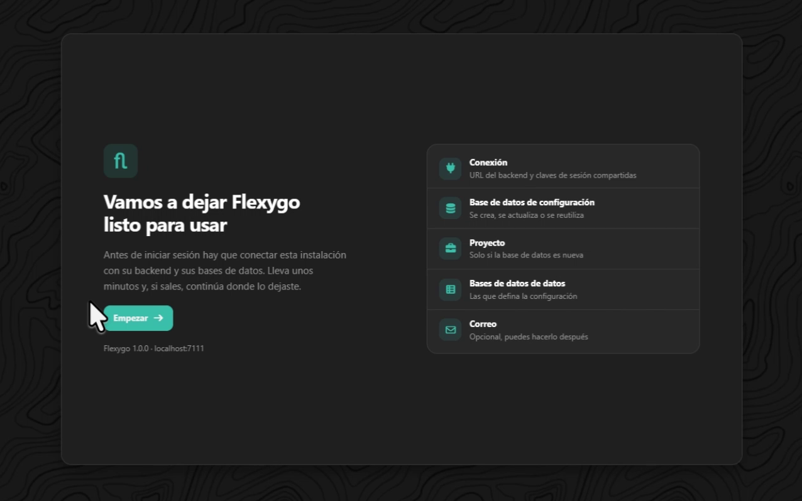
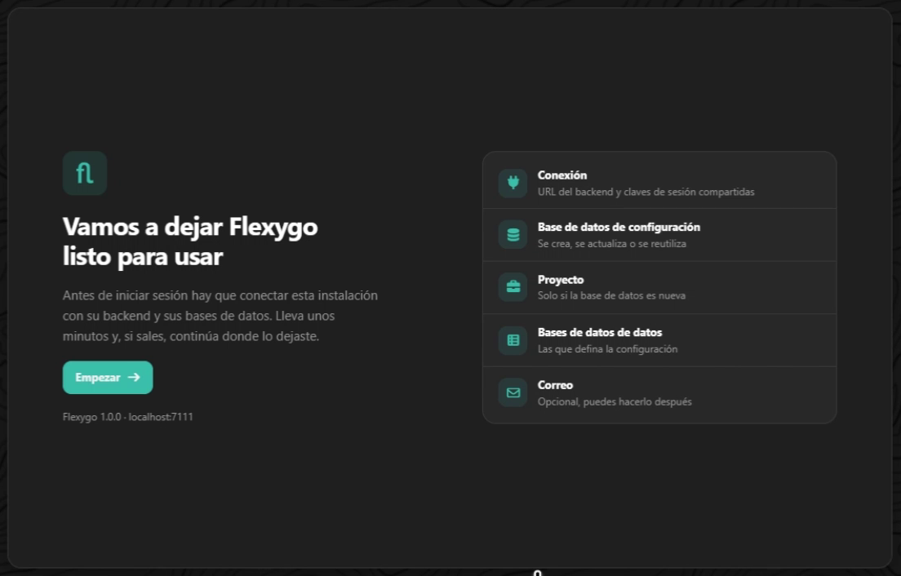
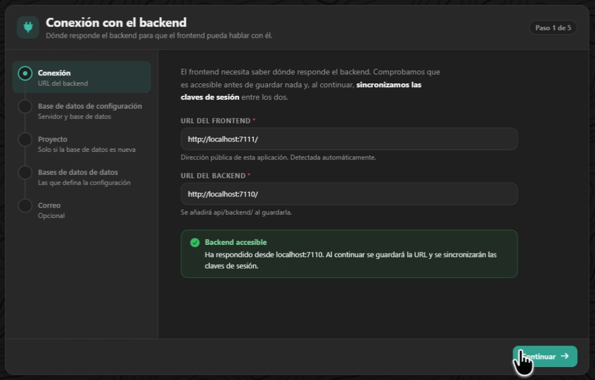
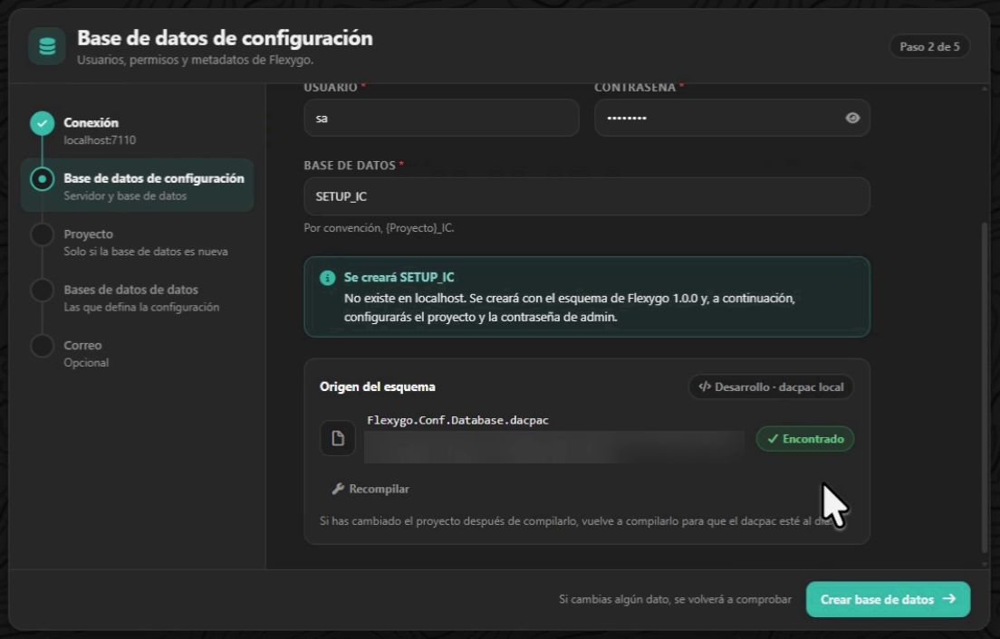
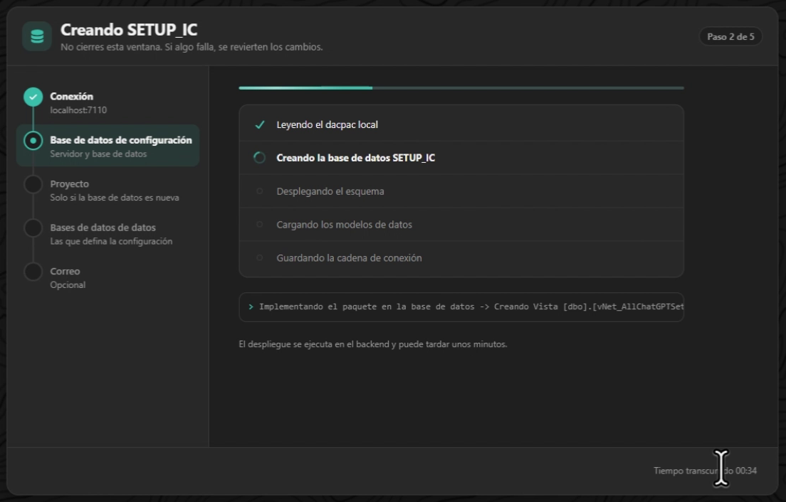
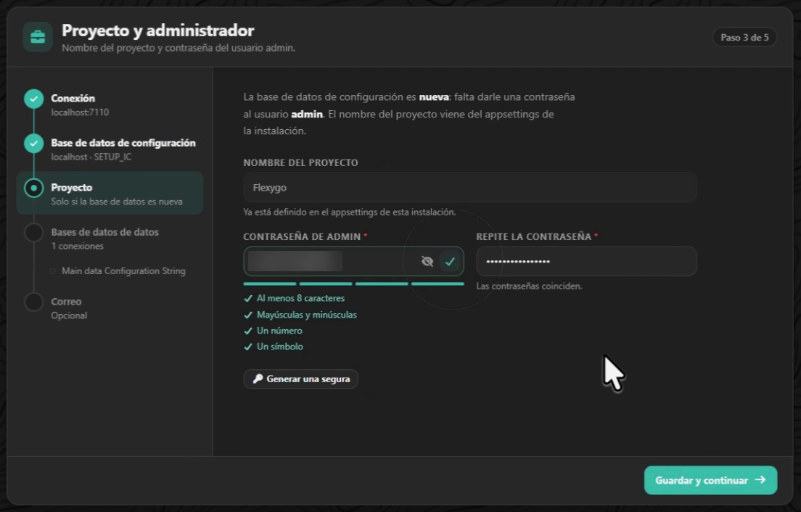
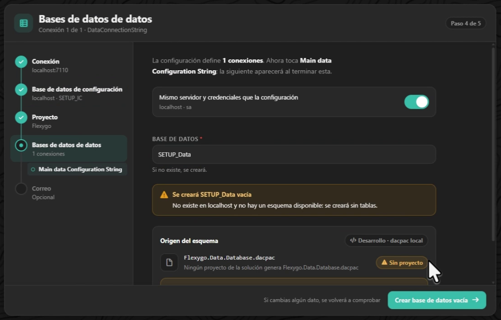
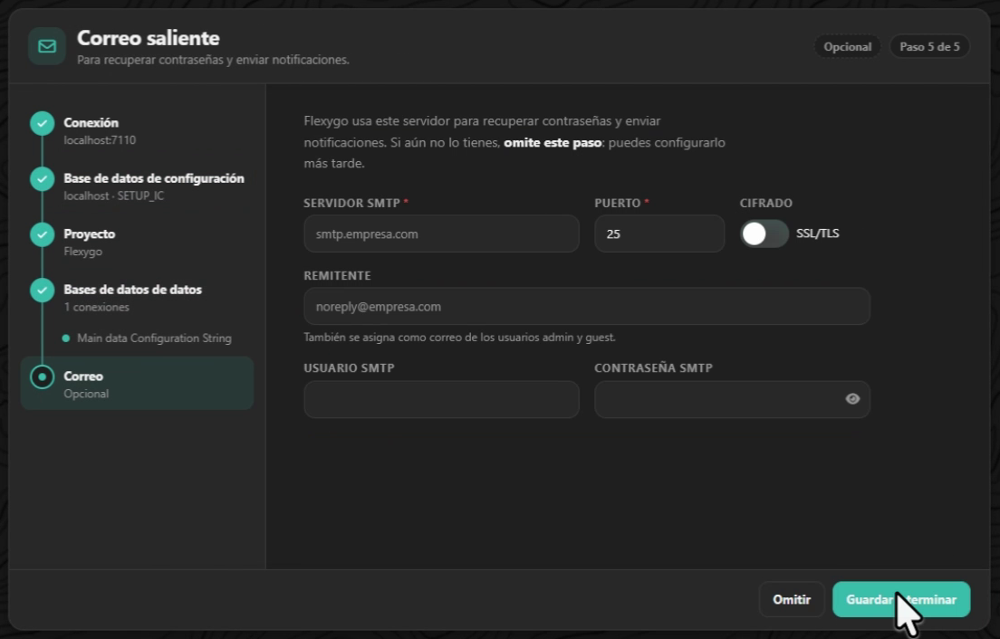
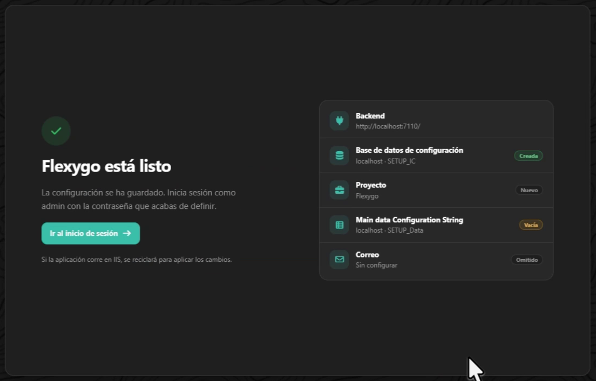
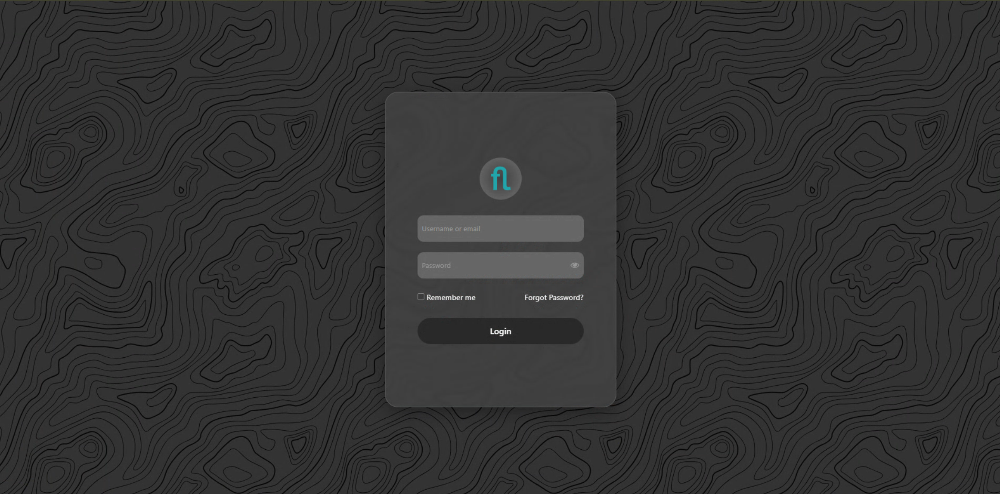

# Configuration

!!! info "New in version 10.0"

    Initial setup is now handled by a wizard on the Login screen. Press **Empezar** to begin. The wizard checks the values and shows progress as it publishes and creates the databases. You can use a dacpac file or a NuGet feed as the schema source.

    If you leave or an error occurs, you can return to the first pending step and retry without losing your progress. Credential errors identify the fields to check. If mail is already configured, the wizard skips that step. When setup is complete, press **Ir al inicio de sesión**.

    

The Configuration Wizard gets a new installation ready before the first sign-in. It connects the frontend with the backend, creates, updates or reuses the databases, names the project, sets the admin user's password and configures mail. Everything is saved to `appsettings.json` and to the configuration database, with no need to edit any file by hand.

!!! info "From web.config to appsettings.json"
    Unlike .NET Framework applications where the configuration lived in `web.config`, in Flexygo (based on .NET 9) all configuration is managed through `appsettings.json`. The wizard takes care of writing and updating this file automatically.

---

## Configuration Wizard

The wizard opens automatically when you access the application while the installation is not configured. The start screen sums up what you are going to set up and, under the **Start** button, shows the Flexygo version and the address of the application.

<figure markdown="span">
  
  <figcaption>Wizard start screen</figcaption>
</figure>

The wizard has five steps, listed on the left with the value saved in each one. Each step **checks** the data before saving anything. If you leave the wizard, it picks up at the first pending step when you come back.

---

### 1. Backend connection

Enter where the backend answers, so the frontend can talk to it:

- **Frontend URL**: the public address of the application. The wizard detects it automatically.
- **Backend URL**: the address of the backend, with its port. `api/backend/` is added when it is saved.

Click **Check connection**. If the backend answers, **Backend reachable** appears and, when you click **Continue**, the URL is saved and the session keys are synced between the frontend and the backend.

<figure markdown="span">
  
  <figcaption>Step 1 — The backend has answered</figcaption>
</figure>

---

### 2. Configuration database

This is the database where Flexygo keeps users, permissions and metadata. Enter the **SQL Server server**, the **user**, the **password** and the **database** name (by convention, `{Project}_IC`) and click **Check**.

The wizard checks the server and the database and tells you what it is going to do before doing it:

| Situation | What the wizard says | Button |
|-----------|----------------------|--------|
| It does not exist | **It will be created**, with the schema of the installed Flexygo version | **Create database** |
| It exists, but from an earlier version | **An update is available**. If it holds real data, back it up first | **Update and use** |
| It exists and is up to date | **Ready to use**: it is used as is | **Use this database** |

If you change any value after checking, the wizard checks it again. If the user or the password is wrong, or the database exists but is not a Flexygo configuration database, it says so on the field.

<figure markdown="span">
  
  <figcaption>Step 2 — The database does not exist and will be created from the local dacpac</figcaption>
</figure>

#### Schema source

To create or update the database, the wizard needs its schema. The **Schema source** box shows where it takes it from:

- **Development · local dacpac**: when the application runs from the solution, it uses the dacpac built by the database project. If the project is not built, it offers **Build the project**; if you changed it after building it, click **Rebuild** so the dacpac is up to date.
- **Production · NuGet**: in an installation, it downloads the database package from the feed configured in `DatabaseNuget`. If the package is not there, you can **Look in another feed** (a NuGet v3 feed or a local folder, with a user and token if it asks for them). That feed is only used for this installation: it is not saved to `appsettings.json` or to the settings.

!!! warning "The configuration database cannot be empty"
    Without a schema (no dacpac and no package), the wizard does not let you create or update the configuration database. Build the project or enter a feed with the package to continue.

#### Creation or update

When you click the button, the wizard deploys the database and shows each phase: reading the dacpac or downloading the package, creating the database, deploying the schema, loading the data models and saving the connection string. Below it you can see the detail of what is being deployed and the elapsed time.

Do not close the window while it runs. If something fails, the changes are rolled back: click **View details** to see the error, fix the cause and click **Retry**.

<figure markdown="span">
  
  <figcaption>Step 2 — Progress of the database creation</figcaption>
</figure>

---

### 3. Project and administrator

This step only appears when the configuration database is **new**. If it already existed, the step is skipped and the project and users it holds are used.

- **Project name**: saved to the project settings and to the backend `appsettings.json`. If the installation already defines it, it is locked.
- **Admin password** and **Repeat the password**: the password of the `admin` user. It needs at least 8 characters, upper and lower case, a number and a symbol; the list of requirements is ticked as you type. **Generate a strong one** creates one that meets them.

Click **Save and continue**.

<figure markdown="span">
  
  <figcaption>Step 3 — Project name and administrator password</figcaption>
</figure>

---

### 4. Data databases

The configuration database defines the data connections the product uses. The wizard sets them up **one at a time**: it says how many there are and which one is next, and the following one appears when the previous one is done.

By default it uses the **same server and credentials as the configuration**; turn the switch off to enter others. Type the **database** name and click **Check**:

| Situation | What the wizard does |
|-----------|----------------------|
| It does not exist and there is a schema (dacpac or package) | Creates it with the schema of its package |
| It does not exist and there is no schema | Creates it **empty**, with no tables |
| It exists and is from an earlier version | Updates it before using it |
| It exists and is up to date | Uses it as is |

The **Schema source** works as in step 2, with one difference: without a schema, a data database can be created empty (**Create empty database**).

!!! note "AHORA ERP databases"
    If the connection is to an AHORA ERP database, it must exist: the wizard does not create ERP databases. If it is not found, restore or create it and check again, or fix the name.

<figure markdown="span">
  
  <figcaption>Step 4 — The data database does not exist and there is no schema, so it will be created empty</figcaption>
</figure>

---

### 5. Outgoing mail

Flexygo uses this server to recover passwords and send notifications. The step is **optional**: if you do not have the server yet, click **Skip** and set it up later. If mail was already configured, the wizard skips this step.

| Field | Description |
|-------|-------------|
| SMTP server | Mail server (for example, `smtp.office365.com`) |
| Port | Usually 587 or 465 |
| Encryption | Turn on **SSL/TLS** if the server requires it |
| Sender | Address shown as the sender. It is also set as the email of the admin and guest users |
| SMTP user and SMTP password | Account used to authenticate with the server |

Click **Save and finish**.

<figure markdown="span">
  
  <figcaption>Step 5 — Outgoing mail server</figcaption>
</figure>

---

### Configuration complete

When it finishes, the wizard shows **Flexygo is ready** with a summary of what was set up: the backend, the configuration database, the project, each data database and mail. Each one shows what was done (**Created**, **Updated**, **Existing**, **Empty**, **New**, **Skipped**…).

If the application runs on IIS, it is recycled to apply the changes.

<figure markdown="span">
  
  <figcaption>Configuration summary</figcaption>
</figure>

Click **Go to sign in**. If the project is new, sign in as `admin` with the password from step 3; if it already existed, with your usual project user.

<figure markdown="span">
  
  <figcaption>Application login screen</figcaption>
</figure>

---

!!! info "appsettings.json reference"
    For a complete reference of the keys available in `appsettings.json` and their meaning, see [Reference: appsettings.json](AppSettingsReference.md).
