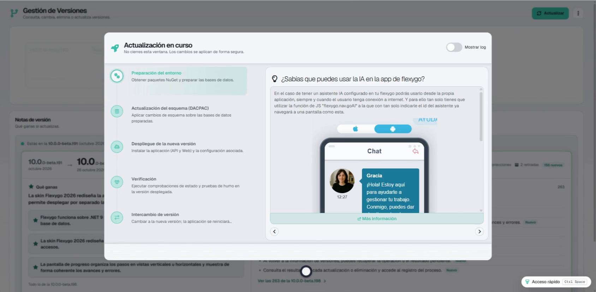
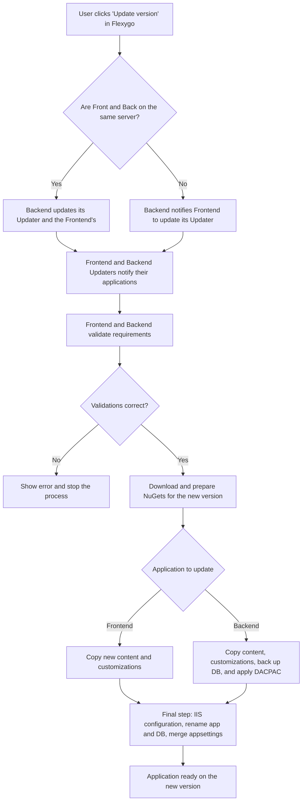

# Flexygo Updater

!!! info "New in version 10.0"

    In **Version management**, you can review what each version includes and use **Update** to start a wizard that can also revert the application or switch it to another version. Before continuing, the wizard checks the requirements and shows progress step by step, with Flexygo tips. When it finishes, it displays the result, the time taken and the version it started from. Select **Show log** to view the detailed log.

    Other administrators can follow an operation in progress. Each update or removal keeps its result and log. Administrators only can access this feature.

    

The Flexygo updater lets you update the version of the deployed application without having to reinstall from scratch. The process coordinates the Frontend and Backend to validate, download, and apply the new version, automatically performing the necessary backups and configuration changes.

## Update flow

Below is the complete flow of the Flexygo update process:

!!! tip "Summary"
    As shown in the diagram above, the Flexygo update process coordinates Frontend and Backend to validate, download, and prepare the new version, perform the necessary backups, and finish by updating files, the database, and the configuration — ensuring a fast and secure update.

!!! warning "Application Pool permissions"
    If the updater cannot overwrite files during the update process, make sure the IIS **Application Pool** user has write permissions on the destination folder. Without these permissions, the update process will fail when trying to replace the application's files.

!!! warning "Permissions to stop processes"
    In addition to write permissions, the **Application Pool** user needs permissions to **stop processes** (*kill process*) during the update. Without these permissions, the updater will not be able to stop the running application before replacing the binary files.

## Resolving the customized differences 10.0+

If you had changed configuration values that the new version also changes, the update leaves them as **differences to review** (*Update conflicts · Modified values that differ from the new version*). They open with the **Conflicts** button of the installed version in **Version management** or, in skin2026, from the version row of the sidebar (*n differences to review*).

- On the left, the list with **All**, **Pending** and **Resolved** filters, and the progress of what is resolved.
- For each difference, a **diff view** (*Custom vs New version*, *Previous vs Custom* or *Previous vs New version*) and the previous version's value as a reference.
- You choose **Keep custom** (your value), **Use new version** (the new version's) or a **Manual value**, which you can start from the previous value, yours or the new one. **All: custom** and **All: new version** decide for all of them at once.
- **Apply resolutions** saves what you decided; **Discard changes** leaves it as it was.

Only administrators see and resolve the differences. Since 10.1 they can also be resolved in Docker and Kestrel installations, where the other maintenance actions stay as they were.

## Refreshing the users' screens 10.0+

In **Version management**, the actions menu has **Refresh screens**, which makes the connected sessions **reload their screen**; for example, after changing a configuration they must see now. You choose **All users** (every other connected session) or **Specific users**, searching them in the list of connected users. It asks for confirmation before sending it, because anyone with unsaved changes may lose them.

## Scheduling an update 10.1+

Instead of updating right away, you can leave the update **scheduled** for a time when nobody is working, for example at night. In **Version management**, on the version you want to go to, the **Update** button group has **Schedule update**:

1. Choose **Starts at**, the start date and time, in the time zone shown below it. It must be at least one minute from now.
2. **Prepare the version beforehand (minutes)**: how many minutes before the start the version is downloaded and prepared, so the update takes less. Between 0 and 1440 (one day).
3. **Schedule** and confirm.

Scheduling is for **IIS** installations. In Kestrel the button is disabled and says why when you hover it; Docker is updated with its images.

**What happens at that time.** The **maintenance mode** is turned on, the update runs with nobody signed in, and the maintenance mode is turned off when it ends, however it ends. If something prevents the update (prerequisites, locked files, pending customized differences), it is aborted and the administrators are told. If the prerequisites only give **warnings**, they wait 10 minutes for you to decide.

Meanwhile:

- A **banner** on the versions page says when it starts (*Update to 10.1.0.4 starts in 36 minutes*) or that the version is being prepared (*Preparing 10.1.0.4: the update starts in 5 minutes*). Its **Manage** button opens the state of the scheduled update, with **Reschedule** to change the time and **Cancel schedule** to call it off; cancelling also turns off its maintenance mode.
- There can only be **one** scheduled update. To update or switch version by hand, cancel it first from its banner.
- When it ends, the result is kept in the operations history and administrators get a notice in the **bell** and by **mail**.

!!! note "The maintenance mode follows the update"
    Every update or version switch, scheduled or launched from the wizard, puts the application in maintenance while it runs. The administrator who launched it from the wizard can stay in; everybody else sees the maintenance page. The change takes about 15 seconds to show at the start and at the end.

<!-- SCREENSHOT PENDING: "Schedule update to …" dialog with Starts at and Prepare the version beforehand, and the "Update to … starts in …" banner with Manage. 1920×1080, skin2026 light. -->

## The next version, prepared every night 10.1+

The **UpdaterWarmup** system job (*System* group, enabled out of the box) runs **every night at 1:00 am**. It has the updater download and prepare the latest version available in the project's feed and remove the packages of earlier versions, so the next update does not wait for the downloads.

- First it **renews the updater itself**: the updater updates itself in the Frontend and the Backend and removes its old packages, so the next update does not need to download it.
- It does nothing while an update is running, nor in installations that are not on IIS (Docker and Kestrel are updated with their images or by hand).
- Its **log** says which packages it prepared, or why it did nothing. A run that fails is logged in the jobs log as an **error**, with its message.
- If you do not want it, disable it in the scheduled jobs list (*Jobs*), like any other.

---

To update dockerized applications, see [Update in Docker Containers](DockerUpdate.md).
