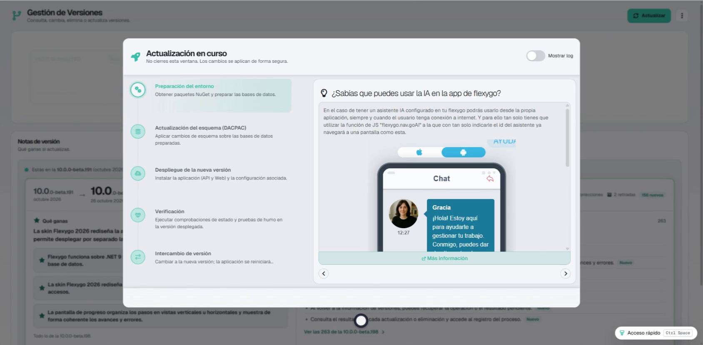
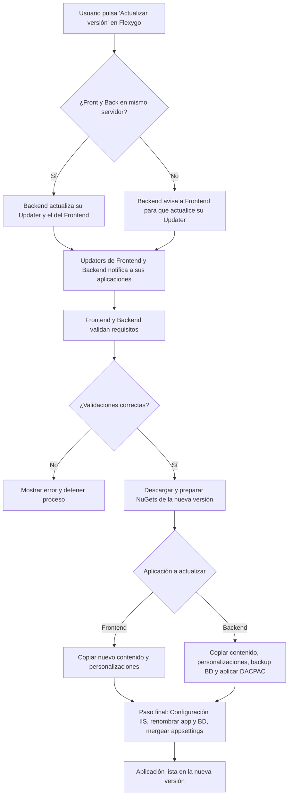

# Actualizador de Flexygo

!!! info "Novedad en la versión 10.0"

    En **Version management**, puedes consultar las novedades de cada versión y usar **Update** para iniciar un asistente que también permite revertir la aplicación o cambiarla a otra versión. Antes de continuar, el asistente comprueba los requisitos y muestra el progreso paso a paso, con consejos de Flexygo. Al terminar, indica el resultado, el tiempo empleado y la versión de origen. Usa **Show log** para consultar el registro detallado.

    Otros administradores pueden seguir una operación en curso. Cada actualización o eliminación conserva su resultado y su registro. Solo pueden acceder los administradores.

    

El actualizador de Flexygo permite actualizar la versión de la aplicación desplegada sin necesidad de reinstalar desde cero. El proceso coordina Frontend y Backend para validar, descargar y aplicar la nueva versión, realizando los backups y cambios de configuración necesarios de forma automática.

## Flujo de actualización

A continuación se muestra el flujo completo del proceso de actualización de Flexygo:

!!! tip "Resumen"
    Como vemos en el diagrama anterior, el proceso de actualización de Flexygo coordina Frontend y Backend para validar, descargar y preparar la nueva versión, realizar los backups necesarios y finalizar con la actualización de archivos, base de datos y configuración, asegurando así una actualización rápida y segura.

!!! warning "Permisos del Application Pool"
    Si el actualizador no puede sobrescribir archivos durante el proceso de actualización, asegúrate de que el usuario del **Application Pool** de IIS tiene permisos de escritura sobre la carpeta de destino. Sin estos permisos, el proceso de actualización fallará al intentar reemplazar los archivos de la aplicación.

!!! warning "Permisos para detener procesos"
    Además de los permisos de escritura, el usuario del **Application Pool** necesita permisos para **detener procesos** (*kill process*) durante la actualización. Sin estos permisos, el actualizador no podrá detener la aplicación en ejecución antes de reemplazar los archivos binarios.

## Resolver las diferencias personalizadas 10.0+

Si habías cambiado valores de la configuración que la versión nueva también trae cambiados, la actualización los deja como **diferencias para revisar** (*Update conflicts · Modified values that differ from the new version*). Se abren con el botón **Conflicts** de la versión instalada en **Version management** o, en skin2026, desde la fila de la versión del menú lateral (*n differences to review*).

- A la izquierda, la lista con filtros **All**, **Pending** y **Resolved**, y el progreso de lo resuelto.
- Para cada diferencia, una **vista comparada** (*Custom vs New version*, *Previous vs Custom* o *Previous vs New version*) y el valor de la versión anterior como referencia.
- Eliges **Keep custom** (tu valor), **Use new version** (el de la versión nueva) o un **Manual value**, que puedes empezar desde el valor anterior, el tuyo o el nuevo. **All: custom** y **All: new version** lo deciden para todas a la vez.
- **Apply resolutions** guarda lo decidido; **Discard changes** lo deja como estaba.

Solo los administradores ven y resuelven las diferencias. Desde la 10.1 también se resuelven en instalaciones Docker y Kestrel, donde el resto de acciones de mantenimiento siguen como estaban.

## Refrescar las pantallas de los usuarios 10.0+

En **Version management**, el menú de acciones tiene **Refresh screens**, que obliga a las sesiones conectadas a **recargar su pantalla**; por ejemplo, después de cambiar una configuración que deben ver ya. Eliges **All users** (todas las demás sesiones conectadas) o **Specific users**, buscándolos en la lista de usuarios conectados. Antes de enviarlo pide confirmación, porque quien tenga cambios sin guardar puede perderlos.

## Programar una actualización 10.1+

En lugar de actualizar al momento, puedes dejar la actualización **programada** para una hora sin gente, por ejemplo de madrugada. En **Version management**, en la versión a la que quieres ir, el grupo de botones de **Update** tiene **Schedule update**:

1. Elige **Starts at**, la fecha y hora de inicio, en la zona horaria que indica debajo. Tiene que ser al menos un minuto después de ahora.
2. **Prepare the version beforehand (minutes)**: cuántos minutos antes se descarga y se prepara la versión, para que la actualización tarde menos. Entre 0 y 1440 (un día).
3. **Schedule** y confirma.

Se programa en instalaciones **IIS**. En Kestrel el botón está desactivado y lo explica al pasar el ratón; Docker se actualiza con sus imágenes.

**Qué pasa a esa hora.** Se activa el **modo mantenimiento**, la actualización se ejecuta sin nadie dentro y el modo mantenimiento se apaga al terminar, acabe como acabe. Si algo la impide (requisitos, ficheros bloqueados, diferencias personalizadas pendientes), se cancela y se avisa a los administradores. Si los requisitos solo dan **avisos**, esperan 10 minutos a que decidas.

Mientras tanto:

- Una **banda** en la página de versiones dice cuándo empieza (*Update to 10.1.0.4 starts in 36 minutes*) o que se está preparando (*Preparing 10.1.0.4: the update starts in 5 minutes*). Su botón **Manage** abre el estado de la actualización programada, con **Reschedule** para cambiar la hora y **Cancel schedule** para anularla; al anularla se apaga también su modo mantenimiento.
- Solo puede haber **una** actualización programada. Para actualizar o cambiar de versión a mano, cancélala antes desde su banda.
- Al terminar, el resultado queda en el historial de operaciones y los administradores reciben un aviso en la **campana** y por **correo**.

!!! note "El modo mantenimiento sigue a la actualización"
    Toda actualización o cambio de versión, programado o lanzado desde el asistente, pone la aplicación en mantenimiento mientras dura. El administrador que la lanzó desde el asistente puede seguir dentro; los demás ven la página de mantenimiento. El cambio de estado tarda unos 15 segundos en notarse al empezar y al acabar.

<!-- CAPTURA PENDIENTE: diálogo «Schedule update to …» con Starts at y Prepare the version beforehand, y la banda «Update to … starts in …» con Manage. 1920×1080, skin2026 claro. -->

## La versión siguiente, preparada cada noche 10.1+

La tarea del sistema **UpdaterWarmup** (grupo *System*, activa de fábrica) se ejecuta **cada noche a la 1:00**. Pide al actualizador que descargue y prepare la última versión disponible del feed del proyecto y que borre los paquetes de versiones anteriores, así la siguiente actualización no espera a las descargas.

- Antes, **renueva el propio actualizador**: el actualizador se actualiza a sí mismo en el Frontend y en el Backend y quita sus paquetes viejos, de modo que la actualización siguiente no tiene que bajarlo.
- No hace nada mientras hay una actualización en marcha, ni en instalaciones que no estén en IIS (Docker y Kestrel se actualizan con sus imágenes o a mano).
- Su **log** dice qué paquetes preparó, o por qué no hizo nada. Una ejecución con error queda en el log de tareas como **error**, con su mensaje.
- Si no la quieres, desactívala en la lista de tareas programadas (*Jobs*), como cualquier otra.

---

Para actualizar aplicaciones dockerizadas, consulta [Actualización en contenedores Docker](DockerUpdate.md).
