# Version management 10.0+

**Version Management** is the window administrators use to keep the installation up to date: it shows which version is installed and which ones are available, and from it you update, go back to an earlier version, delete the ones you no longer need, schedule an update and read the release notes. Its **More actions** menu leads to maintenance mode, refreshing the users' screens, the operation history and the updater settings.

It opens from the **version row** at the foot of the sidebar in the 2026 skin, or at the application's `/version-info` address. Only administrators can use it.

<figure markdown="span">
  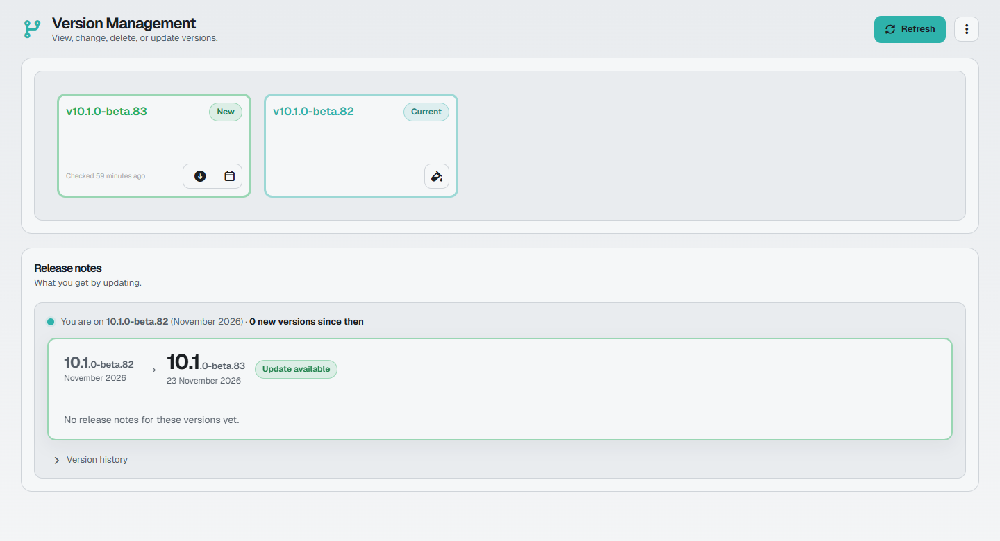
  <figcaption>A new version available (<i>New</i>) and the installed one (<i>Current</i>)</figcaption>
</figure>

!!! info "How the update works inside"
    This page tells what you can do in the window. What the updater does at each step, the permissions it needs in IIS and how to resolve configuration differences are in [Flexygo updater](UpdateFlow.md). On Docker, the window says the installation is updated with its images: see [Updating Docker containers](DockerUpdate.md).

---

## 1. The versions

Each version is a card, with a label that says its state and the buttons for what you can do with it:

| Label | What it is | Buttons |
|---|---|---|
| **New** | A published version you have not installed yet. Below, when it was last checked. | **Update** and **Schedule update** |
| **Current** | The installed version, the one running. | **Tests** (the installation's diagnostic tests) and, when the last update left configuration differences, **Conflicts** |
| **Download** | A version you had installed, kept so you can go back to it. | **Switch** and **Delete** |

The **Refresh** button at the top asks the package repository again for new versions. When a button is disabled, hovering over it tells why; for example, while an operation is running or an update is scheduled.

---

## 2. Updating to a new version

1. On the **New** version, click **Update** and confirm.
2. The wizard first checks that the updater is up to date, that the **prerequisites** are met and that no **files are locked**. If something fails, it says so and stops; if the prerequisites only give **warnings**, you can **Continue**.
3. Then it shows the **progress** step by step: environment preparation, database schema update (DACPAC), deploy new version, verification and version switch. Meanwhile, Flexygo tips show on the right. **Show log** shows the detailed log, with filters by level and by frontend and backend.
4. At the end, the application restarts on the new version. The **Switching version** screen waits for it on its own and reconnects; you do not have to do anything.
5. The result tells how long it took, which version you came from and when it finished.

<figure markdown="span">
  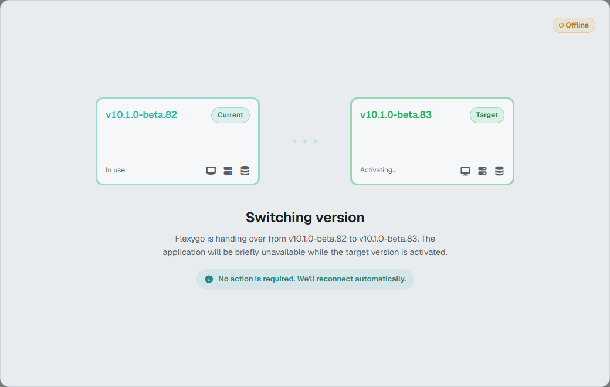
  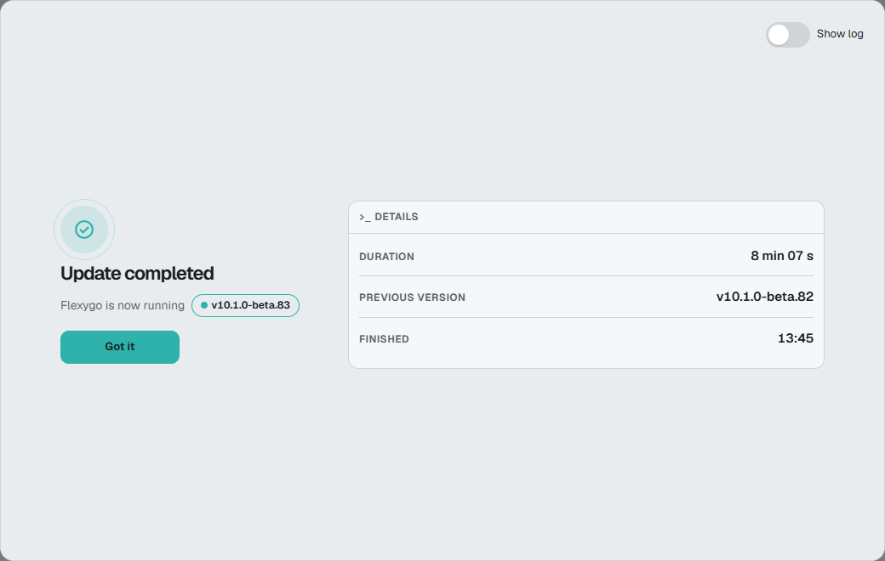
  <figcaption>The switch to the new version and the result</figcaption>
</figure>

An update takes a few minutes: in our tests, about nine. While it runs:

- The application is in **maintenance mode**: you can stay in, and other users see the maintenance page.
- The cards are covered by the **Update to … in progress** notice, and no other operation can start until it ends. Another administrator who opens the window sees who started it and can follow it with **Watch**, but cannot take decisions for you.
- If something fails, the updater leaves the installation as it was and the result says which step failed, with its technical details.

The version you came from stays as **Download**, in case you want to go back to it.

---

## 3. Going back to an earlier version

On a **Download** version, **Switch** goes back to it. It is much faster than updating, because the version is already on the server: in our tests, less than a minute. It also goes through the **Switching version** screen and ends with its result.

<figure markdown="span">
  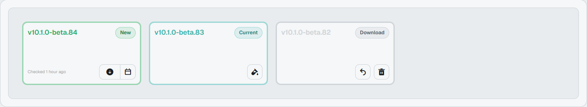
  <figcaption>After updating, the previous version stays as <i>Download</i></figcaption>
</figure>

!!! warning "The configuration goes back to how it was"
    When updating, Flexygo keeps the configuration database as it was before. **Switch** uses that copy, so the configuration changes you made after updating are not kept.

---

## 4. Deleting a version

On a **Download** version, **Delete** removes it from the server to free space. It asks for confirmation and takes a few seconds. The installed version cannot be deleted.

If the deleted version is still published, it shows again as **New**, and you can install it again whenever you want.

---

## 5. Scheduling an update 10.1+

On the **New** version, **Schedule update** (the calendar button next to **Update**) leaves the update for a time with nobody around:

1. **Starts at**: the date and time, in the time zone shown below.
2. **Prepare the version beforehand (minutes)**: how long before it is downloaded and prepared, so the update takes less.
3. **Schedule** and confirm.

<figure markdown="span">
  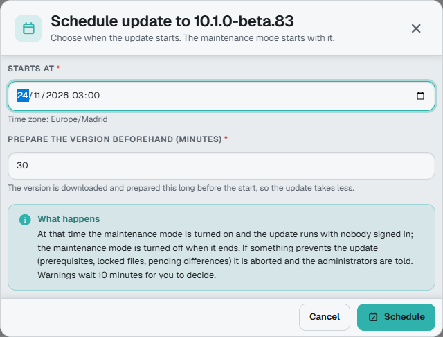{ width="520" }
  <figcaption>Scheduling the update to a version</figcaption>
</figure>

From then on, a band says when it starts. **Manage** opens its state, with **Reschedule** to change the time and **Cancel schedule** to call it off. While an update is scheduled you cannot update or switch versions by hand.

<figure markdown="span">
  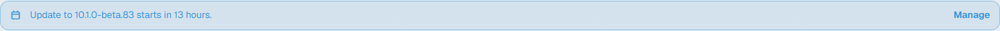
  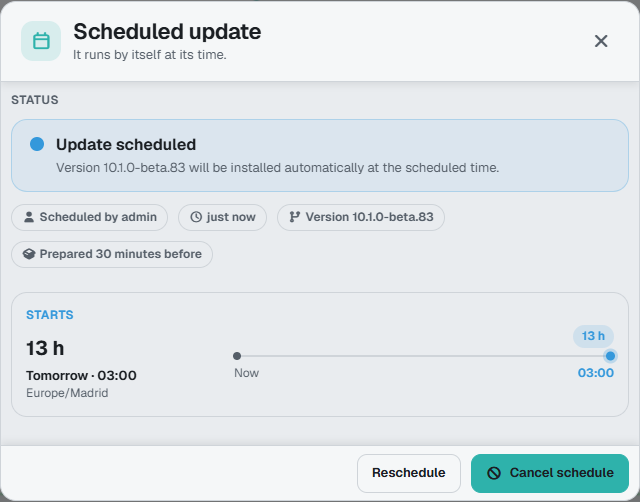{ width="520" }
  <figcaption>The band of the scheduled update and its state</figcaption>
</figure>

What happens at that time, what happens if something prevents it and how administrators are told: see [Scheduling an update](UpdateFlow.md#scheduling-an-update-101).

---

## 6. The release notes

Under the versions, **Release notes** tells what each one brings:

- When there is a newer version, **What you get by updating**: what the versions you are missing bring.
- When you are up to date (**Up to date**), **What … brought**: a summary with the highlights, the **new features** and the **fixes**, with the ones new since the last build marked **New**.
- **Version history** unfolds the notes of the earlier versions, with **Notes** to open each one.

<figure markdown="span">
  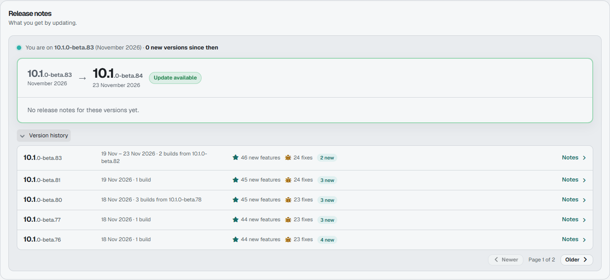
  <figcaption>The release notes, with the version history unfolded</figcaption>
</figure>

---

## 7. More actions

The three-dot button next to **Refresh** opens **More actions**. A red dot on it says maintenance mode is on; a dot of another colour, that a maintenance is scheduled.

<figure markdown="span">
  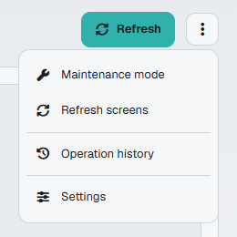{ width="360" }
  <figcaption>The More actions menu</figcaption>
</figure>

### 7.1 Maintenance mode

Closes the application to users while you work on it: everyone except the exempt administrators sees the maintenance page.

- **When should it start?**: **Start now**, or **Schedule** by choosing the date and time.
- **Message for users (optional)**: what they will read on the maintenance page. **This is what users will see** shows how it looks.
- **Activate** and confirm.

While it is on, a red band recalls it in the window, and the same panel says who turned it on and when, with **Deactivate** to open the application again. Maintenance stays on until an administrator turns it off.

<figure markdown="span">
  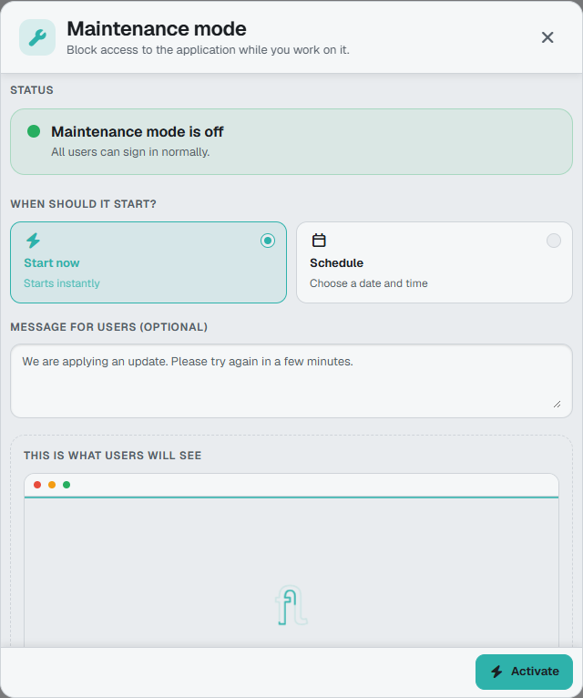
  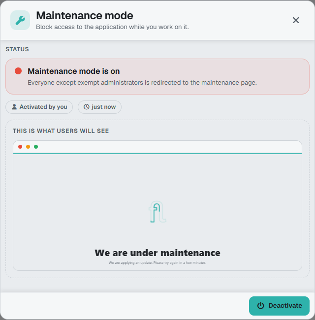
  <figcaption>Turning maintenance mode on and off</figcaption>
</figure>

Updates and version switches put the application in maintenance on their own while they run; that maintenance cannot be turned off by hand and goes away when they end.

### 7.2 Refresh screens

Forces the connected sessions to **reload their screen**, for example after changing something in the configuration they must see now. Choose **All users** or **Specific users**, looking them up among the connected ones, and **Refresh**. It asks for confirmation, because whoever has unsaved changes may lose them.

<figure markdown="span">
  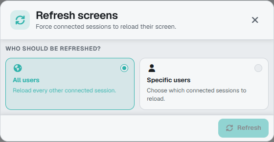{ width="520" }
  <figcaption>Refreshing the screens of the connected users</figcaption>
</figure>

### 7.3 Operation history

Lists the latest updates, switches and deletions of versions, newest first, with who started them, when, how long they took and how they ended. Scheduled updates that did not go through are also listed here, with the reason.

Click one to see its result and, with **Show log**, its full log, with filters by level (*Debug*, *Information*, *Warning*, *Error*, *Critical*), by frontend and backend, and a search box. **Back to history** returns to the list. **Clear history** deletes every operation and its logs.

<figure markdown="span">
  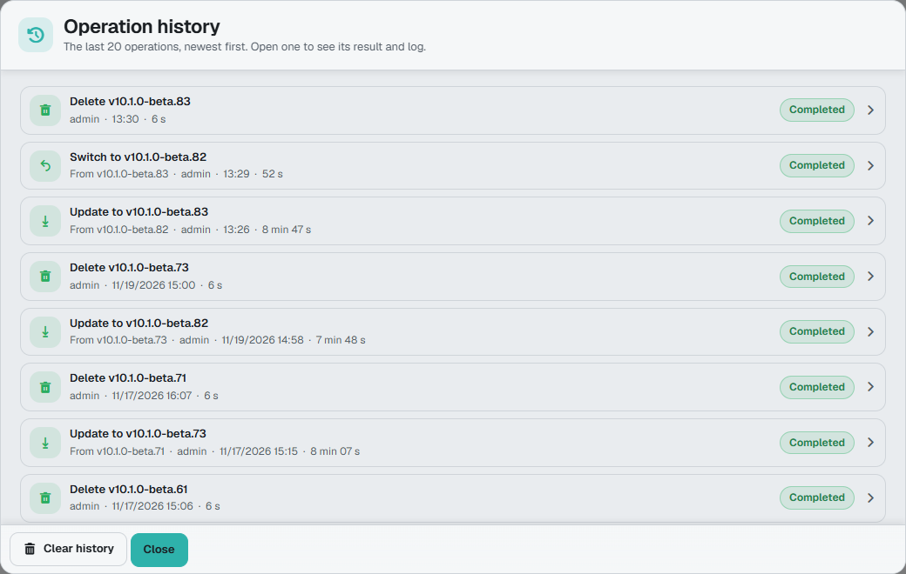
  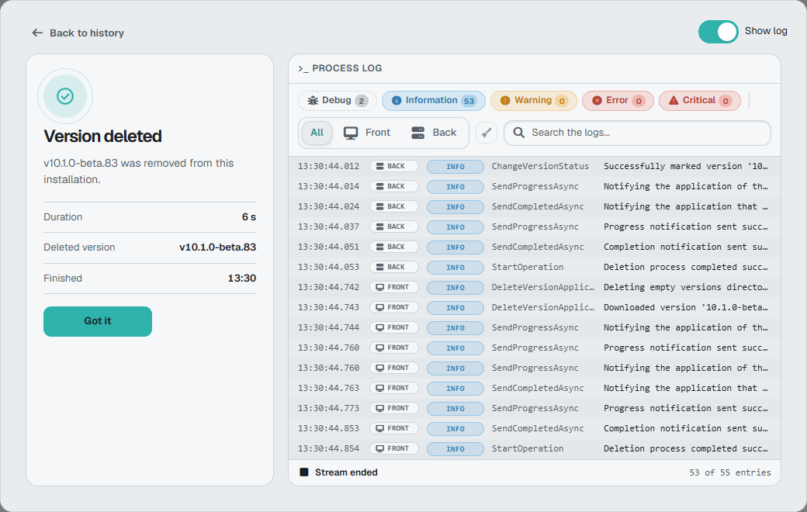
  <figcaption>The history and the log of an operation</figcaption>
</figure>

### 7.4 Settings

Opens the list of updater settings, which are changed like any other Flexygo setting. The main ones:

| Setting | What it is for |
|---|---|
| **AutoUpdateEnable** | Turns on the search for new versions. |
| **AutoUpdateBeta** | Allows updating to beta versions. |
| **AutoUpdateCheckInterval** | Every how many seconds new versions are looked for. |
| **AutoUpdateURL**, **AutoUpdateNugetUser** and **AutoUpdateNugetPassword** | The package repository the versions are downloaded from, and its credentials. |
| **AutoUpdatePackageNamespace** | The base name of the packages: `Flexygo`, or your product's when it publishes its own. |
| **OverrideUpdateVersion** | Fixes the version offered, instead of the latest published. |
| **UpdaterPrerelease** | Makes the updater itself download its beta versions too. |
| **UpdaterLogTableRowLimit** | Above how many rows a log table of the configuration database gives a warning in the update prerequisites, because rebuilding a very large table can time out. `0` turns the check off. |

**MaintenanceMode** keeps the state of maintenance mode: do not change it by hand, use the panel of section 7.1.

<figure markdown="span">
  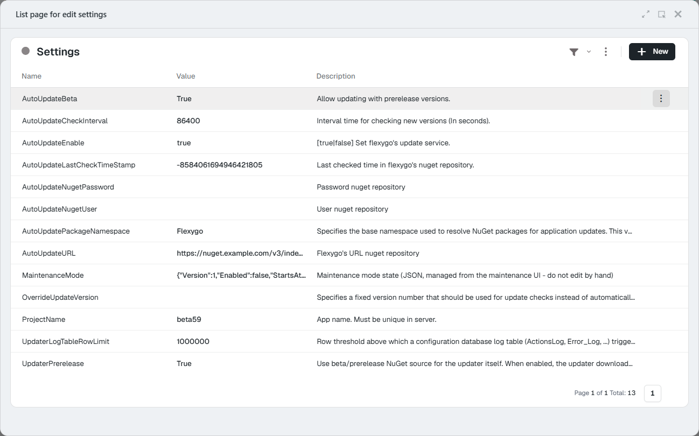
  <figcaption>The updater settings</figcaption>
</figure>
