# Gestión de versiones 10.0+

**Gestión de versiones** es la ventana desde la que los administradores mantienen al día la instalación: ven qué versión tienen y cuáles hay, actualizan, vuelven a una versión anterior, borran las que ya no hacen falta, programan una actualización y leen las notas de versión. Su menú **Más acciones** lleva al modo mantenimiento, a refrescar las pantallas de los usuarios, al historial de operaciones y a los ajustes del actualizador.

Se abre desde la **fila de la versión**, al pie del menú lateral de la skin 2026, o con la dirección `/version-info` de la aplicación. Solo pueden usarla los administradores.

<figure markdown="span">
  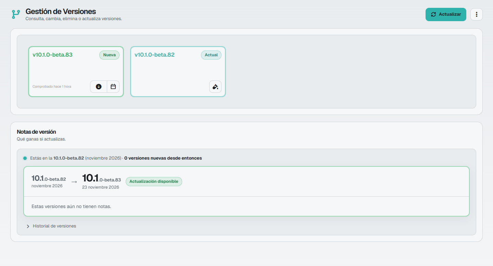
  <figcaption>Una versión nueva disponible (<i>Nueva</i>) y la instalada (<i>Actual</i>)</figcaption>
</figure>

!!! info "Cómo se actualiza por dentro"
    Esta página cuenta qué se puede hacer en la ventana. Qué hace el actualizador en cada paso, los permisos que necesita en IIS y cómo resolver las diferencias de configuración están en [Actualizador de Flexygo](UpdateFlow.md). En Docker, la ventana avisa de que la instalación se actualiza con sus imágenes: ver [Actualización en contenedores Docker](DockerUpdate.md).

---

## 1. Las versiones

Cada versión es una tarjeta, con una etiqueta que dice en qué estado está y los botones de lo que se puede hacer con ella:

| Etiqueta | Qué es | Botones |
|---|---|---|
| **Nueva** | Una versión publicada que todavía no has instalado. Debajo dice cuándo se comprobó por última vez. | **Actualizar** y **Programar actualización** |
| **Actual** | La versión instalada, la que está funcionando. | **Tests** (las pruebas de diagnóstico de la instalación) y, si la última actualización dejó diferencias de configuración, **Conflictos** |
| **Descarga** | Una versión que tuviste instalada y que se guarda para poder volver a ella. | **Cambiar** y **Eliminar** |

El botón **Actualizar** de arriba vuelve a preguntar al repositorio de paquetes si hay versiones nuevas. Si un botón está desactivado, al pasar el ratón por encima dice por qué; por ejemplo, mientras hay una operación en curso o una actualización programada.

---

## 2. Actualizar a una versión nueva

1. En la versión **Nueva**, pulsa **Actualizar** y confirma.
2. El asistente comprueba primero que el actualizador está al día, que se cumplen los **requisitos** y que no hay **ficheros bloqueados**. Si algo falla, lo dice y no sigue; si los requisitos solo dan **avisos**, puedes **Continuar**.
3. Después enseña el **progreso** por pasos: preparación del entorno, actualización del esquema de la base de datos (DACPAC), despliegue de la nueva versión, verificación e intercambio de versión. Mientras tanto, a la derecha, salen consejos de Flexygo. **Mostrar log** enseña el registro detallado, con filtros por nivel y por frontend y backend.
4. Al final, la aplicación se reinicia con la versión nueva. La pantalla **Cambiando de versión** espera sola a que vuelva y se reconecta; no tienes que hacer nada.
5. El resultado dice cuánto tardó, de qué versión venías y a qué hora terminó.

<figure markdown="span">
  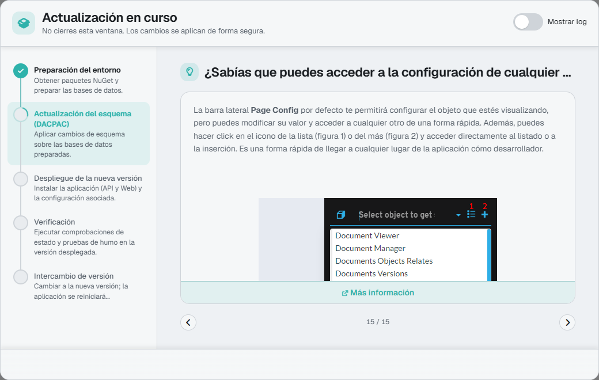
  <figcaption>El progreso de la actualización, paso a paso</figcaption>
</figure>

<figure markdown="span">
  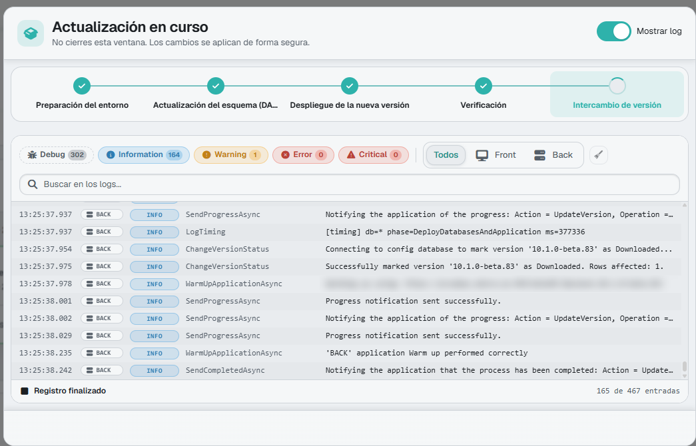
  <figcaption>Con <b>Mostrar log</b>, los pasos pasan arriba y debajo sale el registro, con filtros y buscador</figcaption>
</figure>

<figure markdown="span">
  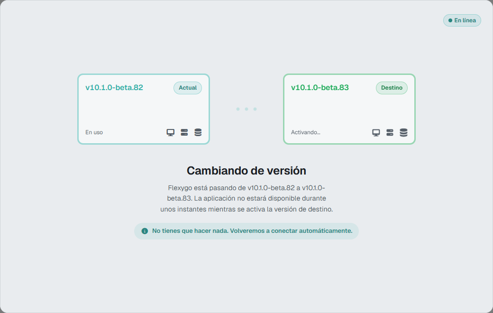
  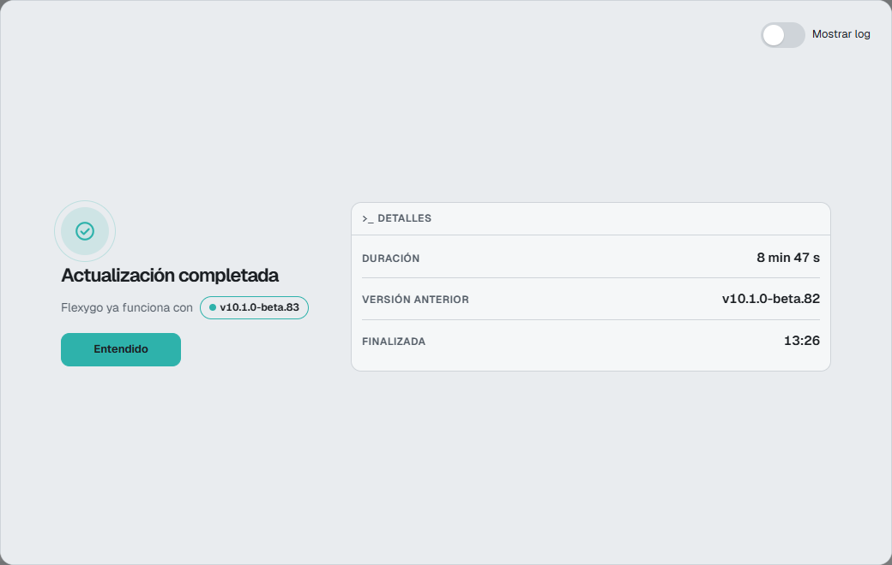
  <figcaption>El cambio a la versión nueva y el resultado</figcaption>
</figure>

Una actualización tarda unos minutos: en nuestras pruebas, cerca de nueve. Mientras dura:

- La aplicación está en **modo mantenimiento**: tú puedes seguir dentro y los demás usuarios ven la página de mantenimiento.
- Las tarjetas se quedan tapadas con el aviso **Actualización a … en curso**, y no se puede hacer otra operación hasta que termine. Otro administrador que abra la ventana ve quién la lanzó y puede seguirla con **Ver**, pero no tomar decisiones por ti.
- Si algo falla, el actualizador deja la instalación como estaba y el resultado dice en qué paso falló, con sus detalles técnicos.

La versión de la que venías se queda como **Descarga**, por si quieres volver a ella.

---

## 3. Volver a una versión anterior

En una versión **Descarga**, **Cambiar** vuelve a ella. Es mucho más rápido que actualizar, porque la versión ya está en el servidor: en nuestras pruebas, menos de un minuto. También pasa por la pantalla **Cambiando de versión** y termina con su resultado.

<figure markdown="span">
  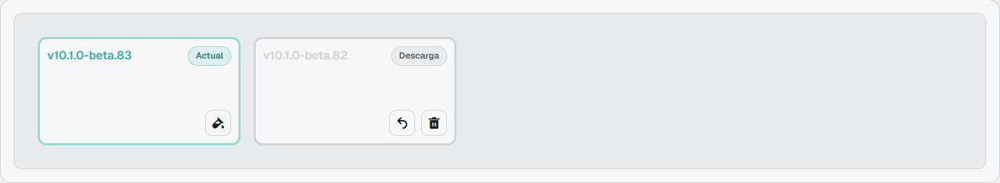
  <figcaption>Después de actualizar, la versión anterior queda como <i>Descarga</i></figcaption>
</figure>

!!! warning "La configuración vuelve a como estaba"
    Al actualizar, Flexygo guarda la base de datos de configuración tal y como estaba antes. Al volver con **Cambiar** se usa esa copia, así que los cambios de configuración que hiciste después de actualizar no se conservan.

---

## 4. Eliminar una versión

En una versión **Descarga**, **Eliminar** la borra del servidor para liberar espacio. Pide confirmación y tarda unos segundos. La versión instalada no se puede eliminar.

Si la versión eliminada sigue publicada, vuelve a salir como **Nueva**, y puedes volver a instalarla cuando quieras.

---

## 5. Programar una actualización 10.1+

En la versión **Nueva**, **Programar actualización** (el botón del calendario, junto a **Actualizar**) deja la actualización para una hora sin gente:

1. **Empieza el**: la fecha y la hora, en la zona horaria que indica debajo.
2. **Preparar la versión antes (minutos)**: con cuánta antelación se descarga y se prepara, para que la actualización dure menos.
3. **Programar** y confirma.

<figure markdown="span">
  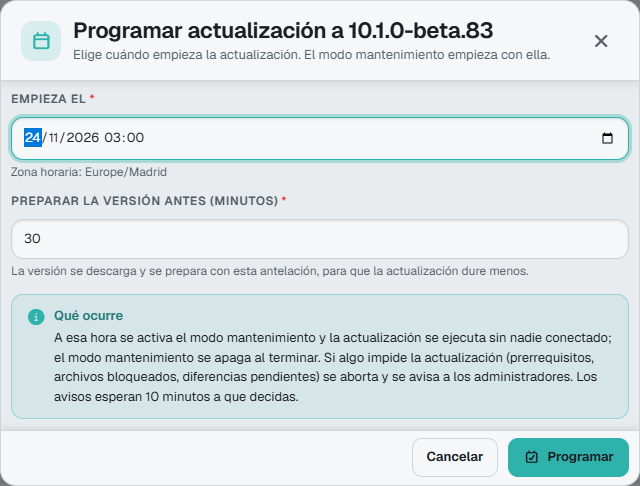{ width="520" }
  <figcaption>Programar la actualización a una versión</figcaption>
</figure>

Desde ese momento, una banda dice cuándo empieza. **Gestionar** abre su estado, con **Reprogramar** para cambiar la hora y **Cancelar programación** para anularla. Mientras hay una actualización programada no se puede actualizar ni cambiar de versión a mano.

<figure markdown="span">
  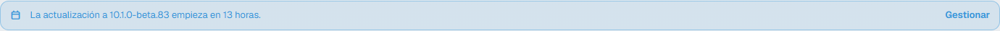
  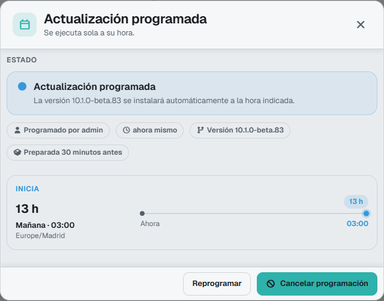{ width="520" }
  <figcaption>La banda de la actualización programada y su estado</figcaption>
</figure>

Qué ocurre a esa hora, qué pasa si algo la impide y cómo se avisa a los administradores: ver [Programar una actualización](UpdateFlow.md#programar-una-actualizacion-101).

---

## 6. Las notas de versión

Debajo de las versiones, **Notas de versión** cuenta qué trae cada una:

- Si hay una versión más nueva, **Qué ganas si actualizas**: lo que traen las versiones que te faltan.
- Si estás al día, **Qué trajo tu versión**: un resumen con lo más destacado, las **Novedades** y las **Correcciones**, con las que son nuevas desde la última compilación marcadas como **Nuevo**.
- **Historial de versiones** despliega las notas de las versiones anteriores.

<figure markdown="span">
  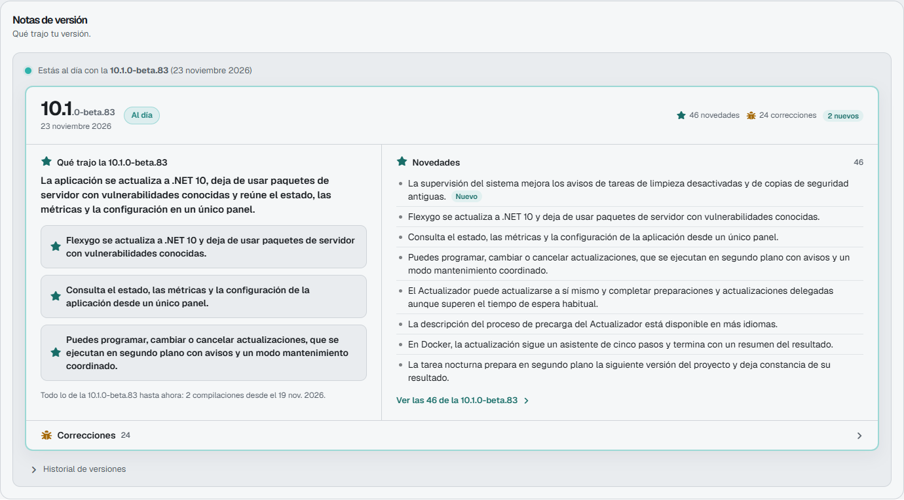
  <figcaption>Las notas de la versión instalada</figcaption>
</figure>

---

## 7. Más acciones

El botón de los tres puntos, junto a **Actualizar**, abre **Más acciones**. Un punto rojo sobre él avisa de que el modo mantenimiento está activado; uno de otro color, de que hay un mantenimiento programado.

<figure markdown="span">
  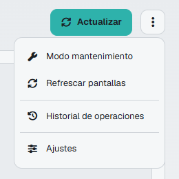{ width="360" }
  <figcaption>El menú Más acciones</figcaption>
</figure>

### 7.1 Modo mantenimiento

Cierra la aplicación a los usuarios mientras trabajas en ella: todos, salvo los administradores exentos, ven la página de mantenimiento.

- **¿Cuándo debe empezar?**: **Empezar ahora** o **Programar**, eligiendo la fecha y la hora.
- **Mensaje para los usuarios (opcional)**: lo que leerán en la página de mantenimiento. **Así lo verán los usuarios** enseña cómo queda.
- **Activar** y confirma.

Mientras está activado, una banda roja lo recuerda en la ventana, y el mismo panel dice quién lo activó y cuándo, con **Desactivar** para abrir la aplicación otra vez. El mantenimiento sigue activo hasta que un administrador lo desactive.

<figure markdown="span">
  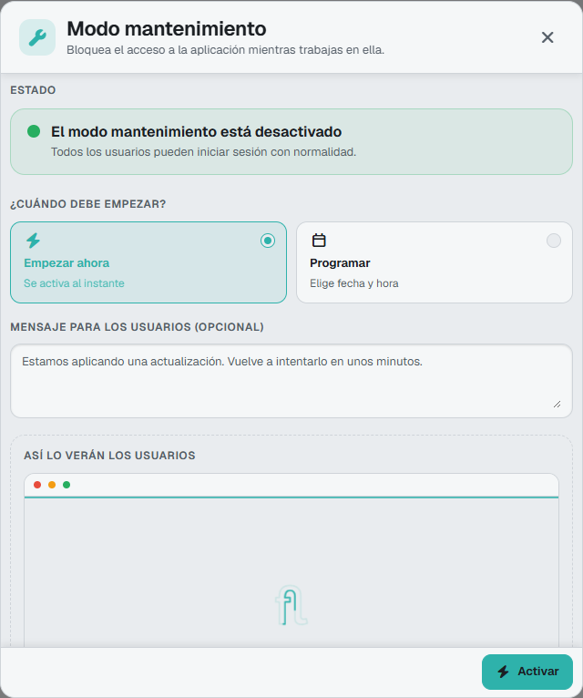
  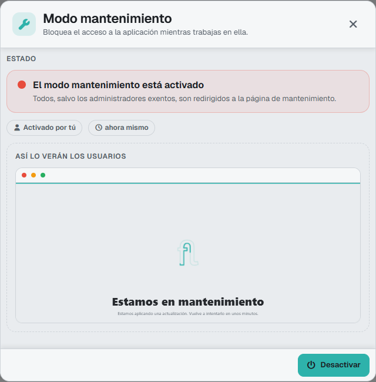
  <figcaption>Activar el modo mantenimiento y desactivarlo</figcaption>
</figure>

Las actualizaciones y los cambios de versión ponen la aplicación en mantenimiento por su cuenta mientras duran; ese mantenimiento no se puede desactivar a mano y se quita solo al terminar.

### 7.2 Refrescar pantallas

Obliga a las sesiones conectadas a **recargar su pantalla**, por ejemplo después de cambiar algo de la configuración que deben ver ya. Eliges **Todos los usuarios** o **Usuarios específicos**, buscándolos entre los conectados, y **Refrescar**. Pide confirmación, porque quien tenga cambios sin guardar puede perderlos.

<figure markdown="span">
  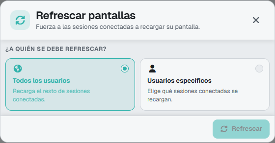{ width="520" }
  <figcaption>Refrescar las pantallas de los usuarios conectados</figcaption>
</figure>

### 7.3 Historial de operaciones

Lista las últimas actualizaciones, cambios y eliminaciones de versión, de la más reciente a la más antigua, con quién las lanzó, cuándo, cuánto duraron y cómo acabaron. Las actualizaciones programadas que no llegaron a hacerse también quedan aquí, con el motivo.

Pulsa una para ver su resultado y, con **Mostrar log**, su registro completo, con filtros por nivel (*Debug*, *Information*, *Warning*, *Error*, *Critical*), por frontend y backend, y un buscador. **Volver al historial** regresa a la lista. **Vaciar historial** borra todas las operaciones y sus registros.

<figure markdown="span">
  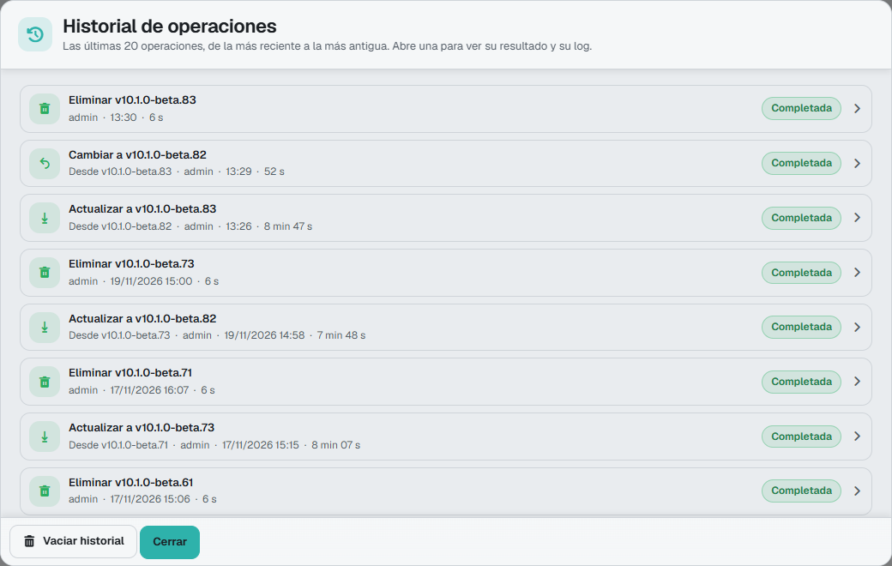
  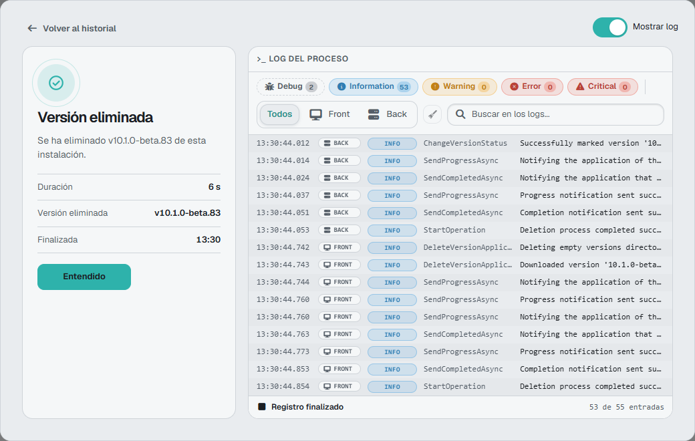
  <figcaption>El historial y el registro de una operación</figcaption>
</figure>

### 7.4 Ajustes

Abre la lista de ajustes del actualizador, que se cambian como cualquier otro ajuste de Flexygo. Los principales:

| Ajuste | Para qué sirve |
|---|---|
| **AutoUpdateEnable** | Activa la búsqueda de versiones nuevas. |
| **AutoUpdateBeta** | Permite actualizar a versiones beta. |
| **AutoUpdateCheckInterval** | Cada cuántos segundos se buscan versiones nuevas. |
| **AutoUpdateURL**, **AutoUpdateNugetUser** y **AutoUpdateNugetPassword** | El repositorio de paquetes del que se descargan las versiones y sus credenciales. |
| **AutoUpdatePackageNamespace** | El nombre base de los paquetes: `Flexygo`, o el de tu producto si publica los suyos. |
| **OverrideUpdateVersion** | Fija la versión que se ofrece, en lugar de la última publicada. |
| **UpdaterPrerelease** | Hace que el propio actualizador se descargue también en versión beta. |
| **UpdaterLogTableRowLimit** | A partir de cuántas filas una tabla de log de la base de datos de configuración da un aviso en los requisitos de la actualización, porque reconstruir una tabla muy grande puede agotar el tiempo de espera. `0` quita la comprobación. |

**MaintenanceMode** guarda el estado del modo mantenimiento: no lo cambies a mano, usa el panel de la sección 7.1.

<figure markdown="span">
  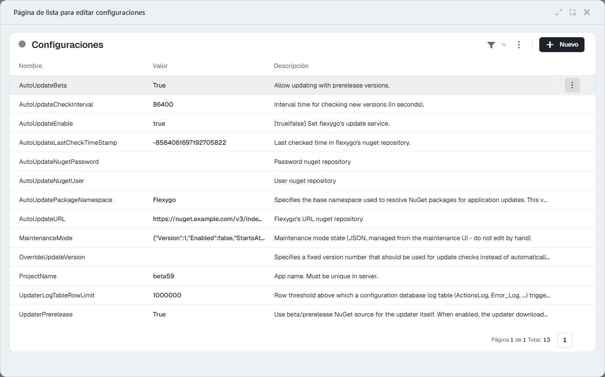
  <figcaption>Los ajustes del actualizador</figcaption>
</figure>
