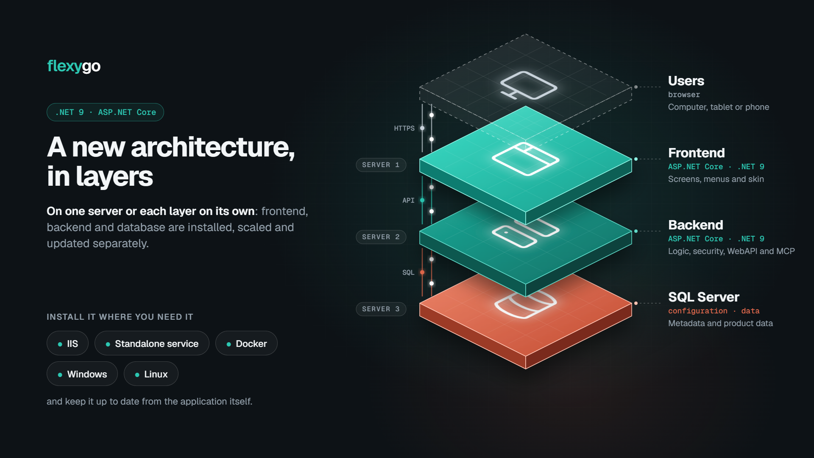

# Flexygo architecture 10.0+

Since version 10, Flexygo runs on **.NET 9**, the current Microsoft platform, instead of .NET Framework. It is faster and safer, and it keeps receiving updates from Microsoft.

The application is split into three parts that can run **together on one server or each on its own**:

| Part | What it does |
| --- | --- |
| **Frontend** | What the browser opens: the screens, the menus and the skin, and the setup and version wizards. It does not connect to the database: it asks the backend for everything. |
| **Backend** | Does the work: the logic, the security, the processes, the scheduled jobs and the reports. It also serves the **WebAPI** and the **MCP server** for integrations. |
| **SQL Server** | Keeps the configuration of the application and the data of the product. |

Keeping them apart lets you, for example, place the frontend on a server reachable from outside and the backend and the database on the internal network, or give more resources only to the part that does most of the work.

## Where it can be installed

- **IIS**, on Windows: the [installer](1Installer/Introduction.md) does everything. In **basic IIS** mode the frontend and the backend share one site; in **advanced IIS** they can go on different sites or servers.
- **Docker**: the frontend and the backend in containers, with the database outside Docker in production. See [Deployment with Docker](4Docker/index.md).
- **Standalone service (Kestrel)**, on Windows or **Linux**, usually behind a reverse proxy such as nginx. It has no installer of its own. See [Deployment with Kestrel](5Kestrel/index.md) and [Reverse proxy](6ReverseProxy/index.md).

Before installing, check the [system requirements](SystemRequirements.md).

## Updating

Flexygo is updated from the application itself with the version wizard, which checks the requirements before it starts and can undo an update. See [Flexygo Updater](3Updater/UpdateFlow.md).
