# IDE Extensions

The **Flexygo Developer Tools** extension is available for VS Code and Visual Studio 2022. From the IDE, without using the command line, it lets you generate and publish your product's NuGet packages and update it to new Flexygo versions. The VS Code one also covers the whole development cycle: creating the product, configuring and publishing its databases, debugging, working with Docker and deploying it.

=== "VS Code *(recommended)*"

    ## Installation

    1. Open VS Code.
    2. Go to the **Extensions** view (<kbd>Ctrl+Shift+X</kbd>).
    3. Search for `Flexygo Developer Tools` and click **Install**.

       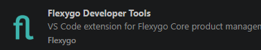
       <em class="caption">Flexygo Developer Tools extension in the VS Code marketplace</em>

    The extension activates when you open a folder that contains a solution (`.sln`). It needs the **.NET SDK**: with it, it installs and updates the tools it uses on its own (`Flexygo.Tools.Product` and SqlPackage), so you don't have to install them by hand. To open the databases from the panel you also need Microsoft's **SQL Server (mssql)** extension.

    ## The Flexygo panel

    Everything is done from the **Flexygo** panel, which opens from the **fl** icon in the Activity Bar (on the left). What it shows depends on the open folder:

    - **A Flexygo solution** (with `*.Backend`, `*.Frontend` and `*.Conf.Database` projects): the project status and every action, as explained below.
    - **An empty folder**: the button to [create a new product](#create-a-new-product).
    - **A Flexygo project for .NET Framework**: a warning that it uses an outdated version and the button to [migrate it](#migrate-an-old-project).
    - **Any other folder**: a warning that it is not a Flexygo project.

    <figure markdown="span">
      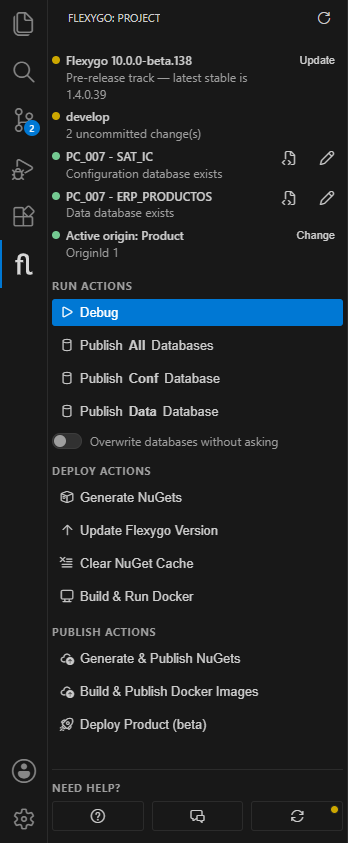
      <figcaption>Flexygo panel: project status at the top and the actions grouped below</figcaption>
    </figure>

    ### Project status

    The top part sums up the state of the solution. Each line has a coloured dot: **green** when it's fine, **yellow** when it's worth a look and **red** when there is a problem. It refreshes on its own when the `appsettings` files change; the icon in the top corner checks again by hand.

    | Line | What it shows |
    |---|---|
    | **Flexygo version** | The product and the Flexygo version the solution uses. Green when it's the latest stable; yellow for a pre-release (beta), with the latest stable next to it; red when a new version is available. When there is a newer one, the **Update** button appears. |
    | **Branch** | The git branch and whether there are uncommitted changes or commits ahead or behind. Clicking it opens the Source Control view. |
    | **Databases** | One line per connection string (`ConfConnectionString` and `DataConnectionString`), with the server and the database. It is checked with a real connection: green when the database exists, yellow when the server responds but the database doesn't exist yet (it needs publishing) and red when it isn't configured or can't connect. |
    | **Active origin** | The active origin of the `Origins` table in the configuration database: green for Product, yellow for Project and red for System or User. |

    Next to each database there are two icons:

    - **Open in SQL Server view**: opens the database in the SQL Server (mssql) extension, already connected with the Backend's connection string.
    - **Edit connection string**: asks in four steps for the server, the database, the user and the password, and saves the connection string in `appsettings.Development.json`. It suggests the values already there; when there are none, `localhost`, `sa` and the solution name (`<Prefix>_IC` for the configuration database).

    <figure markdown="span">
      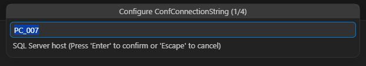
      <figcaption>First of the four steps: the SQL Server host</figcaption>
    </figure>

    The **Change** button of the active origin lists the origins in the `Origins` table and activates the one you pick, the same as the origin selector of the application's develop mode. If the data database also has its own `Origins` table, it is kept the same as the configuration one.

    <figure markdown="span">
      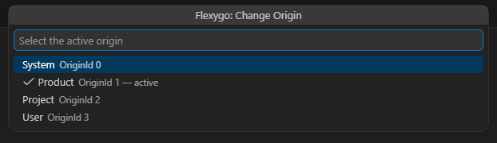
      <figcaption>The ticked origin is the active one</figcaption>
    </figure>

    ### Run actions

    **Debug** (also <kbd>F5</kbd>) starts the application with the debugger. Before launching it:

    1. If a connection string is empty, it asks for its details.
    2. If the server responds but the database doesn't exist, it creates it.
    3. It checks that the Backend and Frontend ports are free. If one is taken, it offers to move it to the next free port and updates the `appsettings` of both projects so they keep finding each other.
    4. It launches the compound configuration in `.vscode/launch.json` (for example, *Launch Full Stack*). If there is none, it lets you pick one of the individual configurations.

    **Publish Databases** builds the database projects (`*.Conf.Database.sqlproj` and `*.Data.Database.sqlproj`) and publishes them with SqlPackage to the database the Backend's connection string points to. There is one button to publish them all and one for each.

    If the database already exists, it asks what to do with it:

    - **Overwrite**: drops it and creates it again from scratch.
    - **Keep Data**: publishes only the changes and keeps what is already there.

    <figure markdown="span">
      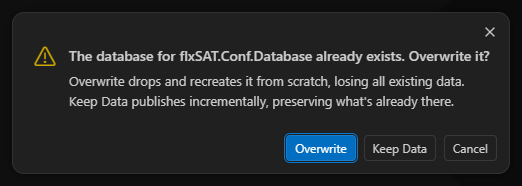
      <figcaption>Question before publishing over a database that already exists</figcaption>
    </figure>

    !!! danger "Overwrite deletes all the data"
        With the **Overwrite databases without asking** switch on, the extension no longer asks: it drops and recreates every database it publishes, and all their data is lost. Leave it off except for test databases.

    ### Deploy actions

    **Generate NuGets** creates the product's NuGet packages. It asks for the package version (for example `1.2.3`, `1.2.3.4` or `1.2.3-beta.1`) and builds the packages in Release with `flexygo-product nuget`. The **Flexygo Core** output channel says which folder they were written to.

    <figure markdown="span">
      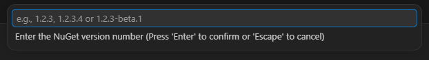
      <figcaption>Version of the packages to generate</figcaption>
    </figure>

    If the solution has the `<Prefix>-version.json` file of the product templates, it suggests the same version continuous integration would calculate for the branch: `X.Y.0.N` on `main` or `master`, `X.Y.N-beta.1` on `develop` and `-alpha` on the rest.

    !!! tip "Pre-release versions"
        A version with a suffix (`-beta`, `-alpha`) must have three numbers: `1.0.5-beta.1`, not `1.0.5.1-beta`. With four numbers the build fails, and the extension warns about it before starting.

    **Update Flexygo Version** updates the solution to another Flexygo version with `flexygo-product update`. It lists the stable versions in the feed, newest first, and asks for confirmation before starting.

    <figure markdown="span">
      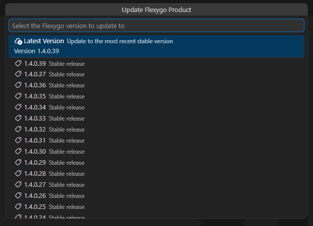
      <figcaption>Available versions; the first option is always the latest</figcaption>
    </figure>

    **Clear NuGet Cache** deletes every local NuGet cache (`dotnet nuget locals all --clear`), after you confirm it. It helps when a package you just published isn't downloaded or an old version sticks around.

    <figure markdown="span">
      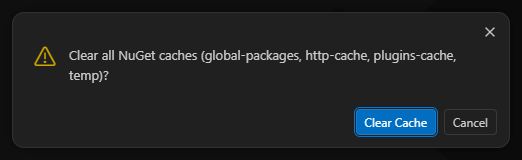
      <figcaption>Confirmation before clearing the cache</figcaption>
    </figure>

    **Build & Run Docker** asks for a Docker Compose project name and runs `docker compose -p <name> up` in a VS Code terminal, which shows the log as it goes. To stop it, stop it from that terminal.

    <figure markdown="span">
      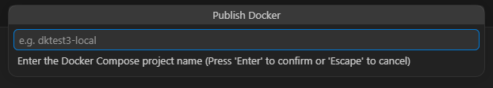
      <figcaption>Docker Compose project name</figcaption>
    </figure>

    ### Publish actions

    **Generate & Publish NuGets** generates the packages the same way as *Generate NuGets* and pushes them to a NuGet feed. It asks for everything up front, so a build of several minutes isn't interrupted later:

    1. The package version.
    2. The feed URL (`.../v3/index.json`). It suggests the last one used.
    3. The feed's API key. It can be saved for next time; it is stored encrypted in the operating system's credential store.

    <figure markdown="span">
      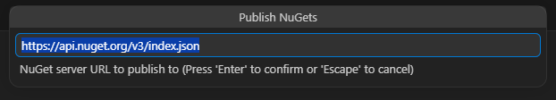
      <figcaption>Second step: the NuGet feed the packages are published to</figcaption>
    </figure>

    **Build & Publish Docker Images** builds the images of the `docker-compose` services that have a `build` section and pushes them to a registry. It asks for the registry URL (`docker.io` by default, optionally with the repository path), the user, the password or token and the image tag, which defaults to the product version. The credentials can also be saved encrypted.

    <figure markdown="span">
      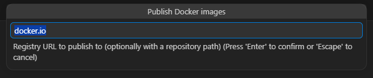
      <figcaption>First step: the registry the images are published to</figcaption>
    </figure>

    To delete the saved API key and credentials, use the **Flexygo: Forget Saved Publish Credentials** command from the Command Palette. When the extension uses saved credentials, it says so and offers to forget them in case they are no longer valid.

    **Deploy Product (beta)** registers the solution as a product in the **Cenit** platform, so it can be deployed from there. It is done in a window with three steps, and nothing is sent until you review the product and click **Accept and publish**:

    1. **Connection**: the platform host (for example, `cloud.mydomain.com`) and the Cenit token. The token can be remembered, encrypted in the credential store.
    2. **Review the product**: name, description, logo, website, version (the image tag), the variables asked for when deploying and the `docker-compose` template, generated from the solution's own. Each variable has a mode: *Text* (visible and editable), *Secret* (editable and masked), *ReadOnly* (visible and fixed) or *Hidden* (invisible and fixed). This is also where you choose whether to build and push the images, whether to generate and publish the database NuGets and whether to run a test deployment. Under **Advanced** you can change the registry and the NuGet feed; by default they are Cenit's.
    3. **Publish**: shows the progress of each step. If a test deployment was requested, it creates a test customer and application, waits for them to install and lets you open the application to check it; **Clean up and finish** deletes them afterwards.

    <figure markdown="span">
      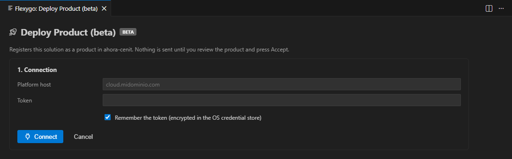
      <figcaption>First step: connection to the Cenit platform</figcaption>
    </figure>

    ### Need help?

    At the bottom of the panel there are three buttons:

    - **Help**: opens this help.
    - **Support**: opens the support portal.
    - **Check Updates**: opens a window with the installed version of the extension and of the tools it uses (`Flexygo.Tools.Product` and `flexygo-mcp`), with a button to update each tool. When there is an update, the button shows an orange dot.

    <figure markdown="span">
      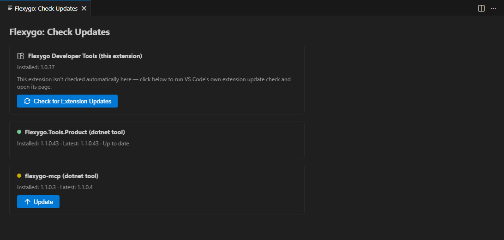
      <figcaption>Installed and available versions of the extension and its tools</figcaption>
    </figure>

    ## Create a new product

    With an empty folder open, the panel offers **Create New Product**:

    <figure markdown="span">
      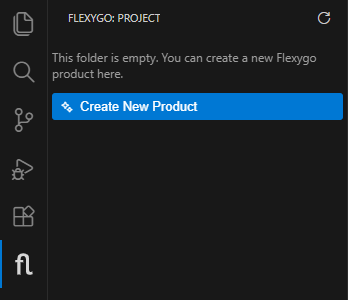
      <figcaption>With an empty folder, the panel only offers to create a product</figcaption>
    </figure>

    1. Pick the product template. The list comes from the templates published in the NuGet feed, with their version.

        <figure markdown="span">
          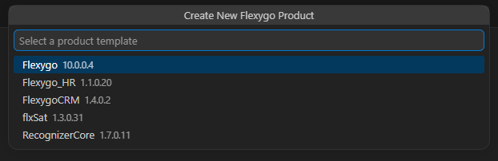
          <figcaption>Available product templates</figcaption>
        </figure>

    2. Type the product name: letters, numbers and `_`, starting with a letter. By default it suggests the folder name.

        <figure markdown="span">
          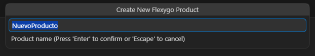
          <figcaption>Product name</figcaption>
        </figure>

    3. The extension installs or updates the template (`dotnet new install`) and generates the product in the open folder.

    ## Migrate an old project

    If the open folder is a Flexygo product for .NET Framework (with the `Flexygo` package in a `packages.config`), the panel shows the version it uses and offers **Migrate to Flexygo Core**:

    <figure markdown="span">
      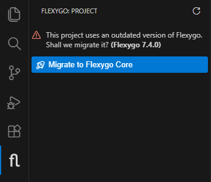
      <figcaption>Outdated version warning, with the project's Flexygo version</figcaption>
    </figure>

    The button opens a window with two paths:

    - **With AI (Claude Code)**: the extension installs the `flexygo-migrar-core` skill in Claude Code's skills folder (`~/.claude/skills`). The skill does the whole migration: it creates the branch, updates the Flexygo NuGet, runs the installer, places the new solution in the repository, validates and fixes it, and writes a report, with one commit per phase. Copy the `/flexygo-migrar-core` command and paste it in Claude Code, or use **Open Claude Code in a terminal**.
    - **Without AI**: download the Flexygo installer and follow the steps the window shows, with this project's path. The installer's migration mode is explained in [Installer: Migration Mode](../1Deployment/1Installer/Migration.md).

    <figure markdown="span">
      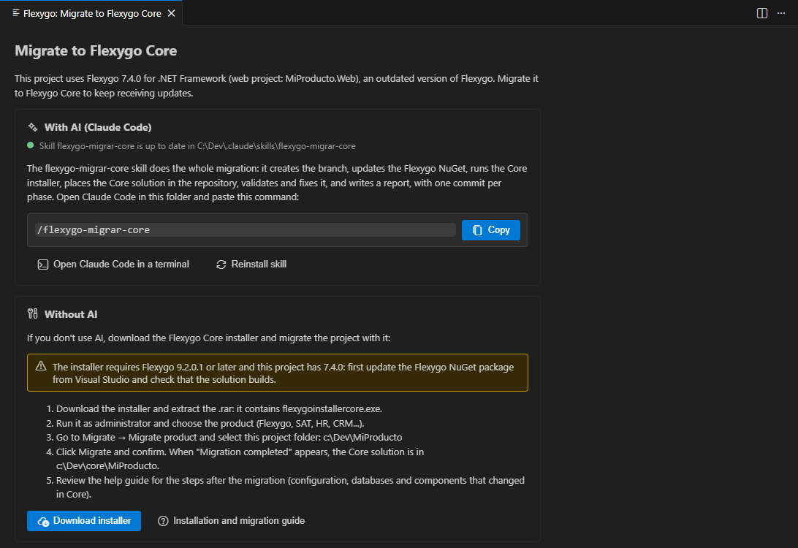
      <figcaption>The two ways to migrate: with Claude Code or with the installer</figcaption>
    </figure>

    !!! warning "Minimum version to migrate"
        The installer requires the project to be on Flexygo 9.2.0.1 or later. If it's older, the window says so: first update the `Flexygo` NuGet package from Visual Studio and check that the solution builds.

    ## Other ways to run the commands

    Every action is also in the **Command Palette** (<kbd>Ctrl+Shift+P</kbd>), starting with `Flexygo:`. Some are only there, such as **Forget Saved Publish Credentials**.

    <figure markdown="span">
      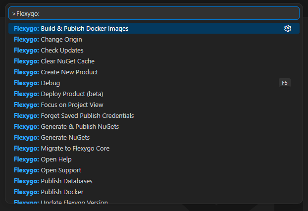
      <figcaption>Flexygo commands in the Command Palette</figcaption>
    </figure>

    The most common ones are also in the Explorer's **context menu** (right-click on any folder or file):

    <figure markdown="span">
      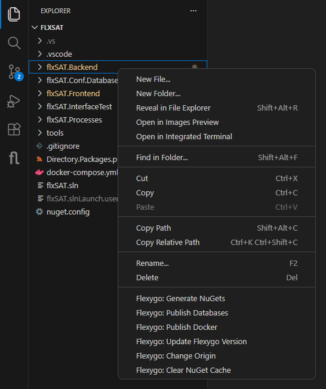
      <figcaption>Flexygo commands at the end of the context menu</figcaption>
    </figure>

    ## Settings

    In the VS Code settings (<kbd>Ctrl+,</kbd>), **Flexygo** section:

    | Setting | What it's for |
    |---|---|
    | `flexygo.productNamespace` | The product namespace (for example, `Flexygo` or `flxSAT`). When empty, it is detected from the solution's package references; if there are several, the extension asks which one to use. |
    | `flexygo.helpUrl` | Page the **Help** button opens. By default, `https://ayuda.ahora.es`. |
    | `flexygo.supportUrl` | Page the **Support** button opens. By default, `https://flexygodesk.ahora.es`. |

    Everything the commands do is logged in the **Flexygo Core** output channel (**View → Output** and pick *Flexygo Core* in the list). If something fails, the full error is there.

=== "Visual Studio 2022"

    ## Installation

    1. Open Visual Studio.
    2. Go to the **Extensions** menu and select **Manage Extensions**.
    3. In the search box, type `Flexygo Developer Tools`.
    4. When the extension appears in the results, click **Download**.
    5. Restart Visual Studio to complete the installation.

    Once installed, you'll find the toolbar under **View** → **Toolbars** → **Flexygo Tools Product**.

    
    <em class="caption">Toolbar with the update and generate NuGets buttons</em>

    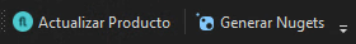
    <em class="caption">Update button (left) and generate NuGets button (right)</em>

    ## Updating the product

    1. Click the update button on the toolbar.
    2. Select the version you want to update to; the latest available is shown by default.

       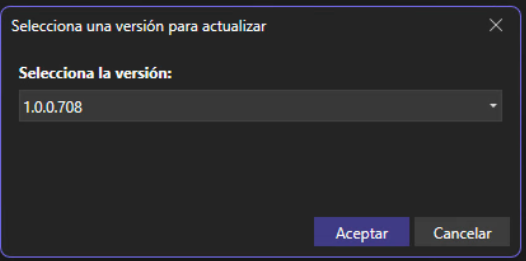

    3. Confirm the update in the confirmation window.

       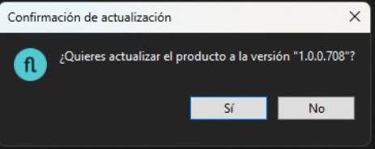

    4. Follow the progress in the output tab.

       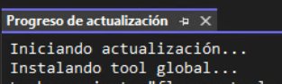

    ## Generating NuGets

    1. Click the generate NuGets button on the toolbar.
    2. Enter the version of the NuGet package you want to generate.

       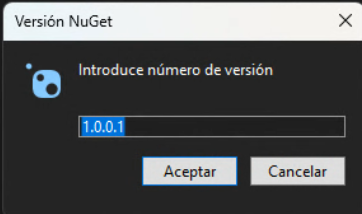

    3. Confirm the generation in the confirmation window.

       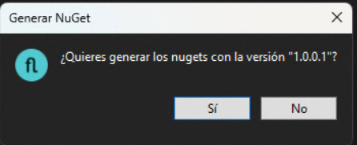

    4. Follow the progress in the output tab. When finished, the folder with the generated packages will open.

       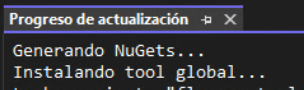
