# Extensiones IDE

La extensión **Flexygo Developer Tools** está disponible para VS Code y Visual Studio 2022. Desde el IDE, sin usar la línea de comandos, permite generar y publicar los paquetes NuGet del producto y actualizarlo a nuevas versiones de Flexygo. La de VS Code hace además todo el ciclo de desarrollo: crear el producto, configurar y publicar sus bases de datos, depurar, trabajar con Docker y desplegarlo.

=== "VS Code *(recomendado)*"

    ## Instalación

    1. Abre VS Code.
    2. Ve a la vista **Extensiones** (<kbd>Ctrl+Shift+X</kbd>).
    3. Busca `Flexygo Developer Tools` y haz clic en **Instalar**.

       
       <em class="caption">Extensión Flexygo Developer Tools en el marketplace de VS Code</em>

    La extensión se activa al abrir una carpeta que contenga una solución (`.sln`). Necesita el **SDK de .NET**: con él instala y actualiza sola las herramientas que usa (`Flexygo.Tools.Product` y SqlPackage), así que no hay que instalarlas a mano. Para abrir las bases de datos desde el panel hace falta además la extensión **SQL Server (mssql)** de Microsoft.

    ## El panel de Flexygo

    Todo se hace desde el panel **Flexygo**, que se abre con el icono **fl** de la barra de actividad (a la izquierda). Lo que muestra depende de la carpeta abierta:

    - **Una solución Flexygo** (con proyectos `*.Backend`, `*.Frontend` y `*.Conf.Database`): el estado del proyecto y todas las acciones, como se explica a continuación.
    - **Una carpeta vacía**: el botón para [crear un producto nuevo](#crear-un-producto-nuevo).
    - **Un proyecto de Flexygo para .NET Framework**: el aviso de que usa una versión obsoleta y el botón para [migrarlo](#migrar-un-proyecto-antiguo).
    - **Cualquier otra carpeta**: un aviso de que no es un proyecto Flexygo.

    <figure markdown="span">
      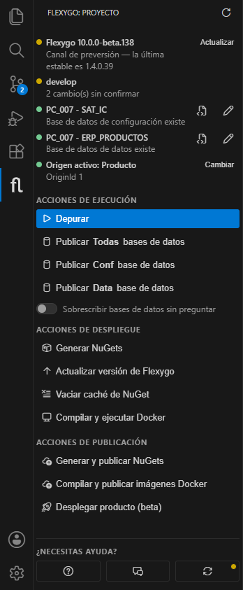
      <figcaption>Panel de Flexygo: estado del proyecto arriba y acciones agrupadas debajo</figcaption>
    </figure>

    ### Estado del proyecto

    La parte de arriba resume el estado de la solución. Cada línea lleva un punto de color: **verde** si está bien, **amarillo** si conviene revisarla y **rojo** si hay un problema. Se actualiza sola cuando cambian los `appsettings`; el icono de la esquina superior la vuelve a comprobar a mano.

    | Línea | Qué muestra |
    |---|---|
    | **Versión de Flexygo** | El producto y la versión de Flexygo que usa la solución. Verde si es la última estable; amarillo si es una versión de preversión (beta), con la última estable al lado; rojo si hay una versión nueva. Cuando hay una más reciente aparece el botón **Actualizar**. |
    | **Rama** | La rama de git y si hay cambios sin confirmar o commits por delante o por detrás. Al hacer clic se abre la vista de Control de código fuente. |
    | **Bases de datos** | Una línea por cadena de conexión (`ConfConnectionString` y `DataConnectionString`), con el servidor y la base. Se comprueba conectando de verdad: verde si la base existe, amarillo si el servidor responde pero la base todavía no existe (hay que publicarla) y rojo si no está configurada o no se puede conectar. |
    | **Origen activo** | El origen activo de la tabla `Origins` de la base de configuración: verde para Producto, amarillo para Proyecto y rojo para Sistema o Usuario. |

    Junto a cada base de datos hay dos iconos:

    - **Abrir en la vista de SQL Server**: abre la base en la extensión SQL Server (mssql), ya conectada con la cadena de conexión del Backend.
    - **Editar cadena de conexión**: pide en cuatro pasos el servidor, la base de datos, el usuario y la contraseña, y guarda la cadena en `appsettings.Development.json`. Propone los valores que ya hubiera; si no hay ninguno, `localhost`, `sa` y el nombre de la solución (`<Prefijo>_IC` para la base de configuración).

    <figure markdown="span">
      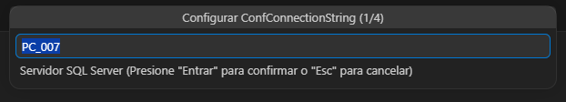
      <figcaption>Primer paso de los cuatro: el servidor SQL Server</figcaption>
    </figure>

    El botón **Cambiar** del origen activo muestra los orígenes de la tabla `Origins` y activa el que elijas, igual que el selector de origen del modo desarrollo de la aplicación. Si la base de datos de datos tiene también su tabla `Origins`, la deja igual que la de configuración.

    <figure markdown="span">
      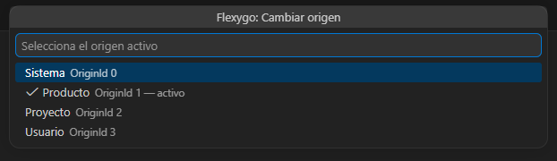
      <figcaption>El origen marcado es el activo</figcaption>
    </figure>

    ### Acciones de ejecución

    **Depurar** (también con <kbd>F5</kbd>) arranca la aplicación con el depurador. Antes de lanzarla:

    1. Si alguna cadena de conexión está vacía, pide sus datos.
    2. Si el servidor responde pero la base de datos no existe, la crea.
    3. Comprueba que los puertos del Backend y del Frontend están libres. Si alguno está ocupado, propone moverlo al siguiente puerto libre y actualiza los `appsettings` de los dos proyectos para que se sigan encontrando.
    4. Lanza la configuración compuesta de `.vscode/launch.json` (por ejemplo, *Launch Full Stack*). Si no hay ninguna, deja elegir entre las configuraciones individuales.

    **Publicar bases de datos** compila los proyectos de base de datos (`*.Conf.Database.sqlproj` y `*.Data.Database.sqlproj`) y los publica con SqlPackage en la base a la que apunta la cadena de conexión del Backend. Hay un botón para publicarlas todas y otro para cada una.

    Si la base de datos ya existe, pregunta qué hacer con ella:

    - **Sobrescribir**: la borra y la vuelve a crear desde cero.
    - **Mantener datos**: publica solo los cambios y conserva lo que ya hay.

    <figure markdown="span">
      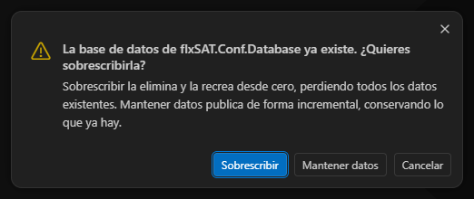
      <figcaption>Pregunta antes de publicar sobre una base que ya existe</figcaption>
    </figure>

    !!! danger "Sobrescribir borra todos los datos"
        Con el interruptor **Sobrescribir bases de datos sin preguntar** activado, la extensión ya no pregunta: borra y vuelve a crear cada base que publica, y se pierden todos sus datos. Déjalo desactivado salvo en bases de pruebas.

    ### Acciones de despliegue

    **Generar NuGets** crea los paquetes NuGet del producto. Pide la versión del paquete (por ejemplo `1.2.3`, `1.2.3.4` o `1.2.3-beta.1`) y genera los paquetes en Release con `flexygo-product nuget`. El canal de salida **Flexygo Core** indica la carpeta donde se han dejado.

    <figure markdown="span">
      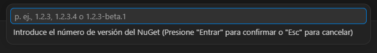
      <figcaption>Versión de los paquetes que se van a generar</figcaption>
    </figure>

    Si la solución tiene el fichero `<Prefijo>-version.json` de las plantillas de producto, propone la misma versión que calcularía la integración continua según la rama: `X.Y.0.N` en `main` o `master`, `X.Y.N-beta.1` en `develop` y `-alpha` en el resto.

    !!! tip "Versiones de preversión"
        Una versión con sufijo (`-beta`, `-alpha`) debe tener tres números: `1.0.5-beta.1`, no `1.0.5.1-beta`. Con cuatro números la compilación falla, y la extensión lo avisa antes de empezar.

    **Actualizar versión de Flexygo** actualiza la solución a otra versión de Flexygo con `flexygo-product update`. Muestra las versiones estables del feed, con la más reciente arriba, y pide confirmación antes de empezar.

    <figure markdown="span">
      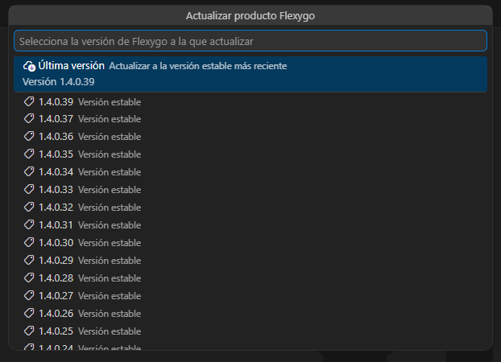
      <figcaption>Versiones disponibles; la primera opción es siempre la última</figcaption>
    </figure>

    **Vaciar caché de NuGet** borra todas las cachés locales de NuGet (`dotnet nuget locals all --clear`), después de confirmarlo. Sirve cuando un paquete recién publicado no se descarga o se queda una versión antigua.

    <figure markdown="span">
      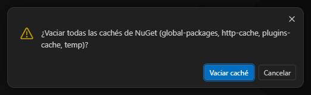
      <figcaption>Confirmación antes de vaciar la caché</figcaption>
    </figure>

    **Compilar y ejecutar Docker** pide un nombre para el proyecto de Docker Compose y lanza `docker compose -p <nombre> up` en un terminal de VS Code, que va mostrando el log. Para pararlo, se detiene desde ese terminal.

    <figure markdown="span">
      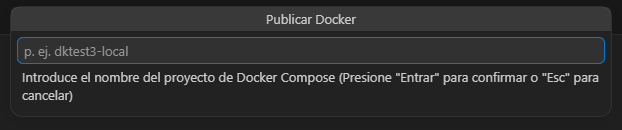
      <figcaption>Nombre del proyecto de Docker Compose</figcaption>
    </figure>

    ### Acciones de publicación

    **Generar y publicar NuGets** genera los paquetes igual que *Generar NuGets* y los sube a un feed NuGet. Pide todo al principio, para no interrumpir después una compilación de varios minutos:

    1. La versión de los paquetes.
    2. La URL del feed (`.../v3/index.json`). Propone la última que se usó.
    3. La API key del feed. Se puede guardar para la próxima vez; se guarda cifrada en el almacén de credenciales del sistema operativo.

    <figure markdown="span">
      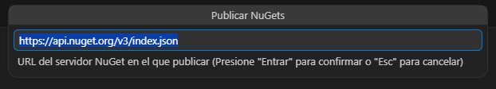
      <figcaption>Segundo paso: el feed NuGet en el que se publican los paquetes</figcaption>
    </figure>

    **Compilar y publicar imágenes Docker** compila las imágenes de los servicios del `docker-compose` que tienen sección `build` y las sube a un registry. Pide la URL del registry (por defecto `docker.io`, opcionalmente con la ruta del repositorio), el usuario, la contraseña o el token y la etiqueta de las imágenes, que por defecto es la versión del producto. Las credenciales también se pueden guardar cifradas.

    <figure markdown="span">
      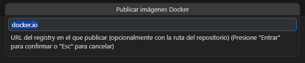
      <figcaption>Primer paso: el registry en el que se publican las imágenes</figcaption>
    </figure>

    Para borrar la API key y las credenciales guardadas, usa el comando **Flexygo: Olvidar credenciales de publicación guardadas** de la paleta de comandos. Cuando la extensión usa unas credenciales guardadas, lo avisa y ofrece olvidarlas por si ya no son válidas.

    **Desplegar producto (beta)** da de alta la solución como producto en la plataforma **Cenit**, para poder desplegarla desde allí. Se hace en una ventana con tres pasos, y no se envía nada hasta que revisas el producto y pulsas **Aceptar y publicar**:

    1. **Conexión**: el host de la plataforma (por ejemplo, `cloud.midominio.com`) y el token de Cenit. El token se puede recordar, cifrado en el almacén de credenciales.
    2. **Revisa el producto**: nombre, descripción, logo, web, versión (la etiqueta de las imágenes), las variables que se piden al desplegar y la plantilla de `docker-compose`, generada a partir del de la solución. Cada variable tiene un modo: *Text* (visible y editable), *Secret* (editable y enmascarada), *ReadOnly* (visible y fija) o *Hidden* (invisible y fija). Aquí se elige también si se compilan y suben las imágenes, si se generan y publican los NuGets de base de datos y si se hace un despliegue de prueba. En **Avanzado** se puede cambiar el registry y el feed NuGet; por defecto son los de Cenit.
    3. **Publicación**: muestra el progreso de cada paso. Si se ha pedido un despliegue de prueba, crea un cliente y una aplicación de prueba, espera a que se instalen y deja abrirla para comprobarla; **Limpiar y terminar** los borra después.

    <figure markdown="span">
      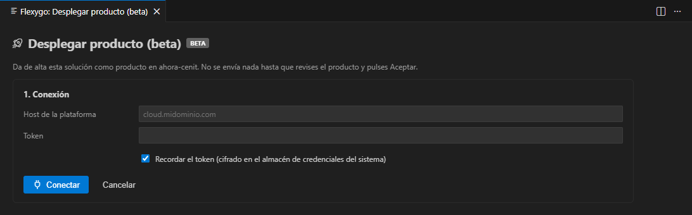
      <figcaption>Primer paso: conexión con la plataforma Cenit</figcaption>
    </figure>

    ### ¿Necesitas ayuda?

    Al pie del panel hay tres botones:

    - **Ayuda**: abre esta ayuda.
    - **Soporte**: abre el portal de soporte.
    - **Comprobar actualizaciones**: abre una ventana con la versión instalada de la extensión y de las herramientas que usa (`Flexygo.Tools.Product` y `flexygo-mcp`), con un botón para actualizar cada herramienta. Cuando hay alguna actualización, el botón lleva un punto naranja.

    <figure markdown="span">
      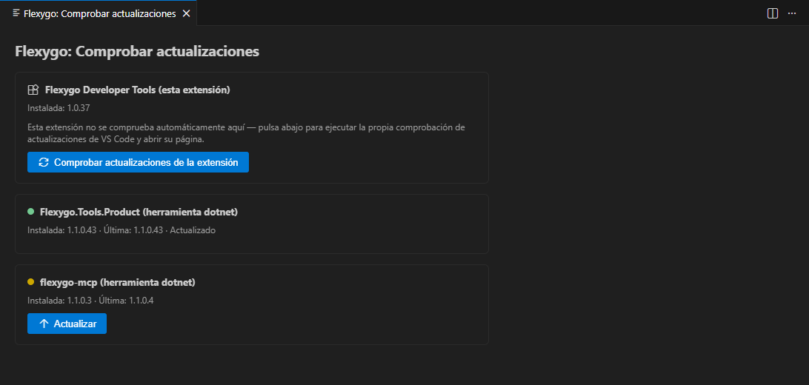
      <figcaption>Versiones instaladas y disponibles de la extensión y sus herramientas</figcaption>
    </figure>

    ## Crear un producto nuevo

    Con una carpeta vacía abierta, el panel ofrece **Crear nuevo producto**:

    <figure markdown="span">
      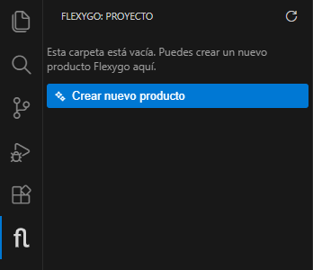
      <figcaption>Con una carpeta vacía, el panel solo ofrece crear un producto</figcaption>
    </figure>

    1. Elige la plantilla de producto. La lista sale de las plantillas publicadas en el feed NuGet, con su versión.

        <figure markdown="span">
          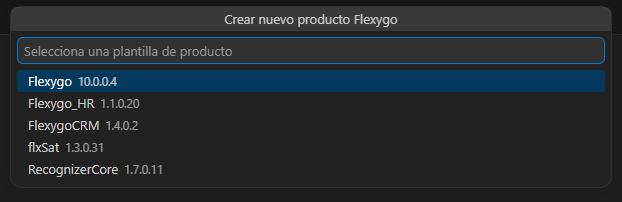
          <figcaption>Plantillas de producto disponibles</figcaption>
        </figure>

    2. Escribe el nombre del producto: letras, números y `_`, empezando por una letra. Por defecto propone el nombre de la carpeta.

        <figure markdown="span">
          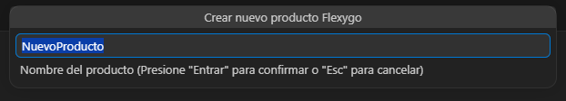
          <figcaption>Nombre del producto</figcaption>
        </figure>

    3. La extensión instala o actualiza la plantilla (`dotnet new install`) y genera el producto en la carpeta abierta.

    ## Migrar un proyecto antiguo

    Si la carpeta abierta es un producto de Flexygo para .NET Framework (con el paquete `Flexygo` en un `packages.config`), el panel avisa de la versión que usa y ofrece **Migrar a Flexygo Core**:

    <figure markdown="span">
      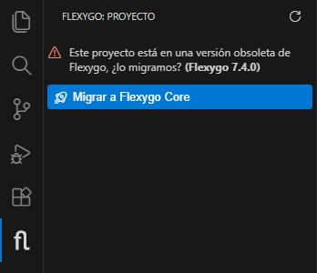
      <figcaption>Aviso de versión obsoleta, con la versión de Flexygo del proyecto</figcaption>
    </figure>

    El botón abre una ventana con dos caminos:

    - **Con IA (Claude Code)**: la extensión instala la skill `flexygo-migrar-core` en la carpeta de skills de Claude Code (`~/.claude/skills`). La skill hace toda la migración: crea la rama, actualiza el NuGet de Flexygo, lanza el instalador, coloca la solución nueva en el repositorio, la valida y la corrige, y deja un informe, con un commit por fase. Copia el comando `/flexygo-migrar-core` y pégalo en Claude Code, o usa **Abrir Claude Code en un terminal**.
    - **Sin IA**: descarga el instalador de Flexygo y sigue los pasos que indica la ventana, con la ruta de este proyecto. El modo migración del instalador se explica en [Instalador: Modo Migración](../1Deployment/1Installer/Migration.md).

    <figure markdown="span">
      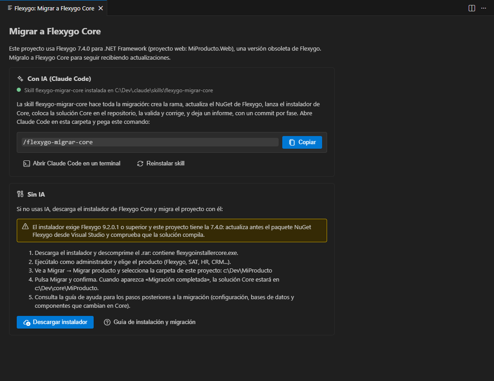
      <figcaption>Los dos caminos para migrar: con Claude Code o con el instalador</figcaption>
    </figure>

    !!! warning "Versión mínima para migrar"
        El instalador exige que el proyecto esté al menos en Flexygo 9.2.0.1. Si es anterior, la ventana lo avisa: actualiza antes el paquete NuGet `Flexygo` desde Visual Studio y comprueba que la solución compila.

    ## Otras formas de lanzar los comandos

    Todas las acciones están también en la **paleta de comandos** (<kbd>Ctrl+Shift+P</kbd>), empezando por `Flexygo:`. Algunas solo están ahí, como **Olvidar credenciales de publicación guardadas**.

    <figure markdown="span">
      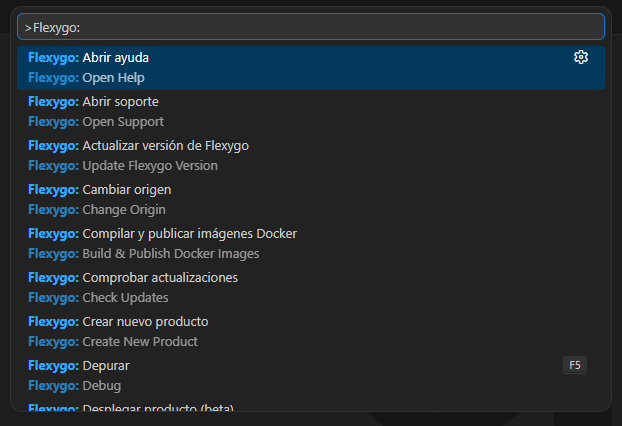
      <figcaption>Comandos de Flexygo en la paleta de comandos</figcaption>
    </figure>

    Las más habituales están además en el **menú contextual** del explorador (clic derecho sobre cualquier carpeta o fichero):

    <figure markdown="span">
      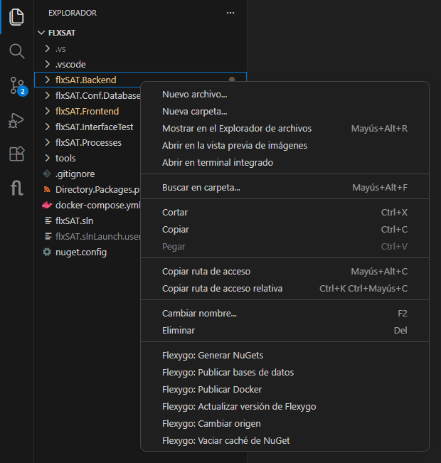
      <figcaption>Comandos de Flexygo al final del menú contextual</figcaption>
    </figure>

    ## Configuración

    En la configuración de VS Code (<kbd>Ctrl+,</kbd>), sección **Flexygo**:

    | Opción | Para qué sirve |
    |---|---|
    | `flexygo.productNamespace` | Espacio de nombres del producto (por ejemplo, `Flexygo` o `flxSAT`). Vacío, se detecta solo a partir de las referencias de paquetes de la solución; si hay varios, la extensión pregunta cuál usar. |
    | `flexygo.helpUrl` | Página que abre el botón **Ayuda**. Por defecto, `https://ayuda.ahora.es`. |
    | `flexygo.supportUrl` | Página que abre el botón **Soporte**. Por defecto, `https://flexygodesk.ahora.es`. |

    Todo lo que hacen los comandos queda en el canal de salida **Flexygo Core** (**Ver → Salida** y elegir *Flexygo Core* en la lista). Si algo falla, el error completo está ahí.

=== "Visual Studio 2022"

    ## Instalación

    1. Abre Visual Studio.
    2. Ve al menú **Extensiones** y selecciona **Administrar extensiones**.
    3. En la ventana de búsqueda, escribe `Flexygo Developer Tools`.
    4. Cuando aparezca la extensión en los resultados, haz clic en **Descargar**.
    5. Reinicia Visual Studio para completar la instalación.

    Una vez instalada, encontrarás la barra de herramientas en **Ver** → **Barras de herramientas** → **Flexygo Tools Product**.

    
    <em class="caption">Barra de herramientas con los botones de actualizar y generar NuGets</em>

    
    <em class="caption">Botón de actualizar (izquierda) y generar NuGets (derecha)</em>

    ## Actualizar el producto

    1. Haz clic en el botón de actualizar en la barra de herramientas.
    2. Selecciona la versión a la que deseas actualizar; por defecto aparece la última disponible.

       

    3. Confirma la actualización en la ventana de confirmación.

       

    4. Sigue el progreso en la pestaña de salida.

       

    ## Generar NuGets

    1. Haz clic en el botón de generar NuGets en la barra de herramientas.
    2. Introduce la versión del paquete NuGet que quieres generar.

       

    3. Confirma la generación en la ventana de confirmación.

       

    4. Sigue el progreso en la pestaña de salida. Al finalizar se abrirá la carpeta con los paquetes generados.

       
