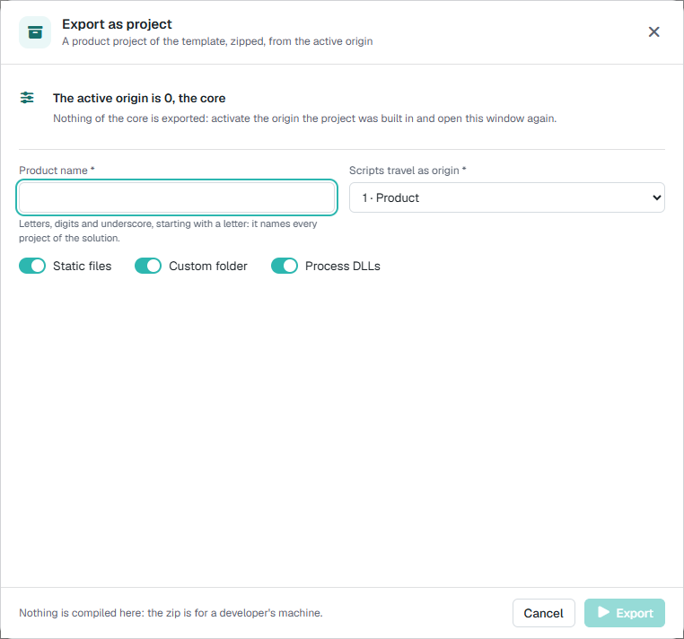
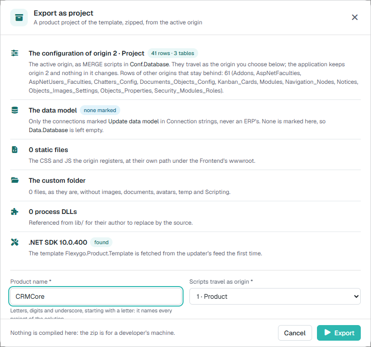
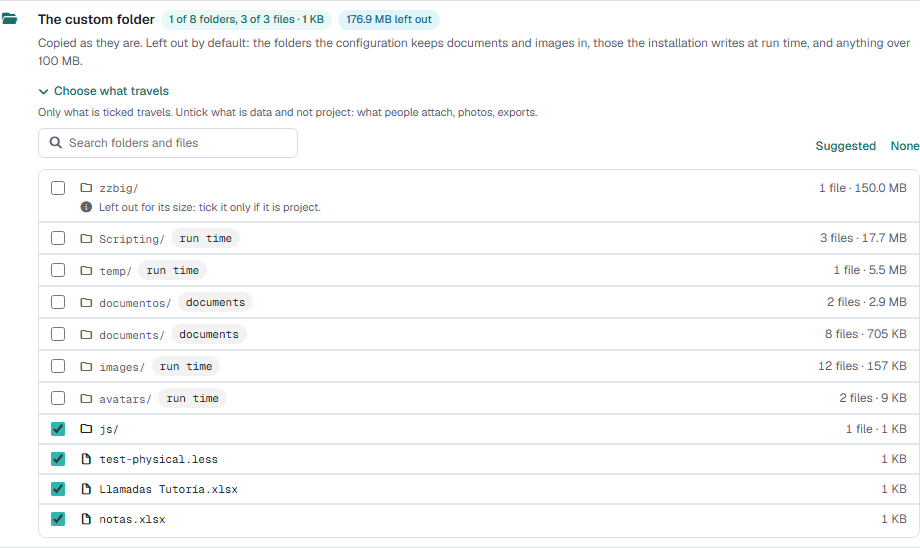
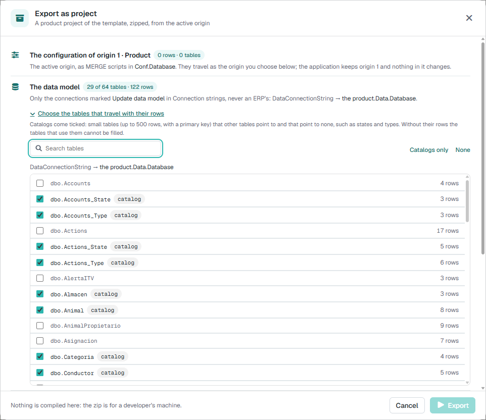

# Exportar la aplicación como proyecto 10.0+

!!! info "Novedad en la versión 10.0"

    El asistente de exportación muestra la plantilla y la versión elegidas, explica qué se incluirá y permite seguir el progreso hasta descargar el ZIP. Puedes elegir los archivos y carpetas personalizados y modificar la plantilla. De forma predeterminada, usa la plantilla del producto instalado y excluye los repositorios de documentos e imágenes y otros archivos grandes. Admite proyectos de más de 2 GB y comprueba que haya espacio suficiente. También registra las exportaciones y los errores.

    La exportación no incluye usuarios y guarda los secretos en un archivo local que no se comparte. Si el origen activo está reservado, el asistente avisa y propone el primer destino disponible. Solo pueden usarlo los administradores autorizados.

    

Una aplicación Flexygo puede nacer configurándola a mano sobre el core —objetos, páginas, procesos, hojas de estilo— sin que exista ningún proyecto detrás. Cuando esa aplicación crece y hace falta **desarrollarla y mantenerla con integración continua**, **Exportar como proyecto** la convierte en un proyecto de la [plantilla de producto](../2Template.md): la misma solución que genera `dotnet new flexygoproduct`, con la configuración, el modelo de datos, los ficheros estáticos y las DLL de la instalación ya dentro, en un zip listo para abrir con Visual Studio y subir a un repositorio.

¿Quieres hacerlo de principio a fin con una aplicación tuya? [Pruébalo: de aplicación instalada a proyecto que compila y arranca](1TryIt.md).

!!! info "Qué es y qué no es"
    La exportación **genera** el proyecto; no compila ni publica nada en el servidor. Compilar, publicar las bases y arrancar el producto es trabajo del desarrollador, en su equipo, con lo que describe [Crear un producto con Flexygo](../2Template.md). La aplicación de la que se exporta **no cambia**: ni sus datos, ni sus orígenes, ni sus ficheros.

---

## 1. Antes de exportar: un origen propio

Todo lo que es del proyecto tiene que estar en un **origen** distinto del 0, que es el core. Se exportan las filas de configuración del **origen activo** (el que se ve en el panel de control, **Active origin**, y en el que el equipo ha construido la aplicación); lo que se creó con el origen activo en 0 no se distingue del core y **no viaja**.

Con el origen activo en 0 la ventana lo dice y no deja exportar:

<figure markdown="span">
  
  <figcaption>Con el origen 0 activo: «Nothing of the core is exported». Se activa el origen del proyecto y se vuelve a abrir la ventana</figcaption>
</figure>

!!! tip "El origen de destino: 1 para un producto, 2 para el hijo de un producto"
    En los guiones del proyecto las filas viajan con el **origen de destino** que se elige en la ventana, no con el activo. Un producto que nace del core va como **1 (Product)**: el post-deploy de la plantilla deja a cada instalación trabajando en el 2 (Project), así que un producto cuyos `MERGE` fueran de origen 2 borraría las personalizaciones del cliente en cada actualización. Un producto que es **hijo de otro producto** (su padre ya ocupa el 1) va como **2**, y así sucesivamente. La conversión se hace **solo en los guiones**: la aplicación conserva su origen activo. El 0 no se ofrece como destino.

---

## 2. Dónde está

En el **panel de control**, en la lista de acciones: **Export as project** (el icono de la carpeta con la flecha). Abre una ventana propia que lleva la exportación de principio a fin: lo que se va a hacer, los pasos mientras corre y el resultado.

- Solo la usan los **administradores**.
- **Una exportación a la vez** en la instalación. Si hay una en marcha, la ventana dice quién la lanzó y a qué hora, y ofrece **Follow it** para seguirla.

---

## 3. Lo que enseña antes de empezar

Nada más abrirse, la ventana lee la instalación y dice qué se va a llevar. Las líneas cambian con lo que se elige: el origen de destino y lo que se marca de la carpeta `custom` (3.1).

<figure markdown="span">
  
  <figcaption>La vista previa con el origen 2 activo y el producto CRMCore: la configuración que viaja, el modelo de datos, los estáticos, la carpeta custom, las DLL, el SDK y la plantilla</figcaption>
</figure>

| Línea | Qué dice |
|---|---|
| **The configuration of origin N** | Cuántas filas y de cuántas tablas viajan como guiones `MERGE` del proyecto `Conf.Database`: las del origen activo más las que ya estén en el de destino. Y, si las hay, cuántas filas de **otros orígenes se quedan fuera** y de qué tablas |
| **The data model** | Qué conexiones llevan su esquema al proyecto y a qué proyecto va cada una (4), o **none marked** si no hay ninguna |
| **Static files** | Cuántos CSS y JS registra el origen, y cuántos de ellos **no están en disco** |
| **The custom folder** | Cuántas carpetas y ficheros de la carpeta `custom` del Frontend viajan, de cuántos, con su tamaño, y cuánto se queda fuera; o que el Frontend no tiene carpeta `custom` (3.1) |
| **Process DLLs** | Cuántas DLL de procesos del origen no son del core, cuántas **no están en `bin`** y cuántas son de un addon (solo se listan) |
| **.NET SDK** | Si el servidor tiene SDK (**found**, con la versión) o no (**not on this server**: la primera exportación lo descarga en una carpeta privada del Backend, sin permisos de administrador; necesita internet y tarda unos minutos más). Y la **plantilla**: si ya está instalada y en qué versión, o que se descargará del feed del actualizador la primera vez |

Debajo, lo que se pide:

| Campo | Qué es |
|---|---|
| **Product name** | Identificador .NET (letras, dígitos y guion bajo, empezando por letra). Nombra la solución y cada proyecto: `CRMCore.Backend`, `CRMCore.Conf.Database`… |
| **Scripts travel as origin** | El origen de destino (1). 1 · Product por defecto |
| **Template package** y **Template short name** | La plantilla sobre la que se genera el proyecto. Salen solas del espacio de nombres del producto (`AutoUpdatePackageNamespace`): `Flexygo.Product.Template` y `flexygoproduct` para Flexygo. Solo se pueden cambiar encendiendo **Custom template**, para generar el proyecto sobre la plantilla de otro producto |

Los **ficheros estáticos** y las **DLL** viajan **siempre**, porque las filas que los nombran viajan y sin ellos el proyecto apuntaría a nada:

- **Ficheros estáticos**: los que el origen registra en `Skins_Css`, `Plugins` e `Interfaces_Types_JS`, copiados bajo `wwwroot` del Frontend del proyecto en la **misma ruta** (`~/crm/css/crm.css` → `wwwroot/crm/css/crm.css`), para que las filas valgan tal cual.
- **DLL de procesos**: las que ejecutan los procesos del origen y no son del core, como referencia binaria del proyecto `Processes` (7).

**Export** se enciende cuando el nombre es válido, el origen activo no es el 0 y no hay otra exportación en marcha. Al pie, un recordatorio: aquí no se compila nada; el zip es para el equipo de un desarrollador.

### 3.1 La carpeta custom: se elige qué viaja

La carpeta `wwwroot/custom` del Frontend suele mezclar **proyecto** (JS, CSS e imágenes propias) con **datos** (lo que la gente adjunta, fotos, exportaciones). Por eso no viaja entera: **Choose what travels** despliega sus carpetas y ficheros de primer nivel, con cuántos ficheros tiene cada uno y su tamaño, un buscador y dos atajos, **Suggested** (lo que sale marcado de serie) y **None**. **Solo viaja lo marcado**, copiado tal cual.

<figure markdown="span">
  { width="640" }
  <figcaption>Lo que es dato o pesa mucho sale desmarcado, con su motivo</figcaption>
</figure>

Salen **desmarcados de serie**, con una etiqueta que dice por qué:

| Etiqueta | Qué es |
|---|---|
| *documents* / *images* | Las carpetas en las que la configuración guarda documentos o imágenes (las rutas de los gestores de documentos y de imágenes de los objetos), se llamen como se llamen |
| *run time* | Las que la instalación escribe mientras funciona: `images`, `documents`, `avatars`, `temp` y `Scripting` |
| *Left out for its size* | Cualquier carpeta o fichero de **más de 100 MB**. Si se marca, la fila avisa y la línea cuenta los grandes que viajan; la lista se abre sola cuando hay alguno |

La línea de la vista previa resume lo elegido (por ejemplo, *1 of 8 folders, 3 of 3 files · 1 KB* y *176.9 MB left out*). Cada vez que se abre la ventana se vuelve a proponer con estas reglas: la elección no se guarda.

---

## 4. El modelo de datos lo deciden las conexiones

Ya no hay un «incluir el modelo de datos» en la ventana. Viaja el esquema (tablas, vistas, procedimientos, funciones, tipos y triggers) de las conexiones activas marcadas para **actualizar su modelo de datos**: la misma marca con la que el actualizador sabe qué bases de datos tiene que actualizar. La de configuración nunca cuenta, y una base de un ERP no se marca, así que no viaja.

Dónde cae cada una lo dice su nombre de paquete (`PackageDbName`):

| Conexión marcada | Proyecto |
|---|---|
| Con `PackageDbName` = `Data` | `{Producto}.Data.Database`, el proyecto de datos de la plantilla |
| Con otro nombre, por ejemplo `Crm` | `{Producto}.Crm.Database`: una copia del de datos añadida a la solución, bajo la carpeta `Database`. El informe avisa de que las pipelines y los ficheros de Docker de la plantilla solo construyen `Data.Database`: los demás hay que añadirlos a mano |
| **Ninguna marcada** | `{Producto}.Data.Database` queda **vacío** y el informe lo dice (una aplicación sobre un ERP, o con sus tablas por script). Si el producto no tiene tablas propias, se quita como explica el `DOCKER.md` de la plantilla |

Una conexión marcada se salta, y el informe lo dice, si su `PackageDbName` no vale como nombre de proyecto, si la instalación no tiene su cadena de conexión, si apunta a la propia base de configuración o si otra marcada ya ocupa el mismo proyecto.

### 4.1 Los datos maestros: las tablas que viajan con sus filas

El esquema solo no basta para que el proyecto **funcione**: las tablas suelen tener claves ajenas obligatorias a catálogos (estados, tipos, categorías), y sin sus filas no se puede dar de alta nada. Por eso, bajo **The data model**, **Choose the tables that travel with their rows** despliega las tablas de cada conexión marcada con sus filas, un buscador y dos atajos, **Catalogs only** y **None**. La línea de la sección dice cuántas tablas y filas viajan, y cuántos avisos hay.

<figure markdown="span">
  { width="640" }
  <figcaption>Los catálogos salen marcados; el resto se marca a mano</figcaption>
</figure>

- **Salen marcados los catálogos**: tablas pequeñas (hasta 500 filas, con clave primaria) a las que apuntan otras y que no apuntan a ninguna. La ventana lo explica bajo el título, y la etiqueta *catalog* lo repite al pasar el ratón. Cada vez que se abre la ventana se vuelve a proponer con esa regla: la elección no se guarda.
- Cada tabla elegida viaja como un **`MERGE` sin borrado** en `scripts\post\<tabla>.sql` del proyecto de datos, en el orden de sus claves ajenas, desde el post-deploy de la plantilla. Publicar el proyecto **añade y actualiza** esas filas; no borra las que la base de destino ya tenga.
- **Avisos**, que no paran la exportación y ponen el paso *Data model* en amarillo: una tabla que apunta a otra que no viaja (la publicación la rechazará salvo que la base ya tenga esas filas), una tabla sin clave, una de más de 500 filas o un usuario de base de datos que no puede crear procedimientos (entonces el proyecto viaja sin filas). Una tabla vacía se deja fuera.
- El `README.md` de la raíz del zip lista las tablas de datos maestros, y el registro de acciones las guarda con sus filas.

---

## 5. Mientras corre

Al pulsar **Export** la ventana pasa a los pasos: arriba «Step N of 10» con una barra y el tiempo, y cada paso con su tiempo y una línea de lo que ha hecho. El interruptor **Show log** enseña la salida de `dotnet` y de cada operación.

| Paso | Qué hace |
|---|---|
| 1. **Origin** | Comprueba el nombre y los orígenes, y cuenta las filas por tabla |
| 2. **.NET SDK** | Busca el SDK en el servidor y, si no hay ninguno, lo instala una vez en una carpeta privada del Backend |
| 3. **Product template** | Instala la plantilla `Flexygo.Product.Template` del mismo feed y con las mismas credenciales que el actualizador, en la **versión de la aplicación**; si el feed no la tiene, la mayor por debajo (el paso dice cuál ha usado), y si no, la última. No vuelve a bajarla mientras sea la misma. Si el feed no contesta y hay una instalada de antes, usa esa y el paso sale en **amarillo** |
| 4. **Solution** | Genera la solución con `dotnet new flexygoproduct`, la misma plantilla que usa un desarrollador o TeamCity |
| 5. **Configuration scripts** | Un `MERGE` por tabla, como los de *Generate scripts*, en `scripts\staticdata` de `Conf.Database`, referenciados desde el post-deploy. Y los **ajustes** que la instalación cambió respecto al core, como `UPDATE` al final de `scripts\config.sql` (ver 9) |
| 6. **Data model** | El esquema de cada conexión marcada (4), una línea por conexión con los objetos que lleva |
| 7. **Static files** | Copia los estáticos registrados |
| 8. **Custom folder** | Copia lo marcado de la carpeta `custom` (3.1) |
| 9. **Process DLLs** | Copia las DLL ajenas al core a `Processes\lib` y las referencia desde el `.csproj` |
| 10. **Zip and download** | Comprueba que el zip cabe en el disco del servidor, lo escribe en disco (sin `bin`, `obj` ni `.vs`) y lo descarga |

Si no se marca nada de la carpeta `custom`, el paso 8 sale como **skipped**. No hay botón de cancelar: cerrar la ventana mientras corre **pregunta antes**, porque la exportación sigue en el servidor y el zip solo se recoge volviendo a abrir la ventana antes de que termine (y pulsando **Follow it**).

---

## 6. Al terminar

**Si sale bien**, el zip se descarga solo y la ventana se queda con lo que merece atención:

- el nombre y el tamaño del zip, y **Download again**;
- **Worth a look**: primero lo que hay que arreglar (ficheros registrados que no estaban en disco, DLL que no estaban en `bin`, conexiones marcadas que no se exportaron…) y después lo que conviene saber (el modelo de datos vacío, las DLL que viajan sin código fuente…);
- los pasos, con los cuatro primeros resumidos en una línea cuando todo fue bien;
- **The full report**, desplegable, con todo lo que se hizo y lo que se quedó, tabla a tabla.

La exportación y su zip se guardan **una hora** en el servidor; después se borran solos y **Download again** deja de servir: se exporta de nuevo.

Antes de escribir el zip se comprueba el espacio: si no cabe, la exportación para con un mensaje que dice cuánto ocupa el proyecto y cuánto espacio libre queda en ese disco. Se libera espacio y se vuelve a exportar.

**Si falla**, la ventana dice «… could not be exported» y «Stopped at step N of 10 · nothing was downloaded, nothing changed»: el paso que falló sale en **rojo** con el error, el registro se abre solo, **Copy details** copia el error y el registro para pasárselos a quien corresponda, y **Try again** vuelve a la vista previa.

---

## 7. Las DLL sin código fuente

Un proceso puede ejecutar una DLL compilada aparte (`Processes.File` fuera de `~/bin/flx*.dll`). El proyecto exportado la lleva en `Processes\lib\` y la referencia como binario, para que **compile y funcione como la instalación**; `lib\README.md` lista cada una. Son una deuda del proyecto: el equipo debe **sustituir cada referencia por su código fuente** en cuanto lo tenga. Una DLL que se llame igual que el propio ensamblado `Processes` del proyecto no se referencia (chocaría con él): se copia y se anota.

Las DLL de un **addon** (`~/custom/<addon>/`) no son del proyecto: se listan y no se copian; el addon se instala en la aplicación destino.

---

## 8. Lo que hay que hacer con el zip

1. Descomprimirlo y abrir la solución con Visual Studio (o `dotnet build`).
2. Publicar las bases desde sus proyectos `.sqlproj` ([instalación en desarrollo](../../1Deployment/1Installer/Development.md)).
3. Configurar `appsettings.json` del Backend: la plantilla lo deja con las cadenas de conexión vacías y el `PackageId` del producto.
4. Subirlo a un repositorio y seguir con la [gestión de producto](../3ProductManagement.md) y la [integración continua](../../3CICD/1Overview.md).

!!! warning "La versión de la plantilla y la del core tienen que casar"
    El proyecto referencia los paquetes `Flexygo.*` de la versión de la plantilla que se instaló (la de la aplicación). Si la aplicación va por delante de cualquier paquete publicado —solo pasa en un entorno de desarrollo del core—, la base de configuración exportada no publicará hasta que exista el paquete de esa versión.

---

## 9. Lo que no viaja

- Las filas creadas con el origen activo en **0** (indistinguibles del core) y las de **otros orígenes** distintos del activo y del de destino: la vista previa y el informe las cuentan por tabla.
- Los **datos** de las bases, salvo las tablas que se elijan como datos maestros (4.1): del resto, solo el esquema, y solo el de las conexiones marcadas (4).
- Los **ajustes del entorno**: los ajustes que la instalación cambió viajan como `UPDATE` en `config.sql` (el MCP o la web API encendidos, `ApplicationDescription`…), pero no los que son de cada instalación: los de tipo contraseña, los del actualizador (`flx-version`), la telemetría, las rutas y los de integraciones con credenciales (`flx-azure`, `flx-google`, `flx-office`, `flx-payments`, `flx-passbook`, `flx-clave`, `flx-sendinblue`, `flx-abh`), ni `BundleGUID`. La ventana lista en *Worth a look* los que viajan.
- Lo que se deje **sin marcar** en la carpeta `custom` (3.1). De serie: los repositorios de documentos e imágenes, las carpetas de ejecución (`images`, `documents`, `avatars`, `temp`, `Scripting`) y lo que pase de 100 MB.
- Un fichero que una fila registra y **no está en disco**: la fila viaja y el informe lo avisa.
- Una DLL que un proceso nombra y **no está en `bin`**: el proceso viaja y el informe lo avisa.

!!! note "Frontend y Backend en servidores distintos"
    La exportación corre en el Backend. Las DLL están en él; los ficheros del Frontend (los registrados y la carpeta `custom`) se piden al Frontend por su API interna de ficheros. No hace falta compartir carpetas ni copiar nada a mano. En ese caso la vista previa no puede mirar uno a uno qué estáticos faltan: lo dice el informe al terminar. Y el zip, que el Backend entrega al Frontend, admite como mucho **700 MB**: si ocupa más, la exportación lo dice y hay que volver a exportar con menos ficheros de `custom`.
