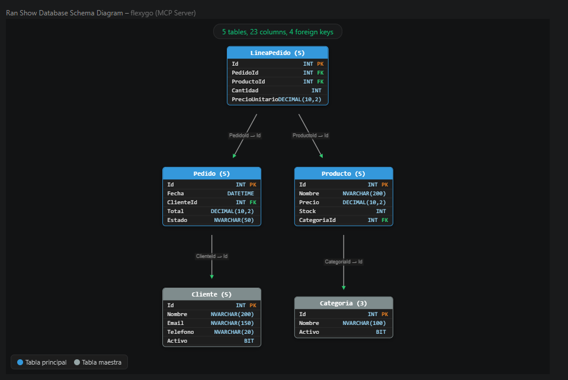
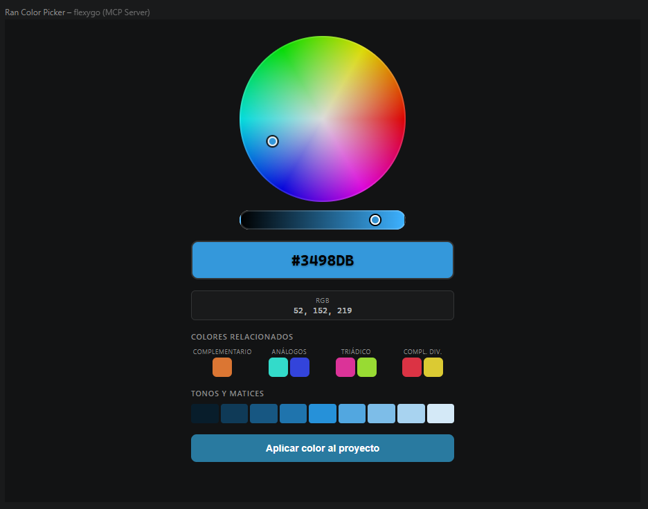
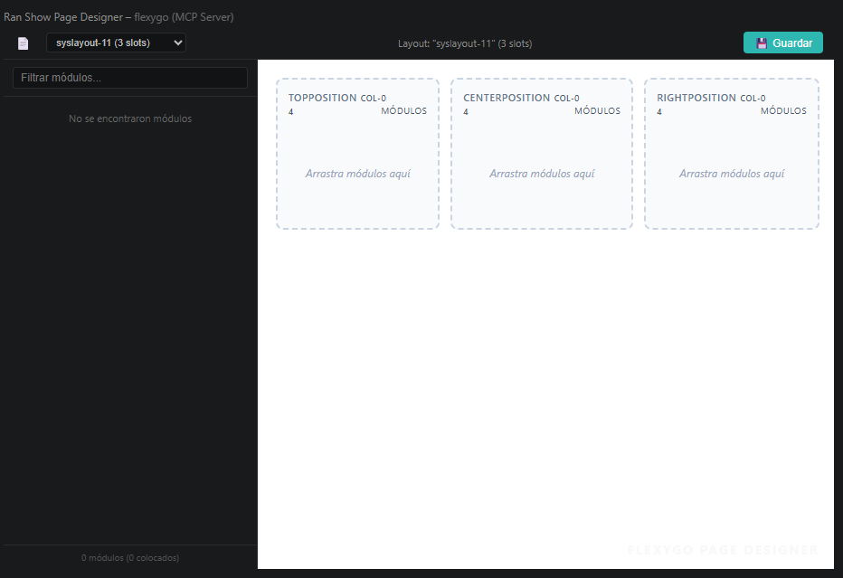

# MCP tools and resources

The `flexygo-mcp` server exposes tools the agent uses to work on the Flexygo project: reading and creating objects, properties, views, pages, modules, menus, processes, reports, templates, security, the WebAPI, the offline app, translations, the help, tests… You don't need to know them: the `/flx-*` commands and the agent itself use them according to what you ask for.

---

## Exploring the available tools

In Claude Code, type `/mcp` and choose the `flexygo` server to see whether it is connected and the list of its tools.

While the agent works, the chat shows each tool it calls. That way you see what it is reading or changing in the project.

---

## The configuration is not queried with SQL

The agent reads Flexygo's configuration database with its tools, never with direct SQL. If it tries, the server does not run the query: it answers with the tool that reads each table the query names. A table no tool reads is recorded as a gap of the server. The application's tables, in the data database, are queried with SQL, always through the server's tools: in Claude Code, a check keeps the agent from using `sqlcmd` from the console.

---

## The application's log

To know what happened while the application was used, the agent reads its own log with `flexygo_get_actions_log`:

- each run of a process: who, on which record, how long it took and its message;
- or, when asked, the errors: code, message and parameters.

Newest first, filtered by process, object, user and dates, and up to 500 rows. It only reads, and it masks values that look like passwords. Ask for it in your own words:

```text
Why did the shift approval process fail this morning?
```

---

## MCP Apps

Besides the data tools, the server includes three **MCP Apps**: interactive visual interfaces that the agent can open in response to specific requests. They show in clients that display MCP Apps.

### Flexygo Schema Diagram UI

An interactive diagram of the project's database model, with hierarchy and relationships between entities. Useful for visualizing the current schema before making changes or for understanding the structure of an existing project.

**How to use it:**
```text
Show me the project's current database model
```

<figure markdown="span">
  
  <figcaption>The diagram shows the project's tables, columns, types, and foreign keys</figcaption>
</figure>

If your client does not show MCP Apps, the agent can give you the same model as a Mermaid diagram in the chat, of every table or of one table and those related to it. The VS Code chat draws it.

### Color Picker UI

An interactive color picker. When you press **Apply color to project**, the color is written to the skin variables the agent prepared for that choice, for example the header color and the navigation color, in the skin you chose together. If no skin was chosen, the button writes nothing and the agent asks you which one to apply it to.

**How to use it:**
```text
Change the application's main color to a dark corporate blue using the color picker
```

<figure markdown="span">
  
  <figcaption>Pick the color and press "Apply color to project" for the agent to apply the change</figcaption>
</figure>

### Flexygo Page Designer UI

A preview of the page designer: shows the available positions (slots) on each page and the modules configured in each one. Useful for reviewing the layout before making modifications.

**How to use it:**
```text
Open the page designer to see which modules are on each page
```

<figure markdown="span">
  
  <figcaption>The designer shows the selected page's layout with its positions and assigned modules</figcaption>
</figure>
