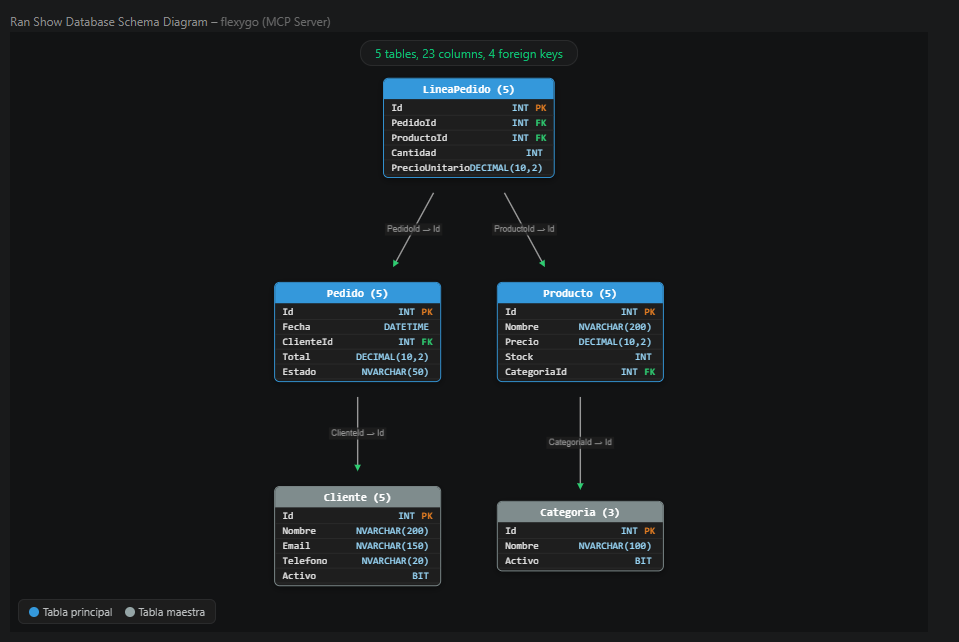
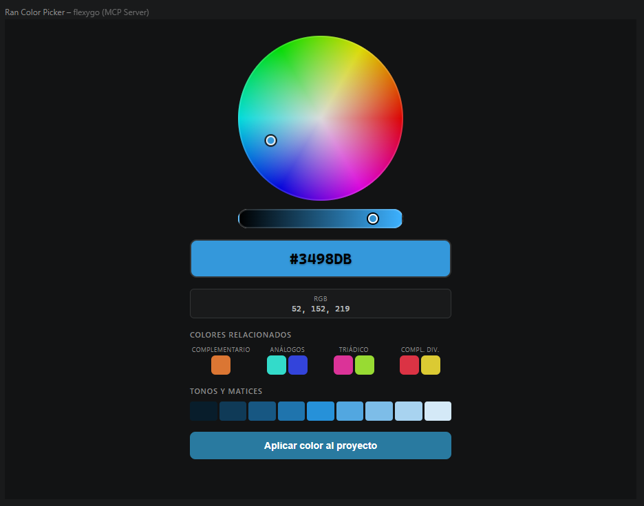
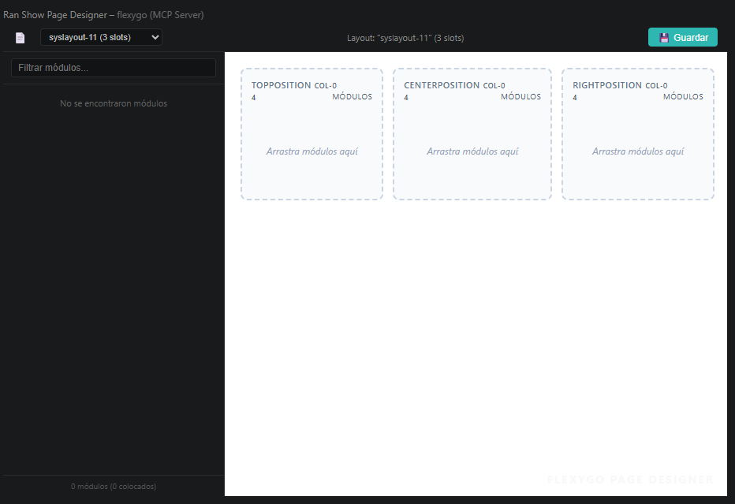

# Herramientas y recursos MCP

El servidor `flexygo-mcp` expone herramientas que el agente usa para trabajar sobre el proyecto Flexygo: leer y crear objetos, propiedades, vistas, páginas, módulos, menús, procesos, informes, plantillas, seguridad, la WebAPI, la aplicación sin conexión, traducciones, la ayuda, pruebas… No es necesario conocerlas: los comandos `/flx-*` y el propio agente las usan según lo que pidas.

---

## Explorar las herramientas disponibles

En Claude Code, escribe `/mcp` y elige el servidor `flexygo` para ver si está conectado y el listado de sus herramientas.

Mientras el agente trabaja, el chat enseña cada herramienta que invoca. Así ves qué está consultando o cambiando en el proyecto.

---

## La configuración no se consulta con SQL

El agente lee la base de configuración de Flexygo con sus herramientas, nunca con SQL directo. Si lo intenta, el servidor no ejecuta la consulta: le responde con la herramienta que lee cada tabla que nombra. Una tabla que ninguna herramienta lee queda apuntada como un hueco del servidor. Las tablas de la aplicación, en la base de datos, sí se consultan con SQL, siempre con las herramientas del servidor: en Claude Code, una comprobación impide que el agente use `sqlcmd` desde la consola.

---

## El registro de la aplicación

Para saber qué ha pasado al usar la aplicación, el agente lee su propio registro con `flexygo_get_actions_log`:

- cada ejecución de un proceso: quién, sobre qué registro, cuánto tardó y su mensaje;
- o, si se le piden, los errores: código, mensaje y parámetros.

Del más reciente al más antiguo, con filtro por proceso, objeto, usuario y fechas, y hasta 500 filas. Solo lee, y oculta los valores que parecen contraseñas. Pídeselo con tus palabras:

```text
¿Por qué falló esta mañana el proceso de aprobar turnos?
```

---

## MCP Apps

Además de las herramientas de datos, el servidor incluye tres **MCP Apps**: interfaces visuales interactivas que el agente puede abrir en respuesta a peticiones concretas. Se ven en los clientes que muestran MCP Apps.

### Flexygo Schema Diagram UI

Diagrama interactivo del modelo de base de datos del proyecto, con jerarquía y relaciones entre entidades. Útil para visualizar el esquema actual antes de hacer cambios o para entender la estructura de un proyecto existente.

**Cómo usarlo:**
```text
Muéstrame el modelo de base de datos actual del proyecto
```

<figure markdown="span">
  
  <figcaption>El diagrama muestra tablas, columnas, tipos y claves foráneas del proyecto</figcaption>
</figure>

Si tu cliente no muestra MCP Apps, el agente puede darte el mismo modelo como un diagrama Mermaid en el chat, de todas las tablas o de una tabla y las que se relacionan con ella. El chat de VS Code lo dibuja.

### Color Picker UI

Selector de color interactivo. Al pulsar **Aplicar color al proyecto**, el color se escribe en las variables de la piel que el agente haya preparado para esa elección, por ejemplo el color de cabecera y el de navegación, y en la piel que hayáis elegido. Si no se ha elegido la piel, el botón no escribe nada y el agente te pregunta en cuál aplicarlo.

**Cómo usarlo:**
```text
Cambia el color principal de la aplicación a un azul corporativo oscuro usando el color picker
```

<figure markdown="span">
  
  <figcaption>Selecciona el color y pulsa "Aplicar color al proyecto" para que el agente aplique el cambio</figcaption>
</figure>

### Flexygo Page Designer UI

Previsualización del diseñador de páginas: muestra las posiciones disponibles (slots) de cada página y los módulos configurados en cada una. Útil para revisar el layout antes de realizar modificaciones.

**Cómo usarlo:**
```text
Abre el diseñador de páginas para ver qué módulos hay en cada página
```

<figure markdown="span">
  
  <figcaption>El diseñador muestra el layout de la página seleccionada con sus posiciones y módulos asignados</figcaption>
</figure>
