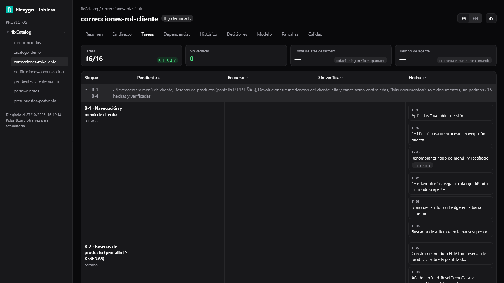
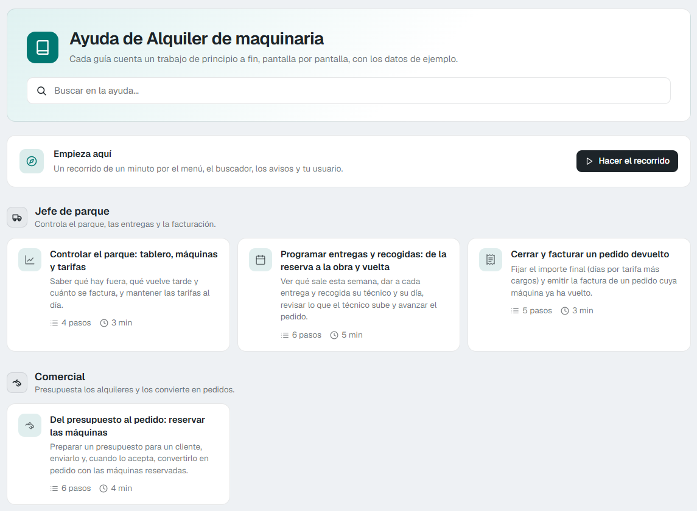

# Workflow with commands

!!! info "New in version 10.0"

    You can now create a Flexygo application by talking to an assistant connected to the MCP. The assistant gathers the requirements, asks you questions before starting, proposes a design and organises the work into blocks and tasks. It then builds the application and opens it in the browser so you can check it.

    You can also open a board from the assistant to follow tasks, decisions, history and quality checks.

    

With Claude Code, the Flexygo MCP server is driven by **commands** that start with `/flx-`. Each command is a phase, and each phase is the gate to the next one: the agent does not skip a phase or guess which one it is in. It talks to you in your words: it explains what it does at each step, without tool names. If one of its messages names one, it is handed back to be written again. When it gives you a choice, it tells you which answer it recommends and why.

The commands are a shortcut: the same is reached by telling the assistant what you want. See the [Guide](./0Guide.md).

!!! tip "Can't see the commands?"
    The commands are installed in the project the first time the server starts. If they do not show when you type `/flx-`, ask the agent to sync the Flexygo commands and open a new chat.

---

## The flow, in order

| Command | What it is for |
|---|---|
| `/flx-setup` | Only if the project has no connection strings yet: prepares the databases, writes the strings and the mail settings (which can be left for later) and offers version control. |
| `/flx-context` | First reads the material you left in the project's `{Product}.Resources/` folder. Then gathers the context: the business, the prefixes, the conventions, **who uses the application** (roles, public screens, and whether anyone will use it from outside) and which languages it will be used in. Writes `ONBOARDING.md` at the project root and a short description of the application, the first thing the board shows. |
| `/flx-plan` | Turns the request into blocks with their task list. If the application has screens, it ends with demo data. If there are several roles, each one gets its own line in the plan with its start page and its menu. The plan says **what** each role sees; **how** it is closed is decided by `/flx-security` (see [Security: who may do what](#security-who-may-do-what)). The users that try each role are created by the server: no task waits for you to give passwords. Before writing the plan it reads the corrections you have made in this project. Each block fits in one chat (see [Blocks sized to a chat](#blocks-sized-to-a-chat)). If the development has an offline app, it rejects auto-numbered keys (`IDENTITY`) and says why: GUID keys are needed. |
| `/flx-discuss` | Closes the plan's open points one at a time and records each decision. Together with them it asks for the [permissions to verify](#permissions-to-verify) and, if there is an approved original, [how faithful](#implanting-an-approved-original) the build has to be. On Flexygo 10 it also asks what the Ctrl+K search should find. |
| `/flx-execute` | Builds **one** block, task by task, and when it finishes, in the same chat, checks it with the [recorded walks](#cheaper-verification-recorded-walks) and writes [its tests](#the-products-own-tests). It tells you in one line how it went and which block comes next. When it starts, it gets what you already decided for its tasks and does not ask you again. What the server will not let it build is in [What the agent does not build](#what-the-agent-does-not-build). |
| `/flx-review` | Compares what was agreed with what was built, and brings the application's description up to date if what was built changes it. It reads every procedure that writes data for a check of which records the user may reach, measures the [quality quotas](#the-quality-quotas) and asks you for the visual identity if it is still undecided. |
| `/flx-security` | Decides **who may do what** and tries it signed in as each role. See [Security: who may do what](#security-who-may-do-what). |
| `/flx-quality` | Looks for what is missing (pager, empty state, way back…) and records your decision on each finding. It sweeps the whole catalogue as well as what you point out, and only calls a fix good once it is seen on screen with the role that uses it and with the contrast measured. On the last block it records what went wrong while building and measures the [quality quotas](#the-quality-quotas): one over its limit does not let it close without its reason or your acceptance. |
| `/flx-help` | Gives the application its help for the end user: a **help centre** with a guide per flow and role, a welcome tour per role, a guided tour per screen and field help. See [The application's help](#the-applications-help-flx-help). |
| `/flx-api` | Only if the application is used from outside: exposes what was built through the WebAPI, read-only by default and per role, decides on Flexygo 10 which roles use the platform's own assistant, and tests it with one user of each role. |
| `/flx-release` | The final check: the security audit, the delivery documents, and the product published from its own scripts into new databases, with all its tests. See [The final check: `/flx-release`](#the-final-check-flx-release). |

The status gives the phase as "Phase (n/9)": context 1, plan 2, discuss 3, execute 4, review 5, security 6, quality 7, help 8, and the API and the final check 9. Setting up with `/flx-setup` shows as phase 0. The phase guides, but does not block: the gates are in the concrete steps (no development without context, no block without a plan, no closing without security, the audit and the final check).

`/flx-verify` and `/flx-test` are no longer phases. Checking a block and writing its tests are part of executing it: `/flx-execute` follows them as a guide for that block's tasks. By hand they still serve to check everything again or to go over the tests. `/flx-audit` is not a phase either: it is the method of the audit that `/flx-release` makes.

At any time, as well:

- `/flx-status` says where the work stands and what comes next.
- `/flx-origin` says which origin new work lands in.
- `/flx-build-product` walks the whole flow for "an application for…".
- `/flx-new-development` starts new work in a project that already has things built.
- `/flx-design` shows you the design of the screens before they are built, and waits for your yes.
- `/flx-lovable` implants a project already approved, generated with Lovable or another tool. See [Implanting an approved original](#implanting-an-approved-original).
- `/flx-video` makes a product video with HyperFrames: a tour of the whole product (20 to 40 s) or what a development has just delivered (15 to 25 s), landscape and vertical, in the `{Product}.Marketing/videos/` folder. It is optional and not a phase. Use it when you want to show the product or a delivery; the agent offers it once when a development closes and only makes it with your yes. It needs Node.js, ffmpeg, the Claude Code `brag` plugin, the HyperFrames skills and the application running to capture its screens.

### Small changes: `/flx-fast`

A minor change to something that already exists (a property, a label, a filter, a module, a list) needs no plan and no blocks: `/flx-fast` makes it and keeps a record.

If the change is bigger, `/flx-fast` sends it to `/flx-new-development`. It is bigger if it does any of these:

- creates new tables or entities;
- touches permissions;
- loads data;
- deletes an entity;
- adds up to more than about five changes.

It only asks before starting if the change deletes something or is ambiguous.

---

## The model for each phase

Each phase is best done with a model, and the agent recommends the one for the phase the project is in, **in bold and with its reason**, together with the effort:

| Phases | Recommended model | Why |
|---|---|---|
| `/flx-plan`, `/flx-discuss`, `/flx-review` and `/flx-quality`, and the audit in `/flx-release` | Opus | They are phases of thinking and deciding. The audit is made by a subagent on Opus. |
| `/flx-status` and `/flx-origin` | Haiku | They only read where the work stands. |
| The rest | Sonnet | They are phases of building and checking. |

The recommended effort is medium, and high in `/flx-review` and in the audit, where a miss costs most. Raise the effort before moving to a bigger model. The mechanical steps of a phase (replaying the recorded walks in `/flx-execute`; translating the tours' texts and taking the screenshots in `/flx-help`) can go to a subagent on Haiku, which costs a fraction; edits to the code or the configuration stay on the chat's model.

You decide: switch model (`/model opus`, for example), keep yours, or **always** keep yours. If you keep yours, it recommends the model again when each phase or block starts; if you say always, it does not ask again in this project. The agent never switches model on its own. The best moment to switch is the start of a phase or a block: switching in the middle of a task makes the new model reread the whole chat.

If you would rather it switched by itself, turn on the environment variable `FLEXYGO_MODEL_PER_PHASE=auto`; it is off by default. With it, each command carries its model. Claude Code uses it for the turn in which you type the command, and with your next message it goes back to the session's model.

---

## Blocks sized to a chat

`/flx-plan` sizes each block to fit in **one chat**: what one `/flx-execute` builds, checks on screen and records before the chat fills up, about 150 turns. What counts is not the number of tasks but the **screens with rules of their own**: a block carries two or three at most, and a bigger one is split by screen. On the other hand, the data model or many offline screens copied from a template fit in a single block.

If tasks have to be added to a block later, they go at its end with their origin: nothing is renumbered, so assumptions and dependencies keep pointing at their task.

---

## Version control

**When preparing the project.** If the product's folder is not in git, `/flx-setup` and `/flx-build-product` offer to put it there, step by step and only with your yes:

1. install git, if it is not found;
2. start the repository with the template's `.gitignore`;
3. set a local identity for this project's commits;
4. make a first commit, without files that hold secrets.

If you say no, it is recorded and you are not asked again.

**Once per project: continuous integration and git.** `/flx-context` asks you two questions, one at a time. While they stay unanswered, the project's status and the first block ask them again. Each answer is recorded as a project decision and not asked again.

1. **Which continuous integration does the team use: TeamCity, GitHub Actions, Gitea or none?** With TeamCity, the agent connects the server with the address and project you give it; the token stays on your computer and never goes through the chat. With GitHub Actions or Gitea, the template's workflows already build the product, and the connection is only used to read their runs.
2. **When each block and each phase that changes the configuration closes: commit only, commit and push, or nothing?** The configuration is put into the product's files in every case; the commit and the push depend on your answer.

**When each block closes.** If the product is in git and the block closed well, the agent commits the block, with only that block's work and its title in your words as the message ("B-3: Roles and security"), and pushes it if that is what the project decided. If the project already decided, nothing is asked: it does it in the same chat, before its closing message. If the project has not decided yet, it offers you the commit and waits for your yes. It does so at the start of the next chat, before its first task, together with the other end-of-block questions; the last block, when it closes.

- It first says which files it takes, and leaves out the configuration files that hold secrets.
- If the block's configuration is not in files yet, it puts it there before the commit. If the project decided not to commit, it puts it there all the same, so it travels with the product.
- It only pushes if the project decided so.
- When it offers, a "no" counts for that block; if you say no for the whole project, it does not ask again.

**The push.** It uses your git as you have it set up (your SSH key or your credential manager) and asks you for nothing:

- If the product has no remote yet, it asks whether the repository already exists (its address) or has to be created (its name, its group and where), and never makes up a name.
- Before the first push it checks that the remote exists: on GitLab, a push to a project that does not exist creates it, so a mistyped name would leave a new repository behind.
- If it is refused for the credentials, it shows you git's message; you fix it in your credential manager and it retries once. The token or the key never goes through the chat or the project's files.
- If it is refused for anything else (a protected branch, changes on the remote), it tells you and proposes the way out.
- It never forces a push.

**When each phase that changes the configuration closes.** What security, help, the API and the fixes of review, quality and audit do is kept in the configuration database, and it only travels with the product once it is in files. That is why, before saying what comes next, each of those phases puts it into the product's files and commits it, and pushes it, as when a block closes. It does not wait until the end: it also does it after each round of fixes, so a chat cut halfway loses nothing.

**When the development closes.** The status asks for the configuration to be put into files before calling it finished. If the project has continuous integration connected:

- with TeamCity, it offers to create the product's build if it has none and shows you the last one;
- with GitHub Actions or Gitea, it shows you the last run.

When creating the build in TeamCity, it asks you once which SQL Server the product is tested on. It has to be 2017 or later, because the configuration database needs it: it proposes the ones that TeamCity's product builds already use and does not accept 2016 or earlier.

The project's status also warns if a `conf/appsettings*.json` tracked by git holds secrets: it names the file and the kind of key, never the value, and says how to stop tracking it.

### Which server version wrote what

Each time an MCP server version other than the previous one writes something in `.flexygo/`, it is noted in **`.flexygo/versions.md`**: when, which version, the first file it wrote and the version it took over from. So in a development started with one version and updated halfway, you can see what each one did, and `/flx-status` sums it up. Gaps, incidents and corrections also carry their own version stamp on each entry.

---

## The project's material: the `{Product}.Resources/` folder

Leave in the `{Product}.Resources/` folder at the project's root (`{Product}` is the name of the `*.Backend` folder) the material it is built from: requirements, sample data, screenshots, logos or links. You can copy it by hand or upload it from the [board](./7PanelAndBoard.md#resources). The folder travels with git.

`/flx-context` reads everything it can read in that folder before asking you anything, sums up what it brings and marks it as reviewed. If you add files later, run `/flx-context` again: it reads only the new ones.

---

## The application's help: `/flx-help`

`/flx-help` writes the help the end user will see inside the application itself. Before writing anything it proposes what it will do and waits for your yes.

- **The help centre.** An index page, ordered by role, with a search box and a guide per workflow. Each guide tells the work from start to end, screen by screen, with its screenshots on the demo data. It opens from the **Help** menu option and from a button on each screen's bar.
- **The welcome tour.** One per role, on its start page. It is offered by itself the first time the user enters and does not come back. On each page, each role sees a single invitation.
- **A guided tour per screen** and **field help**.
- **The offline app's guides.** If the development has an offline app, each role that uses it gets a guide of its work on the phone and another one on synchronising: when to sync, what goes up and what comes down, and how to tell a change has arrived. They are in the same help centre, under their role, and open from the phone's or the computer's browser.

The phase takes **two chats**, on purpose: the first writes everything and saves it into the product; the second, another `/flx-help`, walks every tour as each role, writes the other languages and records it. The guides and the tours come in every language the project said it would use, the main one first. If a product's help was written with an earlier version of the server, run `/flx-help` again to redo it in the new format.

<figure markdown="span">
  
  <figcaption>The help centre: search box, welcome tour and one guide per flow, grouped by role</figcaption>
</figure>

---

## The final check: `/flx-release`

It is the last phase of every development that builds something, after `/flx-help` and `/flx-api`. It answers the question that matters before a delivery: **does the product, built only from what is in its repository, work?** Without it, the development does not close.

1. **The security audit.** It is made by a subagent that did not build the application, once and over everything built, including what help and the API change in who may do what. See [The security audit](#the-security-audit).
2. **The delivery documents**, in your language:
    - **`README.md`** at the root, with no section left to be written: what the application is and for whom, how to publish its two databases from its own projects, which ports the Backend and the Frontend answer on, how to create the first user of each role (and what has to match for it to see its data), and where the help is.
    - **`CI.md`**, with only the files that exist; if the project decided to have no continuous integration, it says so in one line.
    - **`ONBOARDING.md`**, with its two hand-written sections filled in: the main screens and where to start.
3. **The product published from scratch.** It publishes both databases on this computer's SQL Server as `<database>_release`, without touching the working ones; copies the test users in, loads the demo data, starts the application on them, runs the unit tests and the interface tests with every walk, and puts the application back as it was. It takes a few minutes.
    - **Green**: it drops the `_release` databases and the development is ready to close.
    - **Red**: it **keeps** them so you can look at them, and tells you why. A defect of the product becomes a task of the last block, goes through `/flx-execute`, and the check runs again. A walk that did not run, a working database used during the check, or demo data that does not load on a clean database all count as red.
    - If the project's databases are not on this computer, it stops and asks you where it may publish; it never uses a server you did not name.
4. **The closing report.** With the check green, it publishes the development's report and gives you the link: the verdict on the first line, each block, what reopened and how it was closed again, the comparison against the approved original if there is one, the security model and its audit, what quality found and what you decided, the final check in figures, and what is still open. It is the only report published at the end of the flow; if your Claude client cannot publish it, it shows it in full in the terminal.

Then the test users are deleted, and the configuration is put into files and committed, as the project decided.

Publishing from the scripts only happens if the product has its own database projects and the plan builds something a test covers; the audit always happens. If the scripts change after a green check, the status asks for `/flx-release` again; a fix made after the audit also reopens it, and a subagent audits what changed.

---

## Cheaper verification: recorded walks

There is no verification phase after the blocks: `/flx-execute` checks each block as it closes, in the same chat, and `/flx-verify` stays as a guide and to check everything again by hand. Each screen has a **walk**: a browser route recorded in a file of the interface test project. Each development keeps its own in its own folder, `{Product}.InterfaceTest/walks/<development>/`; the ones that already existed without a folder count for the active development. It is product code: it travels with git and, if the project has continuous integration, also runs there.

While building, the server only replays the walks of the screens that changed; when the block closes, it replays all of them once, in a single browser. What earlier blocks built is checked by replaying their walks, not by opening it again by hand. Each step waits for the screen to be ready, not for a fixed time:

- **A walk that passes** against its accepted baseline is recorded as "seen working", with its capture. You are not asked to look at that screen again.
- **A walk that fails** is recorded red and reopens its task, the one of its own development, even if another development has a task with the same number.
- **A new or changed capture** comes back to you with the difference painted in red. You open it, look at it, and accept or reject it. What you accept is recorded.

Each capture is also measured on its own: contrast, untranslated identifiers, broken images, sideways scroll and the order of lists.

Every execution and every verification is recorded with its time: a task redone after its check needs to be checked again.

The saving is that the agent only deals with what fails or changes, instead of going through every screen one by one.

The captures the agent takes with the browser go to the project's `.playwright-mcp/` folder. If one is left loose at the root, the project's status says so.

### Permissions to verify

The agent asks you at once for the permissions it needs to verify: in `/flx-discuss`, together with the plan's open points, or before a block's first task if they are still unanswered. Once the development has your answer, it does not ask again; if you say no, it asks you in every block:

- create and delete test data (`TEST`);
- start and stop the application.

When the first block starts it also asks for your yes to a **test admin**: a user with full access that every block uses to look at the screens, with a password the server generates and you are never asked for. `/flx-security` locks it, and it is deleted at the end of the flow.

Signing in as each role needs no further permission: each role's test users are created by the server. The walks run without opening windows, in user turns: the server leaves only the administrator and the test user of the role being tried unlocked, and at the end puts every lock back as it was. It only touches the test users the flow itself created, never the administrator or real users. The walks are replayed in the light theme of their captures, and each user gets their theme back at the end.

!!! note "The licence"
    The licence always admits one user besides the administrator and the guest; that is why the test users sign in one at a time, and that is enough to try every role. If the licence rejects a sign-in, the agent says so ("Invalid license…") and not as a credentials failure, and a locked user is named as locked, not as a timeout.

---

## The product's own tests

There is no separate test phase either: each block writes its own as it closes, in the same chat, following `/flx-test` as a guide. The tests stay in the product's repository, in its two test projects:

- **`{Product}.UnitTest`**: at least one test for each new process or business rule.
- **`{Product}.InterfaceTest`**: at least one walk for each new screen. It checks that the screen opens without errors, that its main action works and that the effect shows. A list's walk also opens its records' pages, and the walk of a list with figures or saved views presses each one and checks that the list narrows to what it says. Each process of the plan has its walk, which takes it to the end of its flow.

What depends on permissions (each role's walk, and a role without permission being refused) is written in `/flx-security`, once the rules are in place.

The agent proposes the list to you in business terms and waits for your yes. Each test creates its own data and deletes it at the end, without touching the demo data, and never opens a record by its identifier: it finds it by a field that names it, so it also works on a database published from scratch. The test users are created by the server, with a password it generates and the agent never sees.

Before calling the tests good, the agent breaks one on purpose, sees it fail and puts it back to green. If the project has continuous integration, the unit tests run there before every publication; `/flx-release` also runs them all on the databases published from scratch. The interface tests need the application to be running. They are recorded like the walks: in user turns, without windows and in the light theme. A rejected sign-in closes its browser and is not retried.

**Tests cannot be waived.** A task that builds a screen or a process owes its test until one passes: without it the development does not close and the final check is not green. A task that builds neither (translations, a menu entry) needs no test.

---

## Security: who may do what

`/flx-security` comes after `/flx-review` and before `/flx-quality` in every development that builds something, and without it the flow does not go on. An application handed over with every role seeing everything is the most common defect and the hardest to see: the administrator sees everything, so every screen checked with it looks right.

**Objects are born closed.** Each object the agent creates is closed to every role that signs in, including the ones created later; administrators and designers see everything. While the blocks are built, no role is given permissions: a business role sees nothing of those objects until `/flx-security` opens what it needs. The project status says how many objects with data were born closed and what each role opens.

**Which rows each role sees is the object's security, never a view.** The plan says what each role sees ("each technician, the work of their site") and `/flx-security` sets it as a filter on the row of the object's **singular** that reads the access table with the signed-in user. That way it reaches the list, the record, the API and every screen. The plan refuses a task that limits the rows by the signed-in user in a view. See [Conditions: a permission only for some records](../../Help/Administration/RolesAndPermissions/3Rules.md#conditions-a-permission-only-for-some-records).

1. **It proposes the model.** Each role against every object, process, property, page, menu option and report, and who calls the WebAPI. It starts from what each role needs according to the context and each role's line in the plan, not from what it has: a role that only consults gets view and list, and delete is proposed only where the context says that role deletes.
2. **You decide.** It shows you a table, in your words, and warns you of what the model does not cover by itself:
    - the generic role `users`, which comes with every permission: it proposes closing it;
    - HTML modules or modules with their own SQL, and processes on no object, which need a rule of their own;
    - fields that look like personal data with no rule, and objects holding them with no audit;
    - AI assistants that read the database or the web.

    A high finding about who reads which rows (for example, a row filter that is not on the singular's row) keeps the phase open until it is corrected or you explicitly accept it.
3. **It applies it**, all at once.
4. **It tries it signed in as each role**, with one test user per role, one at a time and without asking you for permission (see [Permissions to verify](#permissions-to-verify)):
    - it opens every list as each role and asks the same through the API;
    - with your yes on the database, it also tries to create, edit and delete as each role, with test records it deletes at the end;
    - it also tries, as each role, to reach records that are not its own and, if the role may write, to create or move records outside what it sees; if it succeeds, it says so and the phase stays open until that is closed or you accept it;
    - it reads which process buttons each role is shown on each page, without pressing them, and how long each list takes to open;
    - what the role may not do, it tries from the menu, from the address and, if there is access from outside, through the API. **It only passes if it is refused**: hiding the menu option is not enough.
5. **It leaves the tests in the product**: a refusal test for each rule that takes something away and at least one walk or test per role, named after its rule. Without them the phase does not close.

What a role can see or do although its rules deny it, and that is not fixed there and then, is recorded as a limit: the phase does not close until it is fixed, with its refusal test, or until you accept **that** limit with your answer. A general "go on" accepts none.

No security at all is only valid with your literal answer, never with a silence or a "go on". Even then, processes and modules with their own SQL or HTML keep a rule per role and are tried as each role.

If the development works on an application that already has its security, it shows it to you as it stands and only asks whether it serves or you want to review it.

As it tries them, it locks each test user once its checks pass, and the test admin too: from here on, what is seen is seen as a role. It does not delete them: the next phases and the final check use them, and they are deleted at the end of `/flx-release`.

---

## The security audit

The audit is the first half of `/flx-release`: it comes after `/flx-help` and `/flx-api`, in every development that builds something, and it is made once over everything built. It is a **defensive** audit of the finished application:

- **It is made by someone who did not build it**: a subagent, on Opus, with no part in the build.
- **It only reads.** It changes nothing and tries to force nothing, and no finding carries steps to take advantage of it. Each finding says its severity, what is wrong, where, why it matters, how it is fixed and whose fix it is: the project's, the MCP server's or the platform's.

The server checks on its own:

- secrets in version control, and compose files with a default password or that sign in as `sa`;
- whether the compose file matches the project: each database is the one the project's settings name, each `dockerfile:` path exists, and the environment is not the development one;
- processes that take the user or the role from the browser;
- permissions decided in the browser, and code loaded by hand or from a public CDN;
- the generic role `users`, and processes and lists with their own SQL or HTML that every role reaches;
- who reads which rows: each role's filters on the singular's row, roles with every right on every object, and objects with data and no filter for any role;
- the warnings of the security model, such as personal data with no rule;
- form values pasted into SQL without quotes, and SQL that builds HTML;
- the project's JavaScript, against the guidelines it is built by;
- fields painted in templates without escaping;
- administrators left over and the template's samples.

The auditor also looks by hand at: each role on screen and through the API against the model you accepted, the project's own JavaScript that decides by role, procedures that build SQL by concatenation, personal data, what errors show, and users or roles left over.

**The development does not close with a high finding open, nor with a medium one that is the project's.** Each one is fixed or you accept it, with one decision per finding. The fixes you accept become tasks of the last block and are built with `/flx-execute`; then a subagent audits again what changed. Medium findings that are the server's or the platform's, and low ones, are reported, but do not block.

---

## What the agent does not build

Some things the server refuses, even when asked:

- **A process that takes the user or the role from the browser.** A process parameter cannot default to the current user or role (`{{currentUserId}}`, `{{currentRole}}`…), because the browser can change it. The process reads it on the server.
- **The administrator role written by hand.** Nothing is decided by comparing with `'admins'`, neither in the browser nor in a procedure, function, trigger or view: the platform's security is used.
- **Code loaded by hand.** An HTML module or a plugin cannot create `<script>` or `<link>`, load an outside address or pull from a public CDN. A library is registered as a project plugin.
- **Handlers written in the HTML.** An HTML module cannot carry `onclick` or other `on…` attributes: the behaviour goes in a project plugin.
- **Rows limited by the user in a view.** Which rows each role sees is decided by the object's security (see [Security: who may do what](#security-who-may-do-what)).
- **Changes to a platform interface.** It does not change a system interface (origin 0), such as `web2026`, which other profiles use: for a start page or a menu of its own it creates an interface and a profile of the project and assigns them. It only changes the platform's one if you explicitly decide so.
- **Dynamic SQL without your permission.** A procedure that builds SQL at run time needs your yes; it is recorded, and `/flx-security` lists it as a risk.
- **An `ISNULL` in a view** whose fallback does not fit the column's type.

Also, when it registers the project's own JavaScript it warns, without refusing, about what usually causes trouble, such as DOM observers or timers. And if a screen goes over about 150 lines of its own JavaScript, the plan has to justify why.

---

## Implanting an approved original

When the client has already approved some screens (generated with Lovable or another tool, drawn in Stitch or brought by you), `/flx-lovable` implants them in Flexygo: it reads the generated project, files its screens as the **original** and builds each one in its image.

**The target is 9 out of 10, not 10.** A very good likeness built with Flexygo's modules is worth more than an exact copy built by hand, because the copy loses what the platform gives: the security per user and role of each object, the pager, search, saved filters and the offline app. If the last 10 % can only be had by going down to HTML, the screen stays at 9 and the difference is recorded in the plan as an **accepted difference**.

**Before the first block, it asks how faithful the build has to be**: 9 out of 10 (the recommended answer) or as close as the skin and the modules' templates reach, and which screens have to match closely, because the client will compare them. The answer is about the look only: it grants no hand-written screens. A screen that no module or template can draw is a task of its own in the plan, with its functional reason and its gap recorded. Afterwards, each screen is compared with the original against that answer.

Each screen is built down a **ladder**, and it only goes down a rung for a functional need the rung above does not cover, never for likeness:

| Rung | What it is |
|---|---|
| **E1** | A standard module on an object: list, edit, view, tabs, chart, planner, timeline… |
| **E2** | The same module with its own template and CSS. This is where the likeness is reached. |
| **E3** | The standard module with behaviour (its events, the product's JavaScript), or a SQL list with its rule per role if there is no object behind it. |
| **E4** | Free HTML, only for what no rung above solves, and with its rule per role. |

There are six shapes the catalogue may not cover yet. The agent tries the base given first and, if it does not reach, records it as a **product gap**, by its name, instead of going down to HTML without saying so:

| | Shape | Tried first |
|---|---|---|
| **H1** | Resource × days grid with state cells | The planner |
| **H2** | Cycle or pattern strip: a bar of N days in segments | A small plugin activated from the template |
| **H3** | Gantt of spans per row | The timeline and, failing that, the planner |
| **H4** | Validate and preview before saving | The process parameter window and its dependencies |
| **H5** | Master-detail on the same page | The list's selection events and the relation between modules |
| **H6** | A working context the user chooses, such as the "active site" | Context variables |

---

## The quality quotas

`/flx-review` measures some **quality quotas** of the whole application and shows them with ✓ or ✗: HTML modules, generic pages, the project's own scripts, hidden lists, unquoted values in SQL, SQL that builds HTML, `!important` and loose colours in the CSS, and template samples still in the application. One over its limit is a deviation it puts to you with what would replace it. The audit in `/flx-release` looks again at the ones that concern security.

**In `/flx-quality` they are a gate.** On the last block, `/flx-quality` measures the whole application against the quotas and says what makes up each figure. A quota over its limit (✗) keeps the development from closing until it is brought under the limit or its reason, or your acceptance, is recorded as a decision; `/flx-status` says which are left. Three cannot be accepted, neither for fidelity nor with your yes, because they are a security risk: HTML modules that hold a form, a list or data, SQL that builds HTML, and modules and templates with handlers written in the HTML. Only a product gap recorded with its functional reason releases them. Advice (·), such as a filter that calls a function for each row, is shown and never blocks.

---

## Resuming without paying for the whole conversation

Resuming a long conversation is expensive: the model reads all of it again. So for each development the server keeps a **checkpoint** of about 2 KB with the essentials:

- the phase and the block;
- the open decisions;
- the last verification result;
- the known incidents;
- what comes next.

To carry on another day, or when the chat is getting heavy:

1. Open a **new chat**.
2. Type `/flx-status`, or just the next command of the flow.

The agent starts from the checkpoint, not from the previous conversation. The panel's band shows how full the chat is. See [How full the chat is](./7PanelAndBoard.md#how-full-the-chat-is). In a terminal there is no band: the status line under the text box warns with `context N% → new chat` from 80 %.

### Lessons carry over from one chat to the next

Each block starts with **the project's lessons**: the platform limits already found and the corrections you made to the agent. They come from the project, not from the conversation or a handover message, so a new chat does not trip over the same thing again. When you ask the agent to remember something, it records it, and the next block already knows.

When a block closes, the agent also records what is left open: a limit, a question or a pending decision. The next block gets it even if nobody tells it when the chat opens.

---

## Error telemetry

When one of the server's tools fails, the server records what is needed to reproduce the failure:

- the tool and its arguments, with passwords and SQL values masked;
- the error;
- the versions;
- the phase and task where it happened.

**It never sends the conversation or the rows of a query.**

By default, errors go to an OpenTelemetry collector on the same computer (`http://localhost:7472`), so they do not leave it. The server's first answer in each session reminds you of this. Product telemetry, which does leave the computer, is a separate thing: see [Telemetry](./3Configuration.md#telemetry).

To send them to another collector, put its address in the `FLEXYGO_MCP_ERROR_TELEMETRY` environment variable. To turn it off:

```bash
FLEXYGO_MCP_ERROR_TELEMETRY=off
```

---

## Panel and board

The state of the flow can also be seen without asking: in the Flexygo panel, above the chat, and on the developer's board. See [Panel and board](./7PanelAndBoard.md).

---

## What it builds on Flexygo 10

With a project on Flexygo 10, the agent uses what this version brings: ECharts charts, KPI cards, rules on save, live notices, REST objects, brand and account screens. See [What it builds on Flexygo 10](./8Flexygo10.md).
