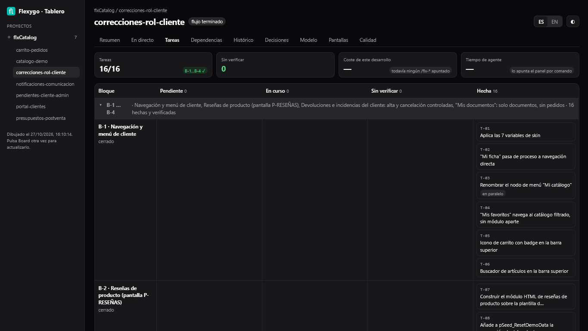
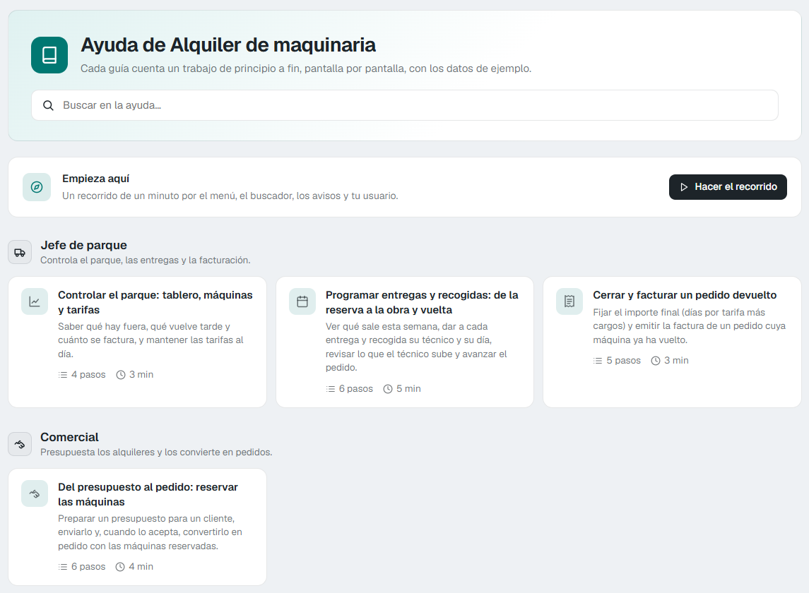

# Workflow with commands

!!! info "New in version 10.0"

    You can now create a Flexygo application by talking to an assistant connected to the MCP. The assistant gathers the requirements, asks you questions before starting, proposes a design and organises the work into blocks and tasks. It then builds the application and opens it in the browser so you can check it.

    You can also open a board from the assistant to follow tasks, decisions, history and quality checks.

    

With Claude Code, the Flexygo MCP server is driven by **commands** that start with `/flx-`. Each command is a phase, and each phase is the gate to the next one: the agent does not skip a phase or guess which one it is in. It talks to you in your words: it explains what it does at each step, without tool names. If one of its messages names one, it is handed back to be written again.

!!! tip "Can't see the commands?"
    The commands are installed in the project the first time the server starts. If they do not show when you type `/flx-`, ask the agent to sync the Flexygo commands and open a new chat.

---

## The flow, in order

| Command | What it is for |
|---|---|
| `/flx-context` | First reads the material you left in the project's `Resources/` folder. Then gathers the context: the business, the prefixes, the conventions and **who uses the application** (roles, public screens, and whether anyone will use it from outside). Writes `ONBOARDING.md` at the project root and a short description of the application, the first thing the board shows. |
| `/flx-plan` | Turns the request into blocks with their task list. If the application has several roles, the plan carries a security task; if it has screens, it ends with demo data. Each block fits in one chat (see [Blocks sized to a chat](#blocks-sized-to-a-chat)). If the development has an offline app, it rejects auto-numbered keys (`IDENTITY`) and says why: GUID keys are needed. |
| `/flx-discuss` | Closes the plan's open points one at a time and records each decision. On Flexygo 10 it also asks what the Ctrl+K search should find. |
| `/flx-execute` | Builds **one** block, task by task, and when it finishes verifies it by itself with the recorded walks. It tells you in one line how it went and which block comes next. When it starts, it gets what you already decided for its tasks and does not ask you again. |
| `/flx-review` | Compares what was agreed with what was built, and brings the application's description up to date if what was built changes it. |
| `/flx-verify` | Checks in the browser that it works, by replaying the recorded walks. `/flx-execute` already does it when it closes each block; by hand it checks everything again. |
| `/flx-test` | Writes the product's own tests and leaves them green. |
| `/flx-quality` | Looks for what is missing (pager, empty state, way back…) and records your decision on each finding. It sweeps the whole catalogue as well as what you point out, and only calls a fix good once it is seen on screen with the role that uses it and with the contrast measured. |
| `/flx-help` | Gives the application its help for the end user: a **help centre** with a guide per flow and role, a welcome tour per role, a guided tour per screen and field help. See [The application's help](#the-applications-help-flx-help). |
| `/flx-api` | Only if the application is used from outside: exposes what was built through the WebAPI, read-only by default and per role, and tests it with one user of each role. |

At any time, as well:

- `/flx-status` says where the work stands and what comes next.
- `/flx-origin` says which origin new work lands in.
- `/flx-build-product` walks the whole flow for "an application for…".
- `/flx-new-development` starts new work in a project that already has things built.

### Small changes: `/flx-fast`

A minor change to something that already exists (a property, a label, a filter, a module, a list) needs no plan and no blocks: `/flx-fast` makes it and keeps a record.

If the change is bigger, `/flx-fast` sends it to `/flx-new-development`. It is bigger if it does any of these:

- creates new tables or entities;
- touches permissions;
- loads data;
- deletes an entity;
- adds up to more than about five changes.

It only asks before starting if the change deletes something or is ambiguous.

---

## The model for each phase

Each phase is best done with a model, and the agent recommends the one for the phase the project is in, **in bold and with its reason**:

| Phases | Recommended model | Why |
|---|---|---|
| `/flx-plan`, `/flx-discuss`, `/flx-review` and `/flx-quality` | Opus | They are phases of thinking and deciding. |
| The rest | Sonnet | They are phases of building and checking. |

You decide: switch model (`/model opus`, for example), keep yours, or **always** keep yours. If you keep yours, it does not ask again in that phase; if you say always, it does not ask again in this project. The agent never switches model on its own.

If you would rather it switched by itself, turn on the environment variable `FLEXYGO_MODEL_PER_PHASE=auto`; it is off by default. With it, each command carries its model, and `/flx-status` and `/flx-origin`, which only read where the work stands, use Haiku. Claude Code uses it for the turn in which you type the command, and with your next message it goes back to the session's model.

---

## Blocks sized to a chat

`/flx-plan` sizes each block to fit in **one chat**: what one `/flx-execute` builds, checks on screen and records before the chat fills up, about 150 turns. What counts is not the number of tasks but the **screens with rules of their own**: a block carries two or three at most, and a bigger one is split by screen. On the other hand, the data model or many offline screens copied from a template fit in a single block.

If tasks have to be added to a block later, they go at its end with their origin: nothing is renumbered, so assumptions and dependencies keep pointing at their task.

---

## Version control

**When preparing the project.** If the product's folder is not in git, `/flx-setup` and `/flx-build-product` offer to put it there, step by step and only with your yes:

1. install git, if it is not found;
2. start the repository with the template's `.gitignore`;
3. set a local identity for this project's commits;
4. make a first commit, without files that hold secrets.

If you say no, it is recorded and you are not asked again.

**When each block closes.** If the product is in git and the block closed well, the agent offers a local commit of the block, with the message "B-n: block title". It offers it at the start of the next chat, before its first task, together with the other end-of-block questions; the last block offers it when it closes.

- It shows you the files first, and leaves out the configuration files that hold secrets.
- If the block's configuration is not in files yet, it says so and offers to put it there before the commit.
- It never pushes.
- A "no" counts for that block; if you say no for the whole project, it does not ask again.

The project's status also warns if a `conf/appsettings*.json` tracked by git holds secrets: it names the file and the kind of key, never the value, and says how to stop tracking it.

---

## The project's material: the `Resources/` folder

Leave in the project's `Resources/` folder the material it is built from: requirements, sample data, screenshots, logos or links. You can copy it by hand or upload it from the [board](./7PanelAndBoard.md#resources). The folder travels with git.

`/flx-context` reads everything it can read in that folder before asking you anything, sums up what it brings and marks it as reviewed. If you add files later, run `/flx-context` again: it reads only the new ones.

---

## The application's help: `/flx-help`

`/flx-help` writes the help the end user will see inside the application itself. Before writing anything it proposes what it will do and waits for your yes.

- **The help centre.** An index page, ordered by role, with a search box and a guide per workflow. Each guide tells the work from start to end, screen by screen, with its screenshots on the demo data. It opens from the **Help** menu option and from a button on each screen's bar.
- **The welcome tour.** One per role, on its start page. It is offered by itself the first time the user enters and does not come back. On each page, each role sees a single invitation.
- **A guided tour per screen** and **field help**.
- **The offline app's guides.** If the development has an offline app, each role that uses it gets a guide of its work on the phone and another one on synchronising: when to sync, what goes up and what comes down, and how to tell a change has arrived. They are in the same help centre, under their role, and open from the phone's or the computer's browser.

The help's texts are in the product's language. If a product's help was written with an earlier version of the server, run `/flx-help` again to redo it in the new format.

<figure markdown="span">
  
  <figcaption>The help centre: search box, welcome tour and one guide per flow, grouped by role</figcaption>
</figure>

---

## Cheaper verification: recorded walks

`/flx-verify` no longer has the agent look at every screen again, and `/flx-execute` applies it to the block it has just built. Each screen has a **walk**: a browser route recorded in a file of the interface test project. Each development keeps its own in its own folder, `{Product}.InterfaceTest/walks/<development>/`; the ones that already existed without a folder count for the active development. It is product code: it travels with git and also runs in continuous integration.

When verifying, the server replays every walk at once, in a single browser:

- **A walk that passes** against its accepted baseline is recorded as "seen working", with its capture. You are not asked to look at that screen again.
- **A walk that fails** is recorded red and reopens its task, the one of its own development, even if another development has a task with the same number.
- **A new or changed capture** comes back to you with the difference painted in red. You open it, look at it, and accept or reject it. What you accept is recorded.

Each capture is also measured on its own: contrast, untranslated identifiers, broken images, sideways scroll and the order of lists.

The saving is that the agent only deals with what fails or changes, instead of going through every screen one by one.

The captures the agent takes with the browser go to the project's `.playwright-mcp/` folder. If one is left loose at the root, the project's status says so.

### Permissions to verify

Before a block's first task, the agent asks you at once for the permissions it needs to verify. Once the development has your answer, it does not ask again; if you say no, it asks you in every block:

- create and delete test data (`TEST`);
- start and stop the application;
- lock and unlock the test users while each role is tested.

The walks run without opening windows, in user turns: each role signs in alone, with the other test users locked, and at the end everything is left as it was. They are replayed in the light theme of their captures, and each user gets their theme back at the end. Real users are never touched. Without the permission to lock, the agent says so and does not try.

!!! note "Evaluation licence"
    An evaluation licence only admits, at once, the administrator and one more user; that is why the other test users are locked before signing in with each role. If the licence rejects a sign-in, the agent says so ("Invalid license…") and not as a credentials failure, and a locked user is named as locked, not as a timeout.

---

## The product's own tests

`/flx-test` writes tests that stay in the product's repository, in its two test projects:

- **`{Product}.UnitTest`**: at least one test for each new process or business rule.
- **`{Product}.InterfaceTest`**: at least one walk for each new screen. It checks that the screen opens without errors, that its main action works and that the effect shows.

The agent proposes the list to you in business terms and waits for your yes. Each test creates its own data and deletes it at the end, without touching the demo data.

Before calling the tests good, the agent breaks one on purpose, sees it fail and puts it back to green. The unit tests run in continuous integration before every publication. The interface tests need the application to be running. They are recorded like the walks: in user turns, without windows and in the light theme. A rejected sign-in closes its browser and is not retried.

If you decide to go without tests, that is recorded as a decision.

---

## Resuming without paying for the whole conversation

Resuming a long conversation is expensive: the model reads all of it again. So for each development the server keeps a **checkpoint** of about 2 KB with the essentials:

- the phase and the block;
- the open decisions;
- the last verification result;
- the known incidents;
- what comes next.

To carry on another day, or when the chat is getting heavy:

1. Open a **new chat**.
2. Type `/flx-status`, or just the next command of the flow.

The agent starts from the checkpoint, not from the previous conversation. The panel's band shows how full the chat is and, from 70 %, offers **New chat and go on**, which does both steps at once. See [How full the chat is](./7PanelAndBoard.md#how-full-the-chat-is). In a terminal there is no band: the status line under the text box warns with `context N% → new chat` from 80 %.

### Lessons carry over from one chat to the next

Each block starts with **the project's lessons**: the platform limits already found and the corrections you made to the agent. They come from the project, not from the conversation or a handover message, so a new chat does not trip over the same thing again. When you ask the agent to remember something, it records it, and the next block already knows.

When a block closes, the agent also records what is left open: a limit, a question or a pending decision. The next block gets it even if nobody tells it when the chat opens.

---

## Error telemetry

When one of the server's tools fails, the server records what is needed to reproduce the failure:

- the tool and its arguments, with passwords and SQL values masked;
- the error;
- the versions;
- the phase and task where it happened.

**It never sends the conversation or the rows of a query.**

By default, errors go to an OpenTelemetry collector on the same computer (`http://localhost:7472`), so they do not leave it. The server's first answer in each session reminds you of this.

To send them to another collector, put its address in the `FLEXYGO_MCP_ERROR_TELEMETRY` environment variable. To turn it off:

```bash
FLEXYGO_MCP_ERROR_TELEMETRY=off
```

---

## Panel and board

The state of the flow can also be seen without asking: in the Flexygo panel, above the chat, and on the developer's board. See [Panel and board](./7PanelAndBoard.md).

---

## What it builds on Flexygo 10

With a project on Flexygo 10, the agent uses what this version brings: ECharts charts, KPI cards, rules on save, live notices, REST objects, brand and account screens. See [What it builds on Flexygo 10](./8Flexygo10.md).
