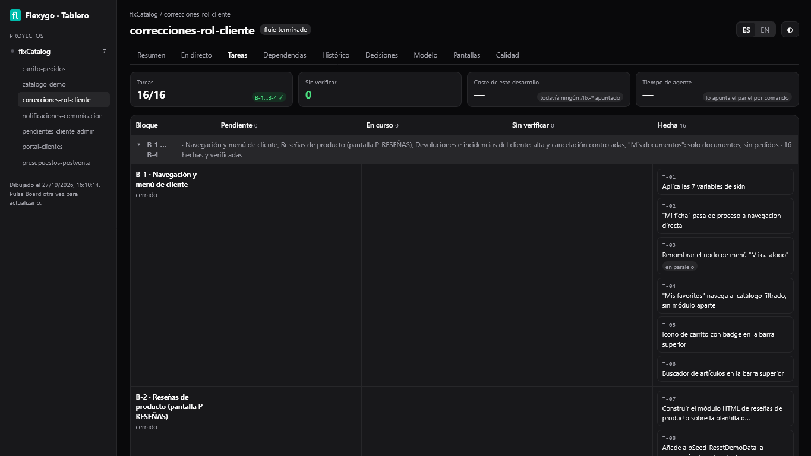
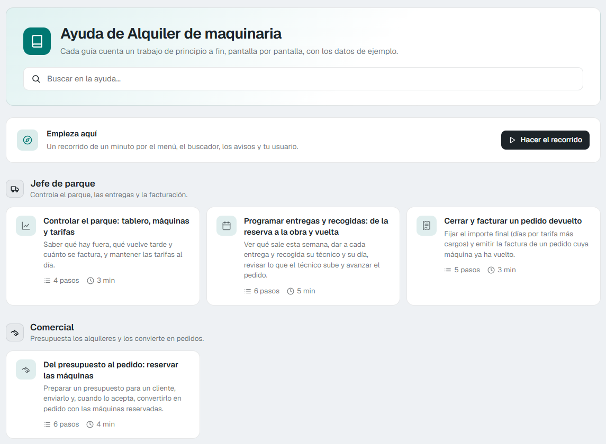

# Flujo de trabajo con comandos

!!! info "Novedad en la versión 10.0"

    Ahora puedes crear una aplicación Flexygo hablando con un asistente conectado al MCP. El asistente recoge los requisitos, te pregunta antes de empezar, propone un diseño y organiza el trabajo en bloques y tareas. Después crea la aplicación y la abre en el navegador para que puedas comprobarla.

    Desde el asistente también puedes abrir un tablero para seguir las tareas, las decisiones, el historial y los controles de calidad.

    

Con Claude Code, el servidor MCP de Flexygo se maneja con **comandos** que empiezan por `/flx-`. Cada comando es una fase, y cada fase es la puerta de la siguiente: el agente no salta una fase ni adivina en cuál está. Te habla con tus palabras: explica lo que hace en cada paso, sin nombres de herramientas. Si un mensaje suyo nombra una, se le devuelve para que lo escriba de nuevo. Cuando te da a elegir, te dice qué respuesta recomienda y por qué.

Los comandos son un atajo: lo mismo se consigue contándole al asistente lo que quieres. Consulta la [Guía](./0Guide.md).

!!! tip "¿No ves los comandos?"
    Los comandos se instalan en el proyecto la primera vez que arranca el servidor. Si al escribir `/flx-` no aparecen, pide al agente que sincronice los comandos de Flexygo y abre un chat nuevo.

---

## El flujo, en orden

| Comando | Para qué sirve |
|---|---|
| `/flx-setup` | Solo si el proyecto aún no tiene cadenas de conexión: prepara las bases de datos, escribe las cadenas y el correo (que se puede dejar para después) y te ofrece el control de versiones. |
| `/flx-context` | Lee primero el material que has dejado en la carpeta `{Producto}.Resources/` del proyecto. Después recoge el contexto: el negocio, los prefijos, las convenciones, **quién usa la aplicación** (roles, pantallas públicas y si alguien entrará desde fuera) y en qué idiomas se va a usar. Escribe `ONBOARDING.md` en la raíz del proyecto y una descripción breve de la aplicación, que es lo primero que enseña el tablero. |
| `/flx-plan` | Convierte el encargo en bloques con su lista de tareas. Si tiene pantallas, termina con datos de demostración. Si hay varios roles, cada uno lleva su línea en el plan con su página de inicio y su menú. El plan dice **qué** ve cada rol; **cómo** se cierra lo decide `/flx-security` (consulta [Seguridad: quién puede qué](#seguridad-quien-puede-que)). Los usuarios para probar cada rol los crea el servidor: ninguna tarea espera a que des contraseñas. Antes de escribir el plan lee las correcciones que le has hecho en este proyecto. Cada bloque cabe en un chat (ver [Bloques a la medida de un chat](#bloques-a-la-medida-de-un-chat)). Si el desarrollo tiene aplicación sin conexión, rechaza las claves autonuméricas (`IDENTITY`) y explica por qué: hacen falta claves GUID. |
| `/flx-discuss` | Cierra uno a uno los puntos abiertos del plan y apunta cada decisión. Con ellos te pregunta también los [permisos para verificar](#permisos-para-verificar) y, si hay un original aprobado, [cómo de fiel](#implantar-un-original-aprobado) tiene que ser lo construido. En Flexygo 10 pregunta además qué debe encontrar la búsqueda de Ctrl+K. |
| `/flx-execute` | Construye **un** bloque, tarea a tarea, y al terminarlo, en el mismo chat, lo comprueba con los [recorridos grabados](#verificacion-mas-barata-recorridos-grabados) y deja escritas [sus pruebas](#las-pruebas-del-propio-producto). Te dice en una línea cómo ha ido y qué bloque toca después. Al empezar, recibe lo que ya decidiste para sus tareas y no te lo vuelve a preguntar. Lo que el servidor no deja construir está en [Lo que el agente no construye](#lo-que-el-agente-no-construye). |
| `/flx-review` | Compara lo acordado con lo construido, y pone al día la descripción de la aplicación si lo construido la cambia. Lee cada procedimiento que escribe datos buscando que compruebe a qué registros llega el usuario, mide los [cupos de calidad](#los-cupos-de-calidad) y te pide la identidad visual si sigue sin decidir. |
| `/flx-security` | Decide **quién puede qué** y lo prueba entrando con cada rol. Consulta [Seguridad: quién puede qué](#seguridad-quien-puede-que). |
| `/flx-quality` | Busca lo que falta (paginador, estado vacío, camino de vuelta…) y apunta tu decisión sobre cada hallazgo. Repasa todo el catálogo además de lo que le señales, y solo da un arreglo por bueno visto en pantalla con el rol que lo usa y con el contraste medido. En el último bloque apunta lo que falló mientras se construía y mide los [cupos de calidad](#los-cupos-de-calidad): uno superado no deja cerrar sin su motivo o tu aceptación. |
| `/flx-help` | Da a la aplicación su ayuda para el usuario final: un **centro de ayuda** con una guía por cada flujo y rol, una visita de bienvenida por rol, una visita guiada por pantalla y la ayuda de los campos. Consulta [La ayuda de la aplicación](#la-ayuda-de-la-aplicacion-flx-help). |
| `/flx-api` | Solo si la aplicación se usa desde fuera: expone lo construido por la WebAPI, de solo lectura por defecto y por rol, decide en Flexygo 10 qué roles usan el asistente propio de la plataforma, y lo prueba con un usuario de cada rol. |
| `/flx-release` | La comprobación final: la auditoría de seguridad, los documentos de entrega y el producto publicado desde sus propios scripts en bases nuevas, con todas sus pruebas. Consulta [La comprobación final: `/flx-release`](#la-comprobacion-final-flx-release). |

El estado dice la fase como «Phase (n/9)»: contexto 1, plan 2, discusión 3, ejecución 4, revisión 5, seguridad 6, calidad 7, ayuda 8, y la API y la comprobación final 9. La preparación con `/flx-setup` sale como fase 0. La fase orienta, pero no bloquea: las puertas están en los pasos concretos (no hay desarrollo sin contexto, ni bloque sin plan, ni cierre sin seguridad, sin auditoría ni sin la comprobación final).

`/flx-verify` y `/flx-test` ya no son fases. Comprobar un bloque y escribir sus pruebas es parte de ejecutarlo: `/flx-execute` los sigue como guía para las tareas de ese bloque. A mano siguen sirviendo para volver a comprobarlo todo o repasar las pruebas. `/flx-audit` tampoco es una fase: es el método de la auditoría que hace `/flx-release`.

Además, en cualquier momento:

- `/flx-status` dice dónde está el trabajo y qué toca después.
- `/flx-origin` dice en qué origen cae lo que se construye.
- `/flx-build-product` recorre el flujo entero para «una aplicación de…».
- `/flx-new-development` empieza un trabajo nuevo en un proyecto que ya tiene cosas construidas.
- `/flx-design` te enseña el diseño de las pantallas antes de construirlas, y espera tu sí.
- `/flx-lovable` implanta un proyecto ya aprobado, generado con Lovable u otra herramienta. Consulta [Implantar un original aprobado](#implantar-un-original-aprobado).
- `/flx-video` hace con HyperFrames un vídeo del producto: un recorrido por todo el producto (de 20 a 40 s) o lo que acaba de entregar un desarrollo (de 15 a 25 s), en horizontal y en vertical, en la carpeta `{Producto}.Marketing/videos/`. Es opcional y no es una fase. Úsalo cuando quieras enseñar el producto o una entrega; el agente te lo ofrece una vez al cerrar un desarrollo y solo lo hace con tu sí. Necesita Node.js, ffmpeg, el plugin `brag` de Claude Code, las skills de HyperFrames y la aplicación en marcha para capturar sus pantallas.

### Cambios pequeños: `/flx-fast`

Para un cambio menor sobre algo que ya existe (una propiedad, una etiqueta, un filtro, un módulo, una lista) no hace falta plan ni bloques: `/flx-fast` lo hace y deja constancia.

Si el cambio es mayor, `/flx-fast` lo manda a `/flx-new-development`. Es mayor si hace alguna de estas cosas:

- crea tablas o entidades nuevas;
- toca permisos;
- carga datos;
- borra una entidad;
- son más de unos cinco cambios.

Antes de empezar solo pregunta si el cambio borra algo o es ambiguo.

---

## El modelo de cada fase

Cada fase se hace mejor con un modelo, y el agente te recomienda el de la fase en que está el proyecto, **en negrita y con su porqué**, junto con el esfuerzo:

| Fases | Modelo recomendado | Por qué |
|---|---|---|
| `/flx-plan`, `/flx-discuss`, `/flx-review` y `/flx-quality`, y la auditoría de `/flx-release` | Opus | Son fases de pensar y decidir. La auditoría la hace un subagente con Opus. |
| `/flx-status` y `/flx-origin` | Haiku | Solo leen dónde está el trabajo. |
| Las demás | Sonnet | Son fases de construir y comprobar. |

El esfuerzo recomendado es medio, y alto en `/flx-review` y en la auditoría, donde un fallo cuesta más. Antes de pasar a un modelo mayor conviene subir el esfuerzo. Los pasos mecánicos de una fase (repetir los recorridos grabados en `/flx-execute`; traducir los textos de las visitas y hacer las capturas en `/flx-help`) los puede hacer un subagente con Haiku, que cuesta mucho menos; lo que cambia el código o la configuración se queda en el modelo del chat.

Decides tú: cambiar de modelo (`/model opus`, por ejemplo), quedarte con el tuyo o quedarte **siempre** con el tuyo. Si te quedas con el tuyo, te lo vuelve a recomendar al empezar cada fase o bloque; si dices que siempre, no vuelve a preguntar en este proyecto. El agente nunca cambia de modelo por su cuenta. El mejor momento para cambiar es al empezar una fase o un bloque: cambiar a mitad de una tarea obliga al modelo nuevo a releer todo el chat.

Si prefieres que cambie solo, activa la variable de entorno `FLEXYGO_MODEL_PER_PHASE=auto`; viene apagada. Con ella, cada comando lleva su modelo. Claude Code lo usa en el turno en que escribes el comando, y con tu siguiente mensaje vuelve al modelo de la sesión.

---

## Bloques a la medida de un chat

`/flx-plan` dimensiona cada bloque para que quepa en **un chat**: lo que un `/flx-execute` construye, comprueba en pantalla y deja apuntado antes de que el chat se llene, unos 150 turnos. No cuenta el número de tareas, sino las **pantallas con reglas propias**: un bloque lleva dos o tres como mucho, y uno más grande se parte por pantallas. En cambio, el modelo de datos o muchas pantallas sin conexión copiadas de una plantilla caben en un solo bloque.

Si después hay que añadir tareas a un bloque, van al final con su origen: nada se renumera, así que las suposiciones y dependencias siguen apuntando a su tarea.

---

## El control de versiones

**Al preparar el proyecto.** Si la carpeta del producto no está en git, `/flx-setup` y `/flx-build-product` te ofrecen ponerla, paso a paso y solo con tu sí:

1. instalar git, si no lo encuentra;
2. iniciar el repositorio con el `.gitignore` de la plantilla;
3. poner una identidad local para los commits de este proyecto;
4. hacer un primer commit, sin ficheros con secretos.

Si dices que no, se apunta y no te lo vuelve a preguntar.

**Una vez por proyecto: la integración continua y git.** `/flx-context` te hace dos preguntas, una cada vez. Mientras sigan sin respuesta, las repiten el estado del proyecto y el primer bloque. Cada respuesta se apunta como decisión del proyecto y no se vuelve a preguntar.

1. **¿Qué integración continua usa el equipo: TeamCity, GitHub Actions, Gitea o ninguna?** Con TeamCity, el agente conecta el servidor con la dirección y el proyecto que le des; el token se queda en tu equipo, nunca pasa por el chat. Con GitHub Actions o Gitea, los flujos de la plantilla ya construyen el producto, y la conexión sirve solo para leer sus ejecuciones.
2. **Al cerrar cada bloque y cada fase que cambia la configuración, ¿solo commit, commit y push, o nada?** La configuración se pasa a ficheros del producto en todos los casos; el commit y el push dependen de tu respuesta.

**Al cerrar cada bloque.** Si el producto está en git y el bloque ha cerrado bien, el agente hace el commit del bloque, solo con lo de ese bloque y con su título en tus palabras como mensaje («B-3: Roles y seguridad»), y el push si así lo decidió el proyecto. Si el proyecto ya lo decidió, no pregunta: lo hace en el mismo chat, antes de su mensaje de cierre. Si aún no lo ha decidido, te ofrece el commit y espera tu sí: te lo pregunta al empezar el chat siguiente, antes de su primera tarea, junto con las demás preguntas de fin de bloque; el del último bloque, al cerrarse.

- Antes dice qué ficheros lleva, y deja fuera los de configuración que guardan secretos.
- Si la configuración del bloque aún no está en ficheros, la pasa antes del commit. Si el proyecto decidió no hacer commit, la pasa igualmente, para que viaje con el producto.
- Solo hace push si el proyecto lo decidió.
- Si te lo ofrece, un «no» vale para ese bloque; si dices que no para todo el proyecto, no vuelve a preguntar.

**El push.** Usa tu git tal como lo tengas configurado (tu clave SSH o tu gestor de credenciales) y no te pide nada:

- Si el producto aún no tiene remoto, te pregunta si el repositorio ya existe (su dirección) o hay que crearlo (su nombre, su grupo y dónde), y nunca se inventa un nombre.
- Antes del primer push comprueba que el remoto existe: en GitLab, un push a un proyecto que no existe lo crea, y un nombre mal escrito dejaría un repositorio nuevo.
- Si lo rechaza por las credenciales, te enseña el mensaje de git; lo arreglas en tu gestor de credenciales y lo reintenta una vez. El token o la clave nunca pasan por el chat ni por los ficheros del proyecto.
- Si lo rechaza por otra cosa (una rama protegida, cambios en el remoto), te lo dice y te propone la salida.
- Nunca fuerza un push.

**Al cerrar cada fase que cambia la configuración.** Lo que hacen la seguridad, la ayuda, la API y los arreglos de la revisión, la calidad y la auditoría se guarda en la base de configuración, y solo viaja con el producto una vez pasado a ficheros. Por eso, antes de decir qué viene después, cada una de esas fases lo pasa a ficheros del producto y hace el commit, y el push, como al cerrar un bloque. No espera al final: lo hace también tras cada tanda de arreglos, para que un chat cortado a medias no pierda nada.

**Al cerrar el desarrollo.** El estado pide pasar la configuración a ficheros antes de darlo por terminado. Si el proyecto tiene la integración continua conectada:

- con TeamCity, te ofrece crear la compilación del producto si no la tiene y te enseña la última;
- con GitHub Actions o Gitea, te enseña la última ejecución.

Al crear la compilación en TeamCity, te pregunta una vez en qué SQL Server se prueba el producto. Tiene que ser 2017 o posterior, porque la base de configuración lo necesita: te propone los que ya usan las compilaciones de productos de ese TeamCity y no acepta 2016 ni anteriores.

Además, el estado del proyecto avisa si un `conf/appsettings*.json` que sigue git guarda secretos: nombra el fichero y el tipo de clave, nunca el valor, y dice cómo dejar de seguirlo.

### Qué versión del servidor escribió cada cosa

Cada vez que una versión del servidor MCP distinta de la anterior escribe algo en `.flexygo/`, lo apunta en **`.flexygo/versions.md`**: cuándo, qué versión, el primer fichero que escribió y la versión a la que sustituye. Así, en un desarrollo que empezó con una versión y se actualizó a medias, se ve qué hizo cada una, y `/flx-status` lo resume. Los huecos, las incidencias y las correcciones llevan además su propio sello de versión en cada entrada.

---

## El material del proyecto: la carpeta `{Producto}.Resources/`

Deja en la carpeta `{Producto}.Resources/` de la raíz del proyecto (`{Producto}` es el nombre de la carpeta `*.Backend`) el material con el que se construye: requisitos, datos de ejemplo, capturas, logos o enlaces. Puedes copiarlo a mano o subirlo desde el [tablero](./7PanelAndBoard.md#recursos). La carpeta viaja con git.

`/flx-context` lee todo lo que puede leer de esa carpeta antes de preguntarte nada, te resume lo que aporta y lo marca como revisado. Si más tarde añades ficheros, vuelve a lanzar `/flx-context`: solo lee los nuevos.

---

## La ayuda de la aplicación: `/flx-help`

`/flx-help` escribe la ayuda que verá el usuario final dentro de la propia aplicación. Antes de escribir nada te propone qué va a hacer y espera tu sí.

- **El centro de ayuda.** Una página índice, ordenada por roles, con un buscador y una guía por cada flujo de trabajo. Cada guía cuenta el trabajo de principio a fin, pantalla por pantalla, con sus capturas sobre los datos de demostración. Se abre desde la opción **Ayuda** del menú y desde un botón en la barra de cada pantalla.
- **La visita de bienvenida.** Una por rol, en su página de inicio. Se ofrece sola la primera vez que el usuario entra y no vuelve a salir. En cada página, cada rol ve una sola invitación.
- **Una visita guiada por pantalla** y **la ayuda de los campos**.
- **Las guías de la aplicación sin conexión.** Si el desarrollo tiene una aplicación sin conexión, cada rol que la usa tiene su guía del trabajo en el móvil y otra de la sincronización: cuándo sincronizar, qué sube y qué baja, y cómo saber que un cambio ha llegado. Están en el mismo centro de ayuda, bajo su rol, y se abren desde el navegador del móvil o del ordenador.

La fase se hace en **dos chats**, a propósito: el primero lo escribe todo y lo guarda en el producto; el segundo, otro `/flx-help`, recorre cada visita con cada rol, escribe los demás idiomas y lo deja apuntado. Las guías y las visitas salen en cada idioma que el proyecto dijo que usaría, empezando por el principal. Si la ayuda de un producto se escribió con una versión anterior del servidor, vuelve a lanzar `/flx-help` para rehacerla con el formato nuevo.

<figure markdown="span">
  
  <figcaption>El centro de ayuda: buscador, recorrido de bienvenida y una guía por flujo, agrupadas por rol</figcaption>
</figure>

---

## La comprobación final: `/flx-release`

Es la última fase de todo desarrollo que construye algo, después de `/flx-help` y de `/flx-api`. Responde a la pregunta que importa antes de entregar: **¿funciona el producto construido solo con lo que hay en su repositorio?** Sin ella, el desarrollo no se cierra.

1. **La auditoría de seguridad.** La hace un subagente que no construyó la aplicación, una sola vez y sobre todo lo construido, incluido lo que la ayuda y la API cambian en quién puede qué. Consulta [La auditoría de seguridad](#la-auditoria-de-seguridad).
2. **Los documentos de entrega**, en tu idioma:
    - **`README.md`** en la raíz, sin apartados por escribir: qué es la aplicación y para quién, cómo publicar sus dos bases de datos desde sus propios proyectos, en qué puertos responden el Backend y el Frontend, cómo crear el primer usuario de cada rol (y qué tiene que coincidir para que vea sus datos) y dónde está la ayuda.
    - **`CI.md`**, solo con los ficheros que existen; si el proyecto decidió no tener integración continua, lo dice en una línea.
    - **`ONBOARDING.md`**, con sus dos apartados escritos a mano: las pantallas principales y por dónde empezar.
3. **El producto publicado desde cero.** Publica las dos bases en el SQL Server de este equipo como `<base>_release`, sin tocar las de trabajo; copia los usuarios de prueba, carga los datos de demostración, arranca la aplicación sobre ellas, ejecuta las pruebas unitarias y las de interfaz con todos los recorridos, y deja la aplicación como estaba. Tarda unos minutos.
    - **En verde**, borra las bases `_release` y el desarrollo queda listo para cerrar.
    - **En rojo**, las **conserva** para que puedas mirarlas y te dice por qué. Un defecto del producto se convierte en una tarea del último bloque, pasa por `/flx-execute` y la comprobación se repite. Un recorrido que no llegó a ejecutarse, una base de trabajo usada durante la comprobación o unos datos de demostración que no cargan en una base limpia cuentan como rojo.
    - Si las bases del proyecto no están en este equipo, se para y te pregunta dónde puede publicar; nunca usa un servidor que no hayas nombrado.
4. **El informe de cierre.** Con la comprobación en verde, publica el informe del desarrollo y te da el enlace: el veredicto en la primera línea, cada bloque, lo que se reabrió y cómo se cerró, la comparación con el original aprobado si lo hay, el modelo de seguridad y su auditoría, lo que encontró la calidad y lo que decidiste, la comprobación final en cifras y lo que sigue abierto. Es el único informe que se publica al final del flujo; si tu cliente de Claude no puede publicarlo, lo enseña entero en la terminal.

Después se borran los usuarios de prueba, se pasa la configuración a ficheros y se hace el commit, como decidió el proyecto.

La publicación desde los scripts solo se hace si el producto tiene sus propios proyectos de base de datos y el plan construye algo que una prueba cubre; la auditoría se hace siempre. Si los scripts cambian después de una comprobación en verde, el estado vuelve a pedir `/flx-release`; un arreglo hecho tras la auditoría también la reabre, y un subagente audita lo que cambió.

---

## Verificación más barata: recorridos grabados

No hay una fase de verificación después de los bloques: `/flx-execute` comprueba cada bloque al cerrarlo, en su mismo chat, y `/flx-verify` queda como guía y para volver a comprobarlo todo a mano. Cada pantalla tiene un **recorrido**: un paseo por el navegador grabado en un fichero del proyecto de pruebas de interfaz. Cada desarrollo guarda los suyos en su propia carpeta, `{Producto}.InterfaceTest/walks/<desarrollo>/`; los que ya había sin carpeta cuentan para el desarrollo activo. Es código del producto: viaja con git y, si el proyecto tiene integración continua, se ejecuta también en ella.

Mientras se construye, el servidor solo repite los recorridos de las pantallas que han cambiado; al cerrar el bloque, los repite todos una vez, en un solo navegador. Lo que construyeron los bloques anteriores se comprueba repitiendo sus recorridos, no volviendo a abrirlo a mano. Cada paso espera a que la pantalla esté lista, no a un tiempo fijo:

- **Un recorrido que pasa** contra su referencia aceptada queda apuntado como «visto funcionando», con su captura. No se te pide volver a mirar esa pantalla.
- **Un recorrido que falla** se apunta en rojo y reabre su tarea, la de su propio desarrollo, aunque otro desarrollo tenga una tarea con el mismo número.
- **Una captura nueva o que ha cambiado** vuelve a ti con la diferencia pintada en rojo. La abres, la miras y la aceptas o la rechazas. Lo aceptado queda apuntado.

Además, cada captura se mide sola: el contraste, los identificadores sin traducir, las imágenes rotas, el desplazamiento lateral y el orden de las listas.

Cada ejecución y cada verificación quedan apuntadas con su hora: una tarea que se rehace después de comprobarla vuelve a necesitar su comprobación.

El ahorro está en que el agente solo atiende lo que falla o cambia, en vez de revisar una por una todas las pantallas.

Las capturas que el agente hace con el navegador van a la carpeta `.playwright-mcp/` del proyecto. Si queda alguna suelta en la raíz, el estado del proyecto lo avisa.

### Permisos para verificar

El agente te pide de una vez los permisos que necesita para verificar: en `/flx-discuss`, junto con los puntos abiertos del plan, o antes de la primera tarea del bloque si siguen sin respuesta. Cuando el desarrollo tiene tu respuesta, no vuelve a preguntar; si dices que no, te lo pregunta en cada bloque:

- crear y borrar datos de prueba (`TEST`);
- arrancar y parar la aplicación.

Al empezar el primer bloque te pide además el sí para un **administrador de prueba**: un usuario con todos los permisos que usan todos los bloques para mirar las pantallas, con una contraseña que genera el servidor y que no se te pide. `/flx-security` lo bloquea y se borra al final del flujo.

Entrar como cada rol no necesita más permiso: los usuarios de prueba de cada rol los crea el servidor. Los recorridos se ejecutan sin abrir ventanas, por turnos de usuario: el servidor deja desbloqueados solo al administrador y al usuario de prueba del rol que se prueba, y al acabar vuelve a poner los bloqueos como estaban. Solo toca los usuarios de prueba que creó el propio flujo, nunca al administrador ni a usuarios reales. Los recorridos se reproducen en el tema claro de sus capturas, y cada usuario recupera su tema al acabar.

!!! note "La licencia"
    La licencia siempre admite un usuario además del administrador y del invitado; por eso los usuarios de prueba entran de uno en uno, y con eso basta para probar todos los roles. Si la licencia rechaza una entrada, el agente lo dice así («Invalid license…») y no como un fallo de credenciales, y un usuario bloqueado se nombra como bloqueado, no como un tiempo agotado.

---

## Las pruebas del propio producto

Tampoco hay una fase de pruebas aparte: cada bloque deja escritas las suyas al cerrarse, en su mismo chat, siguiendo `/flx-test` como guía. Las pruebas se quedan en el repositorio del producto, en sus dos proyectos de pruebas:

- **`{Producto}.UnitTest`**: al menos una prueba por cada proceso o regla de negocio nueva.
- **`{Producto}.InterfaceTest`**: al menos un recorrido por cada pantalla nueva. Comprueba que se abre sin errores, que su acción principal funciona y que se ve el efecto. El recorrido de una lista abre también las fichas de sus registros, y el de una lista con cifras o vistas guardadas pulsa cada una y comprueba que la lista se reduce a lo que dice. Cada proceso del plan tiene su recorrido, que lo lleva hasta el final de su flujo.

Lo que depende de los permisos (el recorrido de cada rol y que un rol sin permiso sea rechazado) se escribe en `/flx-security`, cuando las reglas ya están puestas.

El agente te propone la lista en palabras de negocio y espera tu sí. Cada prueba crea sus propios datos y los borra al acabar, sin tocar los datos de demostración, y nunca abre un registro por su identificador: lo busca por un campo que lo nombre, para que funcione también en una base publicada desde cero. Los usuarios de prueba los crea el servidor, con una contraseña que genera él y que el agente no ve.

Antes de dar las pruebas por buenas, el agente estropea una a propósito, la ve fallar y la deja otra vez en verde. Si el proyecto tiene integración continua, las pruebas unitarias se ejecutan en ella antes de cada publicación; además, `/flx-release` las ejecuta todas sobre las bases publicadas desde cero. Para las de interfaz, la aplicación tiene que estar arrancada. Se graban como los recorridos: por turnos de usuario, sin ventanas y en tema claro. Una entrada rechazada cierra su navegador y no se reintenta.

**Las pruebas no se pueden saltar.** Una tarea que construye una pantalla o un proceso debe su prueba hasta que pase: sin ella el desarrollo no se cierra y la comprobación final no sale en verde. Una tarea que no construye ninguna de las dos (traducciones, una entrada de menú) no necesita prueba.

---

## Seguridad: quién puede qué

`/flx-security` va después de `/flx-review` y antes de `/flx-quality` en todo desarrollo que construye algo, y sin ella el flujo no sigue. Una aplicación entregada con todos los roles viéndolo todo es el defecto más común y el más difícil de ver: el administrador lo ve todo, así que cada pantalla revisada con él parece correcta.

**Los objetos nacen cerrados.** Cada objeto que crea el agente queda cerrado a todos los roles que inician sesión, también a los que se creen después; los administradores y los diseñadores lo ven todo. Mientras se construyen los bloques, ningún rol recibe permisos: un rol de negocio no ve nada de esos objetos hasta que `/flx-security` le abre lo que necesita. El estado del proyecto dice cuántos objetos con datos nacieron cerrados y qué abre cada rol.

**Quién ve qué filas lo decide la seguridad del objeto, no una vista.** El plan dice qué ve cada rol («cada técnico, lo de su obra») y `/flx-security` lo pone como un filtro en la fila del **singular** del objeto que lee la tabla de accesos con el usuario conectado. Así llega a la lista, a la ficha, a la API y a cada pantalla. El plan rechaza una tarea que limite las filas por el usuario conectado en una vista. Consulta [Condiciones: un permiso solo para algunos registros](../../Help/Administration/RolesAndPermissions/3Rules.md#condiciones-un-permiso-solo-para-algunos-registros).

1. **Propone el modelo.** Cada rol frente a cada objeto, proceso, propiedad, página, opción de menú e informe, y quién llama a la WebAPI. Parte de lo que necesita cada rol según el contexto y la línea de cada rol en el plan, no de lo que tiene: un rol que solo consulta ve y lista, y borrar solo se propone donde el contexto dice que ese rol borra.
2. **Tú decides.** Te lo enseña en una tabla, en tus palabras, y te avisa de lo que el modelo no cubre por sí solo:
    - el rol genérico `users`, que trae todos los permisos: propone cerrarlo;
    - los módulos HTML o con SQL propio y los procesos sin objeto, que necesitan su propia regla;
    - los campos que parecen datos personales sin regla, y los objetos con ellos sin auditoría;
    - los asistentes de IA que leen la base de datos o la web.

    Un hallazgo alto sobre quién lee qué filas (por ejemplo, un filtro de filas que no está en la fila del singular) deja la fase abierta hasta que se corrige o lo aceptas tú expresamente.
3. **Lo aplica**, todo de una vez.
4. **Lo prueba entrando como cada rol**, con un usuario de prueba por rol, de uno en uno y sin pedirte permiso (consulta [Permisos para verificar](#permisos-para-verificar)):
    - abre cada lista con cada rol y pregunta lo mismo por la API;
    - con tu sí sobre la base de datos, prueba también a crear, editar y borrar como cada rol, con registros de prueba que borra al acabar;
    - prueba además, como cada rol, a llegar a registros que no son suyos y, si el rol puede escribir, a crearlos o moverlos fuera de lo que ve; si lo consigue, lo dice y la fase sigue abierta hasta que se cierra o lo aceptas tú;
    - lee qué botones de proceso ve cada rol en cada página, sin pulsarlos, y cuánto tarda en abrirse cada lista;
    - lo que el rol no puede hacer lo intenta desde el menú, desde la dirección y, si hay acceso de fuera, por la API. **Solo pasa si se rechaza**: ocultar la opción de menú no basta.
5. **Deja las pruebas en el producto**: una prueba de rechazo por cada regla que quita algo y al menos un recorrido o una prueba por rol, con el nombre de su regla. Sin ellas la fase no se cierra.

Lo que un rol puede ver o hacer aunque sus reglas lo nieguen, y que no se arregla en el momento, se apunta como un límite: la fase no se cierra hasta que se arregla, con su prueba de rechazo, o hasta que aceptas **ese** límite con tu respuesta. Un «sigue» general no acepta ninguno.

Quedarse sin seguridad solo vale con tu respuesta literal, nunca con un silencio o un «sigue». Aun así, los procesos y los módulos con SQL o HTML propio conservan una regla por rol y se prueban con cada rol.

Si el desarrollo trabaja sobre una aplicación que ya tiene su seguridad, te la enseña como está y solo te pregunta si sirve o quieres revisarla.

Al probar, bloquea cada usuario de prueba según pasan sus comprobaciones, y también el administrador de prueba: desde aquí, lo que se ve se ve como un rol. No los borra: las fases siguientes y la comprobación final los usan, y se borran al final de `/flx-release`.

---

## La auditoría de seguridad

La auditoría es la primera mitad de `/flx-release`: va después de `/flx-help` y `/flx-api`, en todos los desarrollos que construyen algo, y se hace una vez sobre todo lo construido. Es una auditoría **defensiva** de la aplicación terminada:

- **La hace quien no la construyó**: un subagente, con Opus, que no ha tomado parte en la construcción.
- **Solo lee.** No cambia nada ni intenta forzar nada, y ningún hallazgo trae pasos para aprovecharlo. Cada hallazgo dice su gravedad, qué está mal, dónde, por qué importa, cómo se arregla y a quién le toca: al proyecto, al servidor MCP o a la plataforma.

El servidor mira por su cuenta:

- secretos en el control de versiones, y ficheros compose con una contraseña por defecto o que entran como `sa`;
- que el fichero compose cuadre con el proyecto: cada base es la que nombra la configuración del proyecto, cada ruta de `dockerfile:` existe y el entorno no es el de desarrollo;
- procesos que toman el usuario o el rol del navegador;
- permisos decididos en el navegador, y código cargado a mano o desde una CDN pública;
- el rol genérico `users`, y los procesos y listas con SQL o HTML propio a los que llegan todos los roles;
- quién lee qué filas: los filtros de cada rol en la fila del singular, roles con todos los derechos sobre todos los objetos y objetos con datos sin filtro para ningún rol;
- los avisos del modelo de seguridad, como los datos personales sin regla;
- valores de formulario pegados en SQL sin comillas, y SQL que construye HTML;
- el JavaScript del proyecto, comparado con las pautas con las que se construye;
- campos pintados en las plantillas sin escapar;
- administradores de más y ejemplos de la plantilla.

El auditor mira además a mano: cada rol en pantalla y por la API frente al modelo que aceptaste, el JavaScript propio que decide por rol, los procedimientos que montan SQL concatenando, los datos personales, qué enseñan los errores y los usuarios o roles que sobran.

**El desarrollo no se cierra con un hallazgo alto abierto, ni con uno medio que toque al proyecto.** Cada uno se arregla o lo aceptas tú, con una decisión por hallazgo. Los arreglos que aceptes se convierten en tareas del último bloque y se construyen con `/flx-execute`; después, un subagente audita de nuevo lo que cambió. Los medios que tocan al servidor o a la plataforma, y los bajos, se informan, pero no bloquean.

---

## Lo que el agente no construye

Hay cosas que el servidor rechaza, aunque se le pidan:

- **Un proceso que toma el usuario o el rol del navegador.** Un parámetro de proceso no puede tener por defecto el usuario o el rol actual (`{{currentUserId}}`, `{{currentRole}}`…), porque el navegador lo puede cambiar. El proceso lo lee en el servidor.
- **El rol de administrador escrito a mano.** Nada se decide comparando con `'admins'`, ni en el navegador ni en un procedimiento, función, trigger o vista: se usa la seguridad de la plataforma.
- **Código cargado a mano.** Un módulo HTML o un plugin no puede crear `<script>` ni `<link>`, cargar una dirección de fuera ni tirar de una CDN pública. Una librería se registra como plugin del proyecto.
- **Manejadores escritos en el HTML.** Un módulo HTML no puede llevar `onclick` ni otros atributos `on…`: el comportamiento va en un plugin del proyecto.
- **Filas limitadas por el usuario en una vista.** Qué filas ve cada rol se decide con la seguridad del objeto (consulta [Seguridad: quién puede qué](#seguridad-quien-puede-que)).
- **Cambios en una interfaz de la plataforma.** No cambia una interfaz del sistema (origen 0), como `web2026`, que usan otros perfiles: para una página de inicio o un menú propios crea una interfaz y un perfil del proyecto y los asigna. Solo cambia la de la plataforma si tú lo decides expresamente.
- **SQL dinámico sin tu permiso.** Un procedimiento que construye SQL al ejecutarse necesita tu sí; queda apuntado, y `/flx-security` lo lista como riesgo.
- **Un `ISNULL` en una vista** cuya alternativa no cabe en el tipo de la columna.

Además, al registrar JavaScript propio avisa, sin rechazarlo, de lo que suele dar problemas, como los observadores del DOM o los temporizadores. Y si una pantalla pasa de unas 150 líneas de JavaScript propio, el plan tiene que justificar por qué.

---

## Implantar un original aprobado

Cuando el cliente ya ha aprobado unas pantallas (generadas con Lovable u otra herramienta, dibujadas en Stitch o traídas por ti), `/flx-lovable` las implanta en Flexygo: lee el proyecto generado, archiva sus pantallas como el **original** y construye cada una a su imagen.

**El objetivo es un 9 sobre 10, no un 10.** Un parecido muy bueno hecho con los módulos de Flexygo vale más que una copia exacta hecha a mano, porque la copia pierde lo que da la plataforma: la seguridad por usuario y rol de cada objeto, el paginador, la búsqueda, los filtros guardados y la aplicación sin conexión. Si el último 10 % solo se consigue bajando a HTML, la pantalla se queda en 9 y la diferencia se apunta en el plan como **diferencia aceptada**.

**Antes del primer bloque, te pregunta cómo de fiel tiene que ser**: un 9 sobre 10 (lo recomendado) o tan cerca como lleguen la piel y las plantillas de los módulos, y qué pantallas tienen que coincidir de cerca, porque el cliente las va a comparar. La respuesta habla solo del aspecto: no da permiso para pantallas hechas a mano. Una pantalla que ningún módulo ni plantilla puede dibujar es una tarea propia del plan, con su motivo funcional y su hueco apuntado. Después, cada pantalla se compara con el original según esa respuesta.

Cada pantalla se construye por una **escalera**, y solo se baja un peldaño por una necesidad funcional que el de arriba no cubre, nunca por parecido:

| Peldaño | Qué es |
|---|---|
| **E1** | Un módulo estándar sobre un objeto: lista, edición, ficha, pestañas, gráfica, planificador, línea de tiempo… |
| **E2** | El mismo módulo con su plantilla y su CSS propios. Aquí es donde se consigue el parecido. |
| **E3** | El módulo estándar con comportamiento (sus eventos, JavaScript del producto), o una lista SQL con su regla por rol si no hay objeto detrás. |
| **E4** | HTML libre, solo para lo que ningún peldaño anterior resuelve, y con su regla por rol. |

Hay seis formas que el catálogo puede no cubrir todavía. El agente prueba primero la base indicada y, si no llega, la apunta como **hueco del producto**, con su nombre, en lugar de bajar a HTML sin decirlo:

| | Forma | Se prueba primero |
|---|---|---|
| **H1** | Rejilla de recurso × días con celdas de estado | El planificador |
| **H2** | Tira de ciclo o patrón: una barra de N días por tramos | Un pequeño plugin activado desde la plantilla |
| **H3** | Gantt de tramos por fila | La línea de tiempo y, si no, el planificador |
| **H4** | Validar y previsualizar antes de guardar | La ventana de parámetros del proceso y sus dependencias |
| **H5** | Maestro-detalle en la misma página | Los eventos de selección de la lista y la relación entre módulos |
| **H6** | Un contexto de trabajo que elige el usuario, como la «sede activa» | Las variables de contexto |

---

## Los cupos de calidad

`/flx-review` mide unos **cupos de calidad** de toda la aplicación y los enseña con ✓ o ✗: módulos HTML, páginas genéricas, scripts propios, listas ocultas, valores sin comillas en SQL, SQL que construye HTML, `!important` y colores sueltos en el CSS, y ejemplos de la plantilla que siguen en la aplicación. Uno superado es una desviación que te enseña con lo que lo sustituiría. Los que tocan a la seguridad los vuelve a mirar la auditoría de `/flx-release`.

**En `/flx-quality` son una puerta.** En el último bloque, `/flx-quality` mide toda la aplicación contra los cupos y dice qué compone cada cifra. Un cupo superado (✗) no deja cerrar el desarrollo hasta que se baja del límite o se apunta como decisión su motivo o tu aceptación; `/flx-status` dice cuáles quedan. Tres no se aceptan ni por fidelidad ni con tu sí, porque son un riesgo de seguridad: los módulos HTML que contienen un formulario, una lista o datos, el SQL que construye HTML y los módulos y plantillas con manejadores escritos en el HTML. Solo los libera un hueco del producto apuntado con su motivo funcional. Los consejos (·), como un filtro que llama a una función por cada fila, se enseñan y nunca bloquean.

---

## Retomar el trabajo sin pagar la conversación entera

Retomar una conversación larga cuesta caro: el modelo vuelve a leerla entera. Por eso el servidor mantiene, para cada desarrollo, un **punto de control** de unos 2 KB con lo esencial:

- la fase y el bloque;
- las decisiones abiertas;
- el último resultado de la verificación;
- las incidencias conocidas;
- lo que toca después.

Para seguir otro día o cuando el chat ya pesa:

1. Abre un **chat nuevo**.
2. Escribe `/flx-status`, o directamente el siguiente comando del flujo.

El agente parte del punto de control y no de la conversación anterior. La banda del panel enseña lo lleno que está el chat. Consulta [Lo lleno que está el chat](./7PanelAndBoard.md#lo-lleno-que-esta-el-chat). En una terminal no hay banda: la línea de estado, bajo el cuadro de texto, avisa con `context N% → new chat` desde el 80 %.

### Las lecciones pasan de un chat a otro

Cada bloque empieza con **las lecciones del proyecto**: los límites de la plataforma que ya se encontraron y las correcciones que has hecho al agente. Salen del proyecto, no de la conversación ni de un mensaje de traspaso, así que un chat nuevo no vuelve a tropezar con lo mismo. Cuando le pidas al agente que recuerde algo, lo apunta, y el siguiente bloque ya lo sabe.

Al cerrar un bloque, el agente apunta además lo que queda abierto: un límite, una pregunta o una decisión pendiente. El siguiente bloque lo recibe aunque nadie se lo diga al abrir el chat.

---

## Telemetría de errores

Cuando una herramienta del servidor falla, el servidor registra lo necesario para reproducir el fallo:

- la herramienta y sus argumentos, con las contraseñas y los valores de SQL enmascarados;
- el error;
- las versiones;
- la fase y la tarea en que ocurrió.

**Nunca envía la conversación ni las filas de una consulta.**

Por defecto, los errores van a un recolector OpenTelemetry en el propio equipo (`http://localhost:7472`), así que no salen de él. La primera respuesta del servidor en cada sesión lo recuerda. La telemetría de producto, que sí sale del equipo, es otra cosa: consulta [Telemetría](./3Configuration.md#telemetria).

Para enviarlos a otro recolector, pon su dirección en la variable de entorno `FLEXYGO_MCP_ERROR_TELEMETRY`. Para apagarla:

```bash
FLEXYGO_MCP_ERROR_TELEMETRY=off
```

---

## Panel y tablero

El estado del flujo también se ve sin preguntar: en el panel de Flexygo, sobre el chat, y en el tablero del desarrollador. Consulta [Panel y tablero](./7PanelAndBoard.md).

---

## Lo que construye en Flexygo 10

Con un proyecto en Flexygo 10, el agente usa lo que trae esta versión: gráficas ECharts, tarjetas de indicadores, reglas al guardar, avisos en directo, objetos REST, marca y pantallas de cuenta. Consulta [Lo que construye en Flexygo 10](./8Flexygo10.md).
