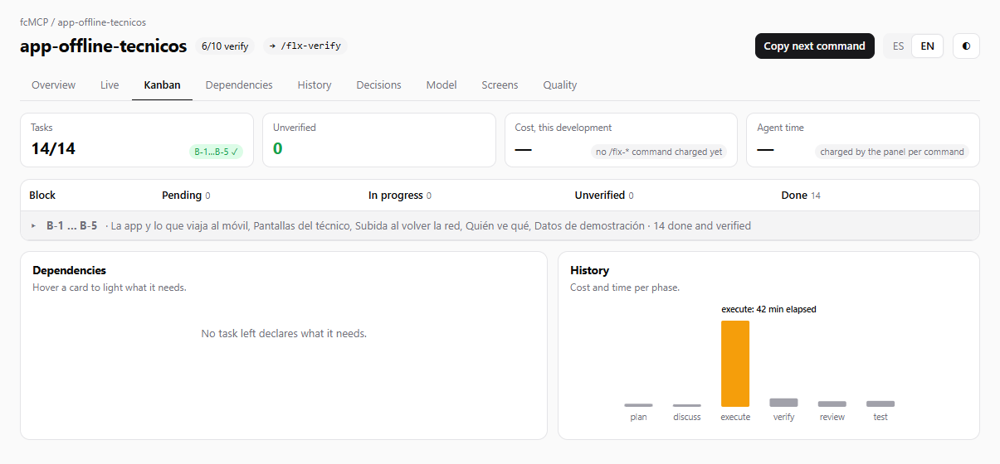

# Panel and board

While you work with the agent, the Flexygo MCP server shows where the development stands without you having to ask. It does so in two places:

- **The Flexygo panel**, inside Claude Code, beside the chat.
- **The developer's board**, a page in the browser with all the detail.

---

## The Flexygo panel

### The band above the chat

In the Claude Code desktop app and in the VS Code extension, the panel is a **band above the text box** with three parts: **Now** (the phase and the command that comes next), **Your call** (what is waiting for a decision of yours) and **Next**.

The band has three modes: full, lite and off.

- **Full** also shows cards with the task ring, what is left to close and the cost per phase.
- **Off** leaves a single pill, **Flexygo ▸**, to open it again. Typing `/flexygo` also brings it back.

Its buttons:

| Button | What it does |
|---|---|
| **Go** | Runs the command that comes next. |
| **Verify** | Shows only when there are unverified tasks. |
| **Start apps** / **Stop apps** | Starts or stops the product's Backend and Frontend, with a dot that says whether they answer. It uses the product's `tools/app.ps1` script, which the server adds if it is missing. |
| **Project** | Opens the `ONBOARDING.md` page. |
| **Board** | Opens the developer's board. |
| **Live view** | Shows the screen being built (see below). |
| **ES / EN** | Changes the panel's language. Spanish is the default. |

The panel also records **the cost and time of each** `/flx-*` **command**, subagents included. They are kept per project on this computer.

!!! note "In the terminal"
    With Claude Code in a terminal there is no band: the panel opens as a side pane with the same information.

### Live view

**Live view** opens the screen being built in the desktop app's built-in browser, beside the chat, and refreshes it after each change.

- If you navigate to another page, it stays where you are and tells you with one line: "Changes in {page}".
- It can be paused.
- It needs the Frontend running. If it is not, the band says so: start the applications first.
- If the panel cannot use that browser, it opens the screen in your own browser and says so. There it does not refresh by itself: press **See** after each change.

---

## The developer's board

The board brings together on one page what is done and what is pending, what is left to verify, the cost and time per command, the data model, the decisions and the quality findings. It shows every Flexygo project on this computer, with its developments.

<figure markdown="span">
  
  <figcaption>The Kanban tab: the state of the blocks, dependencies and cost per phase</figcaption>
</figure>

Its tabs are **Overview**, **Live**, **Kanban**, **Dependencies**, **History**, **Decisions**, **Model**, **Screens** and **Quality**. The **Copy next command** button puts the command that comes next on the clipboard, and **ES / EN** changes the language.

### How to open it

- From the band, with the **Board** button.
- From the band, with **Details**, which opens the decisions directly.
- By hand, from the project folder:

```bash
flexygo-mcp --board
```

The board opens only when you ask for it. It is served by a small local server that only answers on this computer and stops by itself after 30 minutes without use. If the project has no Frontend, the board is a static page.

### Live and Point at it

The **Live** tab shows the application beside the conversation, with a box to reply to Claude: what you type there reaches the chat as your next message.

With **Point at it** you ask for changes on the application itself:

1. Press **Point at it**.
2. Click what you want to change: a page, a module, a field, a column, a button, a menu option…
3. Answer **What should change?** and press **Send** (or Enter). Esc cancels.

The message reaches the chat saying which element it is about.

---

## How to turn on the panel and the board

### One-time step: `--enable-panel`

The panel is a Claude Code add-on that ships inside the Flexygo MCP server. For Claude Code to know about it, run this **once per user and computer**, in a terminal:

```bash
flexygo-mcp --enable-panel
```

This command does two things, and nothing else:

1. It copies the panel to the `~/.flexygo-mcp/mods` folder, which is kept when you update the server.
2. It adds one entry to your Claude Code user settings (`~/.claude/settings.json`) that tells it where the panel is.

You do not need to remember the command: when this step is missing, `/flx-setup` asks whether you want to turn it on and only runs it with your yes. The server never runs it on its own, because it writes to your user settings.

Each project turns the panel on in its own `.claude/settings.json`, and the server does that by itself when it starts. If someone turned it off in a project, it stays off.

The panel shows when you open a **new chat or session** of Claude Code in the project.

### Where it works

| Where you use Claude Code | What you see |
|---|---|
| Desktop app | The band above the chat, with **Live view** in the built-in browser. |
| VS Code extension | The band above the chat. With no browser beside the chat, **Live view** opens the screen in your own browser. |
| Terminal | A side pane instead of the band. |
| No interface (`claude -p`) | Nothing to see, but the cost per command is still recorded. |

The **board** does not depend on the panel: it is a browser page and works in every case, also with `flexygo-mcp --board`.

!!! info "Coming soon"
    In an upcoming version the panel will install with one click, with no commands.
