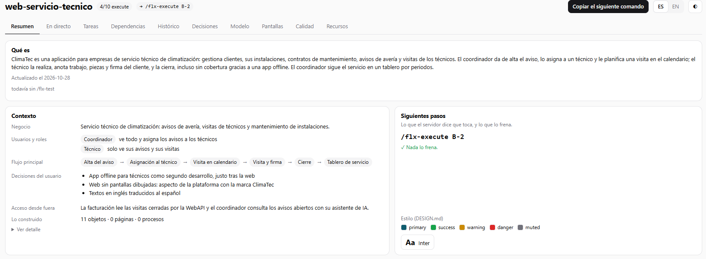
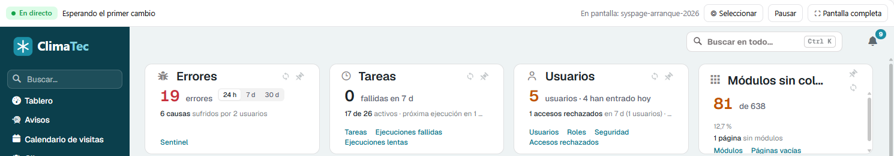

# Panel and board

While you work with the agent, the Flexygo MCP server shows where the development stands without you having to ask. It does so in two places:

- **The Flexygo panel**, inside Claude Code, beside the chat.
- **The developer's board**, a page in the browser with all the detail.

---

## The Flexygo panel

### The band above the chat

In the Claude Code desktop app and in the VS Code extension, the panel is a **one-line band above the text box**. From left to right:

| Part | What it shows | When pressed |
|---|---|---|
| **Flexygo isotype** | Flexygo's mark, in green. | Nothing: it is not a button. |
| **Phase** | The phase with its number out of nine (for example, "6/9 security") and, if a task is under way, its code and title. If it does not fit, it is cut. | Unfolds the nine phases below (see below); another press folds them. |
| **● N %** | The context the chat has used, with a coloured dot. | Explains below what it measures, its value and what each colour says. See [How full the chat is](#how-full-the-chat-is). |
| **● N'** | The minutes this chat's prompt cache has left. | The same: what it measures, its value and what each colour says. |
| **⧉** | Opens the board. | Opens it on the tab that matters now: **Decisions** if a point is open, **Resources** if there are files not yet reviewed and, otherwise, the last one you looked at. |

Each part explains itself when pressed, not on hover, because the VS Code extension does not show those texts.

**The unfolded phases** are numbered 1 to 9: context, plan, decisions, build, review, security, quality, help and, ninth, the API (if the application is used from outside) and the final delivery. Closed ones carry ✓, the current one ▶ and those left ○. Under the current one:

- In **build** and **review**, the block under way with its tasks: ✓ done, ▶ in progress, ○ pending.
- In the others, what is left to close it, in your words: unverified tasks, blocking points or, if none of that is left, what the phase is for.

At the end, apart and unnumbered, comes `/flx-video`, optional: a short video of the product.

The band has no other buttons. Decisions and the live view are on the [board](#the-developers-board), and starting or stopping the applications is in the [side pane](#the-side-pane). There is no verify button either: when a block closes, `/flx-execute` verifies it by itself with recorded walks.

The band is in Spanish. The side pane's **ES / EN** button switches it to English, and the language is kept per project.

The panel also records **the time and API usage price of each agent turn**, subagents included, against the development and phase it is in, whether you typed the `/flx-*` command or the agent ran it itself. Each command you type also gets its own row. The agent's time is recorded apart from the time spent waiting for your answer. Everything is kept per project on this computer. The band shows no money: the price is on the [board](#api-usage-price).

### How full the chat is

The band carries two meters, each with a dot that shifts gradually from green to red.

**Context (● N %)**: how much of this chat's context window is taken. The fuller it is, the more each turn costs and the worse the agent answers.

- **Green**: plenty of room.
- **Amber**: half the way to 80 %.
- **Red**: 80 % or more. Time to carry on in a new chat.

**Prompt cache (● N')**: the minutes this chat's cache has left; it lasts an hour from the last request. While it lasts, each turn reads what was already sent at a lower price; cold (0'), the next turn pays for all of it again. It counts down while the agent works too, and each request renews it. Before the first request it reads cold.

- **Green**: just used.
- **Amber**: half the hour gone.
- **Red**: about to go cold, or cold.

Carrying on in a new chat loses nothing: the agent carries on from the development's [checkpoint](./6Workflow.md#resuming-without-paying-for-the-whole-conversation), not from the conversation. When a chat has grown very long, the assistant itself offers, as a task or a block closes, to carry on in a new one with the command that comes next. It is an offer: if you prefer, you stay in the same chat.

### The side pane

In a terminal there is no band: in a Flexygo project, the panel opens by itself as a **side pane**. Anywhere, `/flexygo` opens it.

It shows:

- The active development and the server's version.
- The phase with its number and the command that comes next, with the **Go** button, which writes it in the text box without sending it.
- The closed blocks, summed up in one line, and the open ones. The block under way carries a progress bar and the mark of each task: ✓ done, ▶ in progress, ○ pending, – skipped.
- What is left to close (unverified tasks, blocking points) and the open decisions, with the command that settles them.
- The phase's time and this computer's total, in time and tokens. No money here either.
- The applications with their port and whether they answer (✓ or ✗), with **Open** for the Frontend and the **Start apps** and **Stop apps** buttons. They use the product's `tools/app.ps1` script, which the server adds if it is missing.
- The **Project** button, which shows `ONBOARDING.md` (with **Back** to return), and **ES / EN** to change the language.

If the server has just refused something (for example, a module that loaded code by hand), the pane shows it in red as **Last refusal**, with the tool, what it was on and when. See [What the agent does not build](./6Workflow.md#what-the-agent-does-not-build).

### The status line

The server also sets, in the project's `.claude/settings.local.json`, the Flexygo **status line**, which Claude Code shows under the text box. It is one line, in English, with:

- the active development, the phase with its number and the command that comes next;
- the tasks done out of the total and what keeps it from closing (unverified, blocking points);
- the task in progress (▶) and the server's last refusal (⛔);
- a warning if the server running is not the version installed, so that you open a new chat;
- from 80 % of context, `context N% → new chat`.

If your settings or the project's already have a status line of their own, it is kept and left as it is.

---

## The developer's board

The board brings together on one page what is done and what is pending, what is left to verify, the API usage price and time, the application's model, its design, who can do what, the decisions and the quality findings. It shows the Flexygo projects on this computer the server has worked on, with their developments, except test benches: copies of another project and folders marked with a `.flexygo-bench` file. The project you open always shows.

<figure markdown="span">
  
  <figcaption>The Overview: what the application is, its context and the next step</figcaption>
</figure>

On the left, under **Flexygo · Builder**, the list of **projects** with their developments. A green dot marks those with a flow under way; the others show folded. Press a project's name to open it even if it has no developments yet. At the foot, when the page was drawn: open the board again, or reload the page, to bring it up to date.

At the top, the development with its phase ("4/9 …") and the command that comes next. On the right:

- **Copy next command** puts the command that comes next on the clipboard.
- **ES / EN** changes the language, and **◐** switches between light and dark. Until you choose, it follows the system's theme.
- On the **Live** tab, **Show projects** or **Hide projects** unfolds or folds the list on the left.

Above the tabs, except on **Live**, the **notices** that matter show: what blocks the phase, the next block or a block (with its reason and the command that solves it), and the server's **last refusal**.

Passwords and keys are masked before they reach the page.

### How to open it

- From the band, with **⧉**.
- By hand, from the project folder:

```bash
flexygo-mcp --board
```

It also takes other projects' folders. With `--tab` and a tab's name (`overview`, `live`, `kanban`, `dependencies`, `history`, `costs`, `decisions`, `model`, `design`, `screens`, `security`, `quality` or `resources`) it opens straight on that tab; for example, `--tab decisions`.

The board opens only when you ask for it. If the project has a Frontend, it is served by a small local server that only answers on this computer and stops by itself after 30 minutes without use; each chat message counts as use. If it has none, the board is a static page, with no live view and no resource uploads.

### The tabs, one by one

While the project is in the context phase, **Resources** becomes the second tab, because it is what you are working on.

| Tab | What it shows | When to look at it |
|---|---|---|
| **Overview** | **What it is**: the application in two or three sentences (`/flx-context` writes it and `/flx-review` keeps it current), with how the last tests went. The **context** in short lines: business, users and roles, main flow, requirements and resources, your decisions, access from outside and what has been built, with **See the detail** and how the business flows according to `ONBOARDING.md`. The **next steps**: what comes next and what holds it. The **environment** (connections, the applications' addresses and the product's and server's versions) and the **style** from `DESIGN.md`, with its colours and typeface. | To understand the project at a glance or show it to someone. |
| **Live** | The application beside a chat with Claude. See [Live](#live-the-application-and-the-chat-with-claude). | To see what is being built and ask for changes by pointing. |
| **Kanban** | At the top, four figures: tasks done, unverified, the development's API usage price and agent time. Below, a board per block with the columns **Pending**, **In progress**, **Unverified** and **Done**; each task says what it needs (🔒 if it waits for something not done), whether it runs in parallel and whether it has an open point. Closed blocks fold away. | To follow progress task by task. |
| **Dependencies** | The same four figures and a graph of what is left: the arrow goes from what a task needs to the task. | To see what holds what. |
| **History** | Everything that happened in the development, with its time: phases, blocks, tasks, verifications, tests, refusals, decisions, commands, quick changes and incidents, with a filter by kind. Each row says which command it happened under, and each command, its API usage price and its time. | To know what was done and when. |
| **Costs** | See [API usage price](#api-usage-price). | To know what each phase and each command cost. |
| **Decisions** | First the open points **that block**, then those that do not. Then every recorded decision, the development's and the project's (marked **P**), with its question, its answer and what it affects, with a filter by text or task. At the end, the plan's **assumptions** and the **corrections** you have made to the assistant. | When the assistant waits for your decision, or to remember why something is the way it is. |
| **Model** | The application as a diagram: its menu, pages, objects, processes and roles, read from the configuration database (read only). See [The model, as a diagram](#the-model-as-a-diagram). | To understand or review how the application is made. |
| **Design** | The **style** `DESIGN.md` decided (the colours and the typography), where each design came from and the **reference screens** the development filed as its design, with their origin. Press one to see it whole. | To compare what was built with what was wanted. |
| **Screens** | Each page with its object, the tasks that built it, its help (guided tour, help button, field help) and a link to open it while the applications are running. If there is a design, a green, amber or red light for how it matches, compared when each block closes, with what fails (a module that does not exist, boxes that overlap, a title that does not fit, a colour off the palette…). The structure and the colours stored in the configuration are compared, not the pixels; a blue bar marks the screens that changed in that block. | To review the screens one by one. |
| **Security** | Each role with its users (with their profile, and whether they are locked) and the explicit permissions on the product's objects (view, create, edit, delete), processes, pages and menu. An administrator role gets through everything. If there is no explicit permission at all, it says so: every role that can sign in sees everything. Read only; passwords are never read. | To review who can do what and which user to try each role with. |
| **Quality** | Three figures: tests green, verifications and what `/flx-quality` reviewed. **Each task with its latest check** and its screenshot, which enlarges when pressed. The **open quality findings**, the review's **deviations** and **what the server could not do** in this project. | Before calling the development closed. |
| **Resources** | The project's `{Product}.Resources/` folder. See [Resources](#resources). | To leave the material it is built from. |

### The model, as a diagram

The **Model** tab draws the whole application except the fields, which show in each object's detail.

- At the top, one button per kind of piece (menu, pages, objects, processes and roles), with how many there are, to show or hide them. Roles start hidden.
- **−** and **+** zoom out and in, **Fit** frames everything and **Rearrange** lays the pieces out again.
- Drag the background to move around, use the wheel to zoom and drag a piece to place it.

Pressing a piece lights its path (its parents and its children) and its detail shows on the right:

- **An object**: what it hangs from and what it holds, its pages, its menu entry, its processes, what runs before and after it is loaded, inserted, changed or deleted, and its fields with their label, type and whether they are required.
- **A page, a process or a menu option**: what it opens and where it is reached from.
- **A role**: its users and what it is granted.

Each piece also says what each role can do with it: by an explicit rule, or by Flexygo's default rule (with no rule, any signed-in role can; someone not signed in, only what is granted to them). From the detail there are links to open the piece in the application and in its Flexygo settings. The diagram also points out the processes no object offers.

### API usage price

The board shows the **API usage price**: what the agent's work would cost at Anthropic API prices. It is worked out the way Claude Code works out `/cost`, with its price table per model and the real tokens of each turn.

- In **Costs**: the whole project's total, this development's, the agent's time and what was spent before a development was opened (setup, context, design). Below, a chart of price and time per phase: hovering over a bar shows the agent's time and the time spent waiting for your answer, with how many questions it asked you. And, at the end, each command you typed, with when, in which development and phase, its price and its time.
- In **History**, each command's.
- In **Kanban** and **Dependencies**, the development's total.

Each turn is charged to the development and phase the project is in when it ends, whether you typed the command or the agent ran it.

If you use Claude Code with a subscription, that is not what you pay: the real cost is not known. It is there to compare phases and developments with each other. It only shows on the board: the band shows no money.

### Resources

The **Resources** tab shows the project's `{Product}.Resources/` folder: the material it is built from. The folder travels with git. Drop files there, or choose them, to upload them; you can also add a link with a note on what it is and why it matters.

- It takes images, PDF, Office documents, CSV, text, JSON, XML and zip, up to 50 MB per file and 300 MB in all.
- Each file shows with its size and date, as **new** until `/flx-context` reads it, and then as **reviewed**. Images show as thumbnails.
- **Delete** removes a file from the folder, after you confirm; it cannot be undone.
- To upload or delete files, the board has to be opened from the project and served with its Frontend.

### Live: the application and the chat with Claude

The **Live** tab shows the application beside a conversation with Claude. The board itself serves the chat by calling Claude Code on this computer, so **it keeps working even if you close the editor**. The conversation is the same one the editor sees: open it there and you find it as the board left it.

- At the top you choose the project's conversation, or start one with **+ New**. Enter sends; the answer arrives as it is generated, and **■ Stop** cuts it.
- If another window has just written in that same conversation, the board shows it as **open in** that window and does not let you write in it, so two do not write at once. Write there or open a new one here.
- From the board, Claude may only use Flexygo's tools. If it tries another one, a **Permission refused** card shows what it wanted to do; **Allow this time and retry** lets it through that once, and **Ignore** dismisses it.
- When the assistant asks you a question with options, it also shows here, as in the editor's dialog: one tab per question, its options and **Other** to write your own. **Send answers** is enabled once every question has an answer. Whichever answer comes first counts, this one or the editor's, and the editor's dialog closes by itself; the dialog itself mentions that you can also answer from here.
- It needs Claude Code installed and signed in on this computer. If either is missing, the board says so in a card.

!!! note "Cost"
    Each message of the board's chat loads the project's context again, so it costs more than a message in the editor's chat.

<figure markdown="span">
  
  <figcaption>The application on the Live tab, with Select, Pause and Full screen</figcaption>
</figure>

If the application does not answer, the board starts it with the product's `tools/app.ps1` script. If it cannot, it says so and what to do: build the solution if it is not built yet, start it by hand if the project has no such script, or open the board again if it took more than 5 minutes.

With **Select** you ask for changes on the application itself:

1. Press **Select**.
2. Click what you want to change: a page, a module, a field, a column, a row, a button, a menu option, a tab, a card, a kanban lane, an event…
3. Answer **What should change?** and press **Ask Claude** (or Enter). Esc cancels.

The message reaches the conversation saying which element it is about.

The view follows by itself the screen the assistant is working on ("Following…"), and the bar says which screen you have in front of you. With **Pause** it stays still while you look; if another screen changes meanwhile, it tells you and **See** takes you there. **Full screen** enlarges the application.

To sign in to the application, the board uses the `admin` user. If it still has the factory password, it signs in and warns you to change it; if it no longer does, it asks you for it and only keeps it while the page stays open. If the application shows its data collection notice, the board accepts it and says so in the chat.

---

## How to turn on the panel and the board

### One-time step: `--enable-panel`

The panel is a Claude Code add-on that ships inside the Flexygo MCP server. For Claude Code to know about it, run this **once per user and computer**, in a terminal:

```bash
flexygo-mcp --enable-panel
```

This command:

1. Copies the panel to the `~/.flexygo-mcp/mods` folder, which is kept when you update the server; the server brings it up to date each time it starts.
2. Adds **one single entry** to your Claude Code user settings (`~/.claude/settings.json`) that tells it where the panel is. If that file cannot be read, it changes nothing and says so.
3. If you run it from a Flexygo project's folder, it also turns the panel on in that project.

You do not need to remember the command: while this step is missing, the assistant tells you when you start and offers to do it, and `/flx-setup` proposes it too. It only runs it with your yes. The server never runs it on its own, because it writes to your user settings. If the project already declares the panel in its own `.claude/settings.json`, Claude Code finds it without this step.

Each project turns the panel on in its own `.claude/settings.json`, and the server does that by itself when it starts. If someone turned it off in a project, it stays off.

The panel shows when you open a **new chat or session** of Claude Code in the project: it does not appear in the chat that was already open.

!!! warning "disableAllHooks"
    Neither the panel nor the status line works if `disableAllHooks` is set in any Claude Code settings.

### Where it works

| Where you use Claude Code | What you see |
|---|---|
| Desktop app | The band above the chat. `/flexygo` opens the side pane. |
| VS Code extension | The band above the chat. `/flexygo` opens the side pane. |
| Terminal | The side pane, which opens by itself in a Flexygo project, and the status line. |
| No interface (`claude -p`) | Nothing to see, but the API usage price is still recorded. |
| Claude Desktop without Claude Code, claude.ai | No panel. |

The **board** does not depend on the panel: it is a browser page and works in every case, also with `flexygo-mcp --board`.
