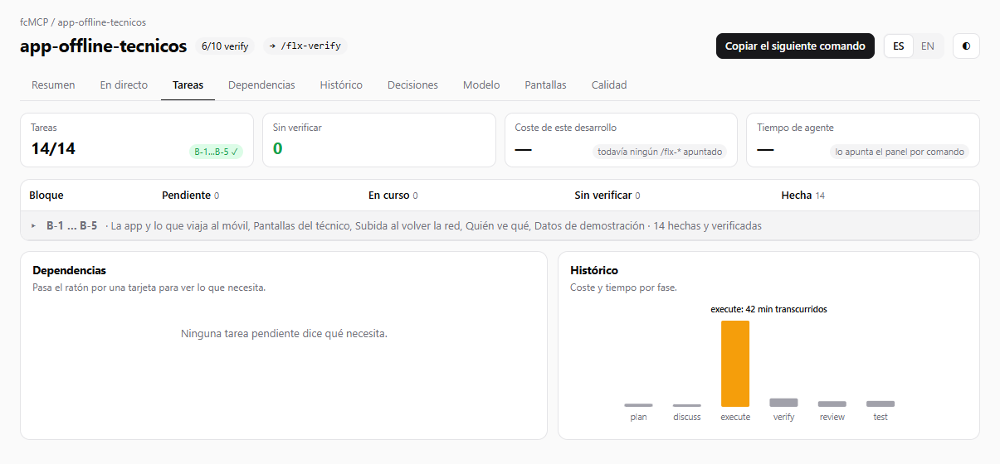

# Panel y tablero

Mientras trabajas con el agente, el servidor MCP de Flexygo enseña dónde está el desarrollo sin que tengas que preguntarlo. Lo hace en dos sitios:

- **El panel de Flexygo**, dentro de Claude Code, junto al chat.
- **El tablero del desarrollador**, una página en el navegador con todo el detalle.

---

## El panel de Flexygo

### La banda sobre el chat

En la aplicación de escritorio de Claude Code y en la extensión de VS Code, el panel es una **banda encima del cuadro de texto** con tres apartados: **Ahora** (la fase y el comando que toca), **Te toca decidir** (lo que espera una decisión tuya) y **Siguiente**.

La banda tiene tres modos: completa, ligera y apagada.

- **Completa** muestra además tarjetas con el anillo de tareas, lo que falta para cerrar y el coste por fase.
- **Apagada** deja solo una pastilla, **Flexygo ▸**, para volver a abrirla. También vuelve escribiendo `/flexygo`.

Sus botones:

| Botón | Qué hace |
|---|---|
| **Ir** | Lanza el comando que toca. |
| **Verificar** | Aparece solo si hay tareas sin verificar. |
| **Arrancar apps** / **Parar apps** | Arranca o para el Backend y el Frontend del producto, con un punto que dice si responden. Lo hace con el script `tools/app.ps1` del producto, que el servidor añade si falta. |
| **Proyecto** | Abre la página de `ONBOARDING.md`. |
| **Tablero** | Abre el tablero del desarrollador. |
| **Ver en directo** | Enseña la pantalla que se está construyendo (ver abajo). |
| **ES / EN** | Cambia el idioma del panel. El español es el idioma por defecto. |

El panel apunta además **el coste y el tiempo de cada comando** `/flx-*`, subagentes incluidos. Se guardan por proyecto en este equipo.

!!! note "En la terminal"
    Con Claude Code en una terminal no hay banda: el panel se abre como un panel lateral con la misma información.

### Ver en directo

**Ver en directo** abre la pantalla que se está construyendo en el navegador integrado de la aplicación de escritorio, al lado del chat, y la refresca tras cada cambio.

- Si navegas a otra página, se queda donde estás y te avisa con una línea: «Hay cambios en {página}».
- Se puede pausar.
- Necesita el Frontend arrancado. Si no lo está, la banda lo dice: arranca antes las aplicaciones.
- Si el panel no puede usar ese navegador, abre la pantalla en tu navegador y lo avisa. Ahí no se refresca sola: pulsa **Ver** tras cada cambio.

---

## El tablero del desarrollador

El tablero reúne en una página lo hecho y lo pendiente, lo que falta verificar, el coste y el tiempo por comando, el modelo de datos, las decisiones y los hallazgos de calidad. Enseña todos los proyectos Flexygo de este equipo, con sus desarrollos.

<figure markdown="span">
  
  <figcaption>La pestaña Tareas: estado de los bloques, dependencias y coste por fase</figcaption>
</figure>

Sus pestañas son **Resumen**, **En directo**, **Tareas**, **Dependencias**, **Histórico**, **Decisiones**, **Modelo**, **Pantallas** y **Calidad**. El botón **Copiar el siguiente comando** deja en el portapapeles el comando que toca, y **ES / EN** cambia el idioma.

### Cómo se abre

- Desde la banda, con el botón **Tablero**.
- Desde la banda, con **Detalles**, que abre directamente las decisiones.
- A mano, desde la carpeta del proyecto:

```bash
flexygo-mcp --board
```

El tablero se abre solo cuando lo pides. Se sirve desde un pequeño servidor local que solo atiende en este equipo y se para solo tras 30 minutos sin uso. Si el proyecto no tiene Frontend, el tablero es una página estática.

### En directo y Señalar

La pestaña **En directo** enseña la aplicación al lado de la conversación, con una caja para responder a Claude: lo que escribes ahí llega al chat como tu siguiente mensaje.

Con **Señalar** pides cambios sobre la propia aplicación:

1. Pulsa **Señalar**.
2. Haz clic en lo que quieras cambiar: una página, un módulo, un campo, una columna, un botón, una opción de menú…
3. Responde a **¿Qué quieres cambiar?** y pulsa **Enviar** (o Intro). Esc cancela.

El mensaje llega al chat diciendo a qué elemento se refiere.

---

## Cómo activar el panel y el tablero

### Paso único: `--enable-panel`

El panel es un complemento de Claude Code que viene dentro del servidor MCP de Flexygo. Para que Claude Code lo conozca, ejecuta **una vez por usuario y equipo**, en una terminal:

```bash
flexygo-mcp --enable-panel
```

Este comando hace dos cosas, y nada más:

1. Copia el panel a la carpeta `~/.flexygo-mcp/mods`, que se conserva aunque actualices el servidor.
2. Añade una entrada a tu configuración de usuario de Claude Code (`~/.claude/settings.json`) que le dice dónde está el panel.

No hace falta saberse el comando: cuando falta este paso, `/flx-setup` te pregunta si quieres activarlo y solo lo ejecuta con tu sí. El servidor nunca lo ejecuta por su cuenta, porque escribe en tu configuración de usuario.

Cada proyecto enciende el panel en su propio `.claude/settings.json`, y eso lo hace el servidor solo al arrancar. Si alguien lo ha apagado en un proyecto, se queda apagado.

El panel aparece cuando abres un **chat o una sesión nueva** de Claude Code en el proyecto.

### Dónde funciona

| Dónde usas Claude Code | Qué ves |
|---|---|
| Aplicación de escritorio | La banda sobre el chat, con **Ver en directo** en el navegador integrado. |
| Extensión de VS Code | La banda sobre el chat. Sin navegador al lado del chat, **Ver en directo** abre la pantalla en tu navegador. |
| Terminal | Un panel lateral en lugar de la banda. |
| Sin interfaz (`claude -p`) | Nada que ver, pero el coste por comando se sigue apuntando. |

El **tablero** no depende del panel: es una página del navegador y funciona en todos los casos, también con `flexygo-mcp --board`.

!!! info "Próximamente"
    En una versión próxima el panel se instalará con un clic, sin comandos.
