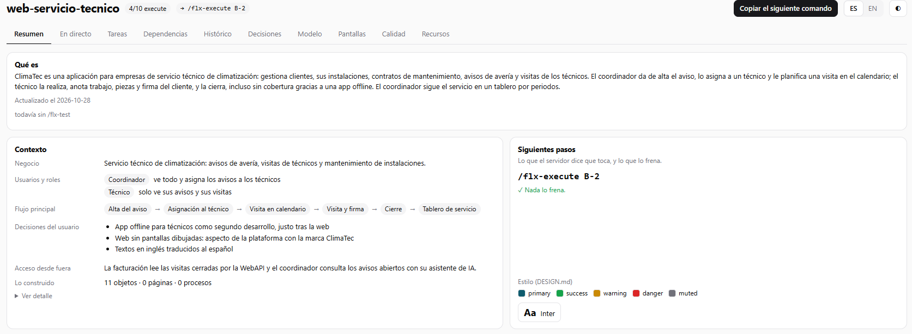
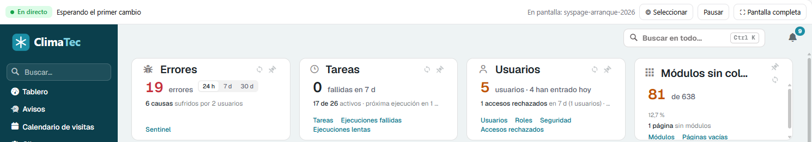

# Panel y tablero

Mientras trabajas con el agente, el servidor MCP de Flexygo enseña dónde está el desarrollo sin que tengas que preguntarlo. Lo hace en dos sitios:

- **El panel de Flexygo**, dentro de Claude Code, junto al chat.
- **El tablero del desarrollador**, una página en el navegador con todo el detalle.

---

## El panel de Flexygo

### La banda sobre el chat

En la aplicación de escritorio de Claude Code y en la extensión de VS Code, el panel es una **banda de una sola línea encima del cuadro de texto**. De izquierda a derecha:

| Parte | Qué enseña | Al pulsarla |
|---|---|---|
| **Isotipo de Flexygo** | La marca de Flexygo, en verde. | Nada: no es un botón. |
| **Fase** | La fase con su número sobre nueve (por ejemplo, «6/9 seguridad») y, si hay una tarea en marcha, su código y su título. Si no cabe, se corta. | Despliega debajo las nueve fases (ver abajo); otra pulsación las pliega. |
| **● N %** | El contexto que lleva gastado el chat, con un punto de color. | Explica debajo qué mide, su valor y qué dice cada color. Consulta [Lo lleno que está el chat](#lo-lleno-que-esta-el-chat). |
| **● N'** | Los minutos que le quedan a la caché del prompt de este chat. | Igual: qué mide, su valor y qué dice cada color. |
| **⧉** | Abre el tablero. | Lo abre en la pestaña que importa ahora: **Decisiones** si hay un punto abierto, **Recursos** si hay ficheros sin revisar y, si no, la última que miraste. |

Cada parte se explica al pulsarla, y no al pasar el ratón, porque la extensión de VS Code no enseña esos textos.

**Las fases desplegadas** van numeradas del 1 al 9: contexto, plan, decisiones, construcción, revisión, seguridad, calidad, ayuda y, la novena, la API (si la aplicación se usa desde fuera) y la entrega final. Las cerradas llevan ✓, la actual ▶ y las que faltan ○. Debajo de la actual:

- En **construcción** y **revisión**, el bloque en curso con sus tareas: ✓ hecha, ▶ en curso, ○ pendiente.
- En las demás, lo que falta para cerrarla, en tus palabras: tareas sin verificar, puntos que bloquean o, si no falta nada de eso, para qué sirve la fase.

Al final, aparte y sin número, sale `/flx-video`, opcional: un vídeo corto del producto.

La banda no tiene más botones. Las decisiones y la vista en directo están en el [tablero](#el-tablero-del-desarrollador), y arrancar o parar las aplicaciones, en el [panel lateral](#el-panel-lateral). Tampoco hay botón de verificar: al cerrar un bloque, `/flx-execute` lo verifica él mismo con recorridos grabados.

La banda sale en castellano. El botón **ES / EN** del panel lateral la cambia a inglés, y el idioma se recuerda por proyecto.

El panel apunta además **el tiempo y el precio de uso por API de cada turno del agente**, subagentes incluidos, en el desarrollo y la fase en que está, tanto si escribiste el comando `/flx-*` como si lo lanzó el propio agente. Cada comando que escribes tiene además su propia fila. El tiempo del agente se apunta aparte del que pasa esperando tu respuesta. Todo se guarda por proyecto en este equipo. La banda no enseña dinero: el precio se ve en el [tablero](#precio-de-uso-por-api).

### Lo lleno que está el chat

La banda lleva dos medidores, cada uno con un punto que pasa poco a poco del verde al rojo.

**Contexto (● N %)**: cuánto de la ventana de contexto de este chat está ocupado. Cuanto más lleno, más cuesta cada turno y peor responde el agente.

- **Verde**: hay sitio de sobra.
- **Ámbar**: a medio camino del 80 %.
- **Rojo**: 80 % o más. Toca seguir en un chat nuevo.

**Caché del prompt (● N')**: los minutos que le quedan a la caché de este chat, que dura una hora desde la última petición. Mientras dura, cada turno lee lo ya enviado a precio reducido; fría (0'), el siguiente turno lo vuelve a pagar entero. Cuenta hacia atrás también mientras el agente trabaja, y cada petición la renueva. Antes de la primera petición sale fría.

- **Verde**: recién usada.
- **Ámbar**: ha pasado media hora.
- **Rojo**: a punto de enfriarse, o fría.

Seguir en un chat nuevo no pierde nada: el agente sigue desde el [punto de control](./6Workflow.md#retomar-el-trabajo-sin-pagar-la-conversacion-entera) del desarrollo, no desde la conversación. Cuando un chat se ha hecho muy largo, el propio asistente te ofrece, al cerrar una tarea o un bloque, seguir en uno nuevo con el comando que toca. Es una oferta: si prefieres, sigues en el mismo.

### El panel lateral

En una terminal no hay banda: en un proyecto de Flexygo, el panel se abre solo como **panel lateral**. En cualquier sitio, `/flexygo` lo abre.

Enseña:

- El desarrollo activo y la versión del servidor.
- La fase con su número y el comando que toca, con el botón **Ir**, que lo escribe en el cuadro de texto sin enviarlo.
- Los bloques cerrados, resumidos en una línea, y los abiertos. El bloque en curso lleva una barra de avance y la marca de cada tarea: ✓ hecha, ▶ en curso, ○ pendiente, – omitida.
- Lo que falta por cerrar (tareas sin verificar, puntos que bloquean) y las decisiones abiertas, con el comando que las resuelve.
- El tiempo de la fase y el total de este equipo, en tiempo y tokens. Aquí tampoco hay dinero.
- Las aplicaciones con su puerto y si responden (✓ o ✗), con **Abrir** para el Frontend y los botones **Arrancar apps** y **Parar apps**. Lo hacen con el script `tools/app.ps1` del producto, que el servidor añade si falta.
- El botón **Proyecto**, que enseña `ONBOARDING.md` (con **Volver** para regresar), y **ES / EN** para cambiar de idioma.

Si el servidor acaba de rechazar algo (por ejemplo, un módulo que cargaba código a mano), el panel lo enseña en rojo como **Último rechazo**, con la herramienta, sobre qué y cuándo. Consulta [Lo que el agente no construye](./6Workflow.md#lo-que-el-agente-no-construye).

### La línea de estado

El servidor pone además, en el `.claude/settings.local.json` del proyecto, la **línea de estado** de Flexygo, que Claude Code enseña bajo el cuadro de texto. Es una sola línea, en inglés, con:

- el desarrollo activo, la fase con su número y el comando que toca;
- las tareas hechas sobre el total y lo que impide cerrar (sin verificar, puntos que bloquean);
- la tarea en curso (▶) y el último rechazo del servidor (⛔);
- un aviso si el servidor que está en marcha no es la versión instalada, para que abras un chat nuevo;
- desde el 80 % de contexto, `context N% → new chat`.

Si tu configuración o la del proyecto ya tienen su propia línea de estado, se respeta y no se cambia.

---

## El tablero del desarrollador

El tablero reúne en una página lo hecho y lo pendiente, lo que falta verificar, el precio de uso por API y el tiempo, el modelo de la aplicación, su diseño, quién puede qué, las decisiones y los hallazgos de calidad. Enseña los proyectos Flexygo de este equipo en los que ha trabajado el servidor, con sus desarrollos, salvo los bancos de pruebas: las copias de otro proyecto y las carpetas marcadas con un fichero `.flexygo-bench`. El proyecto que abres sale siempre.

<figure markdown="span">
  
  <figcaption>El Resumen: qué es la aplicación, su contexto y el siguiente paso</figcaption>
</figure>

A la izquierda, bajo **Flexygo · Builder**, la lista de **proyectos** con sus desarrollos. Un punto verde marca los que tienen un flujo en marcha; los demás salen plegados. Pulsa el nombre de un proyecto para abrirlo aunque todavía no tenga desarrollos. Al pie, cuándo se dibujó la página: vuelve a abrir el tablero, o recarga la página, para ponerla al día.

Arriba, el desarrollo con su fase («4/9 …») y el comando que toca. A la derecha:

- **Copiar el siguiente comando** deja en el portapapeles el comando que toca.
- **ES / EN** cambia el idioma, y **◐** cambia entre claro y oscuro. Hasta que eliges, sigue el tema del sistema.
- En la pestaña **En directo**, **Mostrar proyectos** u **Ocultar proyectos** despliega o pliega la lista de la izquierda.

Encima de las pestañas, salvo en **En directo**, salen los **avisos** que importan: lo que bloquea la fase, el siguiente bloque o un bloque (con su porqué y el comando que lo resuelve), y el **último rechazo** del servidor.

Las contraseñas y las claves se tapan antes de llegar a la página.

### Cómo se abre

- Desde la banda, con **⧉**.
- A mano, desde la carpeta del proyecto:

```bash
flexygo-mcp --board
```

También admite las carpetas de otros proyectos. Con `--tab` y el nombre en inglés de una pestaña (`overview`, `live`, `kanban`, `dependencies`, `history`, `costs`, `decisions`, `model`, `design`, `screens`, `security`, `quality` o `resources`) se abre directamente en ella; por ejemplo, `--tab decisions`.

El tablero se abre solo cuando lo pides. Si el proyecto tiene Frontend, se sirve desde un pequeño servidor local que solo atiende en este equipo y se para solo tras 30 minutos sin uso; cada mensaje del chat cuenta como uso. Si no lo tiene, el tablero es una página estática, sin la vista en directo ni la subida de recursos.

### Las pestañas, una a una

Mientras el proyecto está en la fase de contexto, **Recursos** pasa a ser la segunda pestaña, porque es lo que estás trabajando.

| Pestaña | Qué enseña | Cuándo mirarla |
|---|---|---|
| **Resumen** | **Qué es** la aplicación, en dos o tres frases (la escribe `/flx-context` y la pone al día `/flx-review`), con cómo salieron las últimas pruebas. El **contexto** en líneas cortas: negocio, usuarios y roles, flujo principal, requisitos y recursos, tus decisiones, acceso desde fuera y lo construido, con **Ver detalle** y cómo funciona el negocio según `ONBOARDING.md`. Los **siguientes pasos**: lo que toca y lo que lo frena. El **entorno** (conexiones, direcciones de las aplicaciones y versiones del producto y del servidor) y el **estilo** de `DESIGN.md`, con sus colores y su tipografía. | Para entender el proyecto de un vistazo o enseñárselo a alguien. |
| **En directo** | La aplicación al lado de un chat con Claude. Consulta [En directo](#en-directo-la-aplicacion-y-el-chat-con-claude). | Para ver lo que se construye y pedir cambios señalando. |
| **Tareas** | Arriba, cuatro cifras: tareas hechas, sin verificar, precio de uso por API del desarrollo y tiempo de agente. Debajo, un tablero por bloques con las columnas **Pendiente**, **En curso**, **Sin verificar** y **Hecha**; cada tarea dice qué necesita (🔒 si espera algo sin hacer), si va en paralelo y si tiene un punto abierto. Los bloques cerrados se pliegan. | Para seguir el avance tarea a tarea. |
| **Dependencias** | Las mismas cuatro cifras y un gráfico de lo que queda: la flecha va de lo que una tarea necesita a la tarea. | Para ver qué frena a qué. |
| **Histórico** | Todo lo que ha pasado en el desarrollo, con su hora: fases, bloques, tareas, comprobaciones, pruebas, rechazos, decisiones, comandos, cambios rápidos e incidencias, con un filtro por tipo. Cada fila dice bajo qué comando pasó, y cada comando, su precio de uso por API y su tiempo. | Para saber qué se hizo y cuándo. |
| **Costes** | Consulta [Precio de uso por API](#precio-de-uso-por-api). | Para saber cuánto costó cada fase y cada comando. |
| **Decisiones** | Primero los puntos abiertos **que bloquean** y después los que no. Después, todas las decisiones apuntadas, las del desarrollo y las del proyecto (marcadas con **P**), con su pregunta, su respuesta y a qué afectan, con un filtro por texto o tarea. Al final, los **supuestos** del plan y las **correcciones** que has hecho al asistente. | Cuando el asistente espera tu decisión, o para recordar por qué algo es como es. |
| **Modelo** | La aplicación como un diagrama: su menú, páginas, objetos, procesos y roles, leídos de la base de configuración (solo lectura). Consulta [El modelo, como diagrama](#el-modelo-como-diagrama). | Para entender o revisar cómo está hecha la aplicación. |
| **Diseño** | El **estilo** que decidió `DESIGN.md` (los colores y la tipografía), de dónde salió cada diseño y las **pantallas de referencia** que el desarrollo archivó como su diseño, con su origen. Pulsa una para verla entera. | Para comparar lo construido con lo que se quería. |
| **Pantallas** | Cada página con su objeto, las tareas que la construyeron, su ayuda (visita guiada, botón de ayuda, ayuda de campos) y un enlace para abrirla mientras las aplicaciones están arrancadas. Si hay diseño, un semáforo verde, ámbar o rojo de cómo se parece, comparado al cerrar cada bloque, con lo que falla (un módulo que no existe, cajas que se pisan, un título que no cabe, un color fuera de la paleta…). Se comparan la estructura y los colores guardados en la configuración, no los píxeles; una barra azul marca las pantallas que cambiaron en ese bloque. | Para revisar las pantallas una a una. |
| **Seguridad** | Cada rol con sus usuarios (con su perfil, y si están bloqueados) y los permisos explícitos sobre los objetos (ver, crear, editar, borrar), procesos, páginas y menú del producto. Un rol administrador pasa por todo. Si no hay ningún permiso explícito, lo avisa: todo rol que puede entrar lo ve todo. Solo lectura; las contraseñas nunca se leen. | Para revisar quién puede qué y con qué usuario probar cada rol. |
| **Calidad** | Tres cifras: pruebas en verde, comprobaciones y lo revisado por `/flx-quality`. **Cada tarea con su última comprobación** y su captura, que se amplía al pulsarla. Los **hallazgos de calidad abiertos**, las **desviaciones** de la revisión y **lo que el servidor no supo hacer** en este proyecto. | Antes de dar el desarrollo por cerrado. |
| **Recursos** | La carpeta `{Producto}.Resources/` del proyecto. Consulta [Recursos](#recursos). | Para dejar el material con el que se construye. |

### El modelo, como diagrama

La pestaña **Modelo** dibuja la aplicación entera salvo los campos, que salen en el detalle de cada objeto.

- Arriba, un botón por tipo de pieza (menú, páginas, objetos, procesos y roles), con cuántas hay, para enseñarlas u ocultarlas. Los roles empiezan ocultos.
- **−** y **+** alejan y acercan, **Encajar** encuadra todo y **Recolocar** vuelve a ordenar las piezas.
- Arrastra el fondo para moverte, usa la rueda para acercar y arrastra una pieza para colocarla.

Al pulsar una pieza se ilumina su camino (sus padres y sus hijos) y a la derecha sale su detalle:

- **Un objeto**: de qué cuelga y qué contiene, sus páginas, su entrada de menú, sus procesos, lo que se ejecuta antes y después de cargarlo, darlo de alta, cambiarlo o borrarlo, y sus campos con su etiqueta, tipo y si son obligatorios.
- **Una página, un proceso o una opción de menú**: lo que abre y desde dónde se llega a él.
- **Un rol**: sus usuarios y lo que tiene concedido.

Cada pieza dice además qué puede hacer cada rol con ella: por una regla explícita o por la regla por defecto de Flexygo (sin regla, puede todo rol con sesión; quien no ha iniciado sesión, solo lo que se le concede). Desde el detalle hay enlaces para abrir la pieza en la aplicación y en su configuración de Flexygo. El diagrama avisa también de los procesos que ningún objeto ofrece.

### Precio de uso por API

El tablero enseña el **precio de uso por API**: lo que costaría el trabajo del agente a precio de la API de Anthropic. Se calcula como lo calcula Claude Code en `/cost`, con su tabla de precios por modelo y los tokens reales de cada turno.

- En **Costes**: el total del proyecto, el de este desarrollo, el tiempo de agente y lo gastado antes de abrir un desarrollo (la preparación, el contexto, el diseño). Debajo, un gráfico del precio y el tiempo por fase: al pasar el ratón por una barra, el tiempo del agente y el que estuvo esperando tu respuesta, con cuántas preguntas te hizo. Y, al final, cada comando que escribiste, con cuándo, en qué desarrollo y fase, su precio y su tiempo.
- En **Histórico**, el de cada comando.
- En **Tareas** y **Dependencias**, el total del desarrollo.

Cada turno se apunta al desarrollo y la fase en que está el proyecto cuando termina, tanto si escribiste el comando como si lo lanzó el agente.

Si usas Claude Code con una suscripción, eso no es lo que pagas: el coste real no se conoce. Sirve para comparar fases y desarrollos entre sí. Solo se ve en el tablero: la banda no enseña dinero.

### Recursos

La pestaña **Recursos** enseña la carpeta `{Producto}.Resources/` del proyecto: el material con el que se construye. La carpeta viaja con git. Arrastra ahí los ficheros, o elígelos, para subirlos; también puedes añadir un enlace con una nota de qué es y por qué importa.

- Admite imágenes, PDF, documentos de Office, CSV, texto, JSON, XML y zip, hasta 50 MB por fichero y 300 MB en total.
- Cada fichero sale con su tamaño y su fecha, como **nuevo** hasta que `/flx-context` lo lee, y después como **revisado**. Las imágenes salen en miniatura.
- **Borrar** quita un fichero de la carpeta, tras confirmarlo; no se puede deshacer.
- Para subir o borrar ficheros, el tablero tiene que estar abierto desde el proyecto y servido con su Frontend.

### En directo: la aplicación y el chat con Claude

La pestaña **En directo** enseña la aplicación al lado de una conversación con Claude. El chat lo atiende el propio tablero, que llama a Claude Code en este equipo, así que **sigue funcionando aunque cierres el editor**. La conversación es la misma que ve el editor: si la abres allí, la encuentras como la dejó el tablero.

- Arriba eliges la conversación del proyecto, o empiezas una con **+ Nueva**. Intro envía; la respuesta llega según se genera, y **■ Detener** la corta.
- Si otra ventana acaba de escribir en esa misma conversación, el tablero la enseña como **abierta en** esa ventana y no deja escribir en ella, para que no escriban dos a la vez. Escribe allí o abre una nueva aquí.
- Desde el tablero, Claude solo puede usar las herramientas de Flexygo. Si intenta usar otra, sale una tarjeta **Permiso rechazado** con lo que quería hacer; **Permitir esta vez y repetir** la deja pasar solo esa vez, e **Ignorar** la descarta.
- Cuando el asistente te hace una pregunta con opciones, sale también aquí, como en el diálogo del editor: una pestaña por pregunta, sus opciones y **Otra** para escribir la tuya. **Enviar respuestas** se activa cuando todas tienen respuesta. Vale la que llegue primero, esta o la del editor, y el diálogo del editor se cierra solo; el propio diálogo avisa de que también puedes contestar desde aquí.
- Necesita Claude Code instalado y con la sesión iniciada en este equipo. Si falta una de las dos cosas, el tablero lo dice en una tarjeta.

!!! note "Coste"
    Cada mensaje del chat del tablero vuelve a cargar el contexto del proyecto, así que cuesta más que un mensaje en el chat del editor.

<figure markdown="span">
  
  <figcaption>La aplicación en la pestaña En directo, con Seleccionar, Pausar y Pantalla completa</figcaption>
</figure>

Si la aplicación no responde, el tablero la arranca con el script `tools/app.ps1` del producto. Si no puede, lo dice y qué hacer: compilar la solución si aún no está compilada, arrancarla a mano si el proyecto no tiene ese script, o volver a abrir el tablero si tardó más de 5 minutos.

Con **Seleccionar** pides cambios sobre la propia aplicación:

1. Pulsa **Seleccionar**.
2. Haz clic en lo que quieras cambiar: una página, un módulo, un campo, una columna, una fila, un botón, una opción de menú, una pestaña, una tarjeta, una columna del kanban, un evento…
3. Responde a **¿Qué quieres cambiar?** y pulsa **Pedir a Claude** (o Intro). Esc cancela.

El mensaje llega a la conversación diciendo a qué elemento se refiere.

La vista sigue sola la pantalla que el asistente está tocando («Siguiendo…»), y la barra dice qué pantalla tienes delante. Con **Pausar** se queda quieta mientras miras; si mientras tanto cambia otra pantalla, lo avisa y **Ver** te lleva a ella. **Pantalla completa** amplía la aplicación.

Para entrar en la aplicación, el tablero usa el usuario `admin`. Si todavía tiene la contraseña de fábrica, entra y te avisa de que la cambies; si ya no la tiene, te la pide y solo la guarda mientras la página siga abierta. Si la aplicación enseña su aviso de recogida de datos, el tablero lo acepta y lo dice en el chat.

---

## Cómo activar el panel y el tablero

### Paso único: `--enable-panel`

El panel es un complemento de Claude Code que viene dentro del servidor MCP de Flexygo. Para que Claude Code lo conozca, ejecuta **una vez por usuario y equipo**, en una terminal:

```bash
flexygo-mcp --enable-panel
```

Este comando:

1. Copia el panel a la carpeta `~/.flexygo-mcp/mods`, que se conserva aunque actualices el servidor; el servidor la pone al día cada vez que arranca.
2. Añade **una sola entrada** a tu configuración de usuario de Claude Code (`~/.claude/settings.json`), que le dice dónde está el panel. Si ese fichero no se puede leer, no cambia nada y lo dice.
3. Si lo ejecutas desde la carpeta de un proyecto de Flexygo, enciende además el panel en ese proyecto.

No hace falta saberse el comando: mientras falta este paso, el asistente te lo dice al empezar y te ofrece hacerlo, y `/flx-setup` también lo propone. Solo lo ejecuta con tu sí. El servidor nunca lo ejecuta por su cuenta, porque escribe en tu configuración de usuario. Si el proyecto ya declara el panel en su propio `.claude/settings.json`, Claude Code lo encuentra sin este paso.

Cada proyecto enciende el panel en su propio `.claude/settings.json`, y eso lo hace el servidor solo al arrancar. Si alguien lo ha apagado en un proyecto, se queda apagado.

El panel aparece cuando abres un **chat o una sesión nueva** de Claude Code en el proyecto: en el chat que ya estaba abierto no sale.

!!! warning "disableAllHooks"
    Ni el panel ni la línea de estado funcionan si `disableAllHooks` está puesto en alguna configuración de Claude Code.

### Dónde funciona

| Dónde usas Claude Code | Qué ves |
|---|---|
| Aplicación de escritorio | La banda sobre el chat. `/flexygo` abre el panel lateral. |
| Extensión de VS Code | La banda sobre el chat. `/flexygo` abre el panel lateral. |
| Terminal | El panel lateral, que se abre solo en un proyecto de Flexygo, y la línea de estado. |
| Sin interfaz (`claude -p`) | Nada que ver, pero el precio de uso por API se sigue apuntando. |
| Claude Desktop sin Claude Code, claude.ai | No hay panel. |

El **tablero** no depende del panel: es una página del navegador y funciona en todos los casos, también con `flexygo-mcp --board`.
