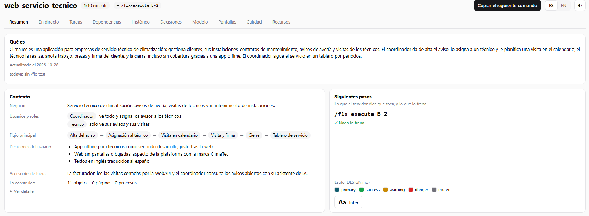
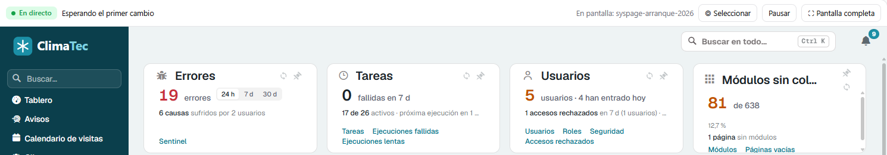

# Panel y tablero

Mientras trabajas con el agente, el servidor MCP de Flexygo enseña dónde está el desarrollo sin que tengas que preguntarlo. Lo hace en dos sitios:

- **El panel de Flexygo**, dentro de Claude Code, junto al chat.
- **El tablero del desarrollador**, una página en el navegador con todo el detalle.

---

## El panel de Flexygo

### La banda sobre el chat

En la aplicación de escritorio de Claude Code y en la extensión de VS Code, el panel es una **banda encima del cuadro de texto** con tres apartados: **Ahora** (la fase y el comando que toca), **Te toca decidir** (lo que espera una decisión tuya) y **Siguiente**.

«Siguiente» y lo que falta por cerrar salen de la misma lista, en tus palabras; si hay más de una cosa, el resto se despliega debajo.

La banda tiene tres modos: completa, mini y oculta.

- **Completa** muestra además tarjetas con el anillo de tareas, lo que falta para cerrar, cómo salió la verificación del último bloque y lo lleno que está el chat.
- **Oculta** deja solo una pastilla, **Flexygo ▸**, para volver a abrirla. También vuelve escribiendo `/flexygo`.

Sus botones:

| Botón | Qué hace |
|---|---|
| **Ir** | Escribe en el cuadro de texto el comando que toca, sin enviarlo. |
| **Arrancar apps** / **Parar apps** | Arranca o para el Backend y el Frontend del producto, con un punto que dice si responden. Lo hace con el script `tools/app.ps1` del producto, que el servidor añade si falta. |
| **Tablero** | Abre el tablero en la pestaña que importa ahora: **Decisiones** si hay una decisión abierta, **Recursos** si hay ficheros sin revisar y, si no, la última que miraste. |
| **Ver en directo** | Enseña la pantalla que se está construyendo (ver abajo). |

Si los botones no caben en una fila, **Ver en directo** y los de las aplicaciones pasan a un menú **…**. Cada decisión abierta lleva un botón por opción, con la recomendada marcada.

No hay botón de verificar: al cerrar un bloque, `/flx-execute` lo verifica él mismo y la banda enseña solo cómo ha ido. La banda sale en castellano.

El panel apunta además **el tiempo y el precio de uso por API de cada comando** `/flx-*`, subagentes incluidos. Se guardan por proyecto en este equipo. La banda no enseña dinero: el precio se ve en el [tablero](#precio-de-uso-por-api).

### Lo lleno que está el chat

La banda enseña cuánto contexto lleva gastado el chat: **contexto N %**. Cuanto más lleno, peor responde el agente, así que avisa a tiempo:

- **Por debajo del 70 %**, queda sitio en este chat.
- **Desde el 70 %**, te pide acabar el paso en curso y seguir en un chat nuevo.
- **Desde el 80 %**, avisa de que a partir de ahí responde peor.

Los avisos citan el porcentaje real, por ejemplo «Contexto al 82 %: …».

Desde el 70 % sale el botón **Nuevo chat y seguir**. Vacía el chat (`/clear`) y, en el chat nuevo, lanza el comando que toca. No se pierde nada: el agente sigue desde el [punto de control](./6Workflow.md#retomar-el-trabajo-sin-pagar-la-conversacion-entera) del desarrollo, no desde la conversación.

Si Claude Code no deja al panel vaciar el chat, la banda te pide que envíes `/clear` tú. El siguiente comando ya está guardado, y se lanza solo al empezar el chat nuevo si lo haces en los 10 minutos siguientes.

<!-- CAPTURA PENDIENTE: la banda con «contexto N %» por encima del 70 % y el botón «Nuevo chat y seguir». -->

!!! note "En la terminal"
    Con Claude Code en una terminal no hay banda: el panel se abre como un panel lateral con la misma información. Ese panel tiene además el botón **Proyecto**, que abre `ONBOARDING.md`, y **ES / EN** para cambiar de idioma.

### Ver en directo

**Ver en directo** abre el tablero en la pestaña **En directo**: la aplicación al lado de un chat con Claude. Consulta [En directo: la aplicación y el chat con Claude](#en-directo-la-aplicacion-y-el-chat-con-claude).

El botón sale cuando el producto tiene su Frontend; si el Frontend no responde, el tablero lo arranca.

---

## El tablero del desarrollador

El tablero reúne en una página lo hecho y lo pendiente, lo que falta verificar, el precio de uso por API y el tiempo por comando, el modelo de datos, las decisiones y los hallazgos de calidad. Enseña todos los proyectos Flexygo de este equipo, con sus desarrollos, salvo los bancos de pruebas: las copias de otro proyecto y las carpetas marcadas con un fichero `.flexygo-bench`. El proyecto que abres sale siempre.

<figure markdown="span">
  
  <figcaption>El Resumen: qué es la aplicación, su contexto y el siguiente paso</figcaption>
</figure>

Sus pestañas son **Resumen**, **En directo**, **Tareas**, **Dependencias**, **Histórico**, **Decisiones**, **Modelo**, **Pantallas**, **Calidad** y **Recursos**. El botón **Copiar el siguiente comando** deja en el portapapeles el comando que toca, y **ES / EN** cambia el idioma.

El **Resumen** empieza por lo que es la aplicación, en dos o tres frases: para qué sirve, para quién y su flujo principal. La escribe `/flx-context` y la pone al día `/flx-review`. Debajo, en líneas cortas, el negocio, los usuarios y roles, el flujo, tus decisiones, si se usa desde fuera y lo construido.

### Cómo se abre

- Desde la banda, con el botón **Tablero**.
- A mano, desde la carpeta del proyecto:

```bash
flexygo-mcp --board
```

Con `--tab decisions` se abre directamente en esa pestaña.

El tablero se abre solo cuando lo pides. Se sirve desde un pequeño servidor local que solo atiende en este equipo y se para solo tras 30 minutos sin uso; cada mensaje del chat cuenta como uso. Si el proyecto no tiene Frontend, el tablero es una página estática.

### Precio de uso por API

El tablero enseña el **precio de uso por API**: lo que costaría el trabajo del agente a precio de la API de Anthropic. Se calcula como lo calcula Claude Code en `/cost`, con su tabla de precios por modelo y los tokens reales de cada turno.

- En **Histórico**, por comando y por fase.
- En **Tareas** y **Dependencias**, el total del desarrollo.

Si usas Claude Code con una suscripción, eso no es lo que pagas: el coste real no se conoce. Sirve para comparar fases y desarrollos entre sí. Solo se ve en el tablero: la banda no enseña dinero.

<!-- CAPTURA PENDIENTE: el Histórico del tablero con la columna «Precio de uso por API» y el gráfico por fase. -->

### Recursos

La pestaña **Recursos** enseña la carpeta `Resources/` del proyecto: el material con el que se construye. Arrastra ahí los ficheros, o elígelos, para subirlos; también puedes añadir un enlace con una nota de qué es y por qué importa.

- Admite imágenes, PDF, documentos de Office, CSV, texto, JSON, XML y zip, hasta 50 MB por fichero y 300 MB en total.
- Cada fichero sale como **nuevo** hasta que `/flx-context` lo lee, y después como **revisado**.
- Para subir ficheros, el tablero tiene que estar abierto desde el proyecto y servido con su Frontend.

### En directo: la aplicación y el chat con Claude

La pestaña **En directo** enseña la aplicación al lado de una conversación con Claude. El chat lo atiende el propio tablero, que llama a Claude Code en este equipo, así que **sigue funcionando aunque cierres el editor**.

- Arriba eliges la conversación del proyecto, o empiezas una con **+ Nueva**. La respuesta llega según se genera, y **■ Detener** la corta.
- Si otra ventana acaba de escribir en esa misma conversación, el tablero la enseña como **abierta en** esa ventana y no deja escribir en ella, para que no escriban dos a la vez. Escribe allí o abre una nueva aquí.
- Desde el tablero, Claude solo puede usar las herramientas de Flexygo. Si intenta usar otra, sale una tarjeta **Permiso rechazado** con lo que quería hacer; **Permitir esta vez y repetir** la deja pasar solo esa vez.
- Necesita Claude Code instalado y con la sesión iniciada en este equipo. Si falta una de las dos cosas, el tablero lo dice en una tarjeta.

!!! note "Coste"
    Cada mensaje del chat del tablero vuelve a cargar el contexto del proyecto, así que cuesta más que un mensaje en el chat del editor.

<figure markdown="span">
  
  <figcaption>La aplicación en la pestaña En directo, con Seleccionar, Pausar y Pantalla completa</figcaption>
</figure>

Con **Seleccionar** pides cambios sobre la propia aplicación:

1. Pulsa **Seleccionar**.
2. Haz clic en lo que quieras cambiar: una página, un módulo, un campo, una columna, un botón, una opción de menú…
3. Responde a **¿Qué quieres cambiar?** y pulsa **Enviar** (o Intro). Esc cancela.

El mensaje llega a la conversación diciendo a qué elemento se refiere.

---

## Cómo activar el panel y el tablero

### Paso único: `--enable-panel`

El panel es un complemento de Claude Code que viene dentro del servidor MCP de Flexygo. Para que Claude Code lo conozca, ejecuta **una vez por usuario y equipo**, en una terminal:

```bash
flexygo-mcp --enable-panel
```

Este comando hace dos cosas, y nada más:

1. Copia el panel a la carpeta `~/.flexygo-mcp/mods`, que se conserva aunque actualices el servidor.
2. Añade una entrada a tu configuración de usuario de Claude Code (`~/.claude/settings.json`) que le dice dónde está el panel.

No hace falta saberse el comando: cuando falta este paso, `/flx-setup` te pregunta si quieres activarlo y solo lo ejecuta con tu sí. El servidor nunca lo ejecuta por su cuenta, porque escribe en tu configuración de usuario.

Cada proyecto enciende el panel en su propio `.claude/settings.json`, y eso lo hace el servidor solo al arrancar. Si alguien lo ha apagado en un proyecto, se queda apagado.

El panel aparece cuando abres un **chat o una sesión nueva** de Claude Code en el proyecto.

### Dónde funciona

| Dónde usas Claude Code | Qué ves |
|---|---|
| Aplicación de escritorio | La banda sobre el chat. **Ver en directo** abre el tablero en la pestaña En directo. |
| Extensión de VS Code | La banda sobre el chat, con el modo en un desplegable. **Ver en directo** abre el tablero en la pestaña En directo. |
| Terminal | Un panel lateral en lugar de la banda. |
| Sin interfaz (`claude -p`) | Nada que ver, pero el precio de uso por API de cada comando se sigue apuntando. |

El **tablero** no depende del panel: es una página del navegador y funciona en todos los casos, también con `flexygo-mcp --board`.

!!! info "Próximamente"
    En una versión próxima el panel se instalará con un clic, sin comandos.
