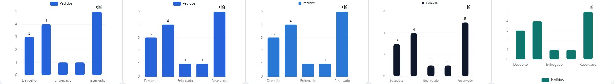
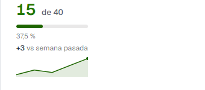
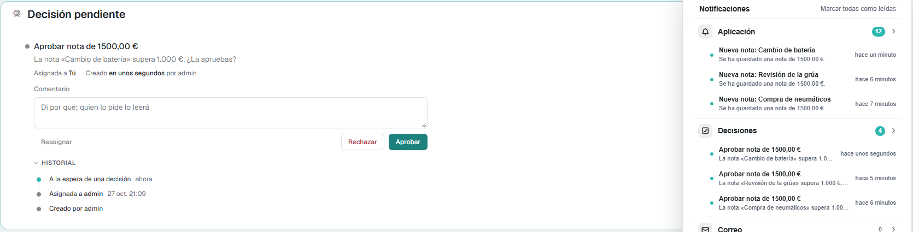
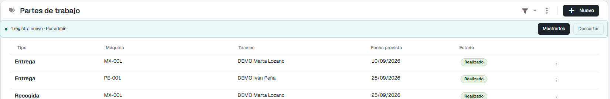
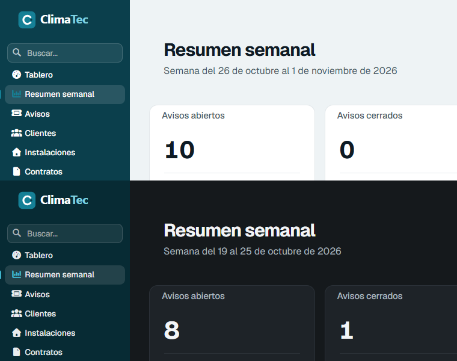
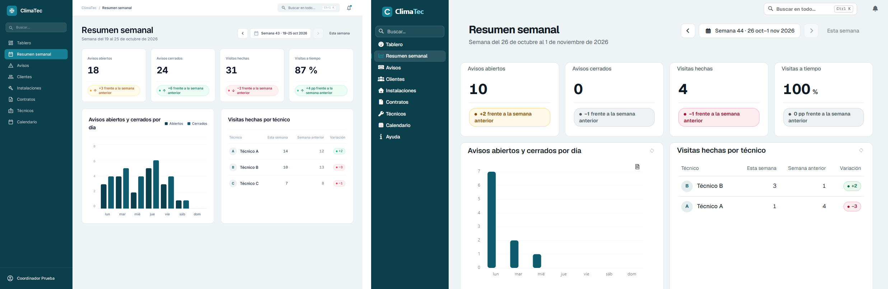
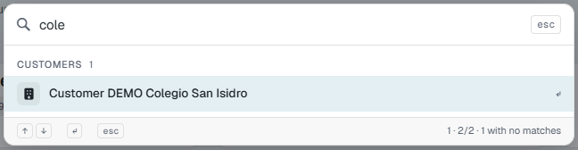

# What it builds on Flexygo 10

With a project on **Flexygo 10**, the MCP server uses what this version brings: ECharts charts, KPI cards, rules on save, live notices, REST objects, brand and account screens…

The agent knows which platform version the project runs on (`/flx-status` says it). If it cannot tell, or the version is older than 10, it builds the way it did before and tells you so.

## ECharts charts and themes

On Flexygo 10 every chart is **ECharts**: ten types (bars, lines, doughnut, radar…). It can also:

- put the total in the centre of a doughnut;
- add a target line;
- put the unit after every figure;
- add a footer line with the change ("+12% vs last month"), drawn in the 2026 skin;
- keep the chart's data in the browser for a number of seconds, so it is not asked for again on every visit.

Figures follow the user's language format (`35,000` in English, `35.000` in Spanish).

If you ask for no theme, the chart uses Flexygo 10's default one. It can also create a **theme of the product's own**, with its colours and the shapes of one of the factory themes, without touching the factory themes, which every application shares.

<figure markdown="span">
  
  <figcaption>The same chart with the factory themes and, on the right, a theme of its own created by the agent</figcaption>
</figure>

## KPI cards

KPI modules (*easy info*) are drawn as **cards**. A card can carry:

- the change and the trend;
- a target with its progress bar;
- a small chart of the evolution;
- action links;
- a period switch (24 h, 7 days, 30 days), which remembers the user's choice.

The colour follows the skin and dark mode. The strip of figures above a list is **one module**, with a row per figure: each row is drawn as its own card.

In `/flx-discuss`, the agent asks which figures open the home page: the figure, the period, what it is compared with and which colour means "bad".

<figure markdown="span">
  
  <figcaption>A card with a target, the change and the evolution</figcaption>
</figure>

## Rules on save and decisions

For what must happen **when a record is saved**, the agent creates an **object rule** instead of a scheduled job. The rule fires on insert, update or delete, and can carry conditions:

- the record matches a condition;
- a column has changed;
- a column has changed to a given value.

What it does can be:

- send a notice to the bell of a role or a user;
- send an email, also with a reusable mail template;
- create or update records;
- run a process;
- ask for a **decision**: a task with options, a deadline and escalation, approved or rejected from the bell or from the record.

The rule acts after the save: if its step fails, what was saved stays. The agent can show you an object's rules with their latest runs, tell you which would fire for a given record, and delete a rule, warning first about what goes with it.

In `/flx-discuss`, the agent asks which steps need a person's approval: who decides, what the answers are and how long before it goes to someone else.

<figure markdown="span">
  
  <figcaption>A rule asks to approve notes over €1,000: the decision shows on the record and in the bell</figcaption>
</figure>

## Live notices

The agent can turn on an object's **live notices**, so connected users see the records others save without reloading. The notice carries no data from the record: each user asks for it again with their own session, so only those who may see it do, with the object's security and its filters. It can also be narrowed to whom each record concerns (for instance, each salesperson and their own orders).

What reaches each module, in the 2026 skin:

| Module | Inserts | Updates and deletes |
|---|---|---|
| List | Yes: a "Show them" strip on the module bar | No |
| Planner | Yes | No |
| Kanban | Yes: it draws the card | No |
| Calendar | Yes | Yes |
| Timeline | No | No |
| Another page | Yes: a notice at the bottom right | No |

Live notices are addressed to no one in particular. To leave a notice in the bell of a role or a user, use a rule on save.

<figure markdown="span">
  
  <figcaption>Another user has added a work order: the list says so and shows it on "Show them"</figcaption>
</figure>

## REST objects

An object can keep its records in another system, behind a REST API. The agent registers the service, with its address, authentication and paging, and then creates the objects that read from it: the paths to list, read, insert, update (with PUT or PATCH) and delete, and their fields. A list's filters and sort order can be passed to the API itself. The service's key is never repeated in the answers: the agent asks you for it.

In `/flx-discuss`, the agent asks whether any record (a customer, a product, a price) already lives in another system.

## Brand, account screens and maintenance

The agent places the brand files with the names Flexygo 10 expects:

- the logo and its variant for dark backgrounds;
- the symbol for the folded sidebar;
- the browser icon;
- the image of the account screens and the one of the maintenance page.

It also styles the account screens (sign-in, registration, forgotten password, two-factor and password change) and the maintenance page. It never turns maintenance mode on or off: an administrator does that.

<figure markdown="span">
  
  <figcaption>The product's logo in the sidebar, light and dark</figcaption>
</figure>

## What the platform already does well stays

A design reference (a mock-up, a screenshot, a screen from another tool) may lack something Flexygo 10 already does well: the top bar with the notices bell and the Ctrl+K search, the control panel or the user menu. **The reference leaving it out is no reason to remove it**: it is the reference that is wrong.

- The agent never removes or hides a working platform element on its own. It only does so if you decide it, and the decision is recorded.
- When comparing with the reference, that difference closes as "the reference is wrong": the platform's element stays, with a note saying which one.
- Putting the brand in the side panel does not remove the top bar.
- The platform's interfaces (origin 0) are not changed, because the platform's own profiles share them: for a header or a menu of its own, the agent creates a project interface and profile. It only changes the platform's one if you decide it, and the decision is recorded.
- In the quality review, each block's walk checks that the top bar is still there with its bell, that Ctrl+K opens the search and finds a record, and that every menu option has its label. Every screen is checked in light and in dark, in the user's language.

<figure markdown="span">
  
  <figcaption>The Stitch reference and the built screen: it follows its design and keeps the top bar with the Ctrl+K search and the bell</figcaption>
</figure>

## The platform's piece before hand-written code

On Flexygo 10, for everything a screen needs the agent uses the platform's piece, which draws from the data, follows the skin and dark mode and needs no CSS: a card for a figure, an ECharts chart, a rule on save, a REST object, the free layout to place the modules where the design puts them, filters and presets to filter a list. When an HTML module or a SQL list that does what a standard module does is saved, the agent gets a warning and changes the module, or writes down why not.

## The project's JavaScript

All the JavaScript the agent writes lives in **project plugins**, registered like any library. A module's `JSAfterLoad` is a call into that plugin.

**What is not saved.** When a plugin or a module is written, code is refused that:

- loads another library by hand, from code or from an outside address: a third-party library goes in the project, as a plugin of its own;
- filters the rows by the signed-in user in the browser: which rows each role sees is decided by the object's security, on the server;
- calls an outside service from the browser: what comes from outside is read by the server, with a job or a process, and kept in a table;
- decides by the administrator role in the browser: who may do what is decided by the platform's security.

Also, an interface carries no JavaScript of its own: creating or changing an interface with a script is refused (it can only be emptied). And a plugin reads its data with `flexygo.obj.Entity` or `getView`, which apply the object's security, never from a hidden SQL list.

**If you are about to write this, the platform already has it.** Before writing a function, the agent looks at this table in its reference:

| You were about to write | Use |
|---|---|
| A checkbox column and "apply to the selected" | The list's own selection and a process launched on it from the toolbar |
| Reading rows from the DOM or from a hidden list | `flexygo.obj.Entity` / `getView` |
| An observer, a `setInterval` or a loop until a module paints | The module's `JSAfterLoad`, or the module's `loaded` event |
| Refreshing modules after an action | Module events with `refresh`, or the module's `refresh()` |
| A table with fields to edit | The editable list (`flx-editlist`) |
| "Save and keep entering" | The save-and-create-another button the edit toolbars already carry |
| A KPI card or a strip of figures | `flx-easyinfo` in card mode, never a SQL list |
| A board where moving a card runs a process | The kanban with its process on changing column |
| A guided help or a help panel | Guided tours and the application's help |
| Filter buttons over a list | Presets |
| Cards or a table, chosen by the user | Two templates of the object and `changeTemplate()` |
| Formatting dates and numbers by hand | The template's `date` and `decimal` modifiers, and `moment` for date arithmetic |
| A translation function of its own | `flexygo.localization.translate` |
| An HTML escape of its own | `flexygo.string.escapeHTML`, or the `html` modifier in the template |
| Its own toasts, `alert` or `confirm` | `flexygo.msg` |
| `localStorage` by hand | `flexygo.storage` |

**The JavaScript audit.** The security audit of `/flx-release` (see [Workflow with commands](./6Workflow.md)) reads the files of the project's plugins, the script of interfaces and pages, and the modules' code, and flags:

| Severity | What |
|---|---|
| High | A row filter built with the signed-in user; a decision by the administrator role in the browser; a key, a token or a password written into code the browser downloads; a `{{Field}}` painted without the `html` modifier in templates, HTML modules or SQL lists; a view whose SQL pastes a `{{token}}` without quotes |
| Medium | An outside service called from the browser; code loaded by hand; running text as code, pasting data as markup or making synchronous calls; an unexpected error reaching the screen as it is; procedures that build SQL by pasting values |
| Low | What re-makes a platform piece, naming the one to use; HTML modules with no recorded gap that justifies them |

Also, the quality review puts beside each screen how many of its modules are standard and how many lines of its own JavaScript and CSS it carries, and flags lists dressed up as a page header.

## More of Flexygo 10

- **Process security with a condition**: a process allowed or denied to a role wherever it runs and, if needed, only while a condition on the user holds.
- **Tabs in forms**: a long form is split into tabs.
- **Toolbar buttons**: the agent marks each module's main button and decides which ones fold into the **…** menu.
- **Calendar**: working hours, overlaps, the "now" line and the rest of the Flexygo 10 calendar options.
- **Free page layout** in the 2026 skin: each module at the position and size the design asks for, and pages where each user can reorder and fold their modules.
- **Guided tours** of a screen, step by step through its modules.
- **The application's AI assistants**: the agent sets up the assistants Flexygo 10 brings, with their model, what they may touch, which roles talk to them and their shortcut buttons. You enter the provider's key in the application yourself, and access to the database or the web, or permission to run processes, is only turned on with your yes.
- **New settings**, such as hiding the news on the sign-in page, allowing users to sign up, locking a user out after several wrong passwords, or the separator of CSV exports.

## Search with Ctrl+K

In `/flx-discuss`, once the data model is settled, the agent asks **one** question: which collections the **Ctrl+K** search should find, and by which fields. It proposes three to five collections with two or three fields each, and you add, drop or say none. Each user only sees the groups of the objects they may see, and can switch a group off in their search settings. Each group's title shows in English even when the user works in another language: it is a platform limit.

<figure markdown="span">
  
  <figcaption>The search finds a customer by name; the group's title shows in English</figcaption>
</figure>

## Screen texts in English, translated

Labels, buttons, tabs, sections, page, module and menu titles, and guided tour steps are written in **English**, the original the platform translates from. Before each block closes, the agent translates them into the languages you chose for the project (or every active one, if you did not choose), the project's language first. That way a user who works in English never sees texts in Spanish.
