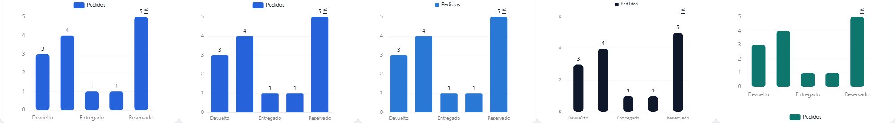
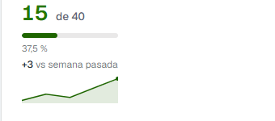
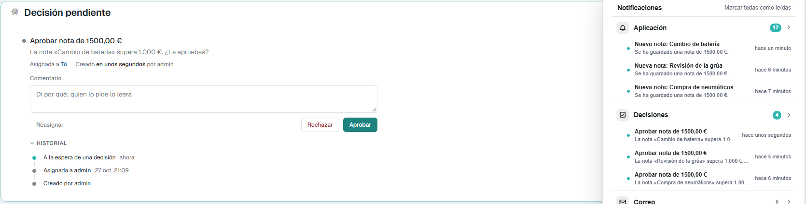
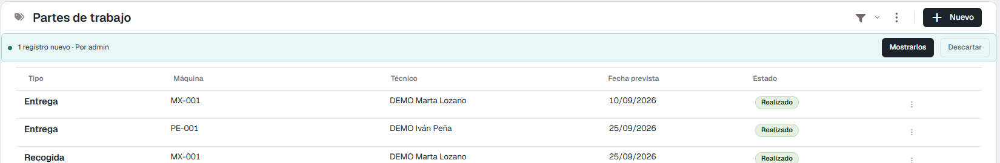
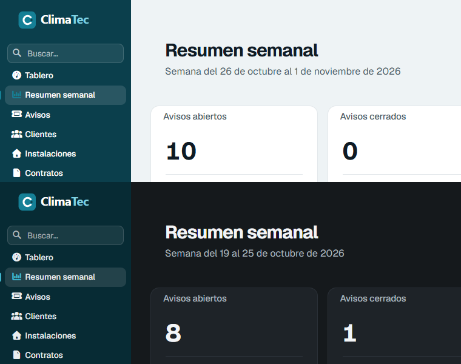
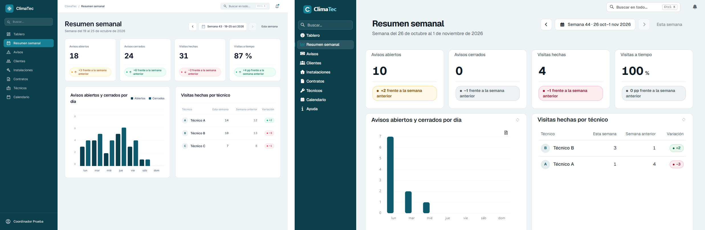
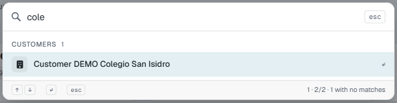

# Lo que construye en Flexygo 10

Con un proyecto en **Flexygo 10**, el servidor MCP usa lo que trae esta versión: gráficas ECharts, tarjetas de indicadores, reglas al guardar, avisos en directo, objetos REST, marca y pantallas de cuenta…

El agente sabe en qué versión de la plataforma corre el proyecto (lo dice `/flx-status`). Si no puede saberlo, o la versión es anterior a la 10, construye como antes y te lo dice.

## Gráficas ECharts y temas

En Flexygo 10 todas las gráficas son **ECharts**: diez tipos (barras, líneas, anillo, radar…). Además, puede:

- poner el total en el centro de un anillo;
- añadir una línea de objetivo;
- poner la unidad tras cada cifra;
- añadir una línea al pie con la variación («+12 % frente al mes anterior»), que se dibuja en la skin 2026;
- guardar en el navegador los datos de la gráfica durante unos segundos, para no pedirlos de nuevo en cada visita.

Las cifras salen con el formato del idioma del usuario (`35.000` en castellano, `35,000` en inglés).

Si no le pides un tema, la gráfica usa el que trae Flexygo 10 por defecto. También puede crear un **tema propio del producto** con sus colores y las formas de uno de los de fábrica, sin tocar los de fábrica, que comparten todas las aplicaciones.

<figure markdown="span">
  
  <figcaption>La misma gráfica con los temas de fábrica y, a la derecha, un tema propio creado por el agente</figcaption>
</figure>

## Tarjetas de indicadores

Los módulos de indicadores (*easy info*) se dibujan como **tarjetas**. Una tarjeta puede llevar:

- la variación y la tendencia;
- un objetivo con su barra de progreso;
- una pequeña gráfica de evolución;
- enlaces de acción;
- un conmutador de periodo (24 h, 7 días, 30 días), que recuerda la elección del usuario.

El color sigue la piel y el modo oscuro. La tira de cifras sobre una lista es **un solo módulo**, con una fila por cifra: cada fila se dibuja como su propia tarjeta.

En `/flx-discuss`, el agente pregunta qué cifras abren la página de inicio: la cifra, el periodo, con qué se compara y qué color significa «mal».

<figure markdown="span">
  
  <figcaption>Una tarjeta con objetivo, variación y evolución</figcaption>
</figure>

## Reglas al guardar y decisiones

Para lo que debe pasar **cuando se guarda un registro**, el agente crea una **regla del objeto** en lugar de un trabajo programado. La regla se dispara al dar de alta, al modificar o al eliminar, y puede llevar condiciones:

- que el registro cumpla una condición;
- que una columna haya cambiado;
- que haya cambiado a un valor concreto.

Lo que hace puede ser:

- mandar un aviso a la campana de un rol o de un usuario;
- enviar un correo, también con una plantilla de correo reutilizable;
- crear o modificar registros;
- lanzar un proceso;
- pedir una **decisión**: una tarea con opciones, plazo y escalado, que se aprueba o se rechaza desde la campana o desde la ficha.

La regla actúa después de guardar: si su paso falla, lo guardado se queda. El agente puede enseñarte las reglas de un objeto con sus últimas ejecuciones, decirte cuáles se dispararían con un registro concreto y borrar una regla, avisando antes de lo que se va con ella.

En `/flx-discuss`, el agente pregunta qué pasos necesitan la aprobación de una persona: quién decide, qué respuestas hay y cuánto tiempo pasa antes de que vaya a otra persona.

<figure markdown="span">
  
  <figcaption>Una regla pide aprobar las notas de más de 1.000 €: la decisión sale en la ficha y en la campana</figcaption>
</figure>

## Avisos en directo

El agente puede activar en un objeto los **avisos en directo**, para que los usuarios conectados vean los registros que guardan otros sin recargar. El aviso no lleva datos del registro: cada usuario vuelve a pedirlo con su propia sesión, así que solo lo ve quien puede verlo, con la seguridad del objeto y sus filtros. Además, se puede limitar a quién concierne cada registro (por ejemplo, a cada comercial, sus pedidos).

Lo que llega a cada módulo, en la skin 2026:

| Módulo | Altas | Cambios y bajas |
|---|---|---|
| Lista | Sí: una banda «Mostrarlos» en la barra del módulo | No |
| Planificador | Sí | No |
| Kanban | Sí: pinta la tarjeta | No |
| Calendario | Sí | Sí |
| Línea de tiempo | No | No |
| Otra página | Sí: un aviso abajo a la derecha | No |

Los avisos en directo no van dirigidos a nadie en concreto. Para dejar un aviso en la campana de un rol o de un usuario, se usa una regla al guardar.

<figure markdown="span">
  
  <figcaption>Otro usuario ha dado de alta un parte: la lista lo avisa y lo enseña al pulsar «Mostrarlos»</figcaption>
</figure>

## Objetos REST

Un objeto puede tener sus registros en otro sistema, detrás de una API REST. El agente da de alta el servicio, con su dirección, su autenticación y su paginación, y después crea los objetos que leen de él: las rutas para listar, leer, dar de alta, modificar (con PUT o PATCH) y borrar, y sus campos. Los filtros y el orden de una lista se pueden pasar a la propia API. La clave del servicio nunca se repite en las respuestas: te la pide a ti.

En `/flx-discuss`, el agente pregunta si algún registro (un cliente, un producto, un precio) ya vive en otro sistema.

## Marca, pantallas de cuenta y mantenimiento

El agente coloca los ficheros de la marca con el nombre que Flexygo 10 espera:

- el logo y su variante para fondo oscuro;
- el símbolo para la barra lateral plegada;
- el icono del navegador;
- la imagen de las pantallas de cuenta y la de la página de mantenimiento.

También da estilo a las pantallas de cuenta (acceso, registro, contraseña olvidada, doble factor y cambio de contraseña) y a la página de mantenimiento. Nunca activa ni desactiva el modo de mantenimiento: eso lo hace un administrador.

<figure markdown="span">
  
  <figcaption>El logo del producto en la barra lateral, en claro y en oscuro</figcaption>
</figure>

## Lo que la plataforma ya hace bien, se queda

Una referencia de diseño (una maqueta, una captura, una pantalla de otra herramienta) puede no tener algo que Flexygo 10 ya hace bien: la barra superior con la campana de avisos y la búsqueda con Ctrl+K, el panel de control o el menú de usuario. **Que la referencia no lo tenga no es motivo para quitarlo**: es la referencia la que se equivoca.

- El agente nunca quita ni esconde por su cuenta un elemento de la plataforma que funciona. Solo lo hace si tú lo decides, y la decisión queda apuntada.
- Al comparar con la referencia, esa diferencia se cierra como «la referencia está mal»: se queda el elemento de la plataforma, con una nota que dice cuál.
- Poner la marca en el panel lateral no quita la barra superior.
- Las interfaces de la plataforma (origen 0) no se cambian, porque las comparten sus propios perfiles: para una cabecera o un menú propios, el agente crea una interfaz y un perfil del proyecto. Solo cambia la de la plataforma si tú lo decides, y la decisión queda apuntada.
- En la revisión de calidad, el recorrido de cada bloque comprueba que la barra superior sigue con su campana, que Ctrl+K abre la búsqueda y encuentra un registro, y que cada opción del menú tiene su texto. Cada pantalla se comprueba en claro y en oscuro, con el idioma del usuario.

<figure markdown="span">
  
  <figcaption>La referencia de Stitch y la pantalla construida: sigue su diseño y conserva la barra superior con la búsqueda Ctrl+K y la campana</figcaption>
</figure>

## La pieza de la plataforma antes que el código a mano

Con Flexygo 10, para cada cosa que necesita una pantalla el agente usa la pieza de la plataforma, que dibuja desde los datos, sigue la piel y el modo oscuro y no necesita CSS: una tarjeta para una cifra, una gráfica ECharts, una regla al guardar, un objeto REST, el diseño libre para colocar los módulos donde dice el diseño, los filtros y los presets para filtrar una lista. Al guardar un módulo HTML o una lista SQL que hace lo que ya hace un módulo estándar, el agente recibe un aviso y cambia el módulo, o deja escrito por qué no.

## El JavaScript del proyecto

Todo el JavaScript que escribe el agente vive en **plugins del proyecto**, registrados como cualquier librería. El `JSAfterLoad` de un módulo es una llamada a ese plugin.

**Lo que no se guarda.** Al escribir un plugin o un módulo, se rechaza el código que:

- carga a mano otra librería, desde código o desde una dirección de fuera: una librería de terceros va en el proyecto, como un plugin propio;
- filtra las filas por el usuario conectado en el navegador: qué filas ve cada rol lo decide la seguridad del objeto, en el servidor;
- llama a un servicio de fuera desde el navegador: lo de fuera lo lee el servidor, con una tarea o un proceso, y lo guarda en una tabla;
- decide por el rol de administrador en el navegador: quién puede qué lo decide la seguridad de la plataforma.

Además, una interfaz no lleva JavaScript propio: crear o cambiar una interfaz con un script se rechaza (solo se puede vaciar). Y un plugin lee sus datos con `flexygo.obj.Entity` o `getView`, que aplican la seguridad del objeto, nunca de una lista SQL oculta.

**Si vas a escribir esto, la plataforma ya lo tiene.** Antes de escribir una función, el agente mira esta tabla de su referencia:

| Ibas a escribir | Usa |
|---|---|
| Una columna de casillas y «aplicar a los marcados» | La selección de la propia lista y un proceso lanzado sobre ella desde la barra |
| Leer filas del DOM o de una lista oculta | `flexygo.obj.Entity` / `getView` |
| Un observador, un `setInterval` o un bucle hasta que pinte un módulo | El `JSAfterLoad` del módulo, o el evento `loaded` del módulo |
| Refrescar módulos después de una acción | Los eventos de módulo con `refresh`, o `refresh()` del módulo |
| Una tabla con campos para editar | La lista editable (`flx-editlist`) |
| «Guardar y seguir dando de alta» | El botón de guardar y crear otro que ya traen las barras de edición |
| Una tarjeta de indicador o una tira de cifras | `flx-easyinfo` en modo tarjeta, nunca una lista SQL |
| Un tablero donde mover una tarjeta ejecuta un proceso | El kanban con su proceso al cambiar de columna |
| Una ayuda guiada o un panel de ayuda | Los recorridos guiados y la ayuda de la aplicación |
| Botones de filtro sobre una lista | Los presets |
| Tarjetas o tabla, a elección del usuario | Dos plantillas del objeto y `changeTemplate()` |
| Formatear fechas y números a mano | Los modificadores `date` y `decimal` de la plantilla, y `moment` para calcular con fechas |
| Una función de traducción propia | `flexygo.localization.translate` |
| Un escape de HTML propio | `flexygo.string.escapeHTML`, o el modificador `html` en la plantilla |
| Avisos, `alert` o `confirm` propios | `flexygo.msg` |
| `localStorage` a mano | `flexygo.storage` |

**La auditoría del JavaScript.** La auditoría de seguridad de `/flx-release` (consulta el [flujo de trabajo con comandos](./6Workflow.md)) lee los ficheros de los plugins del proyecto, el script de las interfaces y de las páginas, y el código de los módulos, y marca:

| Gravedad | Qué |
|---|---|
| Alta | Un filtro de filas montado con el usuario conectado; una decisión por el rol de administrador en el navegador; una clave, un token o una contraseña escritos en el código que descarga el navegador; un `{{Campo}}` pintado sin el modificador `html` en plantillas, módulos HTML o listas SQL; una vista cuya SQL pega un `{{token}}` sin comillas |
| Media | Un servicio de fuera llamado desde el navegador; código cargado a mano; ejecutar texto como código, pegar datos como marcado o hacer llamadas síncronas; un error inesperado que llega tal cual a la pantalla; procedimientos que montan SQL pegando valores |
| Baja | Lo que rehace una pieza de la plataforma, nombrando la que hay que usar; módulos HTML sin un hueco apuntado que los justifique |

Además, la revisión de calidad pone junto a cada pantalla cuántos de sus módulos son estándar y cuántas líneas de JavaScript y CSS propias lleva, y señala las listas disfrazadas de cabecera de página.

## Más cosas de Flexygo 10

- **Seguridad de procesos con condición**: un proceso permitido o denegado a un rol esté donde esté, y, si hace falta, solo mientras se cumple una condición sobre el usuario.
- **Pestañas en los formularios**: un formulario largo se reparte en pestañas.
- **Botones de la barra**: el agente marca el botón principal de cada módulo y decide cuáles se pliegan en el menú «…».
- **Calendario**: el horario laboral, los solapes, la línea de «ahora» y el resto de opciones del calendario de la 10.
- **Diseño libre de páginas** en la skin 2026: cada módulo en la posición y con el tamaño que pide el diseño, y páginas en las que cada usuario puede reordenar y plegar sus módulos.
- **Visitas guiadas** de una pantalla, paso a paso por sus módulos.
- **Asistentes de IA de la aplicación**: el agente da de alta los asistentes que trae Flexygo 10, con su modelo, lo que pueden tocar, qué roles hablan con ellos y sus botones de atajo. La clave del proveedor la escribes tú en la aplicación, y el acceso a la base de datos o a la web, o el permiso para lanzar procesos, solo se activa con tu sí.
- **Ajustes nuevos**, como ocultar las novedades del acceso, permitir el registro de usuarios, bloquear a un usuario tras varias contraseñas fallidas o el separador de las exportaciones a CSV.

## La búsqueda con Ctrl+K

En `/flx-discuss`, cuando el modelo de datos ya está decidido, el agente hace **una** pregunta: qué colecciones debe encontrar la búsqueda de **Ctrl+K**, y por qué campos. Propone tres a cinco colecciones con dos o tres campos cada una, y tú añades, quitas o dices que ninguna. Cada usuario solo ve los grupos de los objetos que puede ver, y puede quitar un grupo en sus ajustes de búsqueda. El título de cada grupo sale en inglés aunque el usuario trabaje en otro idioma: es un límite de la plataforma.

<figure markdown="span">
  
  <figcaption>La búsqueda encuentra un cliente por su nombre; el título del grupo sale en inglés</figcaption>
</figure>

## Textos de pantalla en inglés, traducidos

Las etiquetas, botones, pestañas, secciones, títulos de páginas, módulos y menús, y los pasos de las visitas guiadas se escriben en **inglés**, que es el original del que traduce la plataforma. Antes de cerrar cada bloque, el agente los traduce a los idiomas que elegiste para el proyecto (o a todos los activos, si no elegiste), empezando por el del proyecto. Así un usuario que trabaja en inglés no ve textos en castellano.
