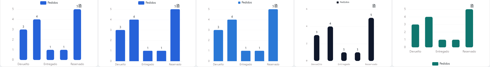
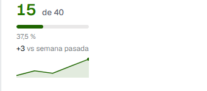
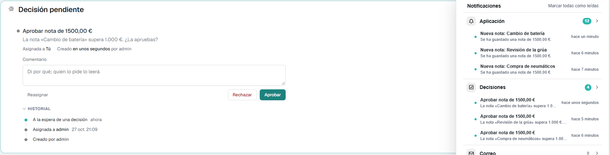
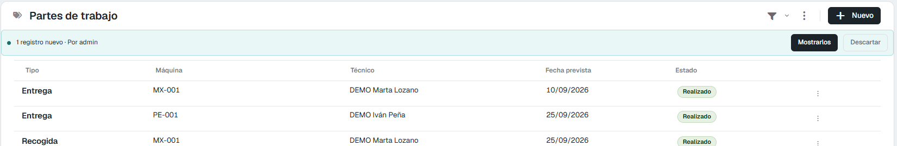
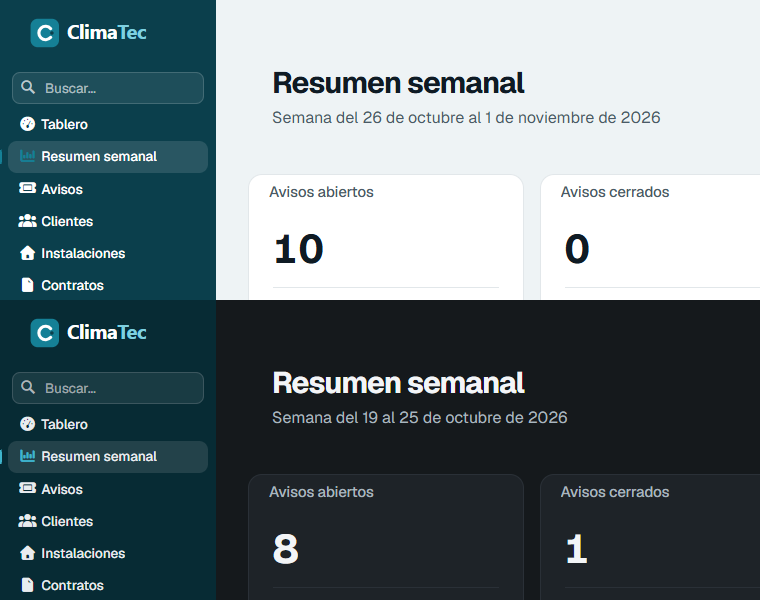
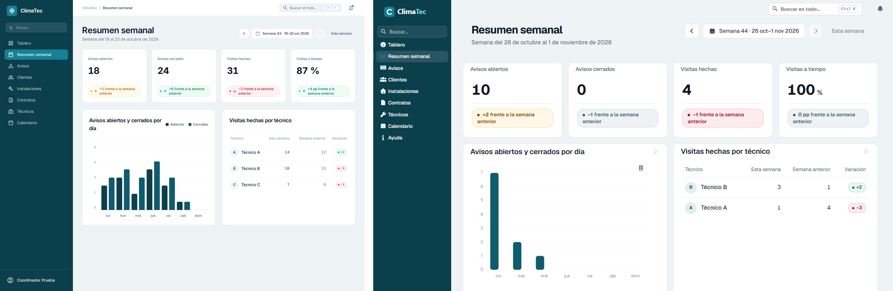
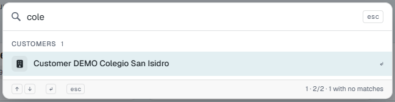

# Lo que construye en Flexygo 10

Con un proyecto en **Flexygo 10**, el servidor MCP usa lo que trae esta versión: gráficas ECharts, tarjetas de indicadores, reglas al guardar, avisos en directo, objetos REST, marca y pantallas de cuenta…

## Gráficas ECharts y temas

En Flexygo 10 todas las gráficas son **ECharts**: diez tipos (barras, líneas, anillo, radar…). Además, puede:

- poner el total en el centro de un anillo;
- añadir una línea de objetivo;
- poner la unidad tras cada cifra;
- añadir una línea al pie con la variación («+12 % frente al mes anterior»).

Las cifras salen con el formato del idioma del usuario (`35.000` en castellano, `35,000` en inglés).

Si no le pides un tema, la gráfica usa el que trae Flexygo 10 por defecto. También puede crear un **tema propio del producto** con sus colores y las formas de uno de los de fábrica, sin tocar los de fábrica, que comparten todas las aplicaciones.

<figure markdown="span">
  
  <figcaption>La misma gráfica con los temas de fábrica y, a la derecha, un tema propio creado por el agente</figcaption>
</figure>

## Tarjetas de indicadores

Los módulos de indicadores (*easy info*) se dibujan como **tarjetas**. Una tarjeta puede llevar:

- la variación y la tendencia;
- un objetivo con su barra de progreso;
- una pequeña gráfica de evolución;
- enlaces de acción;
- un conmutador de periodo (24 h, 7 días, 30 días), que recuerda la elección del usuario.

El color sigue la piel y el modo oscuro.

<figure markdown="span">
  
  <figcaption>Una tarjeta con objetivo, variación y evolución</figcaption>
</figure>

## Reglas al guardar y decisiones

Para lo que debe pasar **cuando se guarda un registro**, el agente crea una **regla del objeto** en lugar de un trabajo programado. La regla se dispara al dar de alta, al modificar o al eliminar, y puede llevar condiciones:

- que el registro cumpla una condición;
- que una columna haya cambiado;
- que haya cambiado a un valor concreto.

Lo que hace puede ser:

- mandar un aviso a la campana de un rol o de un usuario;
- enviar un correo;
- crear o modificar registros;
- lanzar un proceso;
- pedir una **decisión**: una tarea con opciones, plazo y escalado, que se aprueba o se rechaza desde la campana o desde la ficha.

<figure markdown="span">
  
  <figcaption>Una regla pide aprobar las notas de más de 1.000 €: la decisión sale en la ficha y en la campana</figcaption>
</figure>

## Avisos en directo

El agente puede activar en un objeto los **avisos en directo**, para que los usuarios conectados vean los registros que guardan otros sin recargar. Se respetan la seguridad del objeto, sus filtros por usuario y las propiedades ocultas.

Lo que llega a cada módulo, en la skin 2026:

| Módulo | Altas | Cambios y bajas |
|---|---|---|
| Lista | Sí: una banda «Mostrarlos» en la barra del módulo | No |
| Planificador | Sí | No |
| Kanban | Sí: pinta la tarjeta | No |
| Calendario | Sí | Sí |
| Línea de tiempo | No | No |
| Otra página | Sí: un aviso abajo a la derecha | No |

Los avisos en directo no se anotan en la campana. Para avisar en la campana, se usa una regla al guardar.

<figure markdown="span">
  
  <figcaption>Otro usuario ha dado de alta un parte: la lista lo avisa y lo enseña al pulsar «Mostrarlos»</figcaption>
</figure>

## Objetos REST

Un objeto puede tener sus registros en otro sistema, detrás de una API REST. El agente da de alta el servicio, con su dirección, su autenticación y su paginación, y después crea los objetos que leen de él. La clave del servicio nunca se repite en las respuestas.

## Marca, pantallas de cuenta y mantenimiento

El agente coloca los ficheros de la marca con el nombre que Flexygo 10 espera:

- el logo y su variante para fondo oscuro;
- el símbolo para la barra lateral plegada;
- el icono del navegador;
- la imagen de las pantallas de cuenta y la de la página de mantenimiento.

También da estilo al acceso y a la página de mantenimiento. Nunca activa ni desactiva el modo de mantenimiento: eso lo hace un administrador.

<figure markdown="span">
  
  <figcaption>El logo del producto en la barra lateral, en claro y en oscuro</figcaption>
</figure>

## Lo que la plataforma ya hace bien, se queda

Una referencia de diseño (una maqueta, una captura, una pantalla de otra herramienta) puede no tener algo que Flexygo 10 ya hace bien: la barra superior con la campana de avisos y la búsqueda con Ctrl+K, el panel de control o el menú de usuario. **Que la referencia no lo tenga no es motivo para quitarlo**: es la referencia la que se equivoca.

- El agente nunca quita ni esconde por su cuenta un elemento de la plataforma que funciona. Solo lo hace si tú lo decides, y la decisión queda apuntada.
- Al comparar con la referencia, esa diferencia se cierra como «la referencia está mal»: se queda el elemento de la plataforma, con una nota que dice cuál.
- Poner la marca en el panel lateral no quita la barra superior.
- Tras cada bloque, la revisión de calidad comprueba que la barra superior sigue con su campana, que Ctrl+K abre la búsqueda y encuentra un registro, y que cada opción del menú tiene su texto. La verificación mira cada pantalla en claro y en oscuro, con el idioma del usuario.

<figure markdown="span">
  
  <figcaption>La referencia de Stitch y la pantalla construida: sigue su diseño y conserva la barra superior con la búsqueda Ctrl+K y la campana</figcaption>
</figure>

## Más cosas de Flexygo 10

- **Seguridad de procesos con condición**: un proceso permitido o denegado a un rol solo cuando se cumple una condición.
- **Pestañas en los formularios**: un formulario largo se reparte en pestañas.
- **Botones de la barra**: el agente marca el botón principal de cada módulo y decide cuáles se pliegan en el menú «…».
- **Calendario**: el horario laboral, los solapes, la línea de «ahora» y el resto de opciones del calendario de la 10.
- **Ajustes nuevos**, como ocultar las novedades o permitir el registro de usuarios.

## La búsqueda con Ctrl+K

En `/flx-discuss`, cuando el modelo de datos ya está decidido, el agente hace **una** pregunta: qué colecciones debe encontrar la búsqueda de **Ctrl+K**, y por qué campos. Propone tres a cinco colecciones con dos o tres campos cada una, y tú añades, quitas o dices que ninguna. Cada usuario solo ve los grupos de los objetos que puede ver. Los nombres de los grupos y de los objetos salen en inglés aunque el usuario trabaje en otro idioma: es un límite de la plataforma.

<figure markdown="span">
  
  <figcaption>La búsqueda encuentra un cliente por su nombre; el grupo y el objeto salen en inglés</figcaption>
</figure>

## Textos de pantalla en inglés, traducidos

Las etiquetas, botones, pestañas, títulos, opciones de menú y pasos de las visitas guiadas se escriben en **inglés**, que es el original del que traduce la plataforma. En el mismo paso, el agente los traduce al idioma del proyecto y a los demás idiomas activos. Así un usuario que trabaja en inglés no ve textos en castellano.
