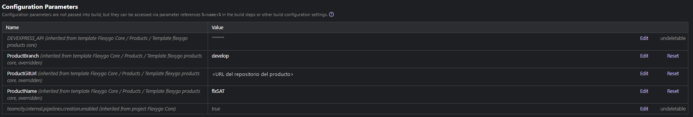
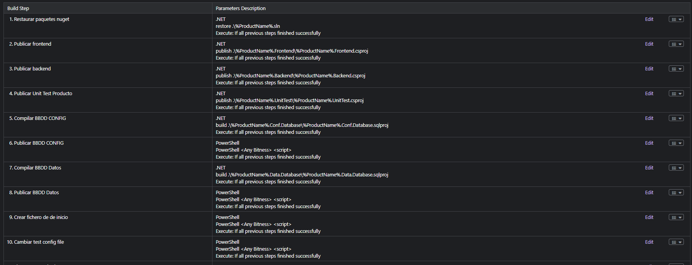
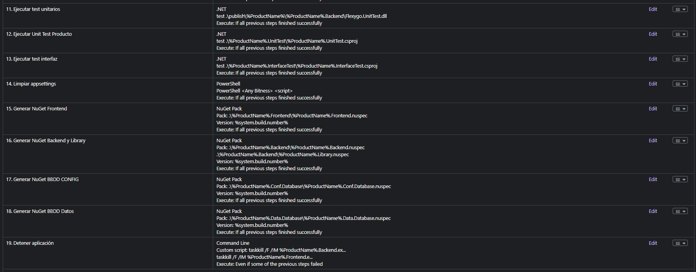

# TeamCity

Flexygo products are built in TeamCity from a common template, **Template flexygo products core**. Each product creates its build configuration from it and only fills in its parameters: the steps, the artifacts and the version number come from the template.

For the general idea of the pipeline, valid in any tool, see the [overview](1Overview.md).

---

## Creating a product's configuration

1. In TeamCity, inside the products project, create a new **Build Configuration** from the **Template flexygo products core** template.
2. Fill in its parameters under **Parameters**:

| Parameter | What it is | Example |
|---|---|---|
| `ProductName` | Prefix of the solution's projects, those of the [product template](../2ProductDevelopment/2Template.md): `<ProductName>.Frontend`, `.Backend`, `.Conf.Database`, `.Data.Database`, `.UnitTest` and `.InterfaceTest` | `MyProduct` |
| `ProductGitUrl` | Address of the product's repository | — |
| `ProductBranch` | Branch that is built | `develop` |
| `DEVEXPRESS_API` | Key of the DevExpress NuGet feed | — |
| `env.msbuild.debugrelease` | Build configuration | `release` |

!!! warning "Credentials"
    Keys and passwords (DevExpress's, the test databases' SQL Server one, the one to publish NuGets) go in parameters of type **Password**, so TeamCity masks them in the build logs. They are never written in a step's text.

<figure markdown="span">
  
  <figcaption>The parameters inherited from the template, filled in for a product; the DevExpress key is masked</figcaption>
</figure>

The configuration uses the products' common VCS root with **clean checkout**, so every build starts from a clean copy.

---

## The steps

The template has 19 steps. They group like this:

<figure markdown="span">
  
  
  <figcaption>The template's 19 steps, with their type, what they run and when: the last one runs even if something failed before (step names in Spanish)</figcaption>
</figure>

### 1. Restore

| Step | What it does |
|---|---|
| Restore NuGet packages | `dotnet restore <ProductName>.sln` with four sources: nuget.org, DevExpress (with `%DEVEXPRESS_API%`) and Flexygo's two NuGet feeds, the stable and the beta one. |

### 2. Publish

| Step | What it does |
|---|---|
| Publish frontend | `dotnet publish` in Release to `publish\<ProductName>\<ProductName>.Frontend`, with `Version`, `FileVersion` and `InformationalVersion` (the build number and the commit). |
| Publish backend | The same, to `publish\<ProductName>\<ProductName>.Backend`. |
| Publish the product's unit tests | Publishes the `<ProductName>.UnitTest` project into the published Backend's folder. |

!!! warning "Node.js on the agent"
    The Frontend compiles TypeScript with `node`. If the agent does not have it, publishing the Frontend fails with `MSB6003`.

### 3. Databases

| Step | What it does |
|---|---|
| Build the CONFIG database | `dotnet build` of `<ProductName>.Conf.Database.sqlproj` in Release, with `/p:DacVersion=%build.number%`. |
| Publish the CONFIG database | Publishes the dacpac with `sqlpackage /Action:Publish` to a test database, `<ProductName>BD_IC`, on the test SQL Server: it creates it from scratch, with the dacpac version equal to the build number. If sqlpackage fails, the step fails. |
| Build the data database | The same with `<ProductName>.Data.Database.sqlproj`. |
| Publish the data database | The same, to the product's test database. |

So every build checks that both databases really build and publish, not only that the project compiles.

### 4. Start the application and test

| Step | What it does |
|---|---|
| Create the start file | Writes `publish\<ProductName>\run_windows.bat`, which starts the Frontend and the Backend with Kestrel. |
| Change the test config file | Keeps a clean copy of the published `conf\appsettings.json` files and gives them the test databases' connection strings, the local addresses (Frontend `http://localhost:7111`, Backend `http://localhost:7110/api/backend/`) and mail as configured. Starts the application and checks that it answers. |
| Run the unit tests | `dotnet test` of `Flexygo.UnitTest.dll`, the core's tests, from the published Backend's folder. |
| Run the product's unit tests | `dotnet test` of `<ProductName>.UnitTest.csproj`. |
| Run the interface tests | `dotnet test` of `<ProductName>.InterfaceTest.csproj`, against the running application. |
| Clean appsettings | Deletes the published `appsettings.local.json` files and puts back the clean `appsettings.json`: it undoes the "Change the test config file" step. |

The three test steps use the .NET 6 SDK.

### 5. Generate the NuGets

| Step | What it does |
|---|---|
| Generate the Frontend NuGet | `NuGet pack` of `<ProductName>.Frontend.nuspec`, with the version equal to the build number, to `publish/`, and publishes the package. |
| Generate the Backend and Library NuGets | The same with `<ProductName>.Backend.nuspec` and `<ProductName>.Library.nuspec`. |
| Generate the CONFIG database NuGet | The same with `<ProductName>.Conf.Database.nuspec`. |
| Generate the data database NuGet | The same with `<ProductName>.Data.Database.nuspec`. |

All five use NuGet.CommandLine 6.12.2.

### 6. Stop

| Step | What it does |
|---|---|
| Stop the application | Stops the Frontend and the Backend that were started. It **always** runs, also when an earlier step failed, so the application is not left running on the agent. |

The step names above describe each step; in TeamCity the template names them in Spanish, for example «Restaurar paquetes NuGet» or «Detener aplicación».

---

## Artifacts

The configuration collects:

- `publish\<ProductName>.v<build number>.zip`, the published product;
- `publish\DockerCompose<build number>.zip`, to deploy it with Docker;
- `<ProductName>.InterfaceTest\bin\Debug\net9.0\tracing`, the interface tests' traces, to see what happened when one fails.

They are downloaded from each build's **Artifacts** tab.

---

## Build number and trigger

- **Build number:** `1.0.%build.counter%.1`. It is the version of everything the build produces: the assemblies, the dacpacs and the NuGets.
- **Trigger:** VCS. Every push to the `ProductBranch` branch starts a build.

---

## Build features

| Feature | What it does |
|---|---|
| AssemblyInfo patcher | Sets the build number as the assemblies' version. |
| File content replacer on `**/*.sqlproj` | Sets `<DacVersion>` to the build number, so the dacpacs carry the same version as the rest. |
| Performance monitor | Records the agent's CPU, memory and disk use during the build. |

---

## What the agent needs

- The **.NET 9 SDK**, to build and publish, and the **.NET 6 SDK**, for the test steps.
- **Node.js**, for the Frontend's TypeScript.
- **sqlpackage**, to publish the databases.
- A **SQL Server** where the test databases are created.
- **NuGet.CommandLine 6.12.2**, to generate the NuGets.
