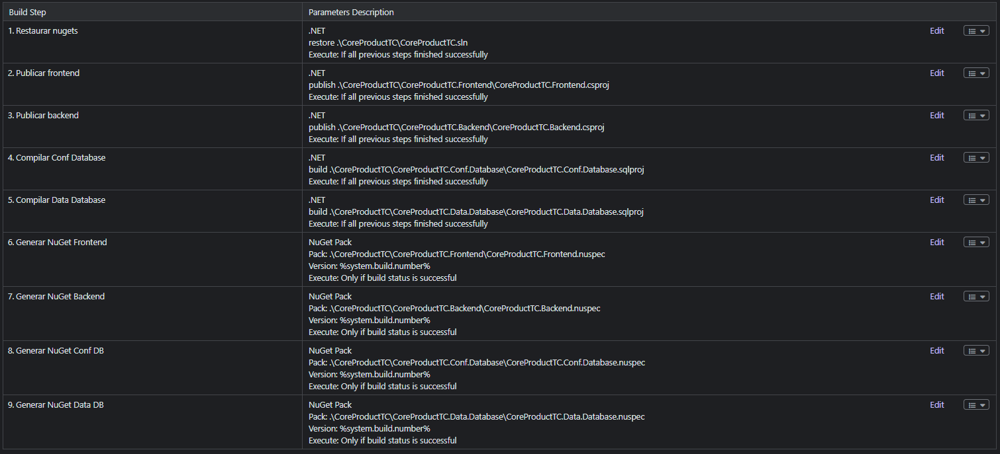

# TeamCity

En TeamCity, un pipeline se compone de **Build Steps**. En la siguiente imagen tienes una compilación básica para productos Flexygo .NET.

## Build Steps



A continuación se describe cada paso con los comandos equivalentes y las opciones recomendadas.

!!! note "Nombres de proyecto"
    Los ejemplos usan `MiProducto` como nombre del producto. Sustitúyelo por el prefijo de los proyectos de tu solución, que son los de la [plantilla de producto](../2ProductDevelopment/2Template.md): `MiProducto.Frontend`, `MiProducto.Backend`, `MiProducto.Conf.Database`, `MiProducto.Data.Database`, `MiProducto.UnitTest` y `MiProducto.InterfaceTest`. Los pasos son los de la [visión general](1Overview.md); el pipeline de GitLab que trae la plantilla (`.gitlab-ci.yml`) es la referencia completa.

### Paso 1: Restore

**Runner type:** Command Line

Los paquetes de DevExpress vienen de su feed privado, que se añade con la clave de la variable `env.DEVEXPRESS_API`:

```bash
dotnet nuget add source "https://nuget.devexpress.com/%env.DEVEXPRESS_API%/api/v3/index.json" -n DevExpress --configfile nuget.config
dotnet restore MiProducto.sln
```

### Paso 2: Publicar Frontend y Backend

**Runner type:** Command Line

```bash
dotnet publish MiProducto.Frontend/MiProducto.Frontend.csproj -c Release -o publish/MiProducto/MiProducto.Frontend /p:Version=%build.number%
dotnet publish MiProducto.Backend/MiProducto.Backend.csproj -c Release -o publish/MiProducto/MiProducto.Backend /p:Version=%build.number%
```

!!! warning "Node.js en el agente"
    El Frontend compila TypeScript con `node`. Si el agente no lo tiene, el publish del Frontend falla con `MSB6003`.

### Paso 3: Compilar las bases de datos

**Runner type:** Command Line

```bash
dotnet build MiProducto.Conf.Database/MiProducto.Conf.Database.sqlproj -c Release -p:NetCoreBuild=true /p:DacVersion=%build.number%
dotnet build MiProducto.Data.Database/MiProducto.Data.Database.sqlproj -c Release -p:NetCoreBuild=true /p:DacVersion=%build.number%
```

La base de datos de datos es opcional: omite la segunda línea si tu producto no la tiene.

### Paso 4: Tests

**Runner type:** Command Line

```bash
dotnet test MiProducto.UnitTest/MiProducto.UnitTest.csproj -c Release --logger "trx;LogFileName=test-results.trx"
dotnet test MiProducto.InterfaceTest/MiProducto.InterfaceTest.csproj -c Release --logger "trx;LogFileName=interface-results.trx"
```

Los tests necesitan una base de datos del producto. La plantilla trae `tools/run-tests-with-db.ps1`, que la levanta en un contenedor a partir de la imagen que genera `tools/build-docker-images.ps1 -Only db`, ejecuta los tests unitarios y la elimina al terminar; requiere Docker en el agente.

### Paso 5: Generar los NuGets

**Runner type:** Command Line

Un `dotnet pack` de `tools/pack.csproj` por cada `.nuspec` del producto (Frontend, Library, Backend, Conf.Database y Data.Database), con la salida en `publish/nuget`. Por ejemplo, el del Frontend:

```bash
dotnet pack tools/pack.csproj -o publish/nuget -p:NuspecProperties="version=%build.number%" -p:NuspecFile=%system.teamcity.build.checkoutDir%/MiProducto.Frontend/MiProducto.Frontend.nuspec -p:NuspecBasePath=%system.teamcity.build.checkoutDir%/MiProducto.Frontend
```

---

## Variables de configuración

Define las siguientes variables en **Build Configuration → Parameters**:

| Variable | Descripción | Ejemplo |
|---|---|---|
| `env.DEVEXPRESS_API` | Clave del feed NuGet de DevExpress | — |
| `env.SQL_PASSWORD` | Contraseña de `sa` de la base de datos de los tests | — |
| `env.NUGET_API_KEY` | Clave para publicar los NuGets en el feed | — |
| `system.build.number` | Número de build (automático en TeamCity) | `1.0.{build.counter}.1` |

> **Seguridad:** Marca las variables de credenciales como tipo **Password** en TeamCity para que se enmascaren en los logs de build.

---

## Configuración del NuGet feed corporativo

Si tu proyecto consume paquetes NuGet de un feed corporativo (Artifactory, Azure Artifacts, TeamCity NuGet Feed), añade un `nuget.config` en la raíz del repositorio:

```xml
<?xml version="1.0" encoding="utf-8"?>
<configuration>
  <packageSources>
    <add key="Corporate" value="https://tu-servidor/nuget/v3/index.json" />
    <add key="nuget.org" value="https://api.nuget.org/v3/index.json" />
  </packageSources>
</configuration>
```

TeamCity usará automáticamente este `nuget.config` en el paso de Restore. Para feeds que requieren autenticación, configura las credenciales en **Administration → Connections** (no en el archivo de configuración).

---

## Publicación de artefactos

En **Build Configuration → General → Artifact paths**, añade las siguientes reglas:

```
publish/MiProducto/MiProducto.Frontend/** => frontend.zip
publish/MiProducto/MiProducto.Backend/** => backend.zip
publish/nuget/*.nupkg
```

Esto comprime las publicaciones del Paso 2, recoge los NuGets del Paso 5 y los publica como artefacto descargable desde la interfaz de TeamCity, disponible para builds de despliegue posteriores.
