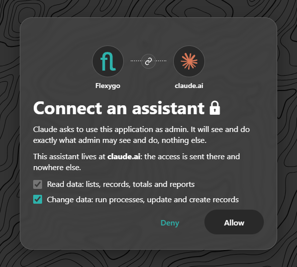
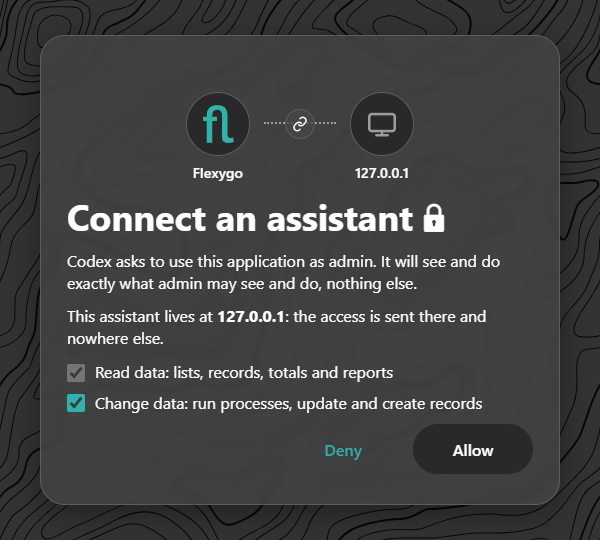
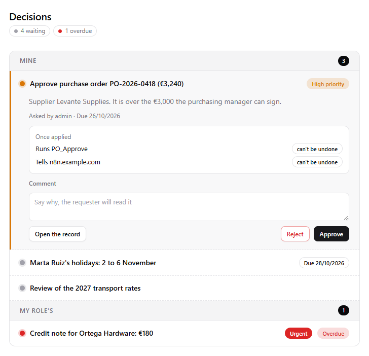
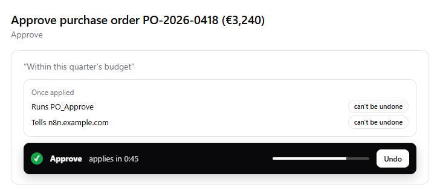
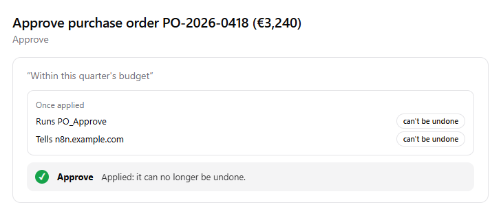
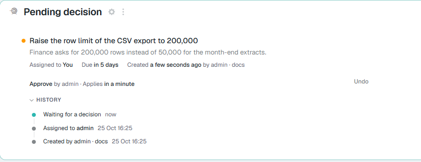

# Approving decisions from the chat <span class="fh-version-tag" title="Available since version 10">10.0+</span>

The [decisions](../Programming/ApprovalsAndWebhooks.md) the application asks of a person (approve an order, a holiday, a credit note…) can be taken **from the AI assistant** that person already works with: Claude, ChatGPT or any other MCP client connected to the application. Ask it "what is waiting for me?" and the assistant shows the decisions with their context. The person approves or rejects, and has **one minute to undo it** before anything happens.

The rules are the application's: only the decisions that person can take show up, with the same options, the same required comment and the same log as in the inbox or on the record.

| Assistant | What it looks like |
|---|---|
| **Claude** (claude.ai web, desktop and mobile) | A widget inside the chat: the list, the card with its buttons and the countdown with *Undo*. |
| **ChatGPT** (Codex too) | The same widget. Tested with Codex connected through CIMD ([How assistants register](4ClientRegistration.md)). |
| **Claude Code and other clients without widgets** | A numbered list in text: "approve 1", "reject 3 because…". The answer says until when it can be undone. |
| **Copilot** (Microsoft 365 chat) | Pending: it needs its own agent pointing at the application's MCP. |

---

## Before you start

| | |
|---|---|
| **The application's MCP switched on** | **Enable WebAPI** and **Enable MCP** in the WebAPI tool, and the MCP permission (the robot) on the person's role. The steps are in [Try it](1TryIt.md#1-turn-on-the-web-api-and-mcp). |
| **Open decisions** | The ones opened by decision rules, by processes or by an orchestrator through the API ([Decisions and webhooks](../Programming/ApprovalsAndWebhooks.md)). Nothing else has to be exposed in the web API: the decision tools read the tasks with the person's security. |
| **The application reachable** | For claude.ai or ChatGPT, the Frontend on the internet with HTTPS ([Reverse proxy](../../1Deployment/6ReverseProxy/index.md)). |

---

## 1. Add the connector

The address is the application's, ending in `/mcp` (**Connect an assistant**, in the profile menu, copies it).

=== "Claude (claude.ai, desktop)"

    *Settings → Connectors → Add custom connector*: a name and the address. Then **Connect**.

=== "ChatGPT"

    *Settings → Apps & Connectors*: create a connector with the address (on the accounts that ask for it, with **developer mode** on). Then **Connect**.

=== "Codex (command line)"

    ```bash
    codex mcp add myapp --url https://<your-application>/mcp
    ```

    ```bash
    codex mcp login myapp
    ```

=== "Claude Code"

    ```bash
    claude mcp add --transport http myapp https://<your-application>/mcp
    ```

    Inside Claude Code, `/mcp`, pick `myapp` and **Authenticate**.

## 2. Sign in and leave writing ticked

The application opens in the browser. You sign in with your usual user and see the consent page.

{ width="420" }

**Leave *Change data* ticked.** Seeing the decisions only needs reading, but **taking them is writing**. With the box cleared, the assistant shows the list and any approval or rejection is refused with a sentence that explains why. To fix it, remove the connector and connect again with the box ticked.

!!! note "Codex says 127.0.0.1"
    Codex receives the access on a port of your own computer, so the consent page shows **127.0.0.1** as the destination. That is right: the access does not leave your machine. Claude shows **claude.ai** and ChatGPT **chatgpt.com**.

    { width="360" }

## 3. Ask for the list

Write, in your own words: "What decisions are waiting for me?", "is there anything I have to approve?".

{ width="560" }

- **At the top**: how many are waiting and how many are overdue (or applying).
- **Mine**: the ones assigned to you. **My role's**: the ones assigned to a role you hold, with the role's name. No others show up.
- **Order**: urgent and high-priority ones first, then by due date. The priority shows in the coloured dot and in the label ("High priority", "Urgent", "Overdue").
- **The open card**: what is asked, who asked, when it is due and **what will happen once it applies**. It may run a process of the application, tell an external system (a callback webhook) or both, and neither can be undone afterwards. **Open the record** takes you to the record in the application.
- Click another decision to open it. Only one is open at a time.

## 4. Approve or reject

Write the comment if needed and click **Approve** or **Reject**. Telling the assistant works too ("reject the transport one, we are waiting for January's offer"): the assistant decides only with the option you choose.

- **Required comment**: if the decision or that option asks for one, the field says so ("Comment (required)") and, if it is empty, a warning shows under the field and nothing is sent.
- **The options** are the decision's: *Approve* and *Reject* by default, or the rule's own (up to three).

## 5. One minute to undo

Taking the decision **does not apply it yet**: it stays **applying** for 60 seconds.

{ width="560" }

- The black strip says what you chose (green ✓ for approve, red ✕ for reject), how long is left, and has **Undo**.
- **Within the minute nothing has happened**: not the process, not the call to the external system, not the log. **Undo** puts it back to pending, as if it had not been touched, and it can be decided again.
- Only **whoever took it** (or an administrator) can undo it.
- While it applies, **nobody else can decide it**: on the record in the application it shows as "Approve by *person* · Applies in a minute".
- If you close the chat or the widget, the time keeps running **on the server**: the decision applies all the same. In assistants without the widget, ask "undo the last one" within the minute.

## 6. "Applied"

Once the minute is over (plus a few seconds at most, what the `flxTaskApply` job takes, which runs every 15 seconds), the decision **applies**:

1. The task becomes `resolved` with your option, your comment and your user, and it stays in its history.
2. Its process (`OnResolveProcess`) runs, if it has one, **only once**.
3. The callback to the system that asked for it (`CallbackUrl`) is queued, if it has one.
4. The bell notice goes away for everyone.

{ width="560" }

**Applied** means exactly that: it has happened and **cannot be undone**. The button goes away, and if someone tries (for example, by reopening an old card in the chat), the server refuses it. Turning it around takes another decision or fixing the record in the application.

---

## In the application, the same minute

The window is not only the chat's. The **Pending decision** card on the record (in both skins) works the same way: approving shows "Approve by admin · Applies in a minute" with **Undo**, and a notice reminds you.



Whoever decides through the API (`sysTaskResolve`) waits that minute too, and can undo with `sysTaskUndo` within it. The statuses and processes are in [Decisions and webhooks](../Programming/ApprovalsAndWebhooks.md#what-happens-on-decision).

## The MCP tools

For whoever wants to know what the assistant calls, or to try it from another client:

| Tool | What it does | Kind |
|---|---|---|
| `flexygo_decisions` | The person's pending decisions (*mine* and *my role's*), with options, required comment, due date and effects. | Read-only |
| `flexygo_decide` | Takes a decision: `taskId`, `outcome` (the option's `id`) and `comment`. It leaves the decision applying for 60 seconds. | Write; reaches outside if the decision has a callback |
| `flexygo_decide_undo` | Undoes it while it has not applied. | Write, idempotent |

All three also return the text for clients without the widget, and every call shows up in **MCP usage** like the rest.

## If something does not work

| What you see | Why | What to do |
|---|---|---|
| The list is empty and the application has decisions | They are not assigned to you or to a role of yours | That is expected: the assistant shows what **you** can decide |
| Approving or rejecting is refused: the connection is read-only | You connected without *Change data* | Remove the connector and connect again with the box ticked |
| "Write a comment first" | The decision or the option asks for a comment | Write it in its field |
| *Undo* is gone | The minute is over: it has applied | It can no longer be undone |
| It says the task is no longer pending | Someone in your role took it first (or it was cancelled) | Ask for the list again: it shows as applying or it is gone |
| The widget is in another language | The widget uses the assistant's language and, failing that, your user's | Change the assistant's language or your user's |
