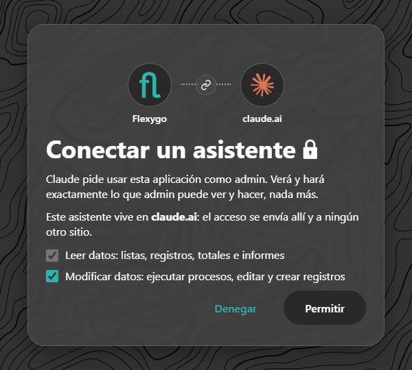
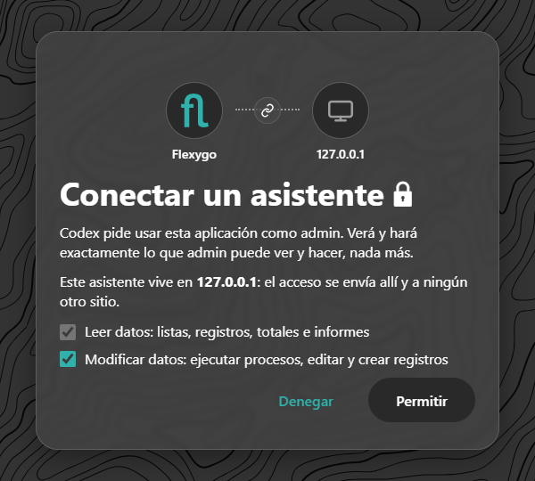
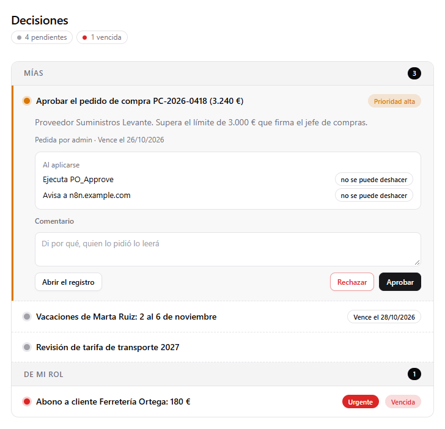
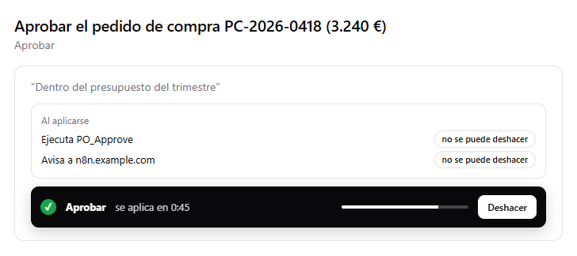
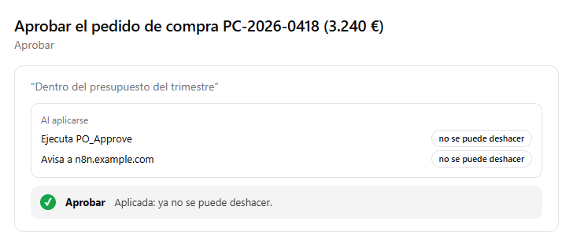
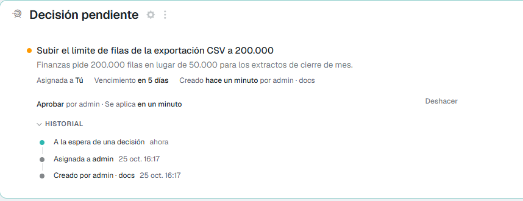

# Aprobar decisiones desde el chat <span class="fh-version-tag" title="Disponible desde la versión 10">10.0+</span>

Las [decisiones](../Programming/ApprovalsAndWebhooks.md) que la aplicación pide a una persona (aprobar un pedido, unas vacaciones, un abono…) se pueden tomar **desde el asistente de IA** con el que esa persona ya trabaja: Claude, ChatGPT o cualquier otro cliente MCP conectado a la aplicación. Se le dice «¿qué tengo pendiente?» y el asistente enseña las decisiones con su contexto. La persona aprueba o rechaza y tiene **un minuto para deshacerlo** antes de que nada ocurra.

Las reglas son las de la aplicación: solo salen las decisiones que esa persona puede tomar, con las mismas opciones, el mismo comentario obligatorio y el mismo registro que en la bandeja o en la ficha.

| Asistente | Cómo se ve |
|---|---|
| **Claude** (claude.ai web, escritorio y móvil) | Un widget dentro del chat: la lista, la tarjeta con sus botones y la cuenta atrás con *Deshacer*. |
| **ChatGPT** (también Codex) | El mismo widget. Probado con Codex conectado por CIMD ([Cómo se registran los asistentes](4ClientRegistration.md)). |
| **Claude Code y otros clientes sin widgets** | Una lista numerada en texto: «aprueba la 1», «rechaza la 3 porque…». La respuesta dice hasta cuándo se puede deshacer. |
| **Copilot** (chat de Microsoft 365) | Pendiente: necesita su propio agente apuntando al MCP de la aplicación. |

---

## Antes de empezar

| | |
|---|---|
| **El MCP de la aplicación encendido** | **Enable WebAPI** y **Enable MCP** en la herramienta WebAPI, y el permiso MCP (el robot) en el rol de la persona. Los pasos, en [Pruébalo](1TryIt.md#1-enciende-la-web-api-y-el-mcp). |
| **Decisiones abiertas** | Las que abren las reglas de decisión, los procesos o un orquestador por la API ([Decisiones y webhooks](../Programming/ApprovalsAndWebhooks.md)). No hay que exponer nada más en la web API: las herramientas de decisiones leen las tareas con la seguridad de la persona. |
| **La aplicación alcanzable** | Para claude.ai o ChatGPT, el Frontend en internet con HTTPS ([Proxy inverso](../../1Deployment/6ReverseProxy/index.md)). |

---

## 1. Añade el conector

La dirección es la de la aplicación terminada en `/mcp` (la copia **Connect an assistant**, en el menú de perfil).

=== "Claude (claude.ai, escritorio)"

    *Ajustes → Conectores → Añadir conector personalizado*: un nombre y la dirección. Después, **Conectar**.

=== "ChatGPT"

    *Ajustes → Aplicaciones y conectores*: crea un conector con la dirección (en las cuentas que lo piden, con el **modo desarrollador** encendido). Después, **Conectar**.

=== "Codex (línea de comandos)"

    ```bash
    codex mcp add miapp --url https://<tu-aplicacion>/mcp
    ```

    ```bash
    codex mcp login miapp
    ```

=== "Claude Code"

    ```bash
    claude mcp add --transport http miapp https://<tu-aplicacion>/mcp
    ```

    Dentro de Claude Code, `/mcp`, elige `miapp` y **Authenticate**.

## 2. Entra y deja marcada la escritura

Se abre la aplicación en el navegador. Entras con tu usuario de siempre y ves la página de consentimiento.

{ width="420" }

**Deja marcado *Modificar datos*.** Ver las decisiones solo pide leer, pero **tomarlas es escribir**. Con la casilla quitada, el asistente enseña la lista y cualquier aprobación o rechazo se rechaza con una frase que lo explica. Para arreglarlo, quita el conector y vuelve a conectarlo con la casilla marcada.

!!! note "Codex dice 127.0.0.1"
    Codex recibe el acceso en un puerto de tu propio equipo, así que el consentimiento enseña **127.0.0.1** como destino. Es lo correcto: el acceso no sale de tu máquina. Claude enseña **claude.ai** y ChatGPT, **chatgpt.com**.

    { width="360" }

## 3. Pide la lista

Escribe, con tus palabras: «¿Qué decisiones tengo pendientes?», «¿hay algo que tenga que aprobar?».

{ width="560" }

- **Arriba**: cuántas hay pendientes y cuántas están vencidas (o aplicándose).
- **Mías**: las asignadas a ti. **De mi rol**: las asignadas a un rol que tienes, con el nombre del rol. Las demás no salen.
- **Orden**: primero las urgentes y las de prioridad alta, y luego por fecha de vencimiento. La prioridad se ve en el punto de color y en la etiqueta («Prioridad alta», «Urgente», «Vencida»).
- **La tarjeta abierta**: qué se pide, quién lo pidió, cuándo vence y **qué pasará al aplicarse**. Puede ejecutar un proceso de la aplicación, avisar a un sistema externo (un webhook de vuelta) o las dos cosas, y ninguna de ellas se puede deshacer después. **Abrir el registro** lleva a la ficha en la aplicación.
- Pulsa otra decisión para abrirla. Solo hay una abierta cada vez.

## 4. Aprueba o rechaza

Escribe el comentario si hace falta y pulsa **Aprobar** o **Rechazar**. También vale decírselo al asistente («rechaza la del transporte, esperamos a la oferta de enero»): el asistente decide solo con la opción que tú eliges.

- **Comentario obligatorio**: si la decisión o esa opción lo piden, el campo lo dice («Comentario (obligatorio)») y, si está vacío, sale un aviso debajo del campo y no se envía nada.
- **Las opciones** son las de la decisión: *Aprobar* y *Rechazar* de serie, o las propias de la regla (hasta tres).

## 5. Un minuto para deshacer

Tomar la decisión **no la aplica todavía**: queda **aplicándose** durante 60 segundos.

{ width="560" }

- La tira negra dice qué elegiste (✓ verde para aprobar, ✕ roja para rechazar), cuánto falta y tiene **Deshacer**.
- **Dentro del minuto no ha pasado nada**: ni el proceso, ni el aviso al sistema externo, ni el registro. **Deshacer** la devuelve a pendiente, como si no se hubiera tocado, y se puede volver a decidir.
- Solo puede deshacerla **quien la tomó** (o un administrador).
- Mientras se aplica, **nadie más puede decidirla**: en la ficha de la aplicación sale como «Aprobar por *persona* · Se aplica en un minuto».
- Si cierras el chat o el widget, el plazo sigue corriendo **en el servidor**: la decisión se aplica igual. En los asistentes sin widget, pide «deshaz la última» dentro del minuto.

## 6. «Aplicada»

Pasado el minuto (y como mucho unos segundos más, lo que tarda el job `flxTaskApply`, que pasa cada 15 segundos), la decisión **se aplica**:

1. La tarea pasa a `resolved` con tu opción, tu comentario y tu usuario, y queda en su historial.
2. Se ejecuta su proceso (`OnResolveProcess`), si tiene, **una sola vez**.
3. Se encola el aviso de vuelta al sistema que la pidió (`CallbackUrl`), si tiene.
4. El aviso de la campana desaparece para todos.

{ width="560" }

**Aplicada** quiere decir eso: ya ha ocurrido y **no se puede deshacer**. El botón desaparece, y si alguien lo intenta (por ejemplo, reabriendo una tarjeta antigua del chat), el servidor lo rechaza. Para darle la vuelta hace falta otra decisión o corregir el registro en la aplicación.

---

## En la aplicación, el mismo minuto

El plazo no es solo del chat. La tarjeta **Decisión pendiente** de la ficha (en las dos pieles) funciona igual: al aprobar sale «Aprobar por admin · Se aplica en un minuto» con **Deshacer**, y un aviso lo recuerda.



Quien decide por la API (`sysTaskResolve`) también espera ese minuto, y puede deshacer con `sysTaskUndo` dentro de él. Los estados y los procesos están en [Decisiones y webhooks](../Programming/ApprovalsAndWebhooks.md#que-pasa-al-decidir).

## Las herramientas del MCP

Para quien quiera saber qué llama el asistente, o probarlo desde otro cliente:

| Herramienta | Qué hace | Tipo |
|---|---|---|
| `flexygo_decisions` | Las decisiones pendientes de la persona (*mías* y *de mi rol*), con opciones, comentario obligatorio, vencimiento y efectos. | Solo lectura |
| `flexygo_decide` | Toma una decisión: `taskId`, `outcome` (el `id` de la opción) y `comment`. Deja la decisión aplicándose 60 segundos. | Escritura; avisa fuera si la decisión tiene vuelta |
| `flexygo_decide_undo` | La deshace mientras no se ha aplicado. | Escritura, idempotente |

Las tres devuelven también el texto para los clientes sin widget, y cada llamada queda en **Uso del MCP** como el resto.

## Si algo no sale

| Lo que ves | Por qué | Qué hacer |
|---|---|---|
| La lista sale vacía y en la aplicación hay decisiones | No están asignadas a ti ni a un rol tuyo | Es lo esperado: el asistente enseña lo que **tú** puedes decidir |
| Aprobar o rechazar se rechaza: la conexión es de solo lectura | Conectaste sin *Modificar datos* | Quita el conector y vuelve a conectar con la casilla marcada |
| «Escribe antes un comentario» | La decisión o la opción piden comentario | Escríbelo en su campo |
| *Deshacer* ya no está | Pasó el minuto: está aplicada | Ya no se puede deshacer |
| Dice que la tarea ya no está pendiente | Alguien de tu rol la tomó antes (o se canceló) | Pide la lista otra vez: sale como aplicándose o ya no sale |
| El widget sale en otro idioma | El widget usa el idioma del asistente y, si no lo da, el de tu usuario | Cambia el idioma del asistente o el de tu usuario |
