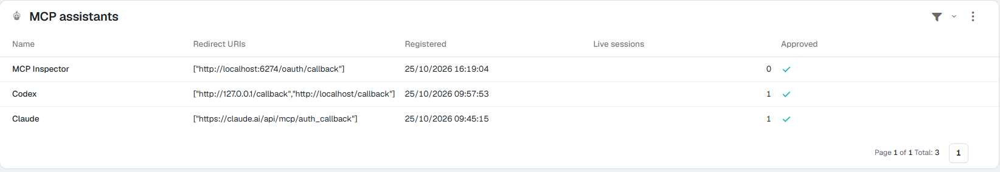
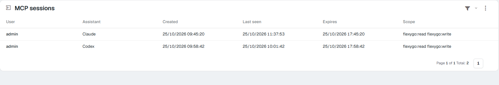

# How assistants register (CIMD) <span class="fh-version-tag" title="Available since version 10">10.0+</span>

When an AI assistant connects to the application's MCP, the application has to know **who it is**: its name, where to send the access back and whether an administrator lets it in. There are now two ways to introduce itself, and the application accepts both:

| | **CIMD** (*Client ID Metadata Document*) | **Dynamic registration** (DCR) |
|---|---|---|
| How it introduces itself | With **its own https address** that publishes its card: name and redirect addresses | It registers when connecting and gets a new identifier |
| Who uses it | Claude (web, desktop and mobile), Claude Code, ChatGPT, Codex… | Clients that do not use CIMD yet (MCP Inspector, in-house developments…) |
| Rows in **MCP assistants** | **One per product**, always the same | One per registration: a client that registers on each connection leaves a row each time |

Assistants that can use CIMD choose it on their own: the application announces that it supports it, and there is nothing to configure or change in the assistant.

---

## What changes for the administrator

**One row per assistant, not per connection.** Before, Claude created a new client every time someone connected from scratch, and the **MCP assistants** list filled up with repeated "Claude" rows. Now Claude is a single row, Codex another and Claude Code another, whoever connects and however many times.



In the picture, **Claude** and **Codex** came in with CIMD: they have the redirect addresses their card publishes (`claude.ai/api/mcp/auth_callback`; `127.0.0.1` and `localhost` for Codex, which receives the access on the person's own computer). **MCP Inspector** registered when connecting.

So:

- **Approving or blocking applies to the whole product.** Clearing *Approved* on the **Claude** row cuts Claude off for everyone (web, desktop and mobile share the row), on the next call. Claude Code has its own row and is not affected.
- **With `MCP_RequireApprovedClients` on**, each assistant is approved **once**. Before, every new registration of Claude had to be approved.
- **The purge does not delete CIMD rows.** The `ClearMcpClients` job still deletes dynamic-registration clients unused for `MCP_ClientPurgeDays` days, but it leaves CIMD ones alone: deleting them would let a blocked one back in, approved, the next time it connects.
- **Each connection still belongs to one person**: **MCP sessions** shows who, with which assistant and with which permissions, and **Revoke** cuts only that session.



### Telling a CIMD row apart

The screen does not show the client's identifier. It is in the `MCP_Clients` table, `ClientId` column:

| Assistant | `ClientId` (CIMD) | Redirects to |
|---|---|---|
| Claude (web, desktop, mobile) | `https://claude.ai/oauth/mcp-oauth-client-metadata` | `https://claude.ai/api/mcp/auth_callback` |
| Claude Code | `https://claude.ai/oauth/claude-code-client-metadata` | the computer's `localhost` / `127.0.0.1` |
| ChatGPT | `https://chatgpt.com/oauth/client.json` | `https://chatgpt.com/connector_platform_oauth_redirect` |
| Codex | `https://chatgpt.com/oauth/codex/client.json` | the computer's `localhost` / `127.0.0.1` |
| Dynamic registration | 32 hexadecimal characters, no `https://` | whatever it declared when registering |

```sql
SELECT ClientId, ClientName, Approved,
       CASE WHEN ClientId LIKE 'https://%' THEN 'CIMD' ELSE 'DCR' END AS Kind
FROM MCP_Clients
```

---

## What the person connecting sees

Nothing new: they sign in with their user and see the consent page, with the assistant's name and **the site the access goes to**. With CIMD, that site comes from the assistant's card:

- **claude.ai** for Claude and **chatgpt.com** for ChatGPT.
- **127.0.0.1** or **localhost** for clients that live on the person's own computer (Claude Code, Codex). That is right: the access does not leave that person's machine.

{ width="360" }

---

## Security

An assistant's card is an internet address, so the application fetches it carefully:

- **Only after the person has signed in** to the application. Nobody anonymous can make the server go and fetch an address.
- **https only**, with a path and no user or password in the address. An address that resolves to a private, loopback or reserved address is refused. Redirects are not followed, and the download stops at **5 seconds** or **64 KB**.
- The card must carry **its own address** as `client_id`, a name and the redirect addresses. The redirect the assistant asks for must be in that list. For clients on the person's own computer (`localhost`, `127.0.0.1`) the port does not count, because it changes on every connection.
- The card is kept in memory for as long as its `Cache-Control` says (between 5 minutes and 24 hours; one hour if it says nothing). Each connection refreshes the row's name and redirect addresses, **but never *Approved***: a blocked assistant stays blocked.
- Authorization responses also carry the **`iss`** parameter with the application's address. The assistant checks it so it does not mistake this application for another. There is nothing to configure.

!!! warning "The Backend must be able to reach the internet"
    The one that fetches the card is the application's **Backend**, over https, to the assistant's domain (`claude.ai`, `chatgpt.com`…). If a firewall or a proxy does not let it out, a CIMD assistant's connection fails on the consent page with the reason ("The client's metadata document could not be fetched…"). Dynamic-registration clients do not need it.

---

## If something does not work

| What you see | Why | What to do |
|---|---|---|
| The consent page says the client's card could not be fetched | The Backend cannot reach the assistant's domain | Open the Backend's https egress to that domain |
| The consent page says the redirect address is not in the card | The assistant asks to return to an address its card does not declare | It is a protection: tell the assistant's vendor |
| An assistant shows up unapproved | `MCP_RequireApprovedClients` is on and it is the first time it connects | Approve it once in **MCP assistants** |
| Repeated rows of one assistant keep appearing | That assistant uses dynamic registration, not CIMD | They are purged on their own after `MCP_ClientPurgeDays` days unused |

Settings, the call log and the other screens are in the reference: [AI assistants (MCP)](2Reference.md).
