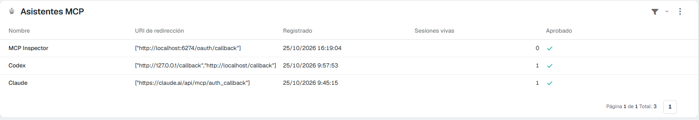
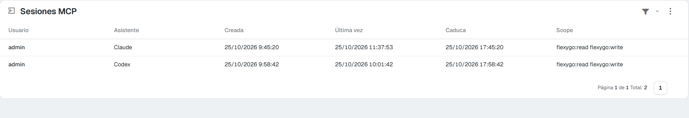

# Cómo se registran los asistentes (CIMD) <span class="fh-version-tag" title="Disponible desde la versión 10">10.0+</span>

Cuando un asistente de IA se conecta al MCP de la aplicación, la aplicación tiene que saber **quién es**: su nombre, a dónde devolver el acceso y si un administrador lo deja entrar. Ahora hay dos maneras de presentarse, y la aplicación acepta las dos:

| | **CIMD** (*Client ID Metadata Document*) | **Registro dinámico** (DCR) |
|---|---|---|
| Cómo se presenta | Con una **dirección https propia** que publica su ficha: nombre y direcciones de vuelta | Se registra al conectar y recibe un identificador nuevo |
| Quién lo usa | Claude (web, escritorio y móvil), Claude Code, ChatGPT, Codex… | Clientes que todavía no usan CIMD (MCP Inspector, desarrollos propios…) |
| Filas en **MCP assistants** | **Una por producto**, siempre la misma | Una por registro: un cliente que se registra en cada conexión deja una fila cada vez |

Los asistentes que saben usar CIMD lo eligen solos: la aplicación anuncia que lo admite y no hay nada que configurar ni que tocar en el asistente.

---

## Qué cambia para el administrador

**Una fila por asistente, no por conexión.** Antes, Claude creaba un cliente nuevo cada vez que alguien conectaba desde cero, y la lista **MCP assistants** se llenaba de «Claude» repetidos. Ahora Claude es una sola fila, Codex otra y Claude Code otra, conecte quien conecte y cuantas veces sea.



En la imagen, **Claude** y **Codex** han entrado con CIMD: tienen las direcciones de vuelta que publica su ficha (`claude.ai/api/mcp/auth_callback`; `127.0.0.1` y `localhost` en Codex, que recibe el acceso en el propio equipo). **MCP Inspector** se ha registrado al conectar.

Por eso:

- **Aprobar o bloquear vale para todo el producto.** Quitar *Approved* en la fila de **Claude** corta a Claude para toda la plantilla (web, escritorio y móvil, que comparten fila), en la siguiente llamada. Claude Code tiene su propia fila y no se ve afectado.
- **Con `MCP_RequireApprovedClients` encendido**, cada asistente se aprueba **una vez**. Antes había que aprobar cada nuevo registro de Claude.
- **La purga no borra las filas CIMD.** El job `ClearMcpClients` sigue borrando los clientes de registro dinámico sin uso en `MCP_ClientPurgeDays` días, pero no toca los CIMD: si los borrara, uno bloqueado volvería a entrar aprobado al conectarse otra vez.
- **Cada conexión sigue siendo de una persona**: en **MCP sessions** se ve quién, con qué asistente y con qué permisos, y **Revoke** corta solo esa sesión.



### Distinguir una fila CIMD

La pantalla no enseña el identificador del cliente. Está en la tabla `MCP_Clients`, columna `ClientId`:

| Asistente | `ClientId` (CIMD) | Vuelve a |
|---|---|---|
| Claude (web, escritorio, móvil) | `https://claude.ai/oauth/mcp-oauth-client-metadata` | `https://claude.ai/api/mcp/auth_callback` |
| Claude Code | `https://claude.ai/oauth/claude-code-client-metadata` | `localhost` / `127.0.0.1` del equipo |
| ChatGPT | `https://chatgpt.com/oauth/client.json` | `https://chatgpt.com/connector_platform_oauth_redirect` |
| Codex | `https://chatgpt.com/oauth/codex/client.json` | `localhost` / `127.0.0.1` del equipo |
| Registro dinámico | 32 caracteres hexadecimales, sin `https://` | lo que declaró al registrarse |

```sql
SELECT ClientId, ClientName, Approved,
       CASE WHEN ClientId LIKE 'https://%' THEN 'CIMD' ELSE 'DCR' END AS Kind
FROM MCP_Clients
```

---

## Qué ve la persona que conecta

Nada nuevo: entra con su usuario y ve el consentimiento, con el nombre del asistente y **el sitio al que va el acceso**. Con CIMD, ese sitio sale de la ficha del asistente:

- **claude.ai** para Claude y **chatgpt.com** para ChatGPT.
- **127.0.0.1** o **localhost** para los clientes que viven en el propio equipo (Claude Code, Codex). Es lo correcto: el acceso no sale de la máquina de esa persona.

{ width="360" }

---

## Seguridad

La ficha de un asistente es una dirección de internet, así que la aplicación la descarga con cuidado:

- **Solo después de que la persona haya entrado** en la aplicación. Nadie anónimo puede hacer que el servidor vaya a buscar una dirección.
- **Solo https**, con ruta y sin usuario ni contraseña en la dirección. Se rechaza la que apunte a una dirección privada, de bucle local o reservada. No se siguen redirecciones, y se corta a los **5 segundos** o a los **64 KB**.
- La ficha tiene que traer **su propia dirección** como `client_id`, un nombre y las direcciones de vuelta. La vuelta que pide el asistente tiene que estar en esa lista. En los clientes del propio equipo (`localhost`, `127.0.0.1`), el puerto no cuenta, porque cambia en cada conexión.
- La ficha se guarda en memoria el tiempo que diga su `Cache-Control` (entre 5 minutos y 24 horas; una hora si no dice nada). Cada conexión refresca el nombre y las direcciones de vuelta de la fila, **pero nunca *Approved***: un asistente bloqueado sigue bloqueado.
- Las respuestas de autorización llevan además el parámetro **`iss`** con la dirección de la aplicación. El asistente lo comprueba para no confundir esta aplicación con otra. No hay nada que configurar.

!!! warning "El Backend tiene que poder salir a internet"
    Quien descarga la ficha es el **Backend** de la aplicación, por https, hacia el dominio del asistente (`claude.ai`, `chatgpt.com`…). Si un cortafuegos o un proxy no le deja salir, la conexión de un asistente CIMD falla en la página de consentimiento con el motivo («The client's metadata document could not be fetched…»). Los clientes de registro dinámico no lo necesitan.

---

## Si algo no sale

| Lo que ves | Por qué | Qué hacer |
|---|---|---|
| El consentimiento dice que la ficha del cliente no se pudo descargar | El Backend no llega al dominio del asistente | Abre la salida https del Backend a ese dominio |
| El consentimiento dice que la dirección de vuelta no es de la ficha | El asistente pide volver a una dirección que su ficha no declara | Es una protección: avisa al proveedor del asistente |
| Un asistente aprobado sale sin aprobar | `MCP_RequireApprovedClients` está encendido y es la primera vez que entra | Apruébalo una vez en **MCP assistants** |
| Siguen saliendo filas repetidas de un asistente | Ese asistente usa registro dinámico, no CIMD | Se purgan solas tras `MCP_ClientPurgeDays` días sin uso |

Los ajustes, el registro de llamadas y el resto de pantallas están en la referencia: [Asistentes de IA (MCP)](2Reference.md).
