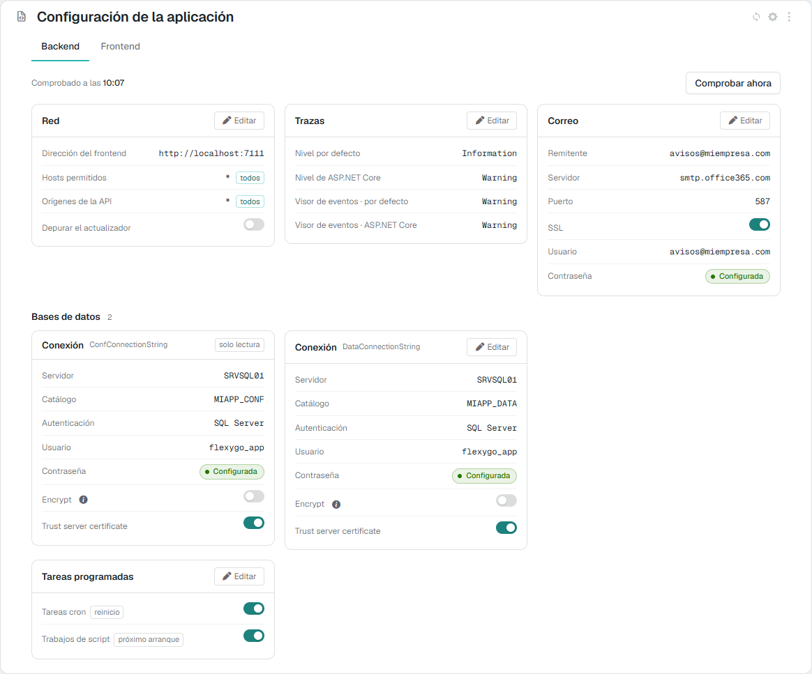
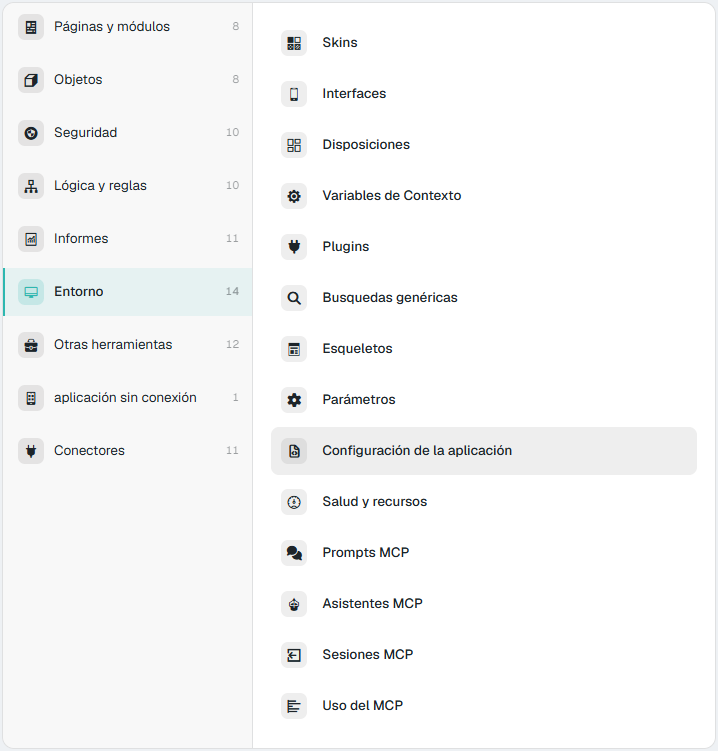
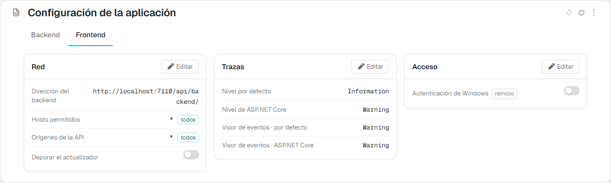
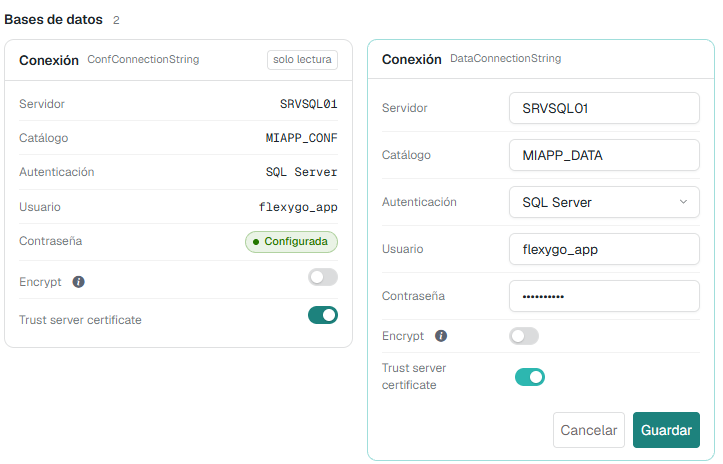
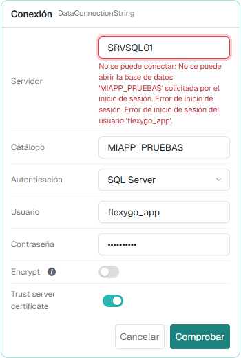
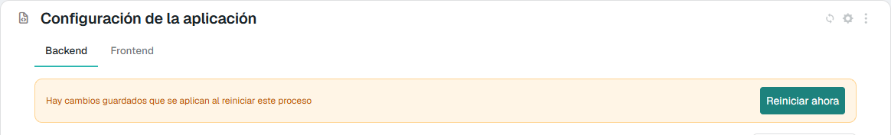
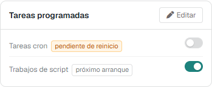

# Application configuration 10.0+

The **Application configuration** screen shows the `appsettings.json` files of the Backend and the Frontend and lets you change them from the application itself, without logging on to the server: the database connections, mail, logging, scheduled jobs and network.

It is not a file editor. It only shows the keys of a closed list; passwords never leave the server, and the connection to the configuration database (`ConfConnectionString`) can be seen but not changed. Before writing anything, the application checks that the new values work: a connection that does not open or a mail account that cannot log in never reach the file.

The screenshots on this page show the application in Spanish.

<figure markdown="span">
  
  <figcaption>The Backend tab: network, logging, mail, one card per database connection and the scheduled jobs</figcaption>
</figure>

---

## 1. Where it is and who sees it

- In the **control panel**, area **Environment** → **Application configuration**. In the flexy2022 skin: *Admin Work Area > Environment > Application configuration*.
- Since version 10.1, also in the [application panel](HealthPanel.md) (**Health and resources**), tab **Configuration**. It is the same screen.

<figure markdown="span">
  
  <figcaption>The Environment area of the control panel</figcaption>
</figure>

It is an **administrators'** screen. The Backend and the Frontend only answer a user with the administrator role; anyone else's request is refused, both to read and to save.

---

## 2. What it shows

It has two tabs, **Backend** and **Frontend**, one per process. Each one shows its own `appsettings.json` grouped in cards. What both processes have (network and logging) comes first and in the same place; then what is each one's own.

**Backend**

| Card | Fields | `appsettings.json` key |
|---|---|---|
| **Network** | Frontend address, Allowed hosts, API origins, Debug the updater | `FrontendEndpoint`, `AllowedHosts`, `WebApiOrigins`, `DebugUpdater` |
| **Logging** | Default level, ASP.NET Core level, and the same two for the Event log | `Logging:LogLevel:Default`, `Logging:LogLevel:Microsoft.AspNetCore`, `Logging:EventLog:LogLevel:…` |
| **Mail** | Sender, Server, Port, SSL, User, Password | `MailSettings:From`, `Host`, `Port`, `Ssl`, `UserName`, `Password` |
| **Databases** | One **Connection** card per connection: Server, Catalog, Authentication, User, Password, Encrypt and Trust server certificate | `ConnectionStrings:<id>` |
| **Scheduled jobs** | Cron jobs, Script jobs | `DisableCronJobs`, `DisableScriptJobs` |

**Frontend**

| Card | Fields | `appsettings.json` key |
|---|---|---|
| **Network** | Backend address, Allowed hosts, API origins, Debug the updater | `BackendEndpoint`, `AllowedHosts`, `WebApiOrigins`, `DebugUpdater` |
| **Logging** | The same four levels as in the Backend | `Logging:…` |
| **Access** | Windows authentication | `EnableWindowsAuth` |

<figure markdown="span">
  
  <figcaption>The Frontend tab: network, logging and access</figcaption>
</figure>

Some details on how the values are read:

- **The connections** are the configuration one and each **active** data connection in the connections table (`DbConnectionStrings`). A third connection is one more card under **Databases**. The connection string is shown split into its parts.
- **Passwords** are never shown: only whether they are **Configured** or **Not configured**. The value does not reach the browser, not even while editing.
- **Cron jobs** and **Script jobs** are shown the right way up: the file stores `DisableCronJobs` and `DisableScriptJobs`, and the screen says whether the jobs **run**. A switch that is on means the jobs are running.
- A `*` in **Allowed hosts** or **API origins** carries the **all** mark: any value is accepted.
- The value shown is **the one the process uses**, not just the one in the file. If an environment variable overrides it (the usual case in Docker), the screen shows that value with the **environment** mark.

### The marks on each row

| Mark | What it means |
|---|---|
| **read-only** | It is shown, but cannot be changed from here (the `ConfConnectionString` connection) |
| **restart** | Changing it needs the process restarted to take effect (`DisableCronJobs`, `EnableWindowsAuth`) |
| **pending restart** | A new value has been saved, but the process still runs with the one it started with (section 5) |
| **next start** | It only decides what the process does the next time it starts (`DisableScriptJobs`): it is never pending |
| **environment** | The value comes from an environment variable, which wins over the file. It cannot be changed from here |
| **fails** | It was checked and does not work. Hovering over it shows the reason and when it was checked |

---

## 3. The checks

When the **Backend** tab opens, the application tries the values that can be wrong without the process noticing:

- **the frontend address**, with the same call the updater makes;
- **each connection**, opening it and running a `SELECT 1`;
- **the mail account**, if it is configured, logging on to the SMTP server **without sending anything**.

Each check waits 3 seconds at most (10 for mail, because Office 365 answers a wrong password slowly on purpose). At the top it says **Checked at hh:mm** and, if something fails, **X of N checks failing**; each failing row carries the **fails** mark with the reason. **Check now** runs every check again at that moment.

The application remembers each result together with the value it tried: a value that has not changed is not tried again, and one that changed (from this screen, by hand in the file or through an environment variable) is tried again on its own. The **Frontend** tab has no checks.

---

## 4. Changing a value

1. Press **Edit** on the card. One card is edited at a time.
2. Change the fields. Each one uses the matching control:
    - a switch for yes/no values;
    - a list for the logging levels (`Trace`, `Debug`, `Information`, `Warning`, `Error`, `Critical`, `None`), so that a typo cannot stop the process from starting;
    - a list for the **Authentication** of a connection: **Windows (integrated)** or **SQL Server**. With Windows the user and password are hidden, and saving removes them from the connection string, because the connection logs in as the process's own identity;
    - a password field that shows dots when there is one already. If you leave it alone, the current one is kept; if you type another, it replaces it.
3. Press **Check** or **Save**:
    - If you changed something that can be tried (a connection, the mail, the frontend or backend address), the button is **Check**. If the values work, it says **The values work. You can save them now.** and **Save** appears.
    - Otherwise the button is **Save** straight away, which checks the same before writing.

<figure markdown="span">
  
  <figcaption>Editing the data connection. The configuration one can only be looked at</figcaption>
</figure>

If a value does not work, the reason appears under the field and nothing is saved. The screen warns when:

- a required value is missing (a connection needs a server and a catalog, and with SQL Server, a user; the mail needs a server);
- an address does not start with `http://` or `https://`;
- the port is not between 1 and 65535, or the sender is not a valid mail address;
- a part of the connection string contains `;`;
- the connection does not open, the mail account cannot log in, or nothing answers at the address given. In these cases the message is the one from the server that refused it (SQL Server, the mail server…).

<figure markdown="span">
  
  <figcaption>Checking a connection with a catalog that does not exist: SQL Server's message appears and nothing is saved</figcaption>
</figure>

### What saving does

- **The server checks everything again** before writing; it does not trust what the screen checked.
- **It only writes if every new value works.** First it leaves a copy of the file next to it, with the `.bak` extension.
- It writes to the process's `conf/appsettings.<Environment>.json` if it exists (for example, `appsettings.Production.json`), and otherwise to `conf/appsettings.json`.
- If the file has its secrets encrypted, new passwords are stored encrypted. See [Encrypted appsettings](../../1Deployment/2ConfigWizard/EncryptedSettings.md).
- Saving the mail marks it as configured (`MailSettings:Configured`), as the configuration wizard does.
- The backend address is accepted with or without the trailing `/` and with or without `api/backend/`, as in the wizard.
- The process log records **who changed which keys**, never their values.

---

## 5. When a change applies

Almost everything applies **at once**, without a restart: the connections, the mail, the API origins, the frontend and backend addresses, and the logging levels.

Only two keys need the process restarted, because they are read at start-up: **Cron jobs** (`DisableCronJobs`, in the Backend) and **Windows authentication** (`EnableWindowsAuth`, in the Frontend). They carry the **restart** mark. When a new value of one of them is saved, the row turns into **pending restart** and the notice **Some saved changes take effect when this process restarts** appears at the top.

<figure markdown="span">
  
  <figcaption>A saved change waiting for the Backend to restart</figcaption>
</figure>

<figure markdown="span">
  
  <figcaption>Cron jobs off, pending a restart. Script jobs only affects the next start</figcaption>
</figure>

- If the application is hosted in **IIS**, the notice has a **Restart now** button. Once confirmed, the process restarts, the screen says it is restarting and reloads by itself when the process answers again. Anyone using the application waits a few seconds.
- In **Docker**, as a service or with Kestrel, the notice says to restart it from there.

The notice survives a page reload: the process compares those keys with what it had when it started.

**Script jobs** (`DisableScriptJobs`) is different: it only decides whether the [database script jobs](../Programming/DatabaseScriptJobs.md) run at the next start, so it carries the **next start** mark and is never pending.

---

## 6. What cannot be changed from here

- **The connection to the configuration database** (`ConfConnectionString`). Changing it is changing the installation, and a mistake would lock the screen itself out. It is changed by hand in the Backend's `appsettings.json`.
- **Anything that comes from an environment variable.** The file would have no effect, because the variable wins. Change the variable instead (for example, in the `docker-compose` file or the container configuration).
- **The keys that are not on the list**, which are neither shown nor written: `Kestrel`, `ProjectName` (with the database running, the settings table governs it), `DatabaseNuget`, `JwtSettings`, `DataProtection` and the optional `ForwardedHeaders` and `HttpsRedirection`. They are edited in the file; see [Reference: appsettings.json](../../1Deployment/2ConfigWizard/AppSettingsReference.md).
