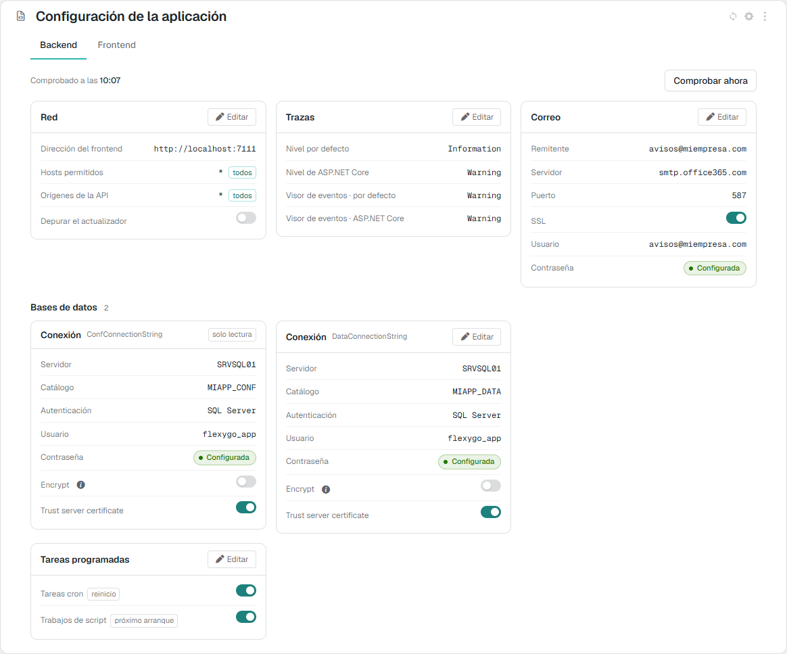
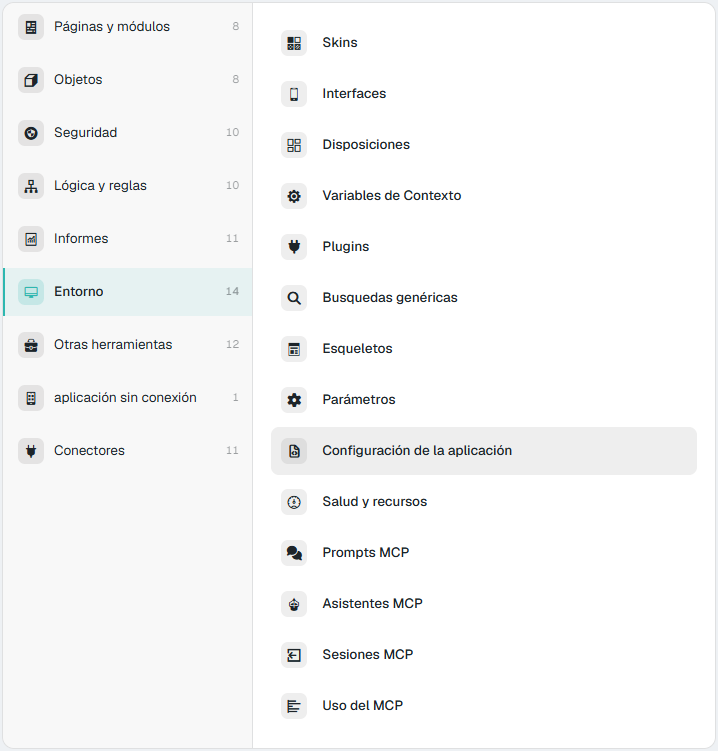
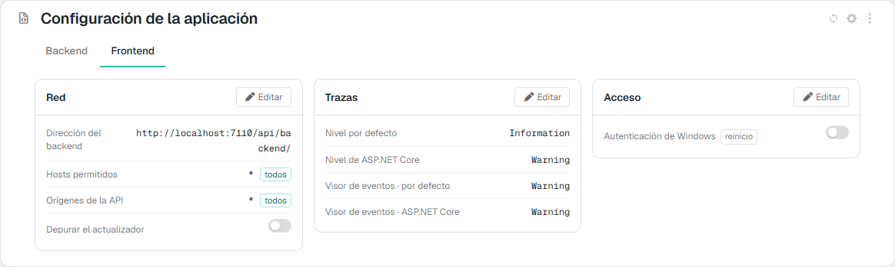
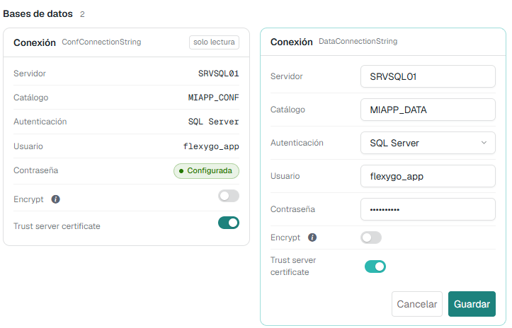
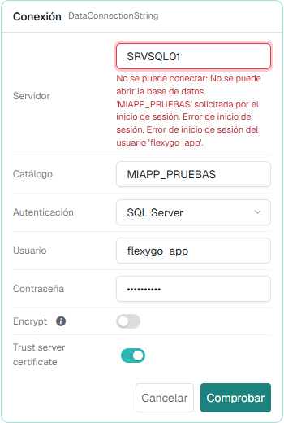
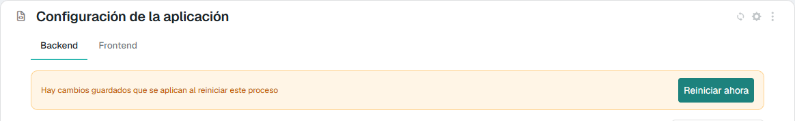
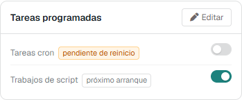

# Configuración de la aplicación 10.0+

La pantalla **Configuración de la aplicación** enseña los ficheros `appsettings.json` del Backend y del Frontend y permite cambiarlos desde la propia aplicación, sin entrar en el servidor: las conexiones a las bases de datos, el correo, las trazas, las tareas programadas y la red.

No es un editor del fichero. Solo enseña las claves de una lista cerrada; las contraseñas no salen nunca del servidor, y la conexión a la base de configuración (`ConfConnectionString`) se puede ver, pero no cambiar. Antes de escribir nada, la aplicación comprueba que los valores nuevos funcionan: una conexión que no abre o una cuenta de correo que no entra no llegan al fichero.

<figure markdown="span">
  
  <figcaption>La pestaña Backend: red, trazas, correo, una tarjeta por cada conexión a base de datos y las tareas programadas</figcaption>
</figure>

---

## 1. Dónde está y quién la ve

- En el **panel de control**, área **Entorno** → **Configuración de la aplicación**. En la skin flexy2022: *Admin Work Area > Environment > Application configuration*.
- Desde la versión 10.1, también en el [panel de la aplicación](HealthPanel.md) (**Salud y recursos**), pestaña **Configuration**. Es la misma pantalla.

<figure markdown="span">
  
  <figcaption>El área Entorno del panel de control</figcaption>
</figure>

Es una pantalla de **administradores**. El Backend y el Frontend solo responden a un usuario con rol de administrador; a cualquier otro le rechazan la petición, tanto para leer como para guardar.

---

## 2. Qué enseña

Tiene dos pestañas, **Backend** y **Frontend**, una por proceso. Cada una enseña su propio `appsettings.json` agrupado en tarjetas. Lo que tienen los dos procesos (la red y las trazas) sale primero y en el mismo sitio; después, lo propio de cada uno.

**Backend**

| Tarjeta | Campos | Clave del `appsettings.json` |
|---|---|---|
| **Red** | Dirección del frontend, Hosts permitidos, Orígenes de la API, Depurar el actualizador | `FrontendEndpoint`, `AllowedHosts`, `WebApiOrigins`, `DebugUpdater` |
| **Trazas** | Nivel por defecto, Nivel de ASP.NET Core, y los mismos dos para el Visor de eventos | `Logging:LogLevel:Default`, `Logging:LogLevel:Microsoft.AspNetCore`, `Logging:EventLog:LogLevel:…` |
| **Correo** | Remitente, Servidor, Puerto, SSL, Usuario, Contraseña | `MailSettings:From`, `Host`, `Port`, `Ssl`, `UserName`, `Password` |
| **Bases de datos** | Una tarjeta **Conexión** por cada conexión: Servidor, Catálogo, Autenticación, Usuario, Contraseña, Encrypt y Trust server certificate | `ConnectionStrings:<id>` |
| **Tareas programadas** | Tareas cron, Trabajos de script | `DisableCronJobs`, `DisableScriptJobs` |

**Frontend**

| Tarjeta | Campos | Clave del `appsettings.json` |
|---|---|---|
| **Red** | Dirección del backend, Hosts permitidos, Orígenes de la API, Depurar el actualizador | `BackendEndpoint`, `AllowedHosts`, `WebApiOrigins`, `DebugUpdater` |
| **Trazas** | Los mismos cuatro niveles que en el Backend | `Logging:…` |
| **Acceso** | Autenticación de Windows | `EnableWindowsAuth` |

<figure markdown="span">
  
  <figcaption>La pestaña Frontend: red, trazas y acceso</figcaption>
</figure>

Algunos detalles de cómo se leen los valores:

- **Las conexiones** son la de configuración y cada conexión de datos **activa** de la tabla de conexiones (`DbConnectionStrings`). Una tercera conexión es una tarjeta más dentro de **Bases de datos**. La cadena de conexión se enseña desmontada en sus partes. Junto a **Encrypt**, una explicación 10.1+: es el atributo de la cadena que obliga a **cifrar la comunicación** con SQL Server, y entonces el cliente valida el certificado del servidor, salvo que `TrustServerCertificate` diga que se fíe de él. No tiene que ver con el [cifrado de los appsettings](../../1Deployment/2ConfigWizard/EncryptedSettings.md), que protege los valores guardados en el fichero.
- **Las contraseñas** no se enseñan nunca: solo si están **Configurada** o **Sin configurar**. El valor no llega al navegador ni siquiera al editar.
- **Tareas cron** y **Trabajos de script** se enseñan al derecho: el fichero guarda `DisableCronJobs` y `DisableScriptJobs`, y la pantalla dice si las tareas **se ejecutan**. El interruptor encendido significa que las tareas están en marcha.
- Un `*` en **Hosts permitidos** u **Orígenes de la API** lleva la marca **todos**: se acepta cualquiera.
- El valor enseñado es **el que usa el proceso**, no solo el del fichero. Si una variable de entorno lo sustituye (lo normal en Docker), la pantalla enseña ese valor con la marca **entorno**.

### Las marcas de cada fila

| Marca | Qué quiere decir |
|---|---|
| **solo lectura** | Se enseña, pero no se cambia desde aquí (la conexión `ConfConnectionString`) |
| **reinicio** | Cambiarla exige reiniciar el proceso para que tenga efecto (`DisableCronJobs`, `EnableWindowsAuth`) |
| **pendiente de reinicio** | Se ha guardado un valor nuevo, pero el proceso sigue con el que tenía al arrancar (sección 5) |
| **próximo arranque** | Solo decide qué hace el proceso la próxima vez que arranque (`DisableScriptJobs`): nunca queda pendiente |
| **entorno** | El valor viene de una variable de entorno, que manda sobre el fichero. No se puede cambiar desde aquí |
| **falla** | Se ha comprobado y no funciona. Al pasar el ratón por encima se ve el motivo y la hora de la comprobación |

---

## 3. Las comprobaciones

Al abrir la pestaña **Backend**, la aplicación prueba los valores que pueden estar mal sin que el proceso lo note:

- **la dirección del frontend**, con la misma llamada que hace el actualizador;
- **cada conexión**, abriéndola y ejecutando un `SELECT 1`;
- **la cuenta de correo**, si está configurada, iniciando sesión en el servidor SMTP **sin enviar nada**.

Cada prueba espera como mucho 3 segundos (10 la del correo, porque Office 365 responde despacio a propósito cuando la contraseña es incorrecta). Arriba sale **Comprobado a las hh:mm** y, si algo falla, **X de N comprobaciones fallan**; cada fila que falla lleva la marca **falla** con el motivo. **Comprobar ahora** repite todas las pruebas en ese momento.

La aplicación recuerda cada resultado junto con el valor que probó: un valor que no ha cambiado no se vuelve a probar, y uno que ha cambiado (desde esta pantalla, a mano en el fichero o con una variable de entorno) se prueba de nuevo él solo. La pestaña **Frontend** no tiene comprobaciones.

---

## 4. Cambiar un valor

1. Pulsa **Editar** en la tarjeta. Se edita una tarjeta cada vez.
2. Cambia los campos. Cada uno usa el control que le corresponde:
    - un interruptor para los sí/no;
    - una lista para los niveles de traza (`Trace`, `Debug`, `Information`, `Warning`, `Error`, `Critical`, `None`), para que una errata no impida arrancar el proceso;
    - una lista para la **Autenticación** de una conexión: **Windows (integrada)** o **SQL Server**. Con Windows se ocultan el usuario y la contraseña, y al guardar se quitan de la cadena de conexión, porque la conexión entra con la identidad del propio proceso;
    - un campo de contraseña que aparece relleno con puntos si ya hay una. Si no lo tocas, se mantiene la actual; si escribes otra, se sustituye.
3. Pulsa **Comprobar** o **Guardar**:
    - Si has cambiado algo que se puede probar (una conexión, el correo, la dirección del frontend o del backend), el botón es **Comprobar**. Si los valores funcionan, sale **Los valores funcionan. Ya puedes guardarlos.** y aparece **Guardar**.
    - En cualquier otro caso el botón es directamente **Guardar**, que comprueba lo mismo antes de escribir.

<figure markdown="span">
  
  <figcaption>Editando la conexión de datos. La de configuración solo se puede consultar</figcaption>
</figure>

Si un valor no sirve, el motivo sale debajo del campo y no se guarda nada. La pantalla avisa cuando:

- falta un valor obligatorio (una conexión necesita servidor y catálogo, y con SQL Server, usuario; el correo necesita servidor);
- una dirección no empieza por `http://` o `https://`;
- el puerto no está entre 1 y 65535, o el remitente no es una dirección de correo válida;
- una parte de la cadena de conexión contiene `;`;
- la conexión no abre, la cuenta de correo no entra o no hay respuesta en la dirección indicada. En estos casos el mensaje es el del propio servidor que lo rechaza (SQL Server, el servidor de correo…).

<figure markdown="span">
  
  <figcaption>Comprobar una conexión con un catálogo que no existe: sale el mensaje de SQL Server y no se guarda nada</figcaption>
</figure>

### Qué hace al guardar

- **El servidor vuelve a comprobarlo todo** antes de escribir; no se fía de lo que haya comprobado la pantalla.
- **Solo escribe si todos los valores nuevos funcionan.** Antes deja una copia del fichero al lado, con la extensión `.bak`.
- Escribe en `conf/appsettings.<Entorno>.json` del proceso si existe (por ejemplo, `appsettings.Production.json`) y, si no, en `conf/appsettings.json`.
- Si el fichero tiene los secretos cifrados, las contraseñas nuevas se guardan cifradas. Ver [Cifrado de los appsettings](../../1Deployment/2ConfigWizard/EncryptedSettings.md).
- Al guardar el correo se marca como configurado (`MailSettings:Configured`), igual que en el asistente de configuración.
- La dirección del backend se acepta con o sin la `/` final y con o sin `api/backend/`, como en el asistente.
- El registro del proceso apunta **quién cambió qué claves**, nunca sus valores.

---

## 5. Cuándo se aplica un cambio

Casi todo se aplica **al momento**, sin reiniciar: las conexiones, el correo, los orígenes de la API, la dirección del frontend y la del backend, y los niveles de traza.

Solo dos claves necesitan reiniciar el proceso, porque se leen al arrancar: **Tareas cron** (`DisableCronJobs`, en el Backend) y **Autenticación de Windows** (`EnableWindowsAuth`, en el Frontend). Llevan la marca **reinicio**. Cuando se guarda un valor nuevo de alguna de ellas, la fila pasa a **pendiente de reinicio** y arriba aparece el aviso **Hay cambios guardados que se aplican al reiniciar este proceso**.

<figure markdown="span">
  
  <figcaption>Un cambio guardado que espera a que se reinicie el Backend</figcaption>
</figure>

<figure markdown="span">
  
  <figcaption>Tareas cron apagada, pendiente de reinicio. Trabajos de script solo afecta al próximo arranque</figcaption>
</figure>

- Si la aplicación está alojada en **IIS**, el aviso trae el botón **Reiniciar ahora**. Tras confirmarlo, el proceso se reinicia, la pantalla indica que se está reiniciando y se recarga sola cuando el proceso vuelve a responder. Quien esté usando la aplicación esperará unos segundos.
- En **Docker**, como servicio o con Kestrel, el aviso dice que hay que reiniciarlo desde allí.

El aviso no se pierde al recargar la página: el proceso compara esas claves con las que tenía al arrancar.

**Trabajos de script** (`DisableScriptJobs`) es distinto: solo decide si los [trabajos de script de base de datos](../Programming/DatabaseScriptJobs.md) se ejecutan en el próximo arranque, así que lleva la marca **próximo arranque** y nunca queda pendiente.

---

## 6. Lo que no se cambia desde aquí

- **El tiempo máximo de las llamadas al Backend.** No es una clave del `appsettings`, sino el ajuste **BackendCallTimeoutSeconds** de la aplicación; ver [Una operación larga se corta a los 10 minutos](../../4Troubleshooting/1Deployment.md).
- **La conexión a la base de configuración** (`ConfConnectionString`). Cambiarla es cambiar la instalación, y un error dejaría sin acceso a la propia pantalla. Se cambia a mano en el `appsettings.json` del Backend.
- **Lo que viene de una variable de entorno.** El fichero no tendría efecto, porque la variable manda. Hay que cambiar la variable (por ejemplo, en el `docker-compose` o en la configuración del contenedor).
- **Las claves que no están en la lista**, que ni se enseñan ni se pueden escribir: `Kestrel`, `ProjectName` (con la base de datos en marcha manda la tabla de ajustes), `DatabaseNuget`, `JwtSettings`, `DataProtection` y las opcionales `ForwardedHeaders` y `HttpsRedirection`. Se editan en el fichero; ver [Referencia: appsettings.json](../../1Deployment/2ConfigWizard/AppSettingsReference.md).
