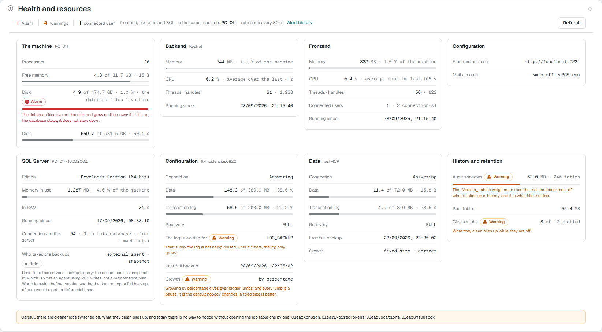
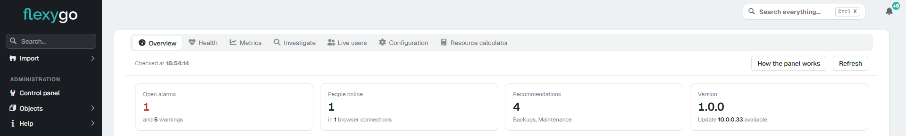
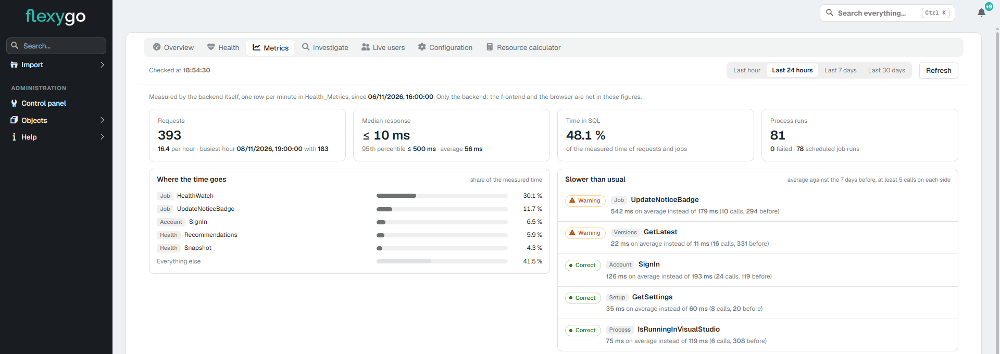
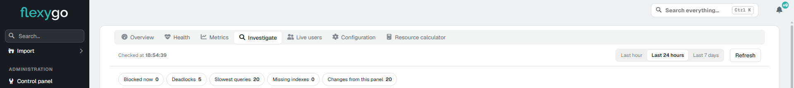
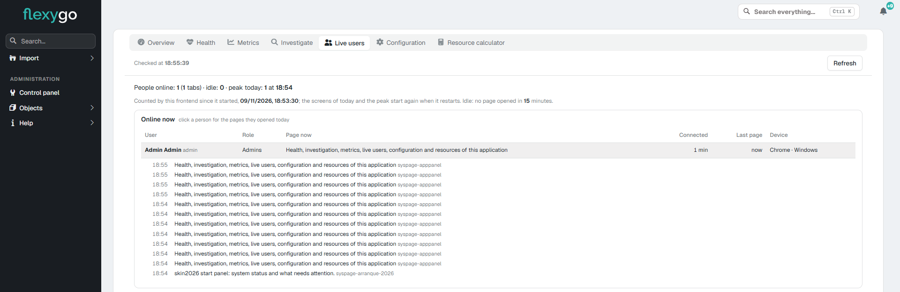
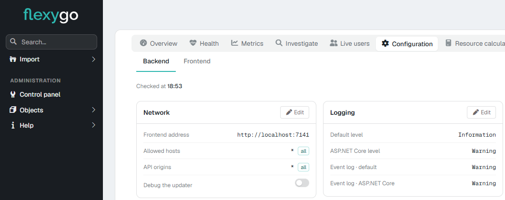
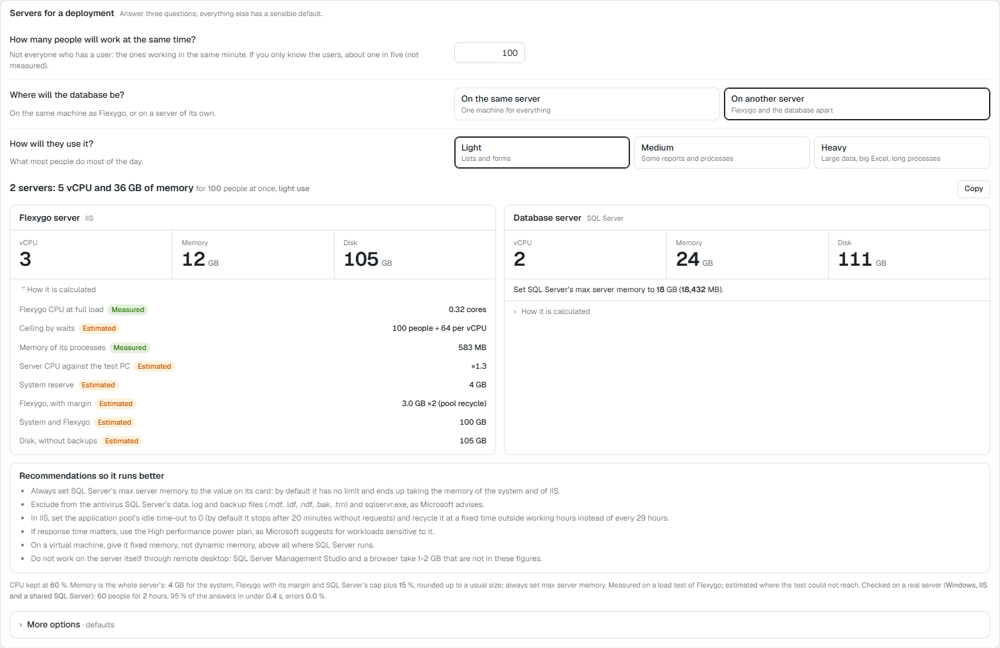
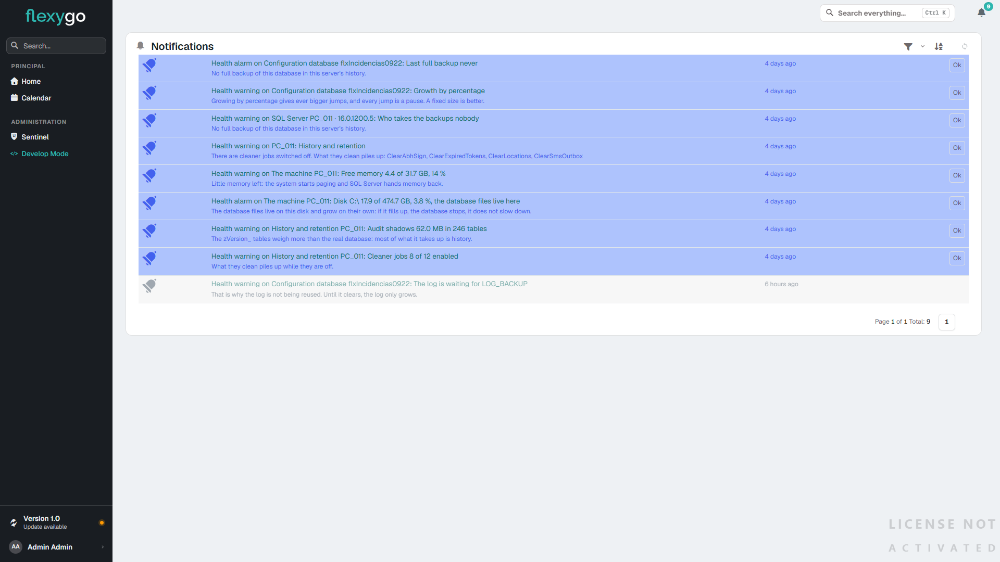

# Application panel 10.0+

!!! info "New in version 10.1"

    You can now review alerts and recommendations, find blocking, deadlocks and slow queries, and see where the application spends its time and who is online. The panel also suggests indexes: review the script before creating one, and undo it if needed. Changes are recorded.

    Open it from **Admin > Environment > Health and resources** or from the **Control panel** in skin 2026. In **Configuration**, you can review the Backend and Frontend settings; use the resource calculator to size the server. The panel is available to administrators only.

    

The **application panel** brings together on one screen, for administrators only, how the installation is doing, what it spends its time on and who is using it: the machine, the Backend and Frontend processes, SQL Server and each connected database; the metrics the application measures itself; blocking, deadlocks and slow queries; the people online; the configuration of both processes, and a resource calculator. It only reports what it has been able to measure, and when something is wrong, why it matters.

<figure markdown="span">
  
  <figcaption>The Health tab with one alarm (the database disk almost full) and four warnings, each with its explanation below</figcaption>
</figure>

---

## 1. Where it is and who sees it

- In the **control panel**, **Environment** area → **Health and resources**.
- From the administrator home screen, the **Health** card → **Health and resources** ([Administrator home screen](AdminDashboard.md)).

It is an **administrators'** screen: the data is only served to a user with the administrator role, and anyone else gets a clear refusal from the application, not an error. The control panel entry is in skin2026.

The **How the panel works** button, on the **Overview** tab, opens the panel's help inside the application itself.

---

## 2. The tabs

| Tab | What it holds |
|---|---|
| **Overview** | What needs a look now: open alarms and warnings, people online, recommendations and version, each with a link to its tab |
| **Health** | The machine, the processes, SQL Server and each database of the application, refreshed every 30 seconds, and the recommendations (3 and 4) |
| **Metrics** | What the Backend spends its time on, measured by itself (5) |
| **Investigate** | What is blocked now, deadlocks, the slowest queries, missing indexes and the changes made from the panel (6) |
| **Live users** | The people online now, one row per person (7) |
| **Configuration** | The configuration of the Backend and the Frontend (8) |
| **Resource calculator** | The servers for a deployment from three questions, and what the application is, how much it grows and what load it has (9) |

Every figure says where it comes from. When a permission is missing, the panel says which one instead of guessing or showing a zero.

<figure markdown="span">
  
  <figcaption>The Overview tab: open alarms and warnings, people online, recommendations and version</figcaption>
</figure>

---

## 3. Health

At the top, the summary: how many **alarms** and **warnings** there are, how many **connected users**, whether Frontend, Backend and SQL Server are on the same machine or on several, and the **Alert history** link (11). The panel refreshes itself every 30 seconds, and **Refresh** does it immediately.

Below, one card per component. Each row gives its figure and, if it is wrong, carries the **Alarm** or **Warning** mark and a line explaining what happens if it is left as is.

| Card | What it says |
|---|---|
| **The machine** | Processors, free memory and each disk, with how much free space is left. If SQL Server is on that machine, the disk holding the database files is flagged: if it fills up, the database stops |
| **Backend** / **Frontend** | The process memory and what share of the machine it is, the CPU as an **average over the last few seconds** (it says how many), threads and handles, and how long it has been running. The Frontend also says how many **connected users** there are and how many open connections (a user with two tabs is two connections) |
| **Configuration** | The Frontend address the Backend uses and the mail account, with a warning if either does not respond |
| **SQL Server** | Edition, memory in use and how much of it is in RAM (not paged), how long it has been running, connections to the server (to this database and from how many machines) and **who makes the backups**, according to the server's own history |
| **Configuration** / **Data** | One per connected database: whether it responds, the size of the data and of the transaction log, the recovery model, what the log is waiting for before it can be reused, the last full backup and how it grows |
| **History and retention** | How much space the history tables take compared to the real tables, and how many cleanup jobs are enabled |

At the bottom there may be a note with things worth knowing even if they are not an alarm, for example which cleanup jobs are disabled.

!!! note "If permissions are missing, it says so"
    Part of the SQL Server data (memory, CPU, connections and disk space) requires the **VIEW SERVER STATE** server permission for the user the application uses to log in to SQL Server. If it does not have it, the panel does not make up those figures or set them to zero: it says so, naming the missing permission. Each database's data is read with the normal permissions on it.

In **skin2026** the panel only flags what needs looking at —alarms and warnings—: what is correct carries no mark, because when nothing shows up, everything is fine. In flexy2022 it also counts what is correct and has neither the recommendations nor the **Alert history** link.

---

## 4. Recommendations: what they do before you run them

In skin2026, **Health** recommends what the installation is missing: backups, Query Store, SQL Server memory and index and statistics maintenance. Each recommendation first checks that what it proposes does not exist yet (SQL Server Agent jobs, maintenance plans, the server's backup history) and says what it is based on.

**Show the script** shows exactly what will run, and nothing runs without your confirmation. If the connection has no permission to run it, the panel shows the script for a SQL Server administrator to run.

| Recommendation | What it does | How to undo it |
|---|---|---|
| **Backups** | Creates a SQL Server Agent job with a full backup every day at 02:00 and, if the database is in full recovery (FULL), another with a log backup every 30 minutes, in the instance's backup folder | Delete the database's **Flexygo - Backup** and **Flexygo - Backup log** jobs in SQL Server Agent |
| **Query Store** | Turns it on for that database, with a maximum size of 1 GB (256 MB on Express) | `ALTER DATABASE … SET QUERY_STORE = OFF` |
| **Maintenance** | Creates a job that on Sundays at 03:00 rebuilds or reorganizes the fragmented indexes of 1,000 pages or more and updates the statistics | Delete the database's **Flexygo - Maintenance** job |
| **SQL Server memory** | When SQL Server shares the machine with the application, sets its maximum memory to leave room for the rest | Set `max server memory` back with `sp_configure` |

What takes disk (Query Store, backups, index maintenance and the indexes suggested in **Investigate**) first checks the free space of the disk it would land on, adding up every database that would land on that same disk, and says its reach: Query Store is turned on **database by database**, so it says how many databases, the cap of each and the total. If the disk would drop below 15 % free, Query Store tries a smaller cap; and if it still does not fit, the recommendation offers no button and says to free some space first. Without the **VIEW SERVER STATE** permission it cannot check the disk, and says so.

On the **Express** edition, which has no SQL Server Agent, the job recommendations create nothing: they warn and say what to do. And if SQL Server Agent is **stopped**, the panel warns about it, because a backup or maintenance job created would never run.

---

## 5. Metrics

What the Backend spends its time on, measured by itself: requests, median and 95th percentile of the response time, time in SQL, process runs, where the time goes and what is slower than the week before. You choose the period: the last hour, 24 hours, 7 days or 30 days.

One row per minute is kept for 2 days and one per hour for 35 days. Only the Backend is measured. The **HealthMetricsEnabled** setting (**flx-telemetry** group) turns it off within 30 seconds, without a restart.

<figure markdown="span">
  
  <figcaption>Metrics over the last 24 hours: requests, times, time in SQL and what is slower than the week before</figcaption>
</figure>

---

## 6. Investigate

To find out why something is slow or keeps waiting. You choose the period: the last hour, 24 hours or 7 days.

- **The databases of the application**, what each one is and what may be done in it from the panel.
- **What is blocked now**: which session is waiting for which, and since when.
- **Deadlocks**, grouped by the statements that clash. They are kept for 90 days, without the values of their statements. Reading them takes a few seconds, so they are read on demand and remembered for ten minutes unless asked for again.
- **The slowest queries** according to Query Store, in each database where it is on.
- **Missing indexes** (below).
- **Changes from this panel**: every recommendation run and every index created or dropped, written down before it runs, with who, when, where, the script and the result.

<figure markdown="span">
  
  <figcaption>Investigate: how many blockings, deadlocks, slow queries, missing indexes and changes there are, each with its own section</figcaption>
</figure>

### Missing indexes

SQL Server suggests them, and the panel only shows them for the application's **own databases**: never for the configuration database, the ERP's or a product's.

Before creating one, the confirmation says how many rows the table has and, when the edition cannot build it without locking (ONLINE), that the table is locked for writing while it builds. On a big table, better out of working hours.

Every index created here appears under **Created from this panel** with how its queries ran without it and with it, and **Undo: drop the index** drops it again. Only the indexes the panel itself created can be dropped from the panel.

---

## 7. Live users

The people online now, **one row per person** and not per tab: their role, the page they have open, since when, the last page they opened and from which device. Click a person to see the pages they opened today.

A person is **idle** when they have not opened any page in 15 minutes. Only page names are counted, never the data of a record. The list lives in the Frontend's memory: it counts from when the Frontend started.

<figure markdown="span">
  
  <figcaption>Live users with one person opened: the pages they opened today</figcaption>
</figure>

---

## 8. Configuration

The configuration of both processes, in two tabs: **Backend** and **Frontend**. Each block —network, logging, mail, scheduled jobs, each database connection— shows its values, and what may be changed from here has its **Edit** button. The connection to the configuration database is read-only. Passwords are never shown: only whether they are configured.

**Check now** checks at once that what is configured answers, and while editing a block **Verify** tests it before saving. Saved changes that only take effect after restarting the process are marked **pending restart**: **Restart now** restarts it when the application is hosted in IIS; otherwise, restart it from Docker or from the service that runs it.

It is the same screen the control panel opens; what each block shows and how to change it is explained in [Application configuration](AppSettings.md).

<figure markdown="span">
  
  <figcaption>The Backend Configuration: each block with its values and its Edit button</figcaption>
</figure>

---

## 9. Resource calculator

At the top, **Servers for a deployment** says which servers the deployment you describe needs, which may not be the current one. Answer three questions; everything else has a sensible default:

- **How many people will work at the same time**: the ones working in the same minute, not the users with an account. By default, the busiest day measured here plus 25 %, or 40 when nothing is measured yet.
- **Where the database will be**: on the same server as Flexygo or on another one.
- **How they will use it**: light (lists and forms), medium (some reports and processes) or heavy (large data, big Excel files, long processes).

**More options**, folded, lets you change the number of Flexygo applications on that server, the size of the data (by default, this installation's), the SQL Server edition, the **operating system** of the servers (Windows Server with desktop, Server Core, Windows 10/11 or Linux, each with its memory reserve), other databases sharing that SQL Server, the frontend and the backend on separate servers, and text search in very large lists. Its folded line says what you changed.

The result shows below, at once: the total and **one card per server** with its **vCPU**, its **memory** (the whole server’s: the system, Flexygo with its margin and SQL Server) and its **disk**. Where SQL Server runs, the card also says what to set its **max server memory** to, which should always be set. **How it is calculated** shows each line of the sum marked **Measured** (measured in a load test of Flexygo) or **Estimated** (estimated where the test could not reach: the step from a desktop PC to a server, memory from the data size, the disk, the medium use). One-line warnings show when they matter: text search in huge lists (more hardware does not fix it), SQL Server Express that is not enough, or more than 6 vCPU for Flexygo (measure first).

Under the cards, **Recommendations so it runs better** lists what to do for what was chosen: set max server memory, move SQL Server apart from 100 people on, the antivirus exclusions, the IIS application pool, fixed memory on virtual machines and, with Linux, each container’s limits. With Windows 10/11 it warns that it is not for production: IIS runs at most 10 requests at once.

**Copy** leaves the result as text to paste wherever you want. Nothing is saved: when the panel is opened again, the questions return to their defaults.

**This installation against the recommendations** checks those recommendations on this installation, with the application’s normal permissions: SQL Server’s memory cap, SQL Server on another server from 100 people, the IIS application pool, the antivirus exclusions, the power plan, fixed memory on a virtual machine and the remote desktop sessions. Each one says whether it is **met**, **not met** or **cannot be read** (and how to check it by hand). Only SQL Server’s memory cap is applied from here, with confirmation, recorded and with **Undo**; it needs the ALTER SETTINGS permission. What belongs to Windows and IIS is offered as a PowerShell script for an administrator to review and run: the application never runs as administrator.

Below comes what the calculator takes from this installation:

- **What the application is**: objects, pages, processes and tasks.
- **The data**: the size and monthly growth of each database, and the SQL Server Express limit if that is the installed edition.
- **The load**: the load measured now by **Metrics**, and a linear estimate for the people of the deployment.

<figure markdown="span">
  
  <figcaption>Servers for a deployment: 100 people at the same time, database on another server, light use</figcaption>
</figure>

Guide figures for 50, 100 and 200 people are in [System requirements](../../1Deployment/SystemRequirements.md).

---

## 10. Warnings arrive on their own

You don't need to have the panel open. Every quarter of an hour the installation checks the same things **Health** shows, and for each new alarm or warning:

- it **notifies administrators in the notification bell**, with the title (what and where) and the reason; clicking it opens the panel;
- if it is an **alarm** and the application mail is configured, it **also sends an email** to each administrator with an email address.

Each problem notifies once: it is not repeated every quarter of an hour while it persists.

---

## 11. The alert history

**Alert history** opens the notification list filtered to health notifications: every alarm and warning that has been raised, with its reason and when.

<figure markdown="span">
  
  <figcaption>Alert history: the installation's health alarms and warnings, with pending ones highlighted</figcaption>
</figure>
