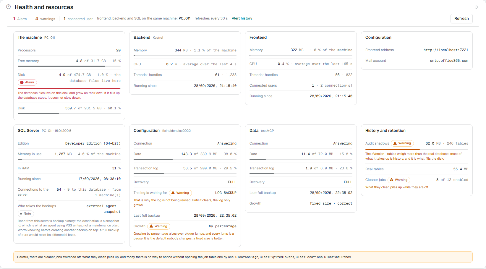
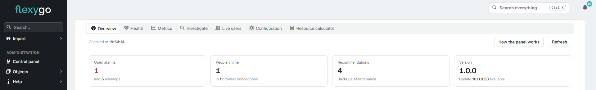
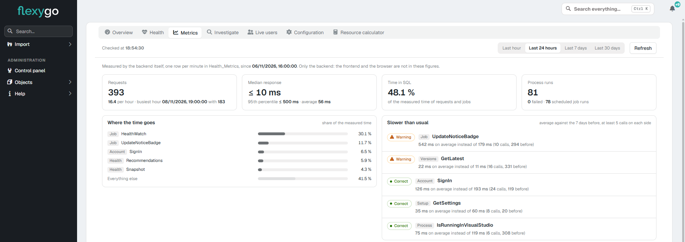
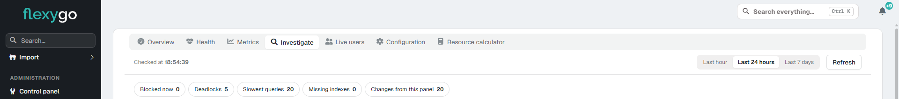
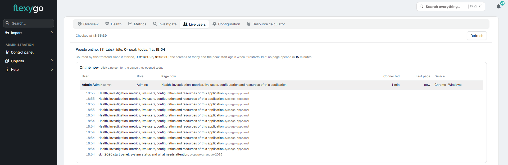
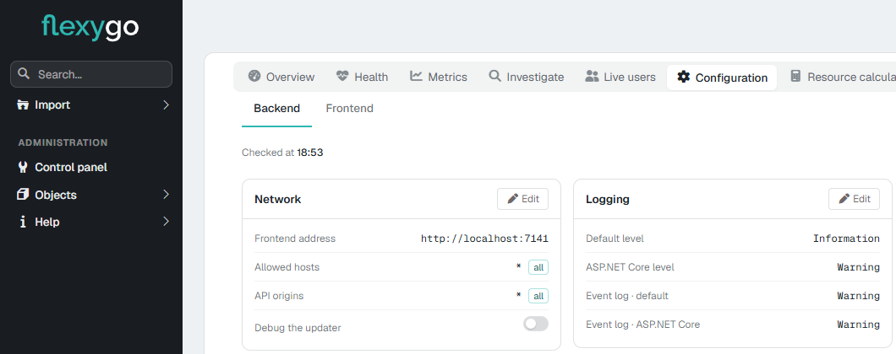
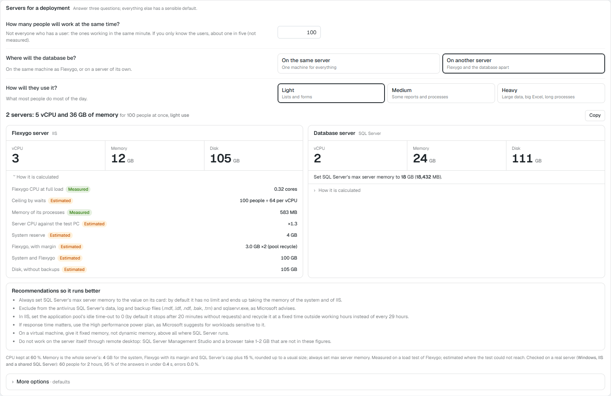
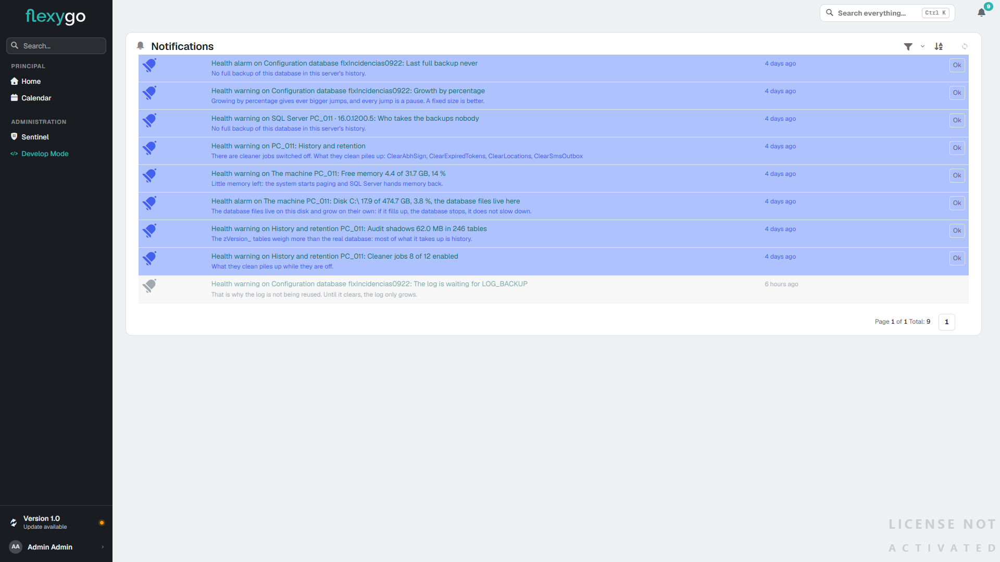

# Panel de la aplicación 10.0+

El **panel de la aplicación** reúne en una pantalla, solo para administradores, cómo está la instalación, en qué gasta el tiempo y quién la está usando: la máquina, los procesos del Backend y del Frontend, SQL Server y cada base conectada; las métricas que mide la propia aplicación; los bloqueos, interbloqueos y consultas lentas; las personas conectadas; la configuración de los dos procesos, y una calculadora de recursos. Dice solo lo que ha podido medir, y cuando algo no está bien, por qué importa.

<figure markdown="span">
  
  <figcaption>La pestaña Health con una alarma (el disco de la base casi lleno) y cuatro avisos, cada uno con su explicación debajo</figcaption>
</figure>

---

## 1. Dónde está y quién lo ve

- En el **panel de control**, área **Entorno** → **Salud y recursos**.
- Desde la pantalla de inicio del administrador, la tarjeta **Health** → **Health and resources** ([Pantalla de inicio del administrador](AdminDashboard.md)).

Es una pantalla de **administradores**: los datos solo se sirven a un usuario con rol de administrador, y a cualquier otro la aplicación le responde con un rechazo claro, no con un error. La entrada del panel de control está en skin2026.

El botón **How the panel works**, en la pestaña **Overview**, abre la ayuda del panel dentro de la propia aplicación.

---

## 2. Las pestañas

| Pestaña | Qué tiene |
|---|---|
| **Overview** | Lo que hay que mirar ahora: alarmas y avisos abiertos, personas conectadas, recomendaciones y versión, cada cosa con un enlace a su pestaña |
| **Health** | La máquina, los procesos, SQL Server y cada base de la aplicación, refrescado cada 30 segundos, y las recomendaciones (3 y 4) |
| **Metrics** | En qué gasta el tiempo el Backend, medido por él mismo (5) |
| **Investigate** | Lo que está bloqueado ahora, los interbloqueos, las consultas más lentas, los índices que faltan y los cambios hechos desde el panel (6) |
| **Live users** | Las personas conectadas ahora, una fila por persona (7) |
| **Configuration** | La configuración del Backend y del Frontend (8) |
| **Resource calculator** | Qué es la aplicación, cuánto crece y qué carga tiene, para dimensionar el servidor (9) |

Cada cifra dice de dónde sale. Cuando falta un permiso, el panel dice cuál en lugar de suponer o poner un cero.

<figure markdown="span">
  
  <figcaption>La pestaña Overview: alarmas y avisos abiertos, personas conectadas, recomendaciones y versión</figcaption>
</figure>

---

## 3. Health

Arriba, el resumen: cuántas **alarmas** y **avisos** hay, cuántos **usuarios conectados**, si Frontend, Backend y SQL Server están en la misma máquina o en varias, y el enlace **Alert history** (11). El panel se refresca solo cada 30 segundos, y **Refresh** lo hace al momento.

Debajo, una tarjeta por pieza. Cada fila dice su dato y, si está mal, lleva la marca **Alarm** o **Warning** y una línea que explica qué pasa si se deja así.

| Tarjeta | Qué dice |
|---|---|
| **The machine** | Procesadores, memoria libre y cada disco, con cuánto queda libre. Si SQL Server está en esa máquina, se señala el disco donde viven los ficheros de la base: si se llena, la base se para |
| **Backend** / **Frontend** | La memoria del proceso y qué parte de la máquina es, la CPU como **media de los últimos segundos** (dice de cuántos), hilos e identificadores, y desde cuándo corre. El Frontend dice además cuántos **usuarios conectados** hay y cuántas conexiones abiertas (un usuario con dos pestañas son dos conexiones) |
| **Configuration** | La dirección del Frontend que usa el Backend y la cuenta de correo, con un aviso si alguna no contesta |
| **SQL Server** | Edición, memoria en uso y qué parte de ella está en RAM (no paginada), desde cuándo corre, conexiones al servidor (a esta base y desde cuántas máquinas) y **quién hace las copias de seguridad**, según el historial del propio servidor |
| **Configuration** / **Data** | Una por cada base conectada: si contesta, lo que ocupan los datos y el registro de transacciones, el modelo de recuperación, a qué espera el registro para reutilizarse, la última copia completa y cómo crece |
| **History and retention** | Lo que ocupan las tablas de historial frente a las tablas reales, y cuántos trabajos de limpieza están encendidos |

Al pie puede salir una nota con lo que conviene saber aunque no sea una alarma, por ejemplo qué trabajos de limpieza están apagados.

!!! note "Si faltan permisos, lo dice"
    Una parte de los datos de SQL Server (memoria, CPU, conexiones y espacio en disco) necesita el permiso de servidor **VIEW SERVER STATE** para el usuario con el que la aplicación entra en SQL Server. Si no lo tiene, el panel no se inventa esas cifras ni las pone a cero: lo dice, con el permiso que falta. Lo de cada base se lee con los permisos normales sobre ella.

En **skin2026** el panel solo marca lo que hay que mirar —alarmas y avisos—: lo correcto no lleva marca, porque cuando no sale nada es que está bien. En flexy2022 cuenta también lo correcto, y no tiene ni las recomendaciones ni el enlace **Alert history**.

---

## 4. Recomendaciones: qué hacen antes de ejecutarlas

En skin2026, **Health** recomienda lo que le falta a la instalación: copias de seguridad, Query Store, la memoria de SQL Server y el mantenimiento de índices y estadísticas. Cada recomendación comprueba antes que lo que propone no existe ya (tareas de SQL Server Agent, planes de mantenimiento, el historial de copias del servidor) y dice en qué se basa.

**Show the script** enseña exactamente lo que se va a ejecutar, y nada se ejecuta sin tu confirmación. Si la conexión no tiene permiso para ejecutarlo, el panel enseña el guion para que lo ejecute un administrador de SQL Server.

| Recomendación | Qué hace | Cómo se deshace |
|---|---|---|
| **Copias de seguridad** | Crea una tarea de SQL Server Agent con una copia completa cada día a las 02:00 y, si la base está en recuperación completa (FULL), otra con una copia del registro cada 30 minutos, en la carpeta de copias de la instancia | Borrar las tareas **Flexygo - Backup** y **Flexygo - Backup log** de la base en SQL Server Agent |
| **Query Store** | Lo activa en esa base, con un tamaño máximo de 1 GB (256 MB en Express) | `ALTER DATABASE … SET QUERY_STORE = OFF` |
| **Mantenimiento** | Crea una tarea que los domingos a las 03:00 reconstruye o reorganiza los índices fragmentados de 1.000 páginas o más y actualiza las estadísticas | Borrar la tarea **Flexygo - Maintenance** de la base |
| **Memoria de SQL Server** | Cuando SQL Server comparte la máquina con la aplicación, fija su memoria máxima para dejar sitio al resto | Volver a poner `max server memory` con `sp_configure` |

Si la edición es **Express**, que no tiene SQL Server Agent, las recomendaciones de tareas no crean nada: avisan y dicen qué hacer. Y si SQL Server Agent está **parado**, el panel lo advierte, porque una tarea de copia o de mantenimiento creada no llegaría a ejecutarse.

---

## 5. Metrics

En qué gasta el tiempo el Backend, medido por él mismo: peticiones, mediana y percentil 95 del tiempo de respuesta, tiempo en SQL, ejecuciones de procesos, en qué se va el tiempo y qué va más lento que la semana anterior. Se elige el periodo: la última hora, 24 horas, 7 días o 30 días.

Se guarda una fila por minuto durante 2 días y una por hora durante 35 días. Solo se mide el Backend. El ajuste **HealthMetricsEnabled** (grupo **flx-telemetry**) lo apaga en 30 segundos como mucho, sin reiniciar.

<figure markdown="span">
  
  <figcaption>Metrics en las últimas 24 horas: peticiones, tiempos, tiempo en SQL y lo que va más lento que la semana anterior</figcaption>
</figure>

---

## 6. Investigate

Para buscar por qué algo va lento o se queda esperando. Se elige el periodo: la última hora, 24 horas o 7 días.

- **Las bases de la aplicación**, qué es cada una y qué se puede hacer en ella desde el panel.
- **Lo que está bloqueado ahora**: qué sesión espera a cuál y desde cuándo.
- **Los interbloqueos**, agrupados por las sentencias que chocan. Se guardan 90 días, sin los valores de sus sentencias. Leerlos tarda unos segundos, así que se piden al pulsar y se recuerdan diez minutos, salvo que se pidan de nuevo.
- **Las consultas más lentas** según Query Store, en cada base que lo tenga activado.
- **Los índices que faltan** (abajo).
- **Changes from this panel**: cada recomendación ejecutada y cada índice creado o quitado, apuntado antes de ejecutarse, con quién, cuándo, dónde, el guion y el resultado.

<figure markdown="span">
  
  <figcaption>Investigate: cuántos bloqueos, interbloqueos, consultas lentas, índices que faltan y cambios hay, cada uno con su apartado</figcaption>
</figure>

### Los índices que faltan

Los sugiere SQL Server, y el panel solo los enseña para las **bases propias** de la aplicación: nunca para la de configuración, la del ERP ni las de un producto.

Antes de crear uno, la confirmación dice cuántas filas tiene la tabla y, cuando la edición no permite crearlo sin bloquear (ONLINE), que la tabla queda bloqueada para escribir mientras se crea. En una tabla grande, mejor fuera del horario de trabajo.

Cada índice creado desde aquí sale en **Created from this panel** con cómo iban sus consultas sin él y con él, y **Undo: drop the index** lo vuelve a quitar. Desde el panel solo se pueden quitar los índices que creó el propio panel.

---

## 7. Live users

Las personas conectadas ahora, **una fila por persona** y no por pestaña: su rol, la página que tienen abierta, desde cuándo, la última página que abrieron y desde qué dispositivo. Al pulsar una persona salen las páginas que ha abierto hoy.

Una persona está **inactiva** cuando no ha abierto ninguna página en 15 minutos. Solo se cuentan nombres de páginas, nunca los datos de un registro. La lista vive en la memoria del Frontend: cuenta desde que arrancó.

<figure markdown="span">
  
  <figcaption>Live users con una persona abierta: las páginas que ha abierto hoy</figcaption>
</figure>

---

## 8. Configuration

La configuración de los dos procesos, en dos pestañas: **Backend** y **Frontend**. Cada bloque —red, registro, correo, trabajos programados, cada conexión a base de datos— enseña sus valores, y lo que se puede cambiar desde aquí tiene su botón **Edit**. La conexión a la base de configuración es de solo lectura. Las contraseñas no se enseñan nunca: solo si están configuradas.

**Check now** comprueba en el momento que lo configurado responde, y al editar un bloque **Verify** lo prueba antes de guardar. Los cambios guardados que solo valen tras reiniciar el proceso quedan marcados como **pending restart**: **Restart now** lo reinicia cuando la aplicación está alojada en IIS; si no, se reinicia desde Docker o desde el servicio que la ejecuta.

<figure markdown="span">
  
  <figcaption>Configuration del Backend: cada bloque con sus valores y su botón Edit</figcaption>
</figure>

---

## 9. Resource calculator

Lo que hace falta para dimensionar el servidor:

- **Qué es la aplicación**: objetos, páginas, procesos y tareas.
- **Los datos**: el tamaño y el crecimiento mensual de cada base, y el límite de SQL Server Express si es la edición instalada.
- **La carga**: la medida ahora por **Metrics**, y una estimación lineal para las personas que se espera que la usen.
- **Este servidor**: sus procesadores y su memoria.

<figure markdown="span">
  
  <figcaption>Resource calculator: qué es la aplicación y este servidor</figcaption>
</figure>

La recomendación de hardware está pendiente de una prueba de carga y todavía no da cifras.

---

## 10. Los avisos llegan solos

No hace falta tener el panel abierto. Cada cuarto de hora la instalación revisa lo mismo que enseña **Health**, y por cada alarma o aviso nuevo:

- **avisa a los administradores en la campana** de notificaciones, con el título (qué y dónde) y el motivo; al pulsarlo se abre el panel;
- si es una **alarma** y el correo de la aplicación está configurado, **manda además un correo** a cada administrador con dirección de correo.

Cada problema avisa una vez: no se repite cada cuarto de hora mientras siga ahí.

---

## 11. El historial de alertas

**Alert history** abre la lista de notificaciones filtrada a las de salud: cada alarma y aviso que se ha levantado, con su motivo y cuándo.

<figure markdown="span">
  
  <figcaption>Alert history: las alarmas y avisos de salud de la instalación, los pendientes resaltados</figcaption>
</figure>
