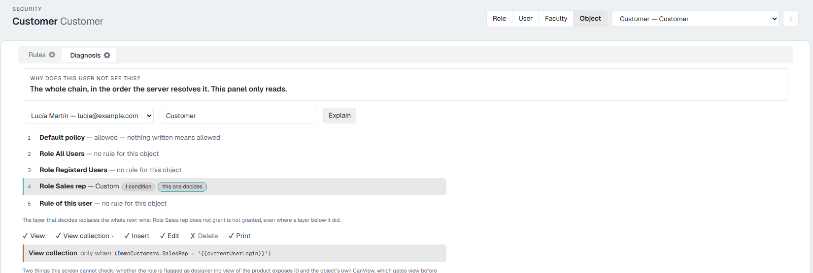
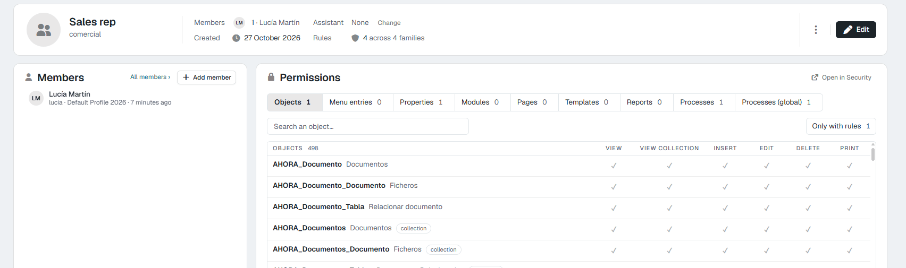
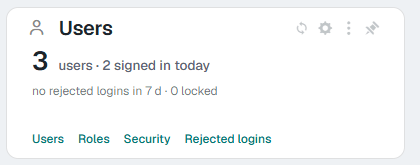

# Security: how Flexygo decides who can do what 10.0+

In version 10 all of the application's security is managed from **one screen**, **Security**: a table with one row for each thing (object, property, process, menu entry, page…) and one column for each permission (view, delete, run…). One click on a cell writes the rule straight away.

This page explains the ideas underneath: who can have rules, what happens when there are none, and how they combine. The other pages of this section cover the rest:

| Page | What you will find |
|---|---|
| [The security screen](2Screen.md) | Every part of the screen, its buttons and its warnings |
| [Rules, one by one](3Rules.md) | Each kind of rule: what it is for, how to set it and how to check it |
| [The web API and AI assistants](4WebAPIMCP.md) | Who gets into the API and who connects an AI assistant, and what they can read or change |
| [Try it: a «Sales rep» role in 15 minutes](5TryIt.md) | A full walk-through on your own application |
| [Common mistakes and how to check](6Mistakes.md) | What confuses people most and how to find out |

---

## 1. Who can have rules: role, user and faculty

| | What it is | When to use it |
|---|---|---|
| **Role** | A group of users who do the same job (*Sales rep*, *Accounts*, *Technician*). Each user has **one** role. | Almost always. It keeps security tidy: you set it once and it applies to everyone in the role. |
| **User** | One specific person. | For the exception: «this person can also…» or «this person cannot…». |
| **Faculty** | An ability given to individual users, of any role. A user can have several. | For what cuts across roles: «can see the North zone», «can approve quotes». |

**And the profile?** A profile is **not security**. It decides how the application looks and starts for the user: the look (the 2026 skin or the classic one), the start page, the language and the mail account. Two users with the same profile and different roles see different things; two users with the same role and different profiles see the same things, with a different look.

### The roles that come out of the box

| Role | What it is for |
|---|---|
| **Admins** | Administrators. They can do everything: security does not apply to them. That is why **you never test security signed in as an administrator**. |
| **All Users** | Everybody, signed in or not. A rule here applies to everyone. |
| **Registered Users** | Everybody who is signed in. The roles you create hang from this one. |
| **Not Registered** | Whoever comes in without signing in (public pages). |
| **Users** | A sample role for ordinary users. |

---

## 2. What is not written is allowed

A new application has no rules, and **with no rule, it is allowed**: a freshly created role can view, create, edit, delete and print everything there is. Security means **writing the exceptions**: what that role must not see or must not do.

The one exception is **Not Registered**: whoever is not signed in can do nothing that has not been granted explicitly.

!!! tip "Two ways to start a role"
    - **Allow everything and take away** what does not belong: the natural choice for a trusted role.
    - **Start read-only**: with **Set business objects to read-only…** (the ⋮ menu of the screen), the role can view and list the business objects but not create, edit or delete. Then you open up what it needs. See [The security screen](2Screen.md#5-the-menu).

---

## 3. How rules combine

When a user tries something, Flexygo looks for rules in this order. **The last layer that has a rule for that thing is the one that decides**:

1. **The default policy**: allowed (denied for whoever is not signed in).
2. **The All Users role**.
3. **The Registered Users role**.
4. **The user's role**.
5. **Their faculties**, if any. If several faculties have a rule, one allowing it is enough.
6. **The user themself**.

Two consequences worth keeping in mind:

- **The user's rule wins over the role's**, and the role's over the general ones. That is how you make an exception for one person without touching anyone else.
- **The deciding layer replaces the whole row, not permission by permission.** If the role has a rule for *Customers* with «Delete» denied and you write a user rule for *Customers* so they can print, that user rule must **also** have «Delete» denied; otherwise the user will be able to delete. The screen says so in **Diagnosis** with the sentence *«The layer that decides replaces the whole row»*.

**Administrators** do not go through this chain: they can do everything.

<figure markdown="span">
  
  <figcaption>The Diagnosis tab shows a user's chain on an object, and marks the layer that decides</figcaption>
</figure>

---

## 4. When a change applies

**Straight away.** Each click on the screen is saved on the server, and the application reads the security again. The user affected notices it on their next action: nothing needs restarting. The exception is **module** conditions, which apply from each person's next sign-in.

---

## 5. How to reach the screen

Only **administrators** can change security. You can open it from several places, and they all lead to the same screen, with the subject already chosen when it is known:

| From | What to click |
|---|---|
| **The administrator home screen** | On the **Users** card, the **Security** link. See [Administrator home screen](../AdminDashboard.md). |
| **A role's record** | The **Permissions** card already shows the role's rules and you can work in it. **Open in Security** takes it full screen. |
| **A faculty's record** | The same as a role's. |
| **A user's record** | The **Permissions** tab. |
| **An object's workbench** | In the **Open** block, **Security** (*Roles, users and faculties*). It opens the screen with that object as the subject. |
| **A module's ⋮ menu** (develop mode) | **Module security**. |
| **A property's or a process's record** | The **Permissions** button on its security card. |
| **The control panel** | **Security** area: **Users**, **Roles**, **Faculties** and **Profiles** lead to their lists; from each record, as above. **WebAPI** is the setup of the API and of AI assistants ([page 4](4WebAPIMCP.md)). |

<figure markdown="span">
  
  <figcaption>The role's record: its members on the left and its rules on the Permissions card</figcaption>
</figure>

<figure markdown="span">
  { width="420" }
  <figcaption>The Security link on the home screen</figcaption>
</figure>

---

## 6. Where to find now what used to be in…

For whoever knew the screens before version 10:

| Before | Now |
|---|---|
| The security tab of a role's, user's or faculty's record, with one list per kind of thing | The **Permissions** card or tab of that record, and the **Security** screen with one family per kind of thing |
| *Object Security*, *Object Process Security*, *Property security* and *Module security* in the develop menus | The same entries open the new screen, already on the object or the module |
| Checking role by role to see who can do what on an object | The **Object** subject: one row per role, user and faculty |
| The **Import security** process of a role or a user | **Start from another role…** / **Start from another user…** in the ⋮ menu |
| Process security only inside its object | Also the **Processes (global)** family: by name, with or without an object, and with an SQL condition |
| Working out by hand why someone does not see something | The **Diagnosis** tab |
| The shield of the **Menus** section of the Offline App | Still there: offline app menus are not on this screen |
| *Security › WebAPI* | Still its own screen: **Control panel › Security › WebAPI** |

---

## See also

- [The security screen](2Screen.md)
- [WebAPI security](../../Programming/WebAPISecurity.md)
- [AI assistants (MCP)](../../AIAssistants/2Reference.md)
- [Did you know you can apply an object's security to a combo?](../../../MoreInformation/3DidYouKnow/ComboObjectSecurity.md)
