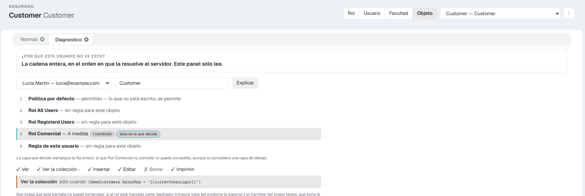
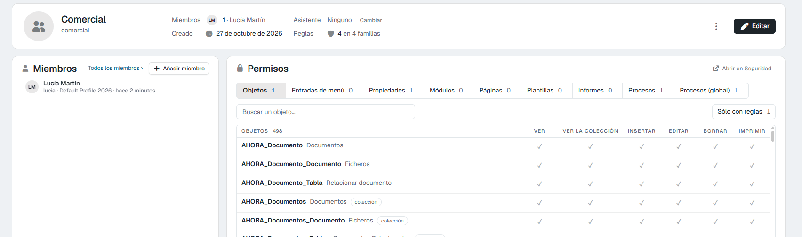
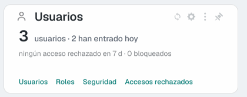

# Seguridad: cómo decide Flexygo quién puede qué 10.0+

En la versión 10 toda la seguridad de la aplicación se gestiona desde **una sola pantalla**, **Seguridad**: una tabla con una fila por cada cosa (objeto, propiedad, proceso, menú, página…) y una columna por cada permiso (ver, borrar, ejecutar…). Un clic en una celda escribe la regla al momento.

Esta página explica las ideas que hay debajo: quién puede tener reglas, qué pasa cuando no hay ninguna y cómo se combinan. Las demás páginas de esta sección cuentan el resto:

| Página | Qué encontrarás |
|---|---|
| [La pantalla de seguridad](2Screen.md) | Cada parte de la pantalla, sus botones y sus avisos |
| [Las reglas, una por una](3Rules.md) | Cada tipo de regla: para qué sirve, cómo se pone y cómo se comprueba |
| [La web API y los asistentes de IA](4WebAPIMCP.md) | Quién entra por la API y quién conecta un asistente, y qué puede leer o cambiar |
| [Pruébalo: un rol «Comercial» en 15 minutos](5TryIt.md) | Un recorrido completo sobre tu propia aplicación |
| [Errores típicos y cómo comprobar](6Mistakes.md) | Lo que más confunde y cómo salir de dudas |

---

## 1. Quién puede tener reglas: rol, usuario y facultad

| | Qué es | Cuándo usarlo |
|---|---|---|
| **Rol** | Un grupo de usuarios con el mismo trabajo (*Comercial*, *Administración*, *Técnico*). Cada usuario tiene **un** rol. | Casi siempre. Es la forma de mantener la seguridad ordenada: se configura una vez y vale para todos los del rol. |
| **Usuario** | Una persona concreta. | Para la excepción: «esta persona, además, puede…» o «esta persona no puede…». |
| **Facultad** | Una capacidad que se da a usuarios sueltos, de cualquier rol. Un usuario puede tener varias. | Para lo que atraviesa los roles: «puede ver la zona Norte», «puede aprobar presupuestos». |

**¿Y el perfil?** El perfil **no es seguridad**. Decide cómo se ve y arranca la aplicación para el usuario: el aspecto (la piel 2026 o la de siempre), la página de inicio, el idioma y la cuenta de correo. Dos usuarios con el mismo perfil y distinto rol ven cosas distintas; dos usuarios con el mismo rol y distinto perfil ven lo mismo, con otro aspecto.

### Los roles que vienen de serie

| Rol | Para qué está |
|---|---|
| **Admins** | Administradores. Lo pueden todo: la seguridad no les aplica. Por eso **nunca se prueba la seguridad entrando como administrador**. |
| **All Users** | Todos los usuarios, con sesión o sin ella. Una regla aquí vale para todo el mundo. |
| **Registered Users** | Todos los usuarios con sesión. Los roles que crees cuelgan de este. |
| **Not Registered** | Quien entra sin sesión (páginas públicas). |
| **Users** | Un rol de ejemplo para usuarios normales. |

---

## 2. Lo que no está escrito, se permite

Una aplicación nueva no tiene reglas, y **sin regla, se permite**: un rol recién creado puede ver, crear, editar, borrar e imprimir todo lo que exista. La seguridad consiste en **escribir las excepciones**: lo que ese rol no debe ver o no debe hacer.

La única excepción es **Not Registered**: quien entra sin sesión no puede nada que no se le conceda expresamente.

!!! tip "Dos maneras de empezar un rol"
    - **Permitir todo y quitar** lo que no toca: lo natural para un rol de confianza.
    - **Partir de solo lectura**: con **Poner los objetos de negocio en sólo lectura…** (menú ⋮ de la pantalla), el rol puede ver y listar los objetos de negocio, pero no crear, editar ni borrar. Después se abre lo que necesite. Ver [La pantalla de seguridad](2Screen.md#5-el-menu).

---

## 3. Cómo se combinan las reglas

Cuando un usuario intenta algo, Flexygo busca reglas en este orden. **La última capa que tiene regla para esa cosa es la que decide**:

1. **La política por defecto**: permitido (denegado para quien no tiene sesión).
2. **El rol All Users**.
3. **El rol Registered Users**.
4. **El rol del usuario**.
5. **Sus facultades**, si tiene. Si varias facultades tienen regla, basta con que una lo permita.
6. **El propio usuario**.

Dos consecuencias que conviene tener claras:

- **La regla del usuario manda sobre la del rol**, y la del rol sobre las generales. Así se hace una excepción para una persona sin tocar al resto.
- **La capa que decide sustituye la fila entera, no permiso a permiso.** Si el rol tiene regla para *Clientes* con «Borrar» denegado y escribes una regla de usuario para *Clientes* para que pueda imprimir, esa regla de usuario **también** tiene que llevar «Borrar» denegado; si no, el usuario podrá borrar. La pantalla lo avisa en **Diagnóstico** con la frase *«La capa que decide reemplaza la fila entera»*.

Los **administradores** no pasan por esta cadena: lo pueden todo.

<figure markdown="span">
  
  <figcaption>La pestaña Diagnóstico enseña la cadena de un usuario sobre un objeto, y marca la capa que decide</figcaption>
</figure>

---

## 4. Cuándo se aplica un cambio

**Al momento.** Cada clic en la pantalla se guarda en el servidor, y la aplicación vuelve a leer la seguridad. El usuario afectado lo nota en su siguiente acción: no hace falta reiniciar nada. La excepción son las condiciones de los **módulos**, que se aplican desde el siguiente inicio de sesión de cada persona.

---

## 5. Cómo se llega a la pantalla

Solo los **administradores** pueden cambiar la seguridad. Puedes abrirla desde varios sitios, y todos llevan a la misma pantalla, con el sujeto ya elegido cuando se sabe:

| Desde | Qué pulsar |
|---|---|
| **La pantalla de inicio del administrador** | En la tarjeta **Usuarios**, el enlace **Seguridad**. Ver [Pantalla de inicio del administrador](../AdminDashboard.md). |
| **La ficha de un rol** | La tarjeta **Permisos** ya enseña las reglas del rol y se puede trabajar en ella. **Abrir en Seguridad** la lleva a pantalla completa. |
| **La ficha de una facultad** | Igual que la del rol. |
| **La ficha de un usuario** | La pestaña **Permisos**. |
| **El banco de trabajo de un objeto** | En el bloque **Abrir**, **Seguridad** (*Roles, usuarios y facultades*). Abre la pantalla con ese objeto como sujeto. |
| **El menú ⋮ de un módulo** (modo desarrollo) | **Seguridad del módulo**. |
| **La ficha de una propiedad o de un proceso** | El botón **Permisos** de su tarjeta de seguridad. |
| **El panel de control** | Área **Seguridad**: **Usuarios**, **Roles**, **Facultades** y **Perfiles** llevan a sus listas; desde la ficha de cada uno, como arriba. **WebAPI** es la configuración de la API y de los asistentes de IA ([página 4](4WebAPIMCP.md)). |

<figure markdown="span">
  
  <figcaption>La ficha del rol: sus miembros a la izquierda y sus reglas en la tarjeta Permisos</figcaption>
</figure>

<figure markdown="span">
  { width="420" }
  <figcaption>El enlace Seguridad de la pantalla de inicio</figcaption>
</figure>

---

## 6. Dónde está ahora lo que antes estaba en…

Para quien conocía las pantallas anteriores a la versión 10:

| Antes | Ahora |
|---|---|
| La pestaña de seguridad de la ficha de un rol, un usuario o una facultad, con una lista por tipo de cosa | La tarjeta o pestaña **Permisos** de esa ficha, y la pantalla **Seguridad** con una familia por tipo de cosa |
| *Seguridad de objeto*, *Procesos del objeto*, *Seguridad de propiedades* y *Seguridad del módulo* en los menús de desarrollo | Las mismas entradas abren la pantalla nueva, ya en el objeto o el módulo |
| Para ver quién puede qué sobre un objeto, revisar rol por rol | El sujeto **Objeto**: una fila por cada rol, usuario y facultad |
| El proceso **Importar seguridad** de un rol o un usuario | **Partir de otro rol…** / **Partir de otro usuario…** en el menú ⋮ |
| La seguridad de procesos solo dentro de su objeto | Además, la familia **Procesos (global)**: por nombre, con o sin objeto y con condición SQL |
| Averiguar a mano por qué alguien no ve algo | La pestaña **Diagnóstico** |
| El escudo de la sección **Menús** de la App Offline | Sigue allí: los menús de la app offline no están en esta pantalla |
| *Security › WebAPI* | Sigue siendo su propia pantalla: **Panel de control › Seguridad › WebAPI** |

---

## Véase también

- [La pantalla de seguridad](2Screen.md)
- [Seguridad de la WebAPI](../../Programming/WebAPISecurity.md)
- [Asistentes de IA (MCP)](../../AIAssistants/2Reference.md)
- [¿Sabías que puedes aplicar la seguridad de un objeto a una combo?](../../../MoreInformation/3DidYouKnow/ComboObjectSecurity.md)
