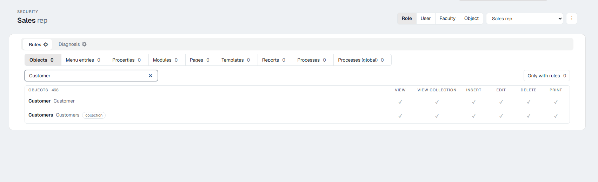
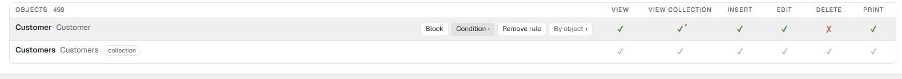
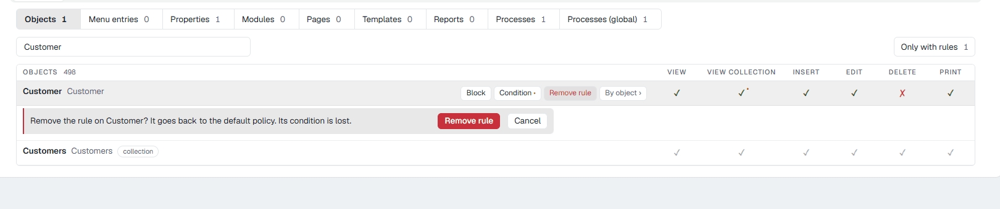
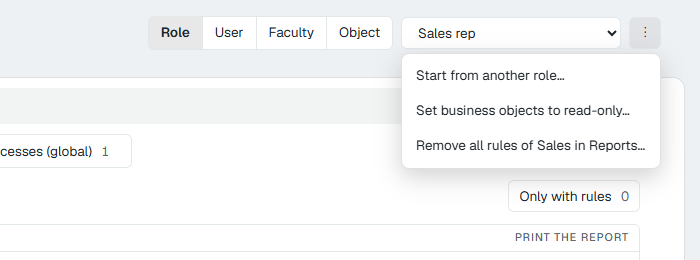
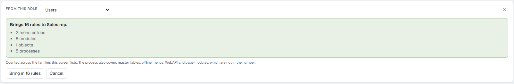
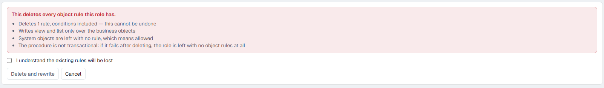
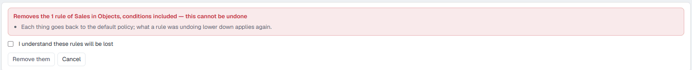
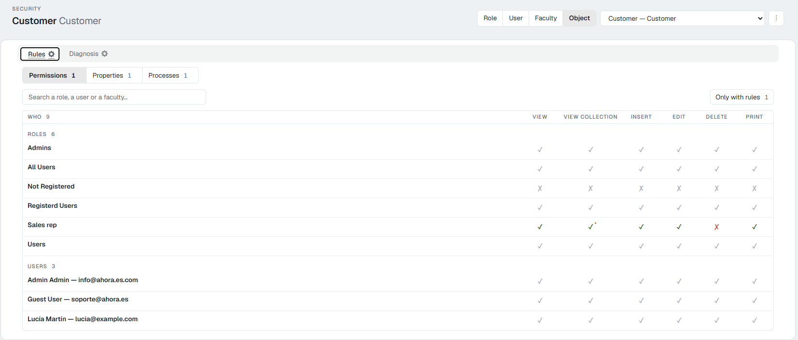

# The security screen 10.0+

This page walks through the **Security** screen from top to bottom: what each part is, what each button does and what you see afterwards. For the ideas underneath (role, user, faculty, what happens with no rules), read [Security: how Flexygo decides who can do what](1Overview.md) first.

<figure markdown="span">
  
  <figcaption>The screen with a role chosen: the subject at the top, the families and the table below</figcaption>
</figure>

---

## 1. At the top: the subject

The **subject** is whose rules you are looking at.

1. Choose the kind with the four buttons: **Role**, **User**, **Faculty** or **Object**.
2. Choose which one in the drop-down next to them (*Choose one…*).

The screen's title changes to the name chosen. The screen remembers the last subject for the rest of the session.

The fourth kind, **Object**, turns the question around: instead of «what can this role do?», it answers **«who can do what with this object?»**. See [section 6](#6-the-object-subject-who-can-do-what-with-one-thing).

---

## 2. The tabs: Rules and Diagnosis

- **Rules** is where rules are seen and written. It is the working tab.
- **Diagnosis** answers *«why does this user not see this?»*. It only reads. See [section 7](#7-diagnosis).

---

## 3. The families

Below the tabs, a row of buttons splits the rules by **family**: the kind of thing they are written on. Each button says how many rules the subject has in that family.

| Family | One row for each… | Columns (permissions) |
|---|---|---|
| **Objects** | object | **View**, **View collection**, **Insert**, **Edit**, **Delete**, **Print** |
| **Menu entries** | entry of the side menu | **Show in the menu** |
| **Properties** | field of an object, grouped by object | **Visible**, **Editable** |
| **Modules** | module | **Show the module** |
| **Pages** | page | **Open the page** |
| **Templates** | template | **Use the template** |
| **Reports** | report | **Print the report** |
| **Processes** | process linked to an object (the object + process pair) | **Run the process** |
| **Processes (global)** | process, by its name, with or without an object | **Run the process** |

What each one means and how to use it, in [Rules, one by one](3Rules.md).

---

## 4. The table

The table is a **catalogue**: it shows **every** thing of the family (every object, every property…), with a rule or without one. Next to the name there may be tags that help you recognise the row: **collection**, the module's or the page's type, a process's menu text, **inactive**…

### Search and filter

- The **search box** (*Search an object…*, *Search a property…*) filters the rows as you type.
- **Only with rules** keeps only the rows that have a written rule, and says how many there are. It is the quick way to review what a role has.

### What each cell means

| What you see | What it means |
|---|---|
| ✓ **grey** | **No rule**: the default policy applies, which is to allow. |
| ✗ **grey** | No rule, and the default policy is to deny. It only happens with the **Not Registered** role. |
| ✓ **green** | There is a rule and it **grants** that permission. |
| ✗ **red** | There is a rule and it **denies** that permission. |
| A **dot** next to the mark | That permission has a **condition**: it is only granted when it holds. |

Hovering over a cell, its description says the same in words, and the full condition if there is one.

<figure markdown="span">
  
  <figcaption>The «Customer» row has a rule (green and red, with a dot on «View collection»); the row below has none (grey)</figcaption>
</figure>

### Changing a permission: one click

**One click on a cell writes the rule straight away.** There is no Save button.

- On a **grey** cell: the row's rule is created with that permission changed, and the others as they were (allowed).
- On a **green or red** cell: only that permission changes.

While saving, the row stays busy for a moment. If something fails, the row itself says so; if it says the rule was created but not left as you wanted, click the cell again.

### Each row's actions

Hovering over a row shows its buttons (they can also be reached with the keyboard):

| Button | What it does |
|---|---|
| **Block** | Sets **every** permission of the row to denied, in one click. |
| **Condition** | Opens the wizard so that a permission is only granted when something holds. Only in **Objects** and **Modules**, and on rows that already have a rule. See [Conditions](3Rules.md#conditions-a-permission-only-for-some-records). |
| **SQL** | Only in **Processes (global)**: the process only runs while a query returns 1. See [Processes (global)](3Rules.md#processes-global-by-name-with-or-without-an-object-and-with-an-sql-condition). |
| **Remove rule** | Deletes the row's rule, after asking for confirmation. The row goes back to the default policy (grey). |
| **By object ›** | Jumps to the same thing seen from the **Object** subject, to see who else has rules on it. |

<figure markdown="span">
  
  <figcaption>«Remove rule» asks for confirmation under the row</figcaption>
</figure>

---

## 5. The ⋮ menu

The **⋮** button next to the subject's drop-down has three actions that work on many rules at once.

<figure markdown="span">
  { width="600" }
  <figcaption>The ⋮ menu with a role chosen</figcaption>
</figure>

### Start from another role… / Start from another user…

Copies another subject's rules to this one, **without overwriting the ones it already has**: it only brings what is not written here. Use it to create a new role similar to an existing one.

1. Choose the source in **From this role**.
2. The screen says how many rules it will bring and from which families (*«Brings 16 rules to Sales rep»*). It also brings rules this screen does not show: master tables, offline menus, WebAPI and page modules.
3. Click **Bring in N rules**, or **Cancel**.

Only for roles and users.

<figure markdown="span">
  
  <figcaption>Before bringing anything, the screen says how many rules and from which families</figcaption>
</figure>

### Set business objects to read-only…

Only for roles. It **deletes every object rule of the role** (with its conditions) and writes **view and list** on the business objects. System objects are left with no rule. It is the «read-only» starting point mentioned on [page 1](1Overview.md#2-what-is-not-written-is-allowed).

It cannot be undone, and the screen says so in red: to go on you must tick **I understand the existing rules will be lost** and click **Delete and rewrite**.

<figure markdown="span">
  
  <figcaption>The box must be ticked before «Delete and rewrite» does anything</figcaption>
</figure>

### Remove all rules of … in …

Deletes all the subject's rules **in the family you are looking at** (for instance, in Pages), conditions included. Everything goes back to the default policy. You must tick **I understand these rules will be lost** and click **Remove them**.

<figure markdown="span">
  
  <figcaption>It only affects the family on screen</figcaption>
</figure>

---

## 6. The Object subject: who can do what with one thing

With **Object** at the top, the table turns around: one row for each **role**, **user** and **faculty**, and the columns are that object's permissions. The families come down to three: **Permissions** (the object's six), **Properties** and **Processes**. The search box looks for roles, users or faculties.

It is the view that answers «who can delete customers?» at a glance. Each row has **By role ›**, **By user ›** or **By faculty ›** to jump to that subject.

<figure markdown="span">
  
  <figcaption>The Customer object: only the Sales rep role has a rule (delete denied and a condition on «View collection»); Not Registered shows a grey ✗ because the default policy denies it</figcaption>
</figure>

!!! note "Each row is a layer, not the final result"
    A user's row shows **their own** rules, not what they end up being able to do. In the picture, the Sales rep user is grey because they have no rules of their own, even though their role cannot delete. The final result is in **Diagnosis**.

---

## 7. Diagnosis

The **Diagnosis** tab answers *«why does this user not see this?»* on an object:

1. Choose the **user**.
2. Type the **object**.
3. Click **Explain**.

You will see the whole chain in the order the server resolves it (default policy, All Users, Registered Users, their role, their faculties, the user themself), each layer with what it says, **the one that decides** marked, and below it the final result permission by permission, with its conditions.

It only reads: it changes nothing. Today it covers the **Objects** family.

<figure markdown="span">
  
  <figcaption>The Sales rep role decides: the user can view, list with a condition, insert, edit and print, but not delete</figcaption>
</figure>
