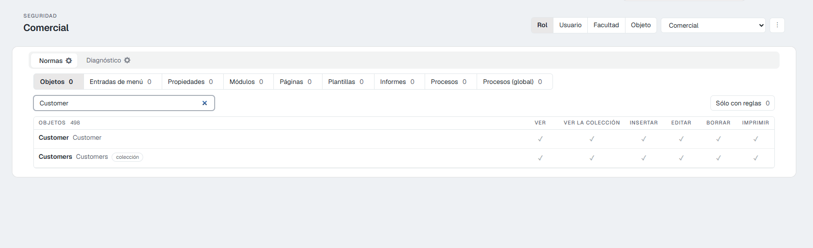
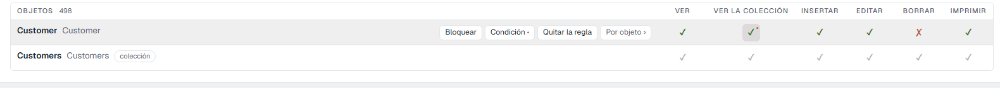
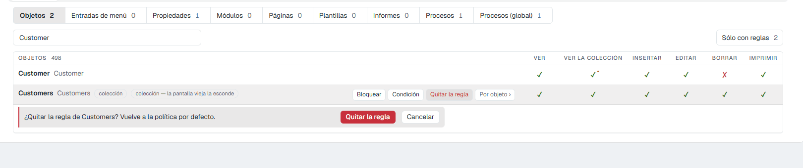
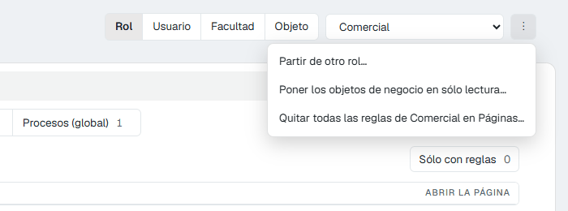
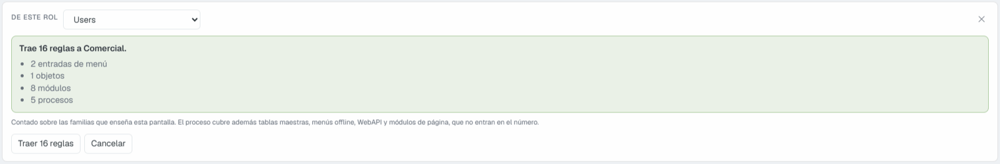
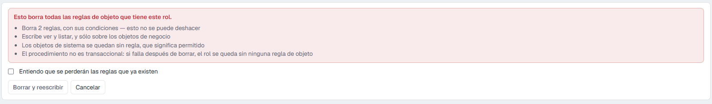
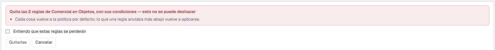
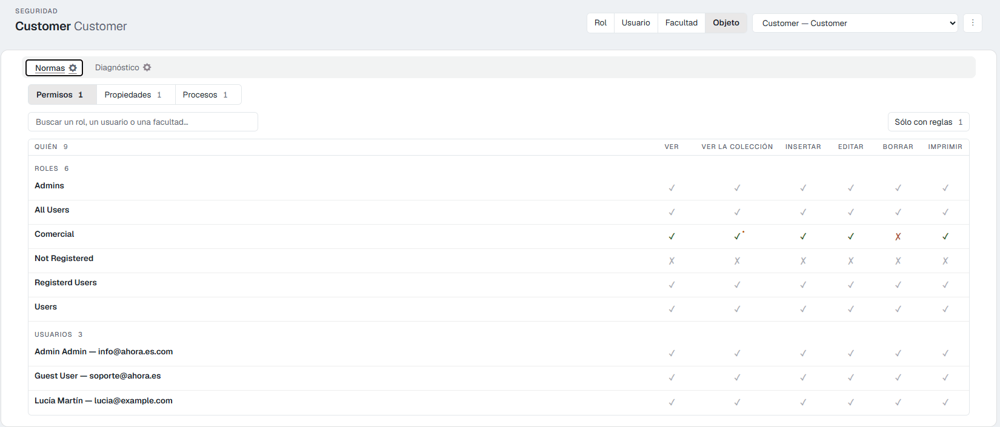

# La pantalla de seguridad 10.0+

Esta página recorre la pantalla **Seguridad** de arriba abajo: qué es cada parte, qué hace cada botón y qué ves después. Para entender las ideas de fondo (rol, usuario, facultad, qué pasa sin reglas), lee antes [Seguridad: cómo decide Flexygo quién puede qué](1Overview.md).

<figure markdown="span">
  
  <figcaption>La pantalla con un rol elegido: arriba el sujeto, debajo las familias y la tabla</figcaption>
</figure>

---

## 1. Arriba: el sujeto

El **sujeto** es de quién son las reglas que estás viendo.

1. Elige el tipo con los cuatro botones: **Rol**, **Usuario**, **Facultad** u **Objeto**.
2. Elige cuál en el desplegable de al lado (*Elige uno…*).

El título de la pantalla cambia al nombre elegido. La pantalla recuerda el último sujeto mientras dure la sesión.

El cuarto tipo, **Objeto**, da la vuelta a la pregunta: en vez de «¿qué puede hacer este rol?», contesta **«¿quién puede hacer qué con este objeto?»**. Lo verás en el [apartado 6](#6-el-sujeto-objeto-quien-puede-que-con-una-cosa).

---

## 2. Las pestañas: Normas y Diagnóstico

- **Normas** es donde se ven y se escriben las reglas. Es la pestaña de trabajo.
- **Diagnóstico** contesta *«¿por qué este usuario no ve esto?»*. Solo lee. Ver el [apartado 7](#7-diagnostico).

---

## 3. Las familias

Debajo de las pestañas, una fila de botones separa las reglas por **familia**: el tipo de cosa sobre la que se escriben. Cada botón dice cuántas reglas tiene el sujeto en esa familia.

| Familia | Una fila por cada… | Columnas (permisos) |
|---|---|---|
| **Objetos** | objeto | **Ver**, **Ver la colección**, **Insertar**, **Editar**, **Borrar**, **Imprimir** |
| **Entradas de menú** | entrada del menú lateral | **Mostrar en el menú** |
| **Propiedades** | campo de un objeto, agrupados por objeto | **Visible**, **Editable** |
| **Módulos** | módulo | **Mostrar el módulo** |
| **Páginas** | página | **Abrir la página** |
| **Plantillas** | plantilla | **Usar la plantilla** |
| **Informes** | informe | **Imprimir el informe** |
| **Procesos** | proceso enlazado a un objeto (el par objeto + proceso) | **Ejecutar el proceso** |
| **Procesos (global)** | proceso, por su nombre, con objeto o sin él | **Ejecutar el proceso** |

Qué significa y cómo se usa cada una, en [Las reglas, una por una](3Rules.md).

---

## 4. La tabla

La tabla es un **catálogo**: enseña **todas** las cosas de la familia (todos los objetos, todas las propiedades…), tengan regla o no. Junto al nombre pueden salir etiquetas que ayudan a reconocer la fila: **colección**, el tipo de módulo o de página, el texto del menú de un proceso, **inactivo**…

### Buscar y filtrar

- El **buscador** (*Buscar un objeto…*, *Buscar una propiedad…*) filtra las filas mientras escribes.
- **Sólo con reglas** deja solo las filas que tienen regla escrita, y dice cuántas son. Es la forma rápida de repasar lo que tiene un rol.

### Qué significa cada celda

| Lo que ves | Qué significa |
|---|---|
| ✓ **gris** | **No hay regla**: se aplica la política por defecto, que es permitir. |
| ✗ **gris** | No hay regla, y la política por defecto es denegar. Solo pasa con el rol **Not Registered**. |
| ✓ **verde** | Hay una regla y **concede** ese permiso. |
| ✗ **roja** | Hay una regla y **deniega** ese permiso. |
| Un **punto** junto a la marca | Ese permiso tiene una **condición**: solo se concede cuando se cumple. |

Al pasar el ratón por una celda, su descripción dice lo mismo con palabras, y la condición completa si la hay.

<figure markdown="span">
  
  <figcaption>La fila «Customer» tiene regla (verde y roja, con un punto en «Ver la colección»); la de debajo no tiene ninguna (gris)</figcaption>
</figure>

### Cambiar un permiso: un clic

**Un clic en una celda escribe la regla al momento.** No hay botón Guardar.

- Sobre una celda **gris**: se crea la regla de esa fila con ese permiso cambiado, y los demás tal como estaban (permitidos).
- Sobre una celda **verde o roja**: cambia solo ese permiso.

Mientras se guarda, la fila se queda ocupada un instante. Si algo falla, la propia fila lo dice con un mensaje; si dice que la regla se creó pero no quedó como querías, vuelve a pulsar la celda.

### Las acciones de cada fila

Al pasar el ratón por una fila aparecen sus botones (también se llega a ellos con el teclado):

| Botón | Qué hace |
|---|---|
| **Bloquear** | Pone **todos** los permisos de la fila en denegado, de un clic. |
| **Condición** | Abre el asistente para que un permiso solo se conceda cuando se cumpla algo. Solo en **Objetos** y **Módulos**, y en filas que ya tienen regla. Ver [Condiciones](3Rules.md#condiciones-un-permiso-solo-para-algunos-registros). |
| **SQL** | Solo en **Procesos (global)**: el proceso solo se ejecuta mientras una consulta devuelva 1. Ver [Procesos (global)](3Rules.md#procesos-global-por-nombre-con-o-sin-objeto-y-con-condicion-sql). |
| **Quitar la regla** | Borra la regla de esa fila, después de pedir confirmación. La fila vuelve a la política por defecto (gris). |
| **Por objeto ›** | Salta a la misma cosa vista desde el sujeto **Objeto**, para ver quién más tiene reglas sobre ella. |

<figure markdown="span">
  
  <figcaption>«Quitar la regla» pide confirmación debajo de la fila</figcaption>
</figure>

---

## 5. El menú ⋮

El botón **⋮** junto al desplegable del sujeto tiene tres acciones que trabajan sobre muchas reglas a la vez.

<figure markdown="span">
  { width="600" }
  <figcaption>El menú ⋮ con un rol elegido</figcaption>
</figure>

### Partir de otro rol… / Partir de otro usuario…

Copia a este sujeto las reglas de otro, **sin pisar las que ya tiene**: solo trae lo que aquí no está escrito. Sirve para crear un rol nuevo parecido a uno que ya existe.

1. Elige el origen en **De este rol**.
2. La pantalla dice cuántas reglas va a traer y de qué familias (*«Trae 16 reglas a Comercial»*). Además trae reglas que esta pantalla no enseña: tablas maestras, menús offline, WebAPI y módulos de página.
3. Pulsa **Traer N reglas**, o **Cancelar**.

Solo para roles y usuarios.

<figure markdown="span">
  
  <figcaption>Antes de traer nada, la pantalla dice cuántas reglas son y de qué familias</figcaption>
</figure>

### Poner los objetos de negocio en sólo lectura…

Solo para roles. **Borra todas las reglas de objeto del rol** (con sus condiciones) y escribe **ver y listar** sobre los objetos de negocio. Los objetos de sistema se quedan sin regla. Es el punto de partida «solo lectura» del que habla la [página 1](1Overview.md#2-lo-que-no-esta-escrito-se-permite).

No se puede deshacer, y la pantalla lo dice en rojo: para continuar hay que marcar **Entiendo que se perderán las reglas que ya existen** y pulsar **Borrar y reescribir**.

<figure markdown="span">
  
  <figcaption>Hay que marcar la casilla antes de que «Borrar y reescribir» haga nada</figcaption>
</figure>

### Quitar todas las reglas de … en …

Borra todas las reglas del sujeto **en la familia que estás viendo** (por ejemplo, en Páginas), condiciones incluidas. Todo vuelve a la política por defecto. Hay que marcar **Entiendo que estas reglas se perderán** y pulsar **Quitarlas**.

<figure markdown="span">
  
  <figcaption>Solo afecta a la familia que se está viendo</figcaption>
</figure>

---

## 6. El sujeto Objeto: quién puede qué con una cosa

Con **Objeto** arriba, la tabla se da la vuelta: una fila por cada **rol**, **usuario** y **facultad**, y las columnas son los permisos de ese objeto. Las familias se reducen a tres: **Permisos** (los seis del objeto), **Propiedades** y **Procesos**. El buscador busca roles, usuarios o facultades.

Es la vista para contestar «¿quién puede borrar clientes?» de un vistazo. Cada fila tiene **Por rol ›**, **Por usuario ›** o **Por facultad ›** para saltar a ese sujeto.

<figure markdown="span">
  
  <figcaption>El objeto Customer: solo el rol Comercial tiene regla (borrar denegado y una condición en «Ver la colección»); Not Registered sale en gris con ✗ porque lo deniega la política por defecto</figcaption>
</figure>

!!! note "Cada fila es una capa, no el resultado final"
    La fila de un usuario enseña **sus propias** reglas, no lo que acaba pudiendo hacer. En la imagen, el usuario del rol Comercial sale en gris porque no tiene reglas propias, aunque su rol no le deje borrar. El resultado final está en **Diagnóstico**.

---

## 7. Diagnóstico

La pestaña **Diagnóstico** responde a *«¿por qué este usuario no ve esto?»* sobre un objeto:

1. Elige el **usuario**.
2. Escribe el **objeto**.
3. Pulsa **Explicar**.

Verás la cadena entera en el orden en que la resuelve el servidor (política por defecto, All Users, Registered Users, su rol, sus facultades, el propio usuario), cada capa con lo que dice, **la que decide** marcada, y debajo el resultado final permiso a permiso con sus condiciones.

Solo lee: no cambia nada. Hoy cubre la familia **Objetos**.

<figure markdown="span">
  
  <figcaption>Decide el rol Comercial: el usuario puede ver, listar con condición, insertar, editar e imprimir, pero no borrar</figcaption>
</figure>
