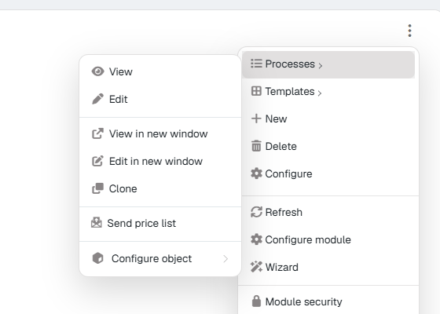
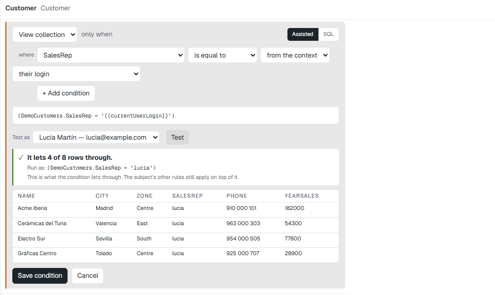
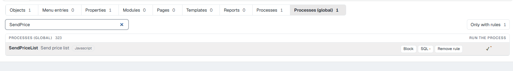
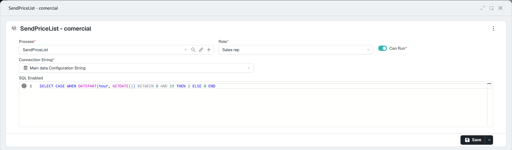
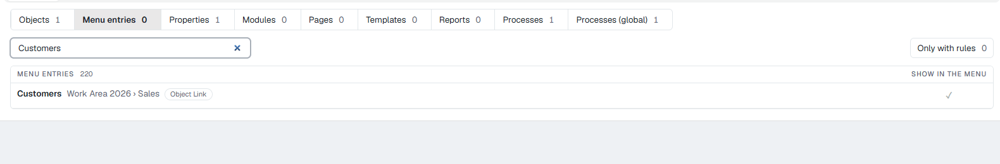
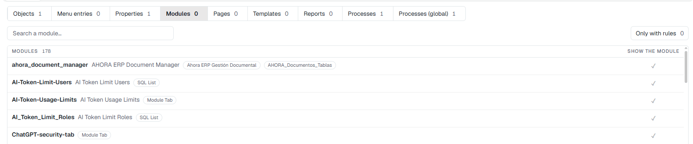
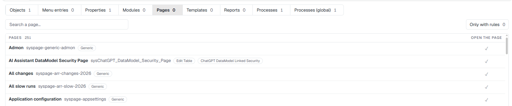
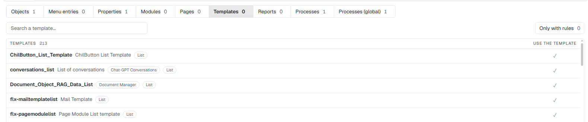
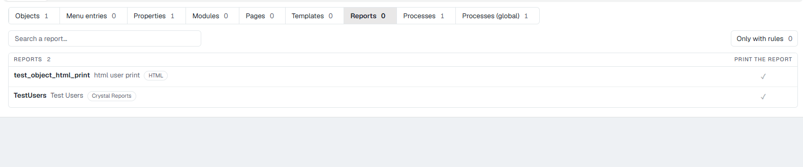

# Rules, one by one <span class="fh-version-tag" title="Available since version 10">10.0+</span>

One section for each family of the **Security** screen: what it is for, how to set it and how to check it works. They are all written the same way: choose the subject at the top, the family, find the row and click the cell (see [The security screen](2Screen.md)).

The examples use a **Sales rep** role and a customers object (*Customer*, with its list *Customers*) that has a cost field (*Cost*). In your application they will be your roles and your objects.

!!! tip "How to check any rule"
    Sign in as a user of that role in a **private window** of the browser (so you do not close your administrator session) and look at the screen affected. **Do not check it as an administrator**: security does not apply to them. To find out why a result is what it is, use **Diagnosis**. More in [Common mistakes and how to check](6Mistakes.md).

---

## Objects: view, list, create, edit, delete, print

**What for:** deciding what the role can do with an object's records.

| Permission | What it controls |
|---|---|
| **View** | Opening a record. |
| **View collection** | Seeing the list of records (and what relies on it: combos, searches, the API's list). |
| **Insert** | Creating records: the **New** button. |
| **Edit** | Saving changes to a record. |
| **Delete** | Removing records: the **Delete** option. |
| **Print** | Printing the object's reports. |

**How:** **Objects** family, find the object and click the permission's cell. For instance, so that Sales rep cannot delete customers, the **Delete** cell of the object's row.

<figure markdown="span">
  
  <figcaption>One click on «Delete» creates the rule: the rest stays granted (green) and delete, denied (red)</figcaption>
</figure>

!!! warning "The row that counts is the object's, not the collection's"
    Each object appears twice: the object (*Customer*) and its collection, tagged **collection** (*Customers*). **Write the rules on the object's row**, **View collection** and its condition included: it is the one the server reads for the list. A rule on the **collection** row is saved, but it does not change what the user sees in the list.

**How to check it:** sign in as a user of the role and open a record. **Delete** is no longer in the record's **⋮** menu. Through the API, deleting answers `403`.

<div class="grid" markdown>

<figure markdown="span">
  
  <figcaption>As administrator: «Delete» and the «Send price list» process are there</figcaption>
</figure>

<figure markdown="span">
  
  <figcaption>As a user of the role: neither «Delete» nor the process</figcaption>
</figure>

</div>

---

## Conditions: a permission only for some records

**What for:** a permission that is not «yes or no» but «yes, when this holds». The typical cases:

- A sales rep **only sees their own customers** (condition on **View collection**).
- They can only **edit draft orders** (condition on **Edit**).
- They can only **delete what they created** (condition on **Delete**).

Conditions exist in **Objects** (on **View**, **View collection**, **Insert**, **Edit** and **Delete**) and in **Modules**.

**How:**

1. The row must have a rule. If it is grey, click any cell twice (you deny it and grant it again): it now has a rule and nothing has changed.
2. Hover over the row and click **Condition**. The wizard opens under the row.
3. Choose the **permission** (for instance, **View collection**) and, in **Assisted** mode:
    - the **field** (*SalesRep*);
    - the **comparison** (*is equal to*, *is not*, *is more than*, *contains*, *is empty*…);
    - the **value**: a **text**, a **number** or **from the context**, which is a detail of the user who is looking: *their login*, *their full name*, *their email*, *their role*, *their reference*, *their language*…
4. **+ Add condition** adds another line, joined with «and» or «or».
5. **Test as**: choose a user and click **Test**. The wizard says how many rows it lets through (*«It lets 4 of 8 rows through»*) and shows them.
6. **Save condition**. The cell gets a **dot**.

<figure markdown="span">
  
  <figcaption>«View collection» only when SalesRep is the user's login: tested as the sales rep, it lets 4 of the 8 rows through</figcaption>
</figure>

If you would rather write it, **SQL** mode takes the condition as it is, with the same variables in braces: `{{currentUserLogin}}`, `{{currentUserId}}`, `{{currentUserFullName}}`, `{{currentUserEmail}}`, `{{currentRoleId}}`, `{{currentRole}}`, `{{currentReference}}`, `{{currentSubreference}}`, `{{currentUserCultureId}}`, `{{currentUserLang}}`. The wizard warns you if you write a variable the server does not know. **Remove condition** leaves the permission unbounded.

**How to check it:** as a user of the role, the list shows only their records, and the footer gives the total they see. The web API's list (and an AI assistant's) comes filtered too.

!!! note "A condition on View decides on its own"
    On **View**, if you write a condition, it is the condition that decides whether the record is seen. On **Insert**, **Edit** and **Delete**, the condition is added to the permission: with the permission denied, no condition helps.

---

## Properties: fields that are not seen or not touched

**What for:** a role that does not see a field (a cost, a margin, a salary) or sees it without being able to change it.

| Permission | What it controls |
|---|---|
| **Visible** | Whether the field appears on the record and in the record the API returns. |
| **Editable** | Whether it can be changed (it appears locked). |

**How:** **Properties** family, find the field (rows are grouped by object) and click **Visible** or **Editable**.

<figure markdown="span">
  
  <figcaption>«Cost» is no longer visible for the role</figcaption>
</figure>

**How to check it:** as a user of the role, open a record: the field is not on it.

<figure markdown="span">
  
  <figcaption>The record as a user of the role: «Cost» is not there</figcaption>
</figure>

---

## Processes: an object's buttons

**What for:** a role that cannot run one of an object's processes (*Send price list*, *Invoice*, *Cancel*…).

**How:** **Processes** family. Each row is an **object + process** pair, tagged with the button's text. Click **Run the process**.

<figure markdown="span">
  
  <figcaption>The «Send price list» process of the Customer object, denied</figcaption>
</figure>

**How to check it:** as a user of the role, the process disappears from the **⋮ › Processes** menu of the record and of the list (see the two pictures in the *Objects* section). If it is requested through the API, the answer is *«Unauthorized process …»*.

---

## Processes (global): by name, with or without an object, and with an SQL condition

**What for:** deciding on a process **wherever** it appears: in one or several objects, on a toolbar button, on a menu entry or called by the API with no object. And, if you want, letting it **run only while something holds**: during working hours, if the user has a reference, if a period is not closed…

It is checked **before** the object's rule: a process denied here runs nowhere. If it is allowed here, each object's **Processes** rule still decides.

**How:**

1. **Processes (global)** family, find the process and click **Run the process** to create the rule.
2. To give it a condition, the row must be granted (green): click **SQL**.
3. The rule opens: **Process**, **Role**, **Can Run**, **Connection String** (where the query runs) and **SQL Enabled**.
4. Write a query that returns **1** when it may run. For instance, only from 8:00 to 19:59:

    ```sql
    SELECT CASE WHEN DATEPART(hour, GETDATE()) BETWEEN 8 AND 19 THEN 1 ELSE 0 END
    ```

5. **Save**. The row's **SQL** button gets a dot.

Anything other than 1 or true (0, empty, no rows) **stops** it from running. You can use the user's variables: `{{currentUserLogin}}`, `{{currentUserId}}`, `{{currentRoleId}}`, `{{currentReference}}`, the date ones and the application's context variables. You cannot use the record's fields or the process's parameters.

<div class="grid" markdown>

<figure markdown="span">
  
  <figcaption>The process granted and with an SQL condition (the dot)</figcaption>
</figure>

<figure markdown="span">
  
  <figcaption>The rule: the process, the role, the connection and the query</figcaption>
</figure>

</div>

**How to check it:** as a user of the role, outside the condition the process does not appear in menus or toolbars, and if it is called through the API the answer is `403` (*«Process … is not enabled»*). If the query has an error, the process does not appear either and the error goes to the error log.

---

## Menu entries

**What for:** an entry of the side menu that does not appear for the role.

**How:** **Menu entries** family. Each row's tag says where it is (*Work Area 2026 › Sales*). Click **Show in the menu**.

<figure markdown="span">
  
  <figcaption>Each entry with its path in the menu</figcaption>
</figure>

!!! note "Hiding is not protecting"
    Taking an entry off the menu **only hides it**. If the user reaches the list another way (a link, the search, the API), what decides is the **object**'s rule. So that they do not see the data, deny **View collection** or **View** in **Objects** too.

**How to check it:** as a user of the role, the entry is not in the side menu.

---

## Modules

**What for:** a module (a list, a chart, a panel) that does not appear for the role on the pages it is on. It accepts a **Condition**: the module is only shown when it holds.

**How:** **Modules** family, click **Show the module**. Each row's tag gives the module's type and its object. You can also get here from the module itself, in develop mode: **⋮ › Module security**.

A module's condition is checked against the object of the page it is on: the screen runs it before saving it, and if it cannot run it does not save it (*«The condition does not run, so it has not been saved»*). It applies from each person's next sign-in.

<figure markdown="span">
  
  <figcaption>Each module with its type and its object</figcaption>
</figure>

---

## Pages

**What for:** a role that cannot open a page.

**How:** **Pages** family, click **Open the page**. The tag gives the page's type and its object.

<figure markdown="span">
  
  <figcaption>Each page with its type and its object</figcaption>
</figure>

---

## Templates

**What for:** a role that does not use one of an object's templates (one way of drawing the list or the record).

**How:** **Templates** family, click **Use the template**.

<figure markdown="span">
  
  <figcaption>The templates, with their type</figcaption>
</figure>

---

## Reports

**What for:** a role that cannot print one specific report.

**How:** **Reports** family, click **Print the report**. The tag gives the report's type (HTML, Crystal Reports…). To take away **all** of an object's reports, deny **Print** in **Objects**.

<figure markdown="span">
  
  <figcaption>The reports, with their type</figcaption>
</figure>

---

## Users and faculties

Everything above works the same with the **User** or **Faculty** subject at the top:

- A **user** rule is one person's exception: it wins over their role. Remember it **replaces the role's whole row** for that thing (see [how rules combine](1Overview.md#3-how-rules-combine)).
- A **faculty** rule applies to every user who has it, whatever their role. If a user has several faculties with a rule on the same thing, one allowing it is enough; with conditions, they are joined with «or».

To give or take faculties from a user, and to change their role, use their record (**Control panel › Security › Users**).
