# Las reglas, una por una <span class="fh-version-tag" title="Disponible desde la versión 10">10.0+</span>

Una sección por cada familia de la pantalla **Seguridad**: para qué sirve, cómo se pone y cómo comprobar que funciona. Todas se escriben igual: eliges el sujeto arriba, la familia, buscas la fila y pulsas la celda (ver [La pantalla de seguridad](2Screen.md)).

Los ejemplos usan un rol **Comercial** y un objeto de clientes (*Customer*, con su lista *Customers*) que tiene un campo de coste (*Cost*). En tu aplicación serán tus roles y tus objetos.

!!! tip "Cómo comprobar cualquier regla"
    Entra como un usuario de ese rol en una **ventana privada** del navegador (así no cierras tu sesión de administrador) y mira la pantalla afectada. **No lo compruebes como administrador**: la seguridad no se le aplica. Para saber el porqué de un resultado, usa **Diagnóstico**. Más en [Errores típicos y cómo comprobar](6Mistakes.md).

---

## Objetos: ver, listar, crear, editar, borrar, imprimir

**Para qué:** decidir qué puede hacer el rol con los registros de un objeto.

| Permiso | Qué controla |
|---|---|
| **Ver** | Abrir la ficha de un registro. |
| **Ver la colección** | Ver la lista de registros (y lo que se apoye en ella: combos, búsquedas, la lista de la API). |
| **Insertar** | Crear registros: el botón **Nuevo**. |
| **Editar** | Guardar cambios en un registro. |
| **Borrar** | Eliminar registros: la opción **Eliminar**. |
| **Imprimir** | Sacar los informes del objeto. |

**Cómo:** familia **Objetos**, busca el objeto y pulsa la celda del permiso. Por ejemplo, para que Comercial no borre clientes, la celda **Borrar** de la fila del objeto.

<figure markdown="span">
  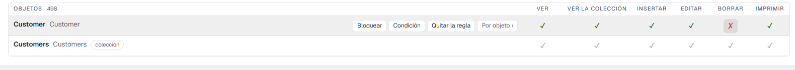
  <figcaption>Un clic en «Borrar» crea la regla: el resto queda concedido (verde) y borrar, denegado (rojo)</figcaption>
</figure>

!!! warning "La fila que manda es la del objeto, no la de la colección"
    Cada objeto aparece dos veces: el objeto (*Customer*) y su colección, con la etiqueta **colección** (*Customers*). **Escribe las reglas en la fila del objeto**, también **Ver la colección** y su condición: es la que el servidor lee para la lista. Una regla en la fila **colección** se guarda, pero no cambia lo que ve el usuario en la lista.

**Cómo comprobarlo:** entra con un usuario del rol y abre un registro. En el menú **⋮** de la ficha ya no está **Eliminar**. Por la API, borrar responde `403`.

<div class="grid" markdown>

<figure markdown="span">
  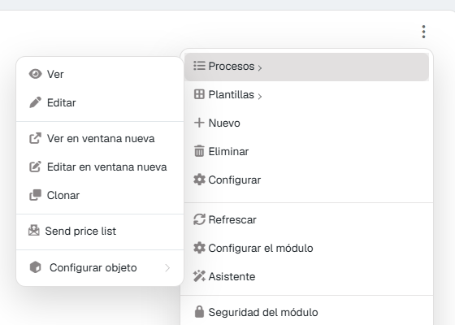
  <figcaption>Como administrador: «Eliminar» y el proceso «Send price list» están</figcaption>
</figure>

<figure markdown="span">
  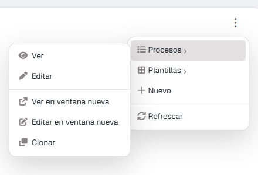
  <figcaption>Como usuario del rol: ni «Eliminar» ni el proceso</figcaption>
</figure>

</div>

---

## Condiciones: un permiso solo para algunos registros

**Para qué:** que un permiso no sea «sí o no», sino «sí, cuando se cumpla esto». Los casos típicos:

- Un comercial **solo ve sus clientes** (condición en **Ver la colección**).
- Solo puede **editar los pedidos en borrador** (condición en **Editar**).
- Solo puede **borrar lo que creó él** (condición en **Borrar**).

Las condiciones existen en **Objetos** (en **Ver**, **Ver la colección**, **Insertar**, **Editar** y **Borrar**) y en **Módulos**.

**Cómo:**

1. La fila tiene que tener regla. Si está en gris, pulsa dos veces cualquier celda (la deniegas y la vuelves a conceder): ya tiene regla y nada ha cambiado.
2. Pasa el ratón por la fila y pulsa **Condición**. Se abre el asistente debajo de la fila.
3. Elige el **permiso** (por ejemplo, **Ver la colección**) y, en modo **Asistido**:
    - el **campo** (*SalesRep*);
    - la **comparación** (*es igual a*, *no es*, *es mayor que*, *contiene*, *está vacío*…);
    - el **valor**: un **texto**, un **número** o **del contexto**, que es el dato del usuario que está mirando: *su login*, *su nombre completo*, *su correo electrónico*, *su rol*, *su referencia*, *su idioma*…
4. **+ Añadir condición** suma otra línea, unida con «y» o con «o».
5. **Probar como**: elige un usuario y pulsa **Probar**. El asistente dice cuántas filas deja pasar (*«Deja pasar 4 de 8 filas»*) y te las enseña.
6. **Guardar la condición**. La celda queda con un **punto**.

<figure markdown="span">
  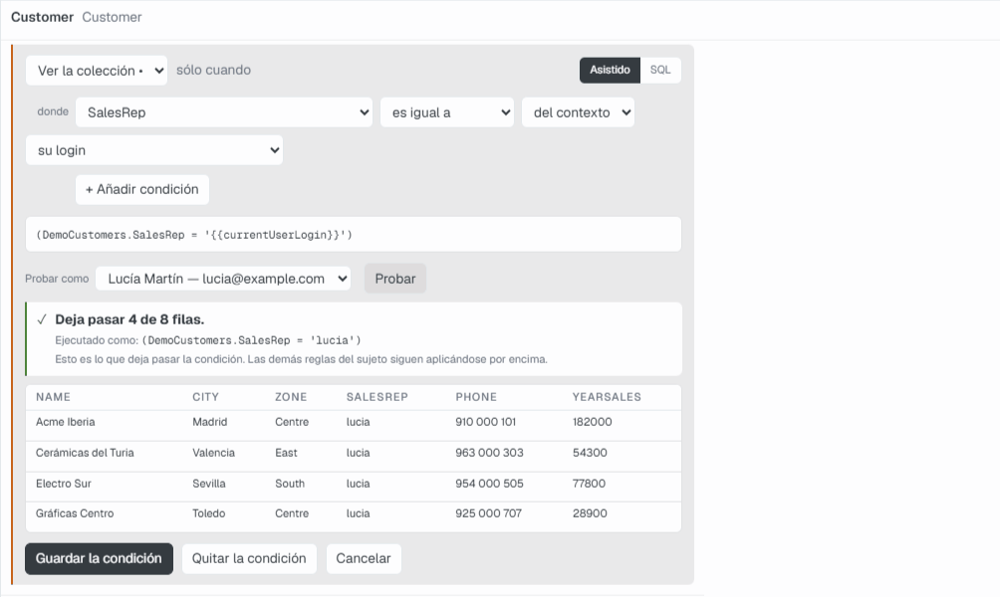
  <figcaption>«Ver la colección» solo cuando SalesRep es el login del usuario: probado como la comercial, deja pasar 4 de las 8 filas</figcaption>
</figure>

Si prefieres escribirla, el modo **SQL** acepta la condición tal cual, con las mismas variables entre llaves: `{{currentUserLogin}}`, `{{currentUserId}}`, `{{currentUserFullName}}`, `{{currentUserEmail}}`, `{{currentRoleId}}`, `{{currentRole}}`, `{{currentReference}}`, `{{currentSubreference}}`, `{{currentUserCultureId}}`, `{{currentUserLang}}`. El asistente avisa si escribes una variable que el servidor no conoce. **Quitar la condición** deja el permiso sin acotar.

**Cómo comprobarlo:** como usuario del rol, la lista enseña solo sus registros, y el pie dice el total que ve. La lista de la web API (y la de un asistente de IA) también sale filtrada.

!!! note "Una condición en Ver decide sola"
    En **Ver**, si escribes una condición, es la condición la que decide si se ve el registro. En **Insertar**, **Editar** y **Borrar**, la condición se suma al permiso: con el permiso denegado no hay condición que valga.

---

## Propiedades: campos que no se ven o no se tocan

**Para qué:** que un rol no vea un campo (un coste, un margen, un sueldo) o lo vea sin poder cambiarlo.

| Permiso | Qué controla |
|---|---|
| **Visible** | Si el campo aparece en la ficha y en el registro que devuelve la API. |
| **Editable** | Si se puede cambiar (aparece bloqueado). |

**Cómo:** familia **Propiedades**, busca el campo (las filas van agrupadas por objeto) y pulsa **Visible** o **Editable**.

<figure markdown="span">
  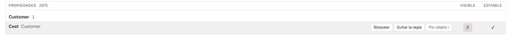
  <figcaption>«Cost» deja de ser visible para el rol</figcaption>
</figure>

**Cómo comprobarlo:** como usuario del rol, abre un registro: el campo no está en la ficha.

<figure markdown="span">
  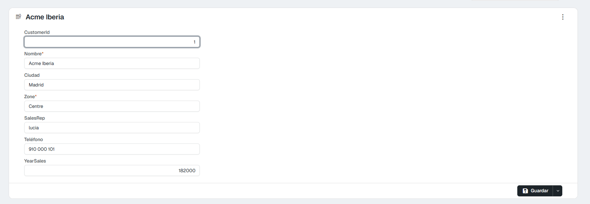
  <figcaption>La ficha del usuario del rol: no aparece «Cost»</figcaption>
</figure>

---

## Procesos: los botones de un objeto

**Para qué:** que un rol no pueda ejecutar un proceso de un objeto (*Enviar tarifa*, *Facturar*, *Anular*…).

**Cómo:** familia **Procesos**. Cada fila es un par **objeto + proceso**, con el texto del botón como etiqueta. Pulsa **Ejecutar el proceso**.

<figure markdown="span">
  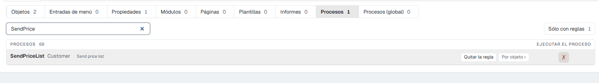
  <figcaption>El proceso «Send price list» del objeto Customer, denegado</figcaption>
</figure>

**Cómo comprobarlo:** como usuario del rol, el proceso desaparece del menú **⋮ › Procesos** de la ficha y de la lista (ver las dos imágenes de la sección *Objetos*). Si se pide por la API, la respuesta es *«Unauthorized process …»*.

---

## Procesos (global): por nombre, con o sin objeto, y con condición SQL

**Para qué:** decidir sobre un proceso **en cualquier sitio** donde aparezca: en uno o en varios objetos, en un botón de barra, en una entrada de menú o llamado por la API sin objeto. Y, si quieres, que **solo se pueda ejecutar mientras se cumpla algo**: en horario laboral, si el usuario tiene una referencia, si un cierre no está hecho…

Se comprueba **antes** que la regla del objeto: un proceso denegado aquí no se ejecuta en ningún sitio. Si aquí está permitido, la regla de **Procesos** de cada objeto sigue mandando.

**Cómo:**

1. Familia **Procesos (global)**, busca el proceso y pulsa **Ejecutar el proceso** para crear la regla.
2. Para ponerle condición, la fila necesita estar concedida (verde): pulsa **SQL**.
3. Se abre la regla: **Proceso**, **Rol**, **Puede ejecutar**, **Cadena de conexión** (dónde se ejecuta la consulta) y **SQL habilitado**.
4. Escribe una consulta que devuelva **1** cuando se pueda ejecutar. Por ejemplo, solo de 8 a 19 h:

    ```sql
    SELECT CASE WHEN DATEPART(hour, GETDATE()) BETWEEN 8 AND 19 THEN 1 ELSE 0 END
    ```

5. **Guardar**. El botón **SQL** de la fila queda con un punto.

Cualquier otra cosa que no sea 1 o verdadero (0, vacío, sin filas) **impide** ejecutarlo. Puedes usar las variables del usuario: `{{currentUserLogin}}`, `{{currentUserId}}`, `{{currentRoleId}}`, `{{currentReference}}`, las de fecha y las variables de contexto de la aplicación. No puedes usar campos del registro ni parámetros del proceso.

<div class="grid" markdown>

<figure markdown="span">
  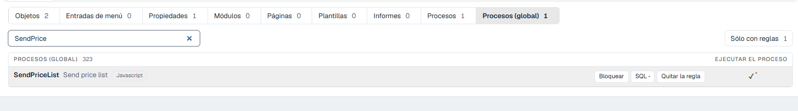
  <figcaption>El proceso concedido y con condición SQL (el punto)</figcaption>
</figure>

<figure markdown="span">
  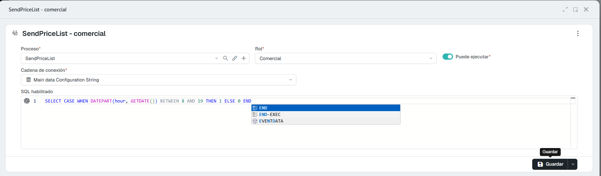
  <figcaption>La regla: el proceso, el rol, la conexión y la consulta</figcaption>
</figure>

</div>

**Cómo comprobarlo:** como usuario del rol, fuera de la condición el proceso no aparece en menús ni barras, y si se llama por la API la respuesta es `403` (*«Process … is not enabled»*). Si la consulta tiene un error, el proceso tampoco aparece y el error queda en el registro de errores.

---

## Entradas de menú

**Para qué:** que una entrada del menú lateral no aparezca para el rol.

**Cómo:** familia **Entradas de menú**. La etiqueta de cada fila dice dónde está (*Work Area 2026 › Sales*). Pulsa **Mostrar en el menú**.

<figure markdown="span">
  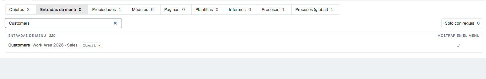
  <figcaption>Cada entrada con su ruta en el menú</figcaption>
</figure>

!!! note "Ocultar no es proteger"
    Quitar una entrada del menú **solo la esconde**. Si el usuario llega a la lista por otro camino (un enlace, el buscador, la API), lo que decide es la regla del **objeto**. Para que no vea los datos, deniega también **Ver la colección** o **Ver** en **Objetos**.

**Cómo comprobarlo:** como usuario del rol, la entrada no está en el menú lateral.

---

## Módulos

**Para qué:** que un módulo (una lista, un gráfico, un panel) no aparezca para el rol en las páginas donde está. Admite **Condición**: el módulo se muestra solo cuando se cumple.

**Cómo:** familia **Módulos**, pulsa **Mostrar el módulo**. La etiqueta de cada fila dice el tipo de módulo y su objeto. También se llega desde el propio módulo, en modo desarrollo: menú **⋮ › Seguridad del módulo**.

La condición de un módulo se comprueba contra el objeto de la página donde está: la pantalla la ejecuta antes de guardarla, y si no se puede ejecutar no la guarda (*«La condición no se ejecuta, así que no se ha guardado»*). Se aplica a partir del siguiente inicio de sesión de cada persona.

<figure markdown="span">
  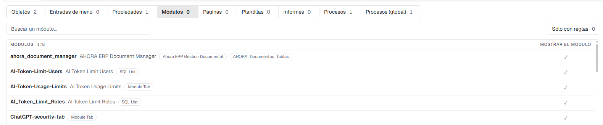
  <figcaption>Cada módulo con su tipo y su objeto</figcaption>
</figure>

---

## Páginas

**Para qué:** que el rol no pueda abrir una página.

**Cómo:** familia **Páginas**, pulsa **Abrir la página**. La etiqueta dice el tipo de página y su objeto.

<figure markdown="span">
  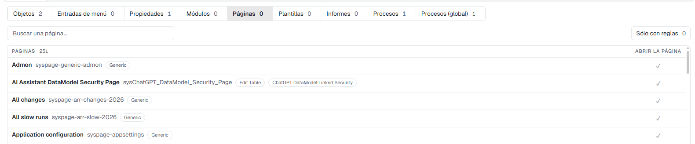
  <figcaption>Cada página con su tipo y su objeto</figcaption>
</figure>

---

## Plantillas

**Para qué:** que el rol no use una plantilla concreta de un objeto (una forma de pintar la lista o la ficha).

**Cómo:** familia **Plantillas**, pulsa **Usar la plantilla**.

<figure markdown="span">
  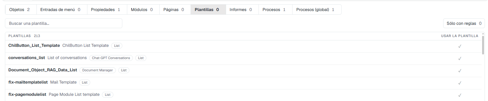
  <figcaption>Las plantillas, con su tipo</figcaption>
</figure>

---

## Informes

**Para qué:** que el rol no pueda imprimir un informe concreto.

**Cómo:** familia **Informes**, pulsa **Imprimir el informe**. La etiqueta dice el tipo de informe (HTML, Crystal Reports…). Para quitar **todos** los informes de un objeto, deniega **Imprimir** en **Objetos**.

<figure markdown="span">
  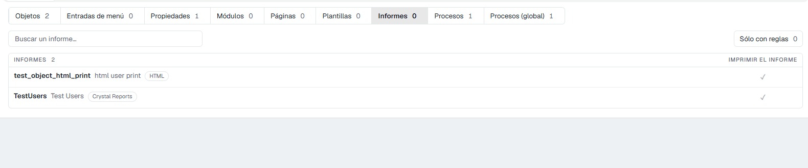
  <figcaption>Los informes, con su tipo</figcaption>
</figure>

---

## Usuarios y facultades

Todo lo anterior vale igual con el sujeto **Usuario** o **Facultad** arriba:

- Una regla de **usuario** es la excepción de una persona: manda sobre su rol. Recuerda que **sustituye la fila entera** del rol para esa cosa (ver [cómo se combinan las reglas](1Overview.md#3-como-se-combinan-las-reglas)).
- Una regla de **facultad** se aplica a todos los usuarios que la tienen, sea cual sea su rol. Si un usuario tiene varias facultades con regla sobre lo mismo, basta con que una lo permita; con condiciones, se suman con «o».

Para dar o quitar facultades a un usuario, y para cambiarle el rol, se usa su ficha (**Panel de control › Seguridad › Usuarios**).
