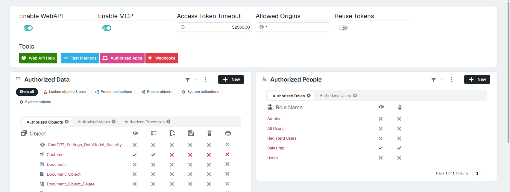

# The web API and AI assistants 10.0+

An integration (an ERP, n8n, a script) comes in through the **web API**, and an AI assistant (Claude, ChatGPT…) comes in through **MCP**. Both act **as a user of the application**, and **that user's and their role's security applies to them just as on screen**. What a role cannot do in the application, it cannot do through the API or through an assistant either.

This page covers what has to do with roles and users. All the detail is in:

- [WebAPI security](../../Programming/WebAPISecurity.md): answers, processes, OpenAPI, IP lockout.
- [AI assistants (MCP)](../../AIAssistants/2Reference.md): what an assistant can do, how it connects, settings and log. To try it, [Try it: an AI assistant working with your application](../../AIAssistants/1TryIt.md).

---

## 1. Where it is set up

In **Control panel › Security › WebAPI**. It is not on the Security screen: it is a screen of its own.

<figure markdown="span">
  
  <figcaption>The switches at the top; what is published on the left; who gets in on the right</figcaption>
</figure>

| Where | What it decides |
|---|---|
| **Enable WebAPI** | The whole API, on or off. It comes off. |
| **Enable MCP** | Whether AI assistants can connect. It comes off and needs the API on. |
| **Authorized Data** | Which objects, views and processes are published, and what can be done with each object through the API (view, list, create, edit, delete, print). What is not published does not exist for the API or for assistants. |
| **Authorized People** | Which roles (**Authorized Roles** tab) and which users (**Authorized Users**) get in. Two columns: the **eye** is the permission to use the API; the **robot** is the permission to **connect an AI assistant**. They are independent. |

---

## 2. Three keys that add up

For a user to read or change something through the API or with an assistant, **all three** must be open:

1. **The object published** in *Authorized Data*, with that action ticked.
2. **The user authorised**, through their role or themself, in *Authorized People*: the eye for the API and the robot for an assistant. If the user has their own row, it wins over their role's.
3. **Their usual security**, the one on the **Security** screen: object permissions, conditions, properties, processes.

Publishing an object in the API **skips none** of the role's rules. For instance, with the role of the [Try it](5TryIt.md):

| Request by the role's user | Answer |
|---|---|
| The list of customers | Only **their** customers: the **View collection** condition applies. |
| Deleting a customer | `403`: the role cannot delete. |
| Running the denied process | *«Unauthorized process …»*. |

---

## 3. Who can connect an AI assistant

A user can connect an assistant when:

- **Enable MCP** is on;
- their **role** has the **robot** column ticked, or they have it themself in **Authorized Users** (theirs wins over the role's).

Then **Connect an assistant** and **Connected assistants** appear in their profile menu. Unticking the robot **cuts at once** any connection they already have open.

The assistant works **as the user who connected it**: it sees what that user sees and can do what that user can do, nothing more. What the assistant adds is its own read and write rule.

---

## 4. Read or change

When connecting the assistant, the person sees a consent page with two permissions:

- **Read data**: lists, records, totals and reports. Always granted.
- **Change data**: running processes and creating or updating records. It comes ticked and **the person can untick it** so the assistant only reads.

With read only, any attempt to change something is refused with a sentence that explains why. And even if the person grants **Change data**, the assistant can only change what their role allows and what the API publishes for editing or creating.

---

## 5. How to check it

- **The API**: ask for a token with the role's user (`POST /token`) and try a list, a record and a delete. The answers must match the table in section 2. The detail of each answer is in [WebAPI security](../../Programming/WebAPISecurity.md#2-refusals-one-status-per-reason-plus-the-sentence).
- **An assistant**: connect it with the role's user and ask it for the object's list: it only brings the records the **View collection** condition lets through. If you ask it to delete a record or run the denied process, it must say it cannot. Every call goes to the web API log.
