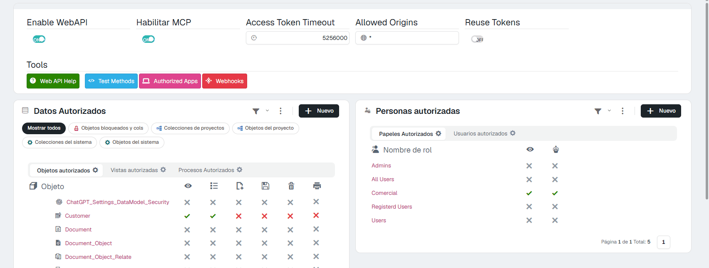

# La web API y los asistentes de IA 10.0+

Una integración (un ERP, n8n, un script) entra por la **web API**, y un asistente de IA (Claude, ChatGPT…) entra por el **MCP**. Los dos actúan **como un usuario de la aplicación**, y **la seguridad de ese usuario y de su rol se les aplica igual que en pantalla**. Lo que un rol no puede hacer en la aplicación, tampoco lo puede hacer por la API ni a través de un asistente.

Esta página cuenta lo que tiene que ver con roles y usuarios. Todo el detalle está en:

- [Seguridad de la WebAPI](../../Programming/WebAPISecurity.md): respuestas, procesos, OpenAPI, bloqueo de IP.
- [Asistentes de IA (MCP)](../../AIAssistants/2Reference.md): qué puede hacer un asistente, cómo se conecta, ajustes y registro. Para probarlo, [Pruébalo: un asistente de IA trabajando con tu aplicación](../../AIAssistants/1TryIt.md).

---

## 1. Dónde se configura

En **Panel de control › Seguridad › WebAPI**. No está en la pantalla Seguridad: es su propia pantalla.

<figure markdown="span">
  
  <figcaption>Arriba los interruptores; a la izquierda lo que se publica; a la derecha quién entra</figcaption>
</figure>

| Dónde | Qué decide |
|---|---|
| **Enable WebAPI** | La API entera, encendida o apagada. Viene apagada. |
| **Habilitar MCP** | Si los asistentes de IA pueden conectarse. Viene apagado y necesita la API encendida. |
| **Datos Autorizados** | Qué objetos, vistas y procesos se publican, y qué se puede hacer con cada objeto por la API (ver, listar, crear, editar, borrar, imprimir). Lo que no se publica no existe para la API ni para los asistentes. |
| **Personas autorizadas** | Qué roles (pestaña **Papeles Autorizados**) y qué usuarios (**Usuarios autorizados**) entran. Dos columnas: el **ojo** es el permiso de usar la API; el **robot** es el permiso de **conectar un asistente de IA**. Son independientes. |

---

## 2. Tres llaves que se suman

Para que un usuario lea o cambie algo por la API o con un asistente tienen que estar abiertas **las tres**:

1. **El objeto publicado** en *Datos Autorizados*, con esa acción marcada.
2. **El usuario autorizado**, por su rol o por él mismo, en *Personas autorizadas*: el ojo para la API y el robot para un asistente. Si el usuario tiene su propia fila, manda sobre la de su rol.
3. **Su seguridad de siempre**, la de la pantalla **Seguridad**: permisos del objeto, condiciones, propiedades, procesos.

Publicar un objeto en la API **no se salta** ninguna regla del rol. Por ejemplo, con el rol del [Pruébalo](5TryIt.md):

| Petición del usuario del rol | Respuesta |
|---|---|
| La lista de clientes | Solo **sus** clientes: se aplica la condición de **Ver la colección**. |
| Borrar un cliente | `403`: el rol no puede borrar. |
| Ejecutar el proceso denegado | *«Unauthorized process …»*. |

---

## 3. Quién puede conectar un asistente de IA

Un usuario puede conectar un asistente cuando:

- **Habilitar MCP** está encendido;
- su **rol** tiene marcada la columna del **robot**, o la tiene él en **Usuarios autorizados** (la suya manda sobre la del rol).

Entonces, en su menú de perfil aparecen **Conectar un asistente** y **Asistentes conectados**. Quitar la marca del robot **corta al momento** las conexiones que ya tenga abiertas.

El asistente trabaja **con el usuario que lo conectó**: ve lo que ese usuario ve y puede lo que ese usuario puede, ni una cosa más. Lo que añade el asistente es su propia regla de lectura y escritura.

---

## 4. Leer o cambiar

Al conectar el asistente, la persona ve una página de consentimiento con dos permisos:

- **Leer datos**: listas, registros, totales e informes. Siempre se concede.
- **Cambiar datos**: ejecutar procesos y crear o modificar registros. Viene marcado y **la persona puede desmarcarlo** para que el asistente solo lea.

Con solo lectura, cualquier intento de cambiar algo se rechaza con una frase que lo explica. Y aunque la persona conceda **Cambiar datos**, el asistente solo puede cambiar lo que su rol permita y lo que la API publique para editar o crear.

---

## 5. Cómo comprobarlo

- **La API**: pide un token con el usuario del rol (`POST /token`) y prueba una lista, un registro y un borrado. Las respuestas deben coincidir con la tabla del apartado 2. El detalle de cada respuesta está en [Seguridad de la WebAPI](../../Programming/WebAPISecurity.md#2-las-negativas-un-estado-por-motivo-y-la-frase).
- **Un asistente**: conéctalo con el usuario del rol y pídele la lista del objeto: trae solo los registros que deja pasar la condición de **Ver la colección**. Si le pides borrar un registro o ejecutar el proceso denegado, debe contestar que no puede. Cada llamada queda en el registro de la web API.
