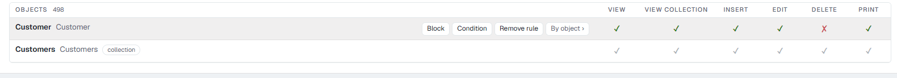
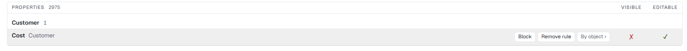
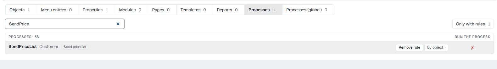
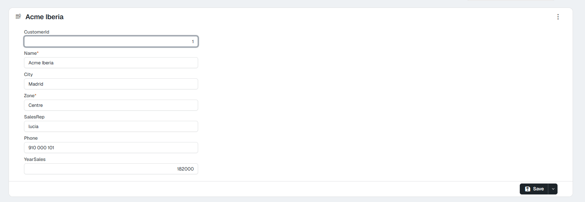
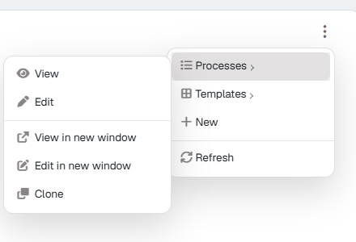

# Try it: a «Sales rep» role in 15 minutes 10.0+

In this walk-through you create a test role, give it three rules on the **Security** screen and check the result by signing in as a user of that role. At the end you delete it all. It works on **your own application**, with no special data.

The pictures come from a sample application with a customers object (*Customer*), its cost field (*Cost*) and a *Send price list* process. In yours the names will be different.

---

## What you need

| | |
|---|---|
| **A Flexygo 10 application** with the 2026 skin | And an **administrator** user. |
| **An object with a «sensitive» field** | A discount, a cost, a margin… For instance, *Customers* with its *Cost*. |
| **A process of that object** | Any that appears in the **⋮ › Processes** menu of its record. |
| **A private browser window** | To sign in as the test user without closing your session. |

!!! note "Licence"
    The test user takes one of the licence's seats while it exists. If the licence takes no more users, use one you already have by changing their role, and give it back at the end.

---

## 1. Create the role

1. **Control panel › Security › Roles**, and **New**.
2. Type an identifier (`salesrep`) and a name (`Sales rep`). Do **not** mark it as administrator.
3. **Save**.

## 2. Create a user with that role

1. **Control panel › Security › Users**, and **New**.
2. Fill in the name, user name and email.
3. In **Role**, choose **Sales rep**.
4. Turn on the manual password, type a test password and **turn off that they must change it** when signing in; otherwise the first thing you will see with that user is the password change.
5. **Save**.

## 3. Open the role's security

Open the **Sales rep** role's record (from the list of roles). The **Permissions** card is already that role's security screen; **Open in Security** takes it full screen.

<figure markdown="span">
  
  <figcaption>The role's record: members on the left and the Permissions card on the right</figcaption>
</figure>

Every cell is **grey**: there are no rules and so the role can do everything.

## 4. First rule: sees the list, but does not delete

1. **Objects** family.
2. Type your object's name in the search box.
3. On the **object**'s row (the one **without** the *collection* tag), click the **Delete** cell.

The row turns green with **Delete** in red: the role can view, list, create, edit and print, but not delete.

<figure markdown="span">
  
  <figcaption>A written rule: green grants, red denies</figcaption>
</figure>

## 5. Second rule: does not see the sensitive field

1. **Properties** family.
2. Find the field (*Cost*).
3. Click **Visible**.

<figure markdown="span">
  
  <figcaption>The field is no longer visible for the role</figcaption>
</figure>

## 6. Third rule: does not run a process

1. **Processes** family.
2. Find the process.
3. Click **Run the process**.

<figure markdown="span">
  
  <figcaption>Each row is an object + process pair</figcaption>
</figure>

The family buttons now say **1** on Objects, Properties and Processes.

## 7. Check it as the role's user

Open a **private window** and sign in with the test user.

1. **The list shows**: open the object's list from the menu. The records are there.
2. **The field is gone**: open a record. The sensitive field is not on it.
3. **Cannot delete or run the process**: open the record's **⋮** menu. **Delete** is not there, and your process is not under **Processes**.

<figure markdown="span">
  
  <figcaption>The record, without the cost field</figcaption>
</figure>

<figure markdown="span">
  
  <figcaption>The ⋮ menu: neither Delete nor «Send price list»</figcaption>
</figure>

Compare it with what you see as administrator on the same record: **Delete** and the process are there.

## 8. Ask Diagnosis

Go back to your administrator window. On the security screen, **Diagnosis** tab: choose the test user, type the object and click **Explain**. You will see that **the Sales rep role decides** and that **Delete** is denied. (In the picture, the role also has the «each sales rep only sees their own customers» condition from [Conditions](3Rules.md#conditions-a-permission-only-for-some-records).)

<figure markdown="span">
  
  <figcaption>The whole chain and the layer that decides</figcaption>
</figure>

## 9. Bonus: an AI assistant sees the same

If your application has the API and MCP turned on (see [The web API and AI assistants](4WebAPIMCP.md)):

1. In **Control panel › Security › WebAPI**, tick the **robot** of the **Sales rep** role and publish your object in **Authorized Data** with view and list.
2. Connect an assistant **with the test user**, following [Try it: an AI assistant working with your application](../../AIAssistants/1TryIt.md).
3. Ask it to delete a record or run the process: it answers that it cannot, because the role cannot.
4. If you also added the «each sales rep only sees their own customers» condition ([Conditions](3Rules.md#conditions-a-permission-only-for-some-records)), ask it for the list: it only brings theirs.

## 10. Clean up

1. Delete the **test user**: their record, **⋮ › Delete**. If you used a user you already had, give them back their role.
2. On the security screen, with the **Sales rep** role chosen, use **⋮ › Remove all rules of Sales rep in …** in **Objects**, **Properties** and **Processes**.
3. Delete the **role**: its record, **⋮ › Delete**.
4. If you ticked the robot or published the object in step 9, untick it.

---

Next: [Rules, one by one](3Rules.md), with conditions («each sales rep only sees their own customers») and global processes with SQL.
