# What's new in the skin2026 interface 10.0+

The **skin2026** (Flexygo 2026) is a **complete redesign of the whole application**: every screen, menu, list, form, dashboard and dialog has a new design, with a side navigation that groups the menus, a new typeface, new colours and spacing, and redrawn controls. The light and dark themes already existed, and both have been redesigned with it; each user switches the theme from their menu, at the bottom of the side navigation: **Light**, **Dark** or **System**, which follows the device's appearance.

To switch it on, open the profile's interface and set its **Skin** field to **Flexygo 2026**.

<figure markdown="span">
  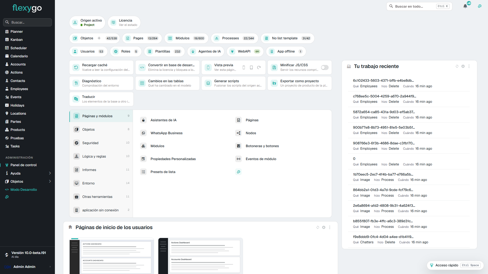
  <figcaption>The Control panel with skin2026</figcaption>
</figure>

What changes for those who **use** and those who **administer** an application with the **skin2026** skin: lists, search, notifications, mobile, the offline app and the side menu. Except where stated, flexy2022 stays as it was.

The screenshots are taken in light mode; everything works the same in dark mode.

---

## 1. Lists

### 1.1 Sort and group by any column

The default list of any object can be sorted and **grouped by any of its columns**, without configuring anything. This is done from the module menu (the three dots in the header), **Sort and group…**: the *Sort* tab for the order and *Groups* for the groups, with **Add a field** to choose each column. Several levels can be chained.

<figure markdown="span">
  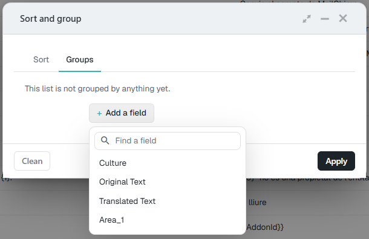{ width="460" }
  <figcaption>Each grouping level is a column of the list</figcaption>
</figure>

Each group starts with a **band** that shows the column and the value. When scrolling, the band of the group being read **sticks below the column header**, and with several levels they stack, one per level; the next one pushes the previous one out. Above the list, a pill reminds you how it is grouped (*Grouped by Culture › Area_1*). Sorting by a group's column reverses the group. Grouping also works in flexy2022, with its colors.

<figure markdown="span">
  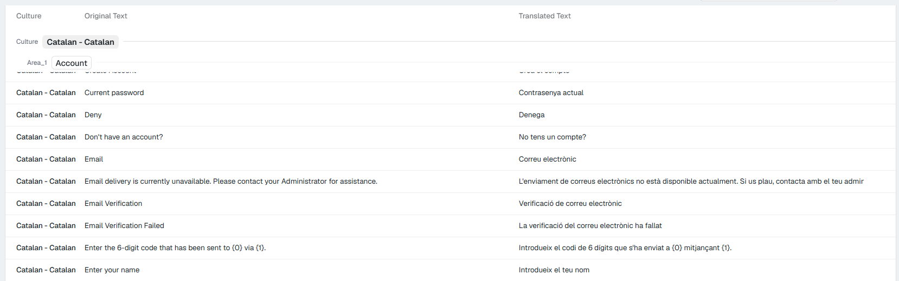
  <figcaption>Scrolled halfway: the column header and the bands of both levels stay in view</figcaption>
</figure>

### 1.2 The column header, always in view

In the default list, the row of column titles stays at the top while the page scrolls. Columns are widened by dragging their border in the header (the first one too), and if the table is wider than its card, the horizontal scrollbar stays at the bottom of the window.

### 1.3 The row opens the record; everything else, in its menu

In lists with the default template, **clicking a row opens the record**. The rest of the actions (view, edit, delete, open in another window, clone, configure the object and the processes) are in the **row menu**: with a **right click** on it or with the **three dots** that appear on hover (on touch devices they are always visible). The selection checkbox goes at the start of the row.

<figure markdown="span">
  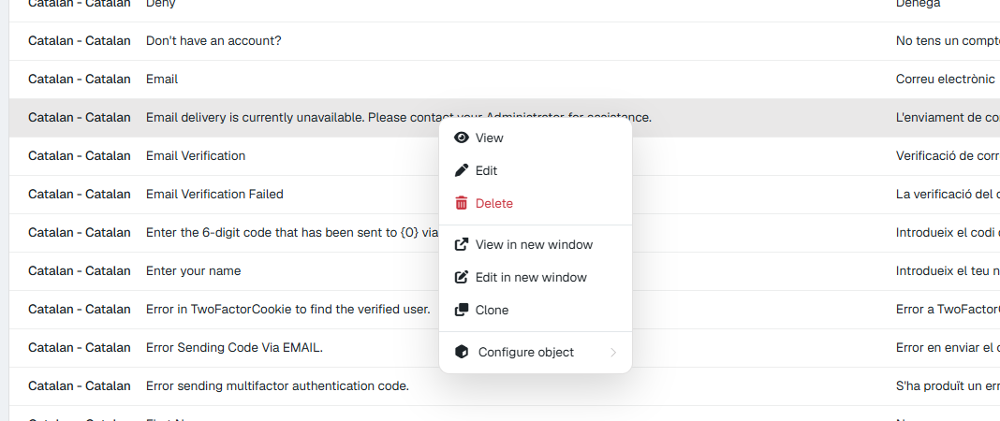
  <figcaption>Right click on the row</figcaption>
</figure>

Cells are rendered according to their content: a checkbox for yes/no values, a swatch for colors, fixed-width digits so that numbers and dates line up, and a dash in empty ones.

### 1.4 Presets as pills, and how many records the filter lets through

An object's **presets** (named saved filters) appear as **pills above the list**, with *Show all* first; the active one is highlighted.

<figure markdown="span">
  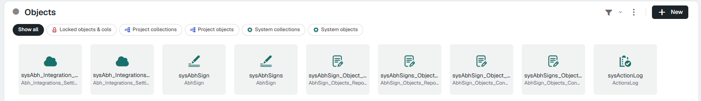
  <figcaption>One tap switches preset</figcaption>
</figure>

With a filter applied, next to the list title it shows **how many records it lets through** (out of the real total, not out of the page).

### 1.5 Filter chips

The list filter is shown as **chips**, one per field. In dropdown fields with several values chosen, the chip shows the ones that fit and **all its values appear on hover**, one per line.

<figure markdown="span">
  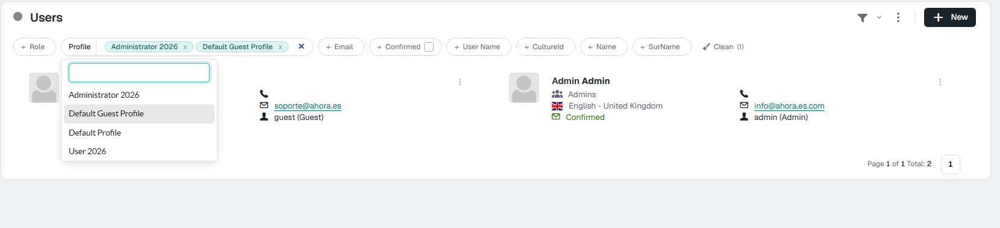
  <figcaption>The "Profile" chip with two values chosen</figcaption>
</figure>

### 1.6 Edit lists

A skin2026 **edit list** reads like the default list, with every value as text (dependent fields and multicombos too, with their texts and the user's number format), and **is edited in place**:

- **A click on a value** edits it right there; the row **is saved when you leave it**. Cancel undoes the whole row, and moving to another row opens it once the first one is saved.
- **New** adds a row on top of a list page; inside a form, **Add row** does it.
- Each row keeps the **record menu** of the default list behind its three dots; the row buttons stay pinned to the right.
- Columns are widened by dragging their edge, and when they do not fit the list scrolls sideways. Sorting or refreshing saves the changed row first, and stops if it cannot be saved.

It works on phones and tablets, in light and dark. In flexy2022 the edit list stays as it was.

<figure markdown="span">
  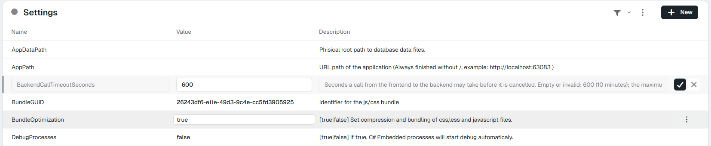
  <figcaption>A row being edited (✓ saves, ✕ cancels) and, below it, the three dots with another row's menu</figcaption>
</figure>

---

## 2. Search: the Ctrl K palette and the search manager

**Ctrl K** (or the search box in the top bar) opens the global **search palette**. When empty, it already tells you **where it searches**: each object with a configured search and by which fields. Those marked *Develop mode* are only visible in development mode; a normal user sees their own.

<figure markdown="span">
  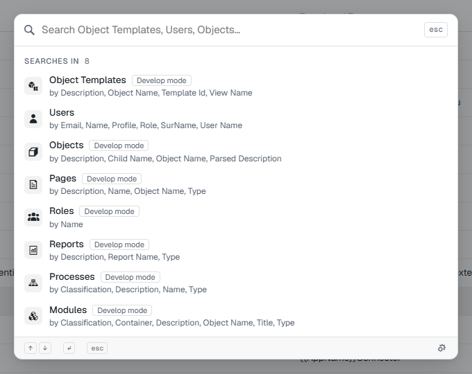{ width="520" }
  <figcaption>Before you type anything, the palette tells you what it can find</figcaption>
</figure>

The gear at the bottom of the palette opens the **search manager** (*Filter Manager*). With no object chosen it shows the **summary of what is already configured**: each search, its object, its fields and whether it is development mode only; clicking one edits it. With an object chosen, its properties are on the left and the search fields on the right.

<figure markdown="span">
  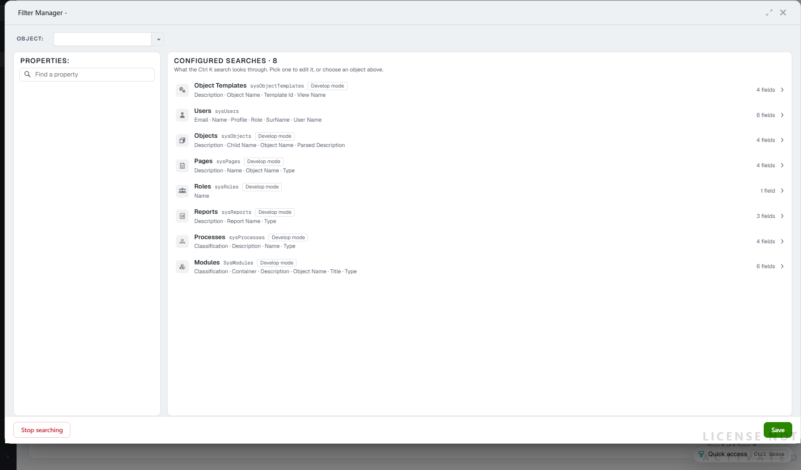
  <figcaption>The summary of the configured searches</figcaption>
</figure>

### 2.1 Favourites, recent pages and shortcuts 10.1+

Before you type anything, the palette also shows your **Favourites** and the pages you opened last (**Recent**). The **star** on each one adds it to your favourites or removes it (*Add to favourites* / *Remove from favourites*); favourites are kept with your user settings, so they follow you to another browser. They open like a result: with ↑ ↓ and **Enter**, or with the mouse.

The **Shortcuts** button at the bottom of the palette, or the **?** key on any screen, opens the list of **keyboard shortcuts**, grouped into *General*, *Search*, *Lists* and *Forms*; in development mode *Development* is added. The list comes from the shortcuts that really exist in the application.

### 2.2 The / key searches the list you are looking at 10.1+

**/** puts the cursor in the search box of the list in front of you. With a dialog or a side panel open, it goes to that one's list. It does nothing while you type in a field or an editor, nor with AltGr or a dead key, so it never gets in the way of typing.

---

## 3. Notifications: the bell

The bell in the top bar opens in one piece, grouped by source (*Application*, *Mail*…), with the number of unread items in each group, the three latest notifications and **Mark all as read**. Opening an unread notification marks it as read, and after *Mark all as read* the three latest stay in view. It closes by clicking the bell again. It has **its own sound** when a notification arrives; pop-up messages no longer make a sound.

<figure markdown="span">
  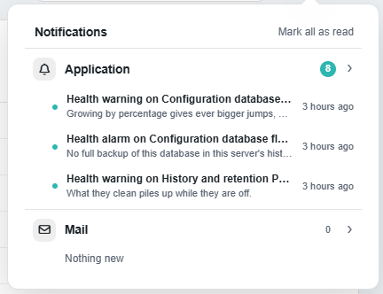{ width="420" }
  <figcaption>On mobile it appears as a sheet from the bottom and closes by swiping it</figcaption>
</figure>

---

## 4. Mobile and tablet

On a phone, skin2026 has **its own bar**: the menu (hamburger), the logo, search and the bell. The **side menu slides in as a sheet** over the page, with the desktop bar links inside; the profile menu opens upwards from the user. Controls are finger-sized.

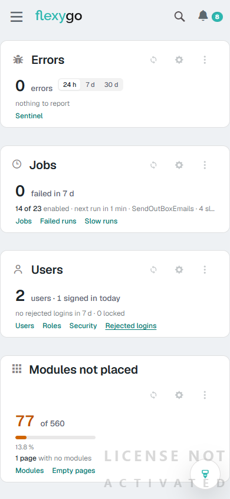{ width="200" } 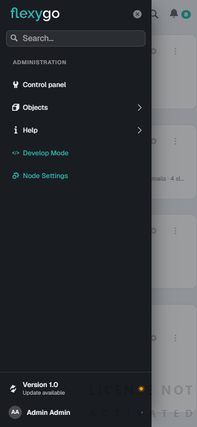{ width="200" } 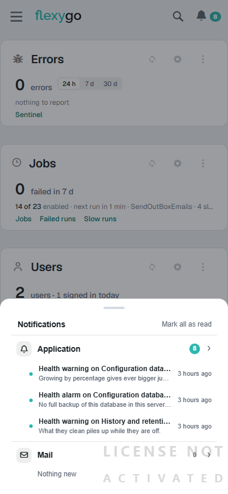{ width="200" }

*The phone bar · The menu, as a sheet · The bell, as a sheet*

Lists switch to **card rows** when they do not fit (in administration lists, below 1100 px): each row is a card with its title at the top and the rest as "label value". Module tabs are the desktop ones, with an arrow and a fade at the edge when there are more than fit. A calendar opens in its list view on the phone.

Dropdowns open their **mobile panel**: the strip at the top with what is chosen, the ✕ to clear and the ✓ to close, and finger-sized options. The search manager **stacks its two panels**, each with its own scrolling.

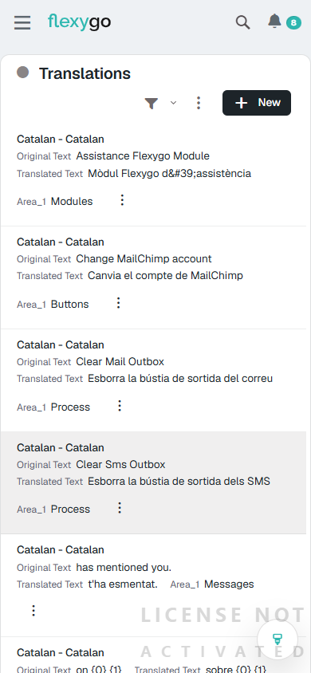{ width="200" } 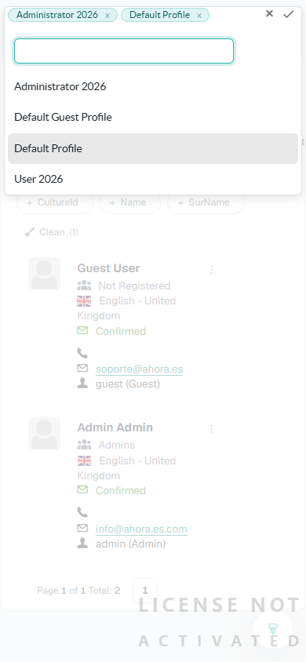{ width="200" } 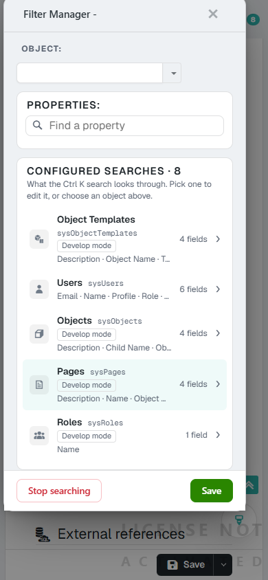{ width="200" }

*Card rows · A dropdown's panel · The search manager, stacked*

---

## 5. Offline app: synchronizations, retrying and correcting what was sent

On each offline app's screen, the **Synchronisation** tab lists what the devices have sent and received:

- **Chips** *All*, *Errors*, *Sent* and *Received* with their count, and a search by type, user, error, id or date.
- **Retry** on each failed submission, and **Retry failed · n** for all of them, one after another.
- Each row expands with its detail, and **Open data** opens what the device sent.
- The app header tells you if it **sends data without a return process** (*no return process*): those submissions cannot be applied.

<figure markdown="span">
  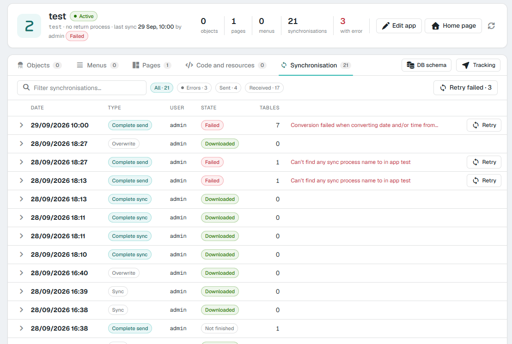
  <figcaption>Three failed submissions, each with its Retry</figcaption>
</figure>

The **editor of what was sent** shows the device's JSON as a table, table by table and paged, with the status of each row (*Inserted*, *Updated*, *Deleted*). At the top, the full **error** and where it has been located: the column it names, the rows that carry the value, *Go to row N* and *1 of N* to jump from one to another. Values can be corrected and **rows removed from the submission**; nothing is saved until you press **Save**, and **Retry** runs it through the return process again. **Raw JSON** shows the submission as is.

<figure markdown="span">
  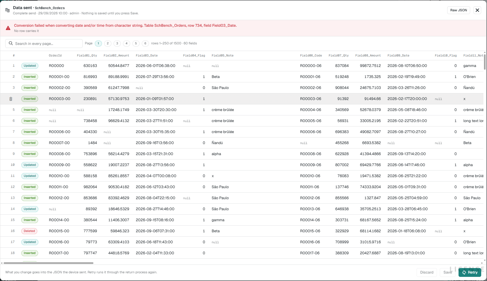
  <figcaption>The date conversion error, with the table, the row and the field it names</figcaption>
</figure>

---

## 6. The side menu

**Out of the box** it comes with *Default Objects*, *Control panel* and *Help*; the rest is added by each application. Since 10.1 there is no *Develop Mode* entry: users with a designer profile **start in development mode when they sign in**, without waiting for the menu to load. A **Group Node** node is a section with its nodes, and it can be **collapsed** if the node says so: the node's **Collapsible** column.

### 6.1 Objects and master tables, in development mode

In development mode, the **Objects** node gives quick access to any object: **System** with the product's ones (when working on origin 0) and **Solution** with the project's ones (origin 1 or higher). Each object opens its list. Inside each one, **Master Tables**: in *System* by groups, in *Solution* the project's ones; a master table with an object opens that object's list and the rest, the table editor. Unregistered users see neither *Objects* nor *Control panel*.

### 6.2 The menu search box

The search box at the top of the menu finds any node, including those in *Objects*:

- **Accent-insensitive and in any order**: "sécurity" finds *Security*; "users object" finds titles containing both words.
- **With the keyboard**: ↑ ↓ move the highlight between results and **Enter** opens the highlighted one.
- If there is nothing, it says so: *Nothing matches that*.
- Matches are highlighted with a tint of the accent color, and long titles end in an ellipsis.

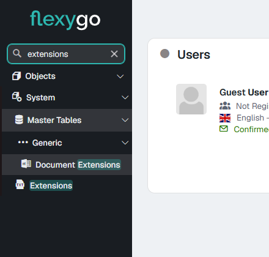{ width="200" } 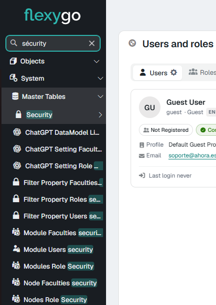{ width="200" } 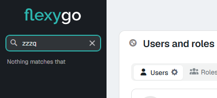{ width="200" }

*A master table found from the search box · Accent-insensitive, with the match highlighted · No results, it says so*

### 6.3 Changing the menu with a right click 10.1+

In development mode, a **right click** on any menu entry (in the sidebar or in the top bar) opens its node menu:

| Option | What it does |
|---|---|
| **Edit this node** | Opens the **node manager** on that node, with its form unfolded |
| **Add a node below** | Opens the manager to create a node right **after** this one, at the same level |
| **Add a node inside** | Opens the manager to create a node **inside** this one. It is offered on text and group nodes, and on nodes that already have nodes inside |
| **Who can see it** | Opens the node's security: which roles or users see the entry |
| **Delete node** | Deletes the node, after asking for confirmation |
| **Manage the whole menu** | Opens the node manager with the whole menu |

A right click on an area of the menu with no entries only offers **Add a node below** (at the end of the menu) and **Manage the whole menu**. A click outside the context menu closes it. A right click no longer opens the entry or folds the sidebar, and the old *Node Settings* button is gone in skin2026, where the right click replaces it. The welcome tour explains it in its *Changing the menu* step.

!!! note "Who sees the entry does not protect the page"
    *Who can see it* decides whether the **link is shown**; the page it opens is protected by its own security. See [Node security and page security](../../1Deployment/3Updater/UpgradeNotes.md#node-security-and-page-security).

<figure markdown="span">
  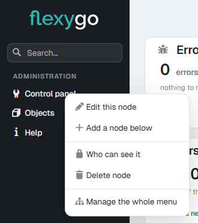{ width="330" }
  <figcaption>Right click on <i>Control panel</i></figcaption>
</figure>

### 6.4 The version row and the notices on sign-in 10.1+

At the bottom of the sidebar, the **version row** shows the whole installed version, as the backend reports it (`10.1.0.3`, or `10.1.0-beta.12` on a beta), and its state:

- **Up to date**, or **Update available** as soon as there is a newer build, even a patch or a newer beta (if the updater looks for betas);
- a **dot** when there is version news you have not read yet;
- for administrators, **n differences to review** when the last update left **customized differences** to resolve. Clicking it opens the versions page on the resolver of the installed version; this also works in Docker and Kestrel. See [Flexygo Updater](../../1Deployment/3Updater/UpdateFlow.md).

On sign-in, the notices come up **one at a time** and in this order, each one when the previous one is closed: the data collection notice, the origin chooser, the welcome tour and the version news. If you have just taken the welcome tour, the news waits for a later visit as the dot on the version row.

---

## 7. Ordering a page's modules

If the administrator allows it on a page, you can put its modules in the order you prefer. It only changes for you.

- **Move**: take a module by its header and drop it where you want it. On a tablet, keep your finger on the header for a moment before dragging.
- **Pin**: the pin in the header (**Pin this module here**) keeps it still, and the others move around it. **Unpin this module** frees it.
- **Go back**: at the foot of the page, **Put the modules back as the administrator arranged them** leaves everything as it was.

Each change is saved when you drop the module. You can move the modules, but not change their size or show or hide any. At mobile width there is no ordering: the modules stack. How to switch it on: [letting each user order the modules](../Modules/ModuleManagement.md#skin-2026-letting-each-user-order-the-modules).

<figure markdown="span">
  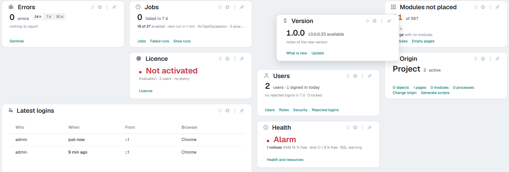
  <figcaption>Dragging the <i>Version</i> module: the others move aside while you move it</figcaption>
</figure>

---

## 8. For product developers

- **New columns in configuration tables**: they go at the end of the table's own columns and **before** the reserved ones (`flxInsertedBy`, `flxUpdatedBy`, `flxInsertedDate`, `flxUpdatedDate`, `OriginAddonId`, `OriginId`). Version 10 rearranges `Pages`, `Pages_Modules`, `Modules`, `Navigation_Nodes` and `Charts_Settings` this way; when upgrading an existing database, those five tables are rebuilt once.
- **Easy info**: the misspelled column warning is now an icon next to the title; see [Easy info](../Modules/EasyInfo.md#16-the-misspelled-column-warning-development-mode).

---

## 9. Guided tours 10.0+

A **guided tour** takes the user step by step through one or more screens: each step is a card that points at something on the screen (a module, a part of the menu or the header) with its title and its text. The Flexygo welcome tour is made this way, and you can create your own without programming. They only exist in skin2026.

**Creating a tour**

1. In development mode, open **Control panel › Other tools › Tours**. The **Tour builder** opens on the list of tours, each with its number of steps and tagged *System* (Flexygo's own) or *Off* (disabled).
2. **Add tour**: give it a **Name** and an **Id** and, if you want, an **Invitation title** and an **Invitation text** for the card that offers it. **Enabled** turns it on, **Offer it on its own** makes it offer itself and **Show progress** shows "2 of 7" on each card.
3. Open the tour and go to the screen where it starts. **Add step** and **click what the step points at** (*Click what this step points at*; with **Alt**, the exact element). A module is named by its id, and the mark follows it even when you scroll the page.
4. Write the **Title** and the **Text**, and choose the card's **Side** and **Align**. The real card shows on the page while you type; the sides where it does not fit are dimmed. **Action** lets the step do something before it shows, such as opening a menu or unfolding a row.
5. Go to another screen and keep adding steps: a tour can cross several. Drag the steps to change their order. Everything is saved as you go.

**Who sees it.** A tour is offered where you put a module of type **Tour** that names it, and it is seen by whoever can see that module: its security decides the roles. The same module lets users take it again later.

In development mode, each card carries **Edit**, which opens the builder on that step. The texts are translated like the rest of the application. In a Flexygo tour (*System*), an update puts its original texts back.

<figure markdown="span">
  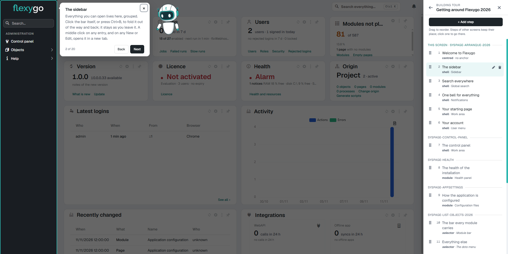
  <figcaption>On the right, the tour's steps by screen; at the top, the real card of the picked step</figcaption>
</figure>
