# Integración con Passbook { .fh-title-with-image }

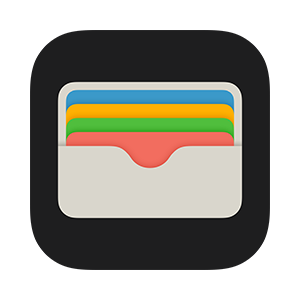{ .fh-image-of-title }

Passbook es el formato utilizado por tarjetas y cupones para integrarse en Apple Wallet.  
**flexygo** permite ahora generar un passbook de forma sencilla.

A continuación explicaremos cómo generar e instalar los certificados obligatorios para poder generar el passbook correctamente.  
El primer requisito es disponer de una cuenta de desarrollador de Apple.

## Apple WWDR

Para obtener el primer certificado solo tenemos que ir a [https://www.apple.com/certificateauthority/](https://www.apple.com/certificateauthority/) y descargar [Worldwide Developer Relations - G4 (Expiring 12/10/2030 00:00:00 UTC)](https://www.apple.com/certificateauthority/AppleWWDRCAG4.cer), que es el que funciona actualmente.

Instalamos el certificado y seleccionamos el almacén **“Intermediate Certification Authorities”**.

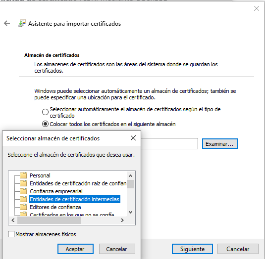

## Crear Pass Type ID

Accede a [https://developer.apple.com/](https://developer.apple.com/) e inicia sesión con una cuenta de desarrollador.  
Una vez dentro, entra en **Account** y accede al menú de la izquierda **Certificates, IDs & Profiles**.

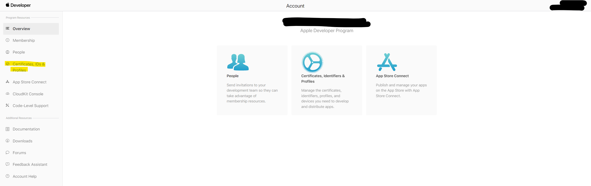

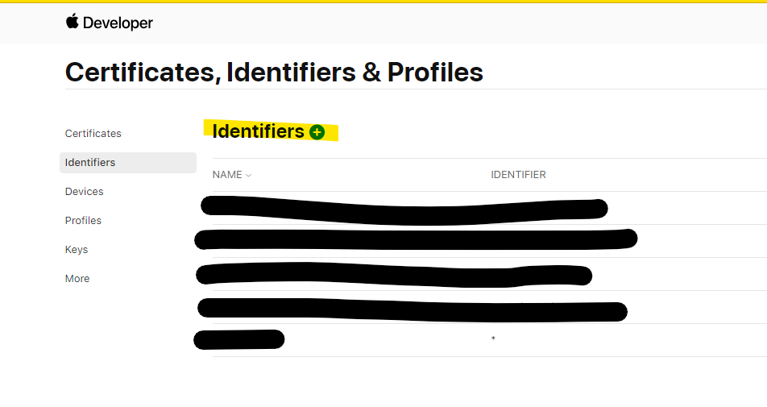

Añadimos un nuevo **Identifier** y elegimos el tipo **Pass Type IDs**, rellenando la información.  
Es recomendable que el identificador mantenga la estructura `pass.com.x`.

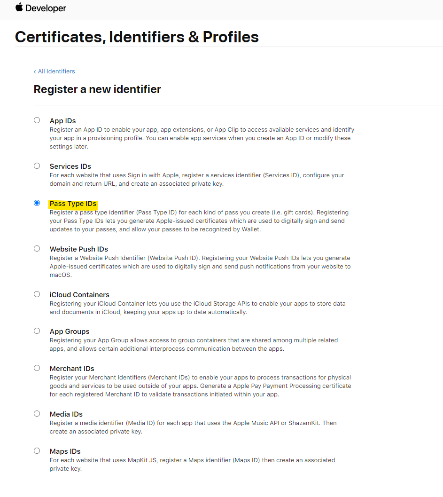

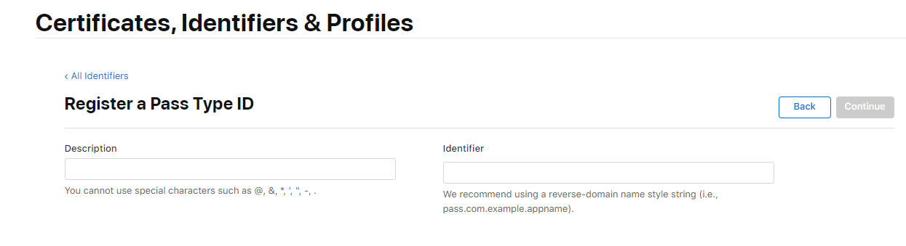

## Crear una petición de certificado (CSR)

Si no tenemos **OpenSSL** instalado, podemos descargarlo e instalarlo desde aquí: [OpenSSL](https://wiki.openssl.org/index.php/Binaries).

Una vez instalado, abrimos la consola con permisos de administrador, nos situamos en la ruta donde queremos generar los ficheros y ejecutamos el comando:

```shell
openssl req -new -newkey rsa:2048 -out passbook.csr -keyout passbook.key
```

Aparecerá una serie de datos a rellenar. El primero será la **PEM pass phrase**; es muy importante recordarla ya que la usaremos para generar el passbook y para firmar con la clave.

Al terminar de rellenar la información, se habrán generado dos ficheros en la ruta indicada:

* `passbook.key` (clave privada para firmar)
* `passbook.csr` (petición de certificado)

## Firmar la CSR y crear el certificado Passbook

Volvemos al portal de desarrolladores y, desde el menú de certificados, pulsamos **+** para crear un nuevo **Pass Type Id Certificate**.

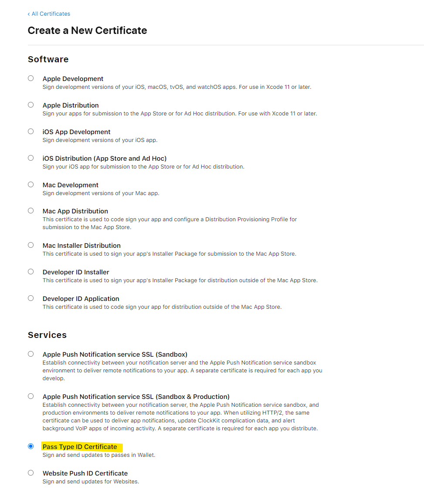

A continuación, rellenamos el nombre del certificado y elegimos el identificador que hemos creado previamente; aparecerá como opción desplegable.
Si nos fijamos en el valor del desplegable, coincide con **TeamID.IdentifierPassTypeID**.

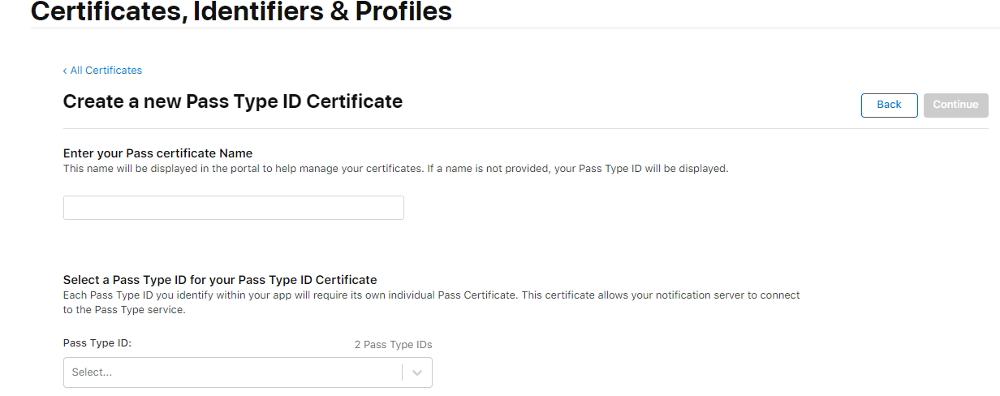

En el siguiente paso debemos seleccionar el archivo CSR que generamos antes (`passbook.csr`), lo subimos y continuamos.
Se mostrará una ventana de resumen con el certificado recién generado, su fecha de caducidad, nombre, tipo, etc.

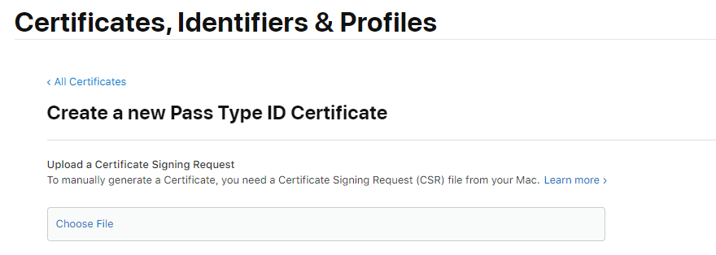

## Convertir el certificado pass.cer a PEM y luego a PFX

Primero, colocamos el archivo `.cer` descargado desde la web de Apple en la misma carpeta que `passbook.key` y `passbook.csr`.

Después abrimos la consola de OpenSSL, navegamos hasta esa carpeta y ejecutamos:

```shell
openssl x509 -in pass.cer -inform der -out passbook.pem
```

```shell
openssl pkcs12 -export -out passbook.pfx -inkey passbook.key -in passbook.pem
```

Con este último comando, nos pedirá la contraseña (pass phrase) asociada a la clave privada.
Una vez introducida, se generará el archivo `passbook.pfx`, que debemos instalar en el equipo.

## Añadir el certificado PFX al servidor

Vamos a la consola de certificados:
**Certificates (Local Computer) -> Personal -> Certificates**.

Botón derecho, **All Tasks → Import**, siguiente, y al examinar el archivo cambiamos el filtro de extensión para buscar `.pfx` y seleccionamos el fichero generado.

En el siguiente paso introducimos la contraseña de la clave privada, marcamos la opción de exportable e incluimos todas las propiedades extendidas.
Lo añadimos al almacén **Personal**.

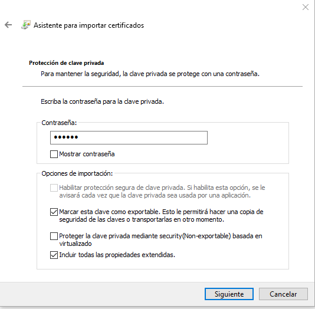

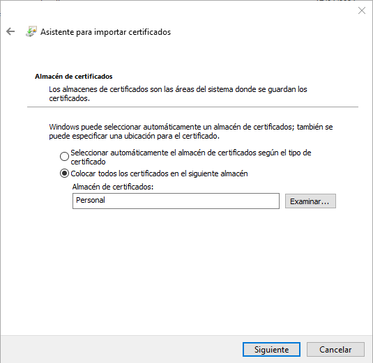

Con esto tendremos instalados los certificados necesarios para poder generar Passbook desde **flexygo**.
Es importante que tanto el archivo `passbook.pfx` como `AppleWWDRCAG4.cer` estén en una carpeta accesible para la aplicación.

También es importante que, desde la consola, una vez importado el certificado en el almacén Personal, hagamos:

* Botón derecho → All Tasks → Manage Private Keys
* Añadimos **IIS_IUSRS** y le damos permisos.

Los pasos con **IIS_IUSRS** y la identidad del Application Pool solo se aplican cuando la aplicación se publica en **IIS**. Si se ejecuta de otra forma (Kestrel, servicio de Windows, Docker), da permisos sobre la clave privada a la cuenta con la que se ejecuta el Backend.
{: .flx-info-card }

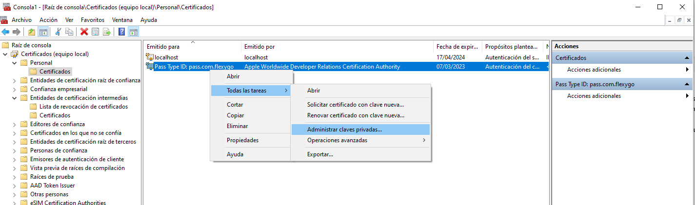

Es necesario también tener configurado el **impersonate**, ya que la generación del passbook hace uso de él.

Si, aun habiendo dado permisos a **IIS_IUSRS** y usando un usuario de impersonation con permisos elevados, sigue dando error de permisos al generar el passbook, será necesario modificar la identidad del Application Pool a **LocalSystem**.

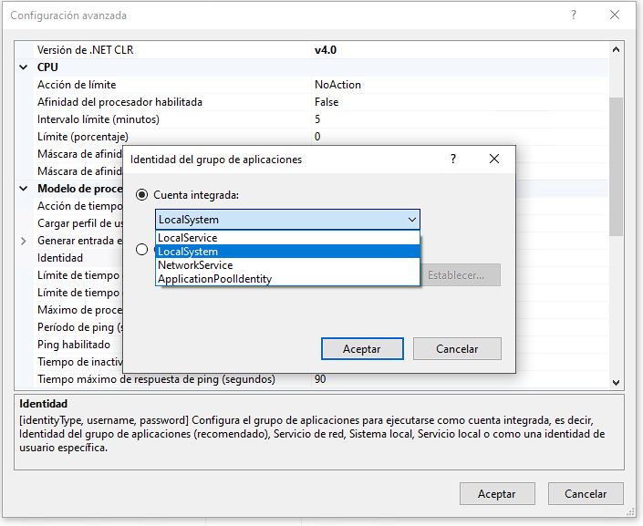

## Configuración en flexygo

Una vez realizado todo lo anterior, podemos proceder a configurar los ajustes en **flexygo**:

* **Passbook_AppleWWDRCACertificatePath**: Ruta absoluta al certificado de Apple.
* **Passbook_CertificatePath**: Ruta absoluta a nuestro certificado.
* **Passbook_CertificatePassword**: Contraseña (clave privada) de nuestro certificado.
* **Passbook_PassTypeIdentifier**: Pass Type ID creado en Apple (por ejemplo, `pass.com.x`).
* **Passbook_TeamIdentifier**: Valor Team ID, visible en el portal de desarrolladores de Apple en
  *Membership → Team ID*.

## Ejemplo de uso desde DLL

La clase es `FLEXYGO.flxPassbook` (biblioteca `flxSysProcess`). Las rutas se resuelven con `Ret.ConfToken.MapFrontPath` (carpeta `wwwroot` del Frontend) y `Ret.ConfToken.MapBackPath` (carpeta del Backend).

<fh-modal class="button" modal_id="fhmodal_dll_example" modal_title="DLL function example">Ejemplo de DLL</fh-modal>

## Ejemplo de diseño y layout

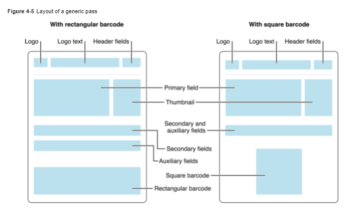

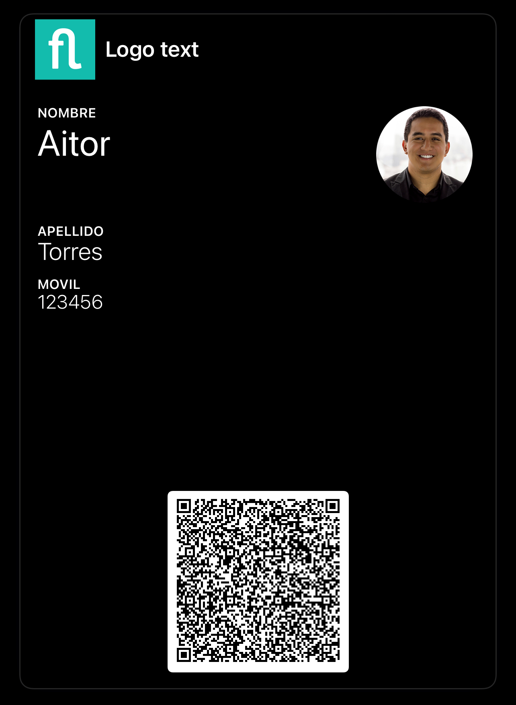

```csharp { #fhmodal_dll_example }
using System;
using System.Collections.Generic;
using System.IO;
using FLEXYGO;
using FLEXYGO.Objects;
using FLEXYGO.Utilities;
using static FLEXYGO.Processing.ProcessManager;

public static bool generatePassbook(EntityObject Entity, ref ProcessHelper Ret)
{
    try
    {
        var aPrimaryField = new List<KeyValuePair<string, string>> { new KeyValuePair<string, string>("Nombre", "Aitor") };
        var aSecondaryField = new List<KeyValuePair<string, string>> { new KeyValuePair<string, string>("Apellido", "Torres") };
        var aAuxiliaryField = new List<KeyValuePair<string, string>> { new KeyValuePair<string, string>("Movil", "123456") };
        var aBackField = new List<KeyValuePair<string, string>> { new KeyValuePair<string, string>("Otros", "Loren ipsum") };
        string aBackgroundColor = "#000000";
        string aForegroundColor = "#FFFFFF";
        string aLabelColor = "#FFFFFF";
        // Images of the Frontend (wwwroot)
        byte[] aIcon = File.ReadAllBytes(Ret.ConfToken.MapFrontPath("~/img/icons/icon-256x256.png"));
        byte[] aLogo = File.ReadAllBytes(Ret.ConfToken.MapFrontPath("~/img/icons/icon-256x256.png"));
        byte[] aThumbnail = File.ReadAllBytes(Ret.ConfToken.MapFrontPath("~/img/avatars/avatar_blank.png"));
        string aDescription = "Passbook flexygo";
        string aOrganizationName = "Flexygo";
        string aLogoText = "Logo text";
        var aHeaderField = new KeyValuePair<string, string>("Cabecera", "Business card");

        // vCard info for qr barcode
        VCard vCard = new VCard("Aitor", "Torres", "Flexygo", "Programador", "Carrer dels Ceramistes 19", "46900", "Valencia", "España",
                                "123456", "987654", "", "aitor@ahora.es", "www.flexygo.com", Guid.NewGuid().ToString());
        string aBarcode = vCard.VCardBody();

        flxPassbook passbook = new flxPassbook(aPrimaryField, aBackgroundColor, aForegroundColor, aLabelColor, aIcon, aDescription, aOrganizationName, aLogoText,
                                               aBarcode, aHeaderField, aLogo, aSecondaryField, aAuxiliaryField, aBackField, aThumbnail);

        // We can write on disk, download it, send by mail, etc...
        string path = Ret.ConfToken.MapBackPath("~/custom/passbook/prueba.pkpass");
        Directory.CreateDirectory(Path.GetDirectoryName(path));
        File.WriteAllBytes(path, passbook.generatePassbook());

        Download dw = new Download { Path = path, DeleteAfterDownload = true };

        Ret.JSCode = string.Format("window.open('{0}')", Ret.ConfToken.ResolveUrl(dw.GetLink()));
        Ret.Success = true;
        Ret.SuccessMessage = "Passbook generated";
        return Ret.Success;
    }
    catch (Exception ex)
    {
        Ret.Success = false;
        Ret.LastException = ex;
        return Ret.Success;
    }
}
```