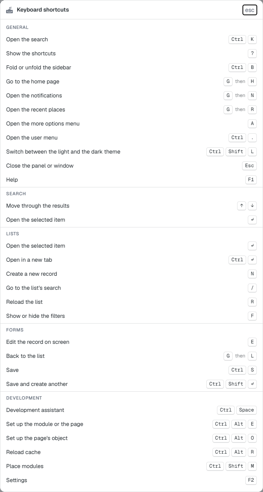

# Keyboard shortcuts 10.0+

Flexygo has keyboard shortcuts for what you do often: searching, moving between pages, working with lists and forms and, in develop mode, setting up what is in front of you.

Press ++"?"++ on any screen to see the list of shortcuts. The list only shows the ones that exist in the application, and the development ones only appear in develop mode.

<figure markdown="span">
  { width="520" }
  <figcaption>The shortcuts panel, with develop mode on</figcaption>
</figure>

---

## 1. How they work

- **They act on what is in front of you.** If a dialog or a side panel is open, on the last one. Otherwise, on the page. When there are several lists or views, on the one that holds the cursor, then on the one under the mouse and, failing that, on the first one.
- **The one-key shortcuts (++"?"++, ++slash++, ++r++, ++f++, ++e++, ++n++, ++a++, ++g++) do nothing while you are typing**: in a field, a dropdown, the HTML editor or the code editor, the key is typed. They do not act with AltGr or a dead key (the accent key) either, nor when the key is held down, nor with a menu open.
- **If there is nothing to act on, the key does nothing.** For example, ++r++ on a page without lists, or ++e++ on a view without the **Edit** button.
- **They respect the setup and the permissions.** ++e++ presses the view's **Edit** button and ++f++ the list's filter button: if the module does not have that button, the shortcut does nothing.
- **On a Mac**, ++cmd++ stands for ++ctrl++. The development shortcuts with ++ctrl+alt++ are ++ctrl+option++.
- Almost all of them belong to the **Flexygo 2026 skin**. ++f1++, ++f2++, ++ctrl+s++, ++ctrl+shift+enter++ and the development ones with ++ctrl+alt++ also work in the flexy2022 skin.

---

## 2. General

| Shortcut | What it does |
|---|---|
| ++ctrl+k++ | Opens the search, with your favourites and your recent pages. |
| ++"?"++ | Shows the list of shortcuts. 10.1+ |
| ++ctrl+b++ | Folds or unfolds the sidebar. |
| ++g++ then ++h++ | Goes to the home page. 10.1+ |
| ++g++ then ++n++ | Opens the notifications (the bell). Pressed again, closes them. 10.1+ |
| ++g++ then ++r++ | Opens the search with only your recent places (up to twelve, without the page you are on) and the first one selected: ++g++ ++r++ ++enter++ takes you back to where you were. 10.1+ |
| ++a++ | Opens the module's **More options** menu (the three dots): processes, reports, new, delete, sort… Move with ++arrow-up++ ++arrow-down++, ++enter++ chooses or goes into a submenu and ++esc++ goes back or closes it. 10.1+ |
| ++ctrl+period++ | Opens the user menu (language, picture, password, log off...). Move through it with ++arrow-up++ ++arrow-down++, choose with ++enter++ and close it with ++esc++. 10.1+ |
| ++ctrl+shift+l++ | Switches between the light and the dark theme, and stores it for your user. It also works with the cursor in a field, but not in the HTML editor or the code editor. 10.1+ |
| ++esc++ | Closes the panel or the window. |
| ++f1++ | Opens the help. Only for users with design permission. |

In ++g++ then ++h++, the two keys are pressed one after the other, not together, with less than a second and a half between them.

---

## 3. Search

| Shortcut | What it does |
|---|---|
| ++arrow-up++ ++arrow-down++ | Moves through the results. |
| ++enter++ | Opens the chosen result. |

---

## 4. Lists

| Shortcut | What it does |
|---|---|
| ++enter++ | Opens the chosen row. |
| ++ctrl+enter++ | Opens the row in another browser tab. |
| ++n++ | Creates a new record, with the module's **New** button, whether it is on the bar or inside **More options**. Also from a record's view. 10.1+ |
| ++slash++ | Puts the cursor in the list's search box. 10.1+ |
| ++r++ | Reloads the list (or the kanban). 10.1+ |
| ++f++ | Shows the list's filters and puts the cursor in the first one; if they are already shown, hides them. ++esc++ inside the filters hides them too. 10.1+ |

++f++ opens the filter set the list has in use; if none, the last one you opened with the key and, failing that, the first set of properties. To choose another set, use the filter button.

If the list is in a dialog, the first ++esc++ hides the filters and the second closes the dialog.

---

## 5. Forms

| Shortcut | What it does |
|---|---|
| ++e++ | From a record's view, opens its edit form. 10.1+ |
| ++g++ then ++l++ | From a record's view or edit form, goes to the list of its object. With a window open in front, it does nothing. 10.1+ |
| ++ctrl+s++ | Saves. Works with the cursor inside the form. |
| ++ctrl+shift+enter++ | Saves and opens a blank form of the same object, to add several records in a row. Works with the cursor inside the form. 10.1+ |

---

## 6. Development

For whoever develops the application. They are only for users with design permission. ++ctrl+space++, ++ctrl+alt+e++, ++ctrl+alt+o++ and ++ctrl+alt+r++ also need develop mode on.

| Shortcut | What it does |
|---|---|
| ++ctrl+space++ | Opens **Quick access**: the page's object, its settings, its security and the development processes. |
| ++ctrl+alt+e++ | Opens the settings of the module that holds the cursor or, if the cursor is in none, of the module with the mouse over its header. If there is none, opens the page's properties. 10.1+ |
| ++ctrl+alt+o++ | Opens the settings of the page's object (or of the one you chose in **Quick access**). 10.1+ |
| ++ctrl+alt+r++ | Reloads the cache. 10.1+ |
| ++ctrl+shift+m++ | Opens **Place modules** to arrange the page's modules. Pressed again, closes it. |
| ++f2++ | Opens the application settings. |

!!! note "AltGr is Ctrl + Alt"
    On Windows, AltGr is the same as ++ctrl+alt++. That is why, inside a field, ++ctrl+alt+e++ types "€" on a Spanish keyboard and does not open the settings. To set up that module, put the mouse over its header, or the cursor on a button or somewhere else in the module, and press the shortcut.

---

## 7. Shortcuts that are not used

Some combinations were left out because the browser does not let a page use them, or because changing them would get in the way more than it would help: ++ctrl+n++, ++ctrl+t++, ++ctrl+w++, ++ctrl+r++, ++ctrl+l++, ++ctrl+p++, ++ctrl+d++, ++ctrl+tab++, ++alt+arrow-left++ and ++alt+arrow-right++. That is why "save and create another" is ++ctrl+shift+enter++ and not ++ctrl+shift+n++, which opens an incognito window.
