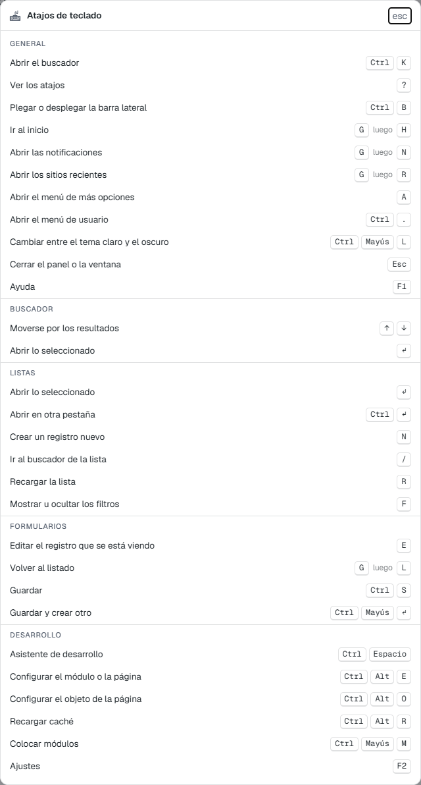

# Atajos de teclado 10.0+

Flexygo tiene atajos de teclado para lo que se hace a menudo: buscar, moverse entre páginas, trabajar con listas y formularios y, en modo desarrollo, configurar lo que tienes delante.

Pulsa ++"?"++ en cualquier pantalla para ver la lista de atajos. La lista solo enseña los que existen en la aplicación, y los de desarrollo solo salen en modo desarrollo.

<figure markdown="span">
  { width="520" }
  <figcaption>El panel de atajos, con el modo desarrollo activado</figcaption>
</figure>

---

## 1. Cómo funcionan

- **Actúan sobre lo que tienes delante.** Si hay un diálogo o un panel lateral abierto, sobre el último. Si no, sobre la página. Cuando hay varias listas o vistas, sobre la que tiene el cursor, después sobre la que está debajo del ratón y, si no, sobre la primera.
- **Los atajos de una sola tecla (++"?"++, ++slash++, ++r++, ++f++, ++e++, ++n++, ++a++, ++g++) no hacen nada mientras escribes**: en un campo, un desplegable, el editor HTML o el editor de código, la tecla se escribe. Tampoco actúan con AltGr ni con una tecla muerta (la de los acentos), ni al dejar la tecla pulsada, ni con un menú abierto.
- **Si no hay nada sobre lo que actuar, la tecla no hace nada.** Por ejemplo, ++r++ en una página sin listas, o ++e++ en una vista que no tiene el botón **Editar**.
- **Respetan la configuración y los permisos.** ++e++ pulsa el botón **Editar** de la vista y ++f++ el de los filtros de la lista: si el módulo no tiene ese botón, el atajo no hace nada.
- **En Mac**, ++cmd++ hace de ++ctrl++. Los atajos de desarrollo con ++ctrl+alt++ son ++ctrl+option++.
- Casi todos son de la **skin Flexygo 2026**. ++f1++, ++f2++, ++ctrl+s++, ++ctrl+shift+enter++ y los de desarrollo con ++ctrl+alt++ funcionan también en la skin flexy2022.

---

## 2. Generales

| Atajo | Qué hace |
|---|---|
| ++ctrl+k++ | Abre el buscador, con tus favoritos y tus páginas recientes. |
| ++"?"++ | Enseña la lista de atajos. 10.1+ |
| ++ctrl+b++ | Pliega o despliega el menú lateral. |
| ++g++ y luego ++h++ | Va a la página de inicio. 10.1+ |
| ++g++ y luego ++n++ | Abre las notificaciones (la campana). Otra vez lo cierra. 10.1+ |
| ++g++ y luego ++r++ | Abre el buscador solo con tus sitios recientes (hasta doce, sin la página en la que estás) y el primero marcado: ++g++ ++r++ ++enter++ te devuelve a donde estabas. 10.1+ |
| ++a++ | Abre el menú **Más opciones** (los tres puntos) del módulo: procesos, informes, nuevo, borrar, ordenar… Se recorre con ++arrow-up++ ++arrow-down++, ++enter++ elige o entra en un submenú y ++esc++ vuelve atrás o lo cierra. 10.1+ |
| ++ctrl+period++ | Abre el menú de usuario (idioma, foto, contraseña, salir…). Se recorre con ++arrow-up++ ++arrow-down++, se elige con ++enter++ y se cierra con ++esc++. 10.1+ |
| ++ctrl+shift+l++ | Cambia entre el tema claro y el oscuro, y lo guarda en tu usuario. Funciona también con el cursor en un campo, pero no en el editor HTML ni en el de código. 10.1+ |
| ++esc++ | Cierra el panel o la ventana. |
| ++f1++ | Abre la ayuda. Solo para los usuarios con permiso de diseño. |

En ++g++ y luego ++h++, las dos teclas se pulsan una detrás de otra, no a la vez, y con menos de un segundo y medio entre ellas.

---

## 3. Buscador

| Atajo | Qué hace |
|---|---|
| ++arrow-up++ ++arrow-down++ | Se mueve por los resultados. |
| ++enter++ | Abre el resultado elegido. |

---

## 4. Listas

| Atajo | Qué hace |
|---|---|
| ++enter++ | Abre la fila elegida. |
| ++ctrl+enter++ | Abre la fila en otra pestaña del navegador. |
| ++n++ | Crea un registro nuevo, con el botón **Nuevo** del módulo, esté en la barra o dentro de **Más opciones**. También desde la vista de un registro. 10.1+ |
| ++slash++ | Pone el cursor en el buscador de la lista. 10.1+ |
| ++r++ | Recarga la lista (o el kanban). 10.1+ |
| ++f++ | Enseña los filtros de la lista y pone el cursor en el primero; si ya se ven, los oculta. ++esc++ dentro de los filtros también los oculta. 10.1+ |

++f++ abre el conjunto de filtros que tenga la lista en uso; si no hay ninguno, el último que abriste con la tecla y, si no, el primero de propiedades. Para elegir otro conjunto, usa el botón de los filtros.

Si la lista está en un diálogo, el primer ++esc++ oculta los filtros y el segundo cierra el diálogo.

---

## 5. Formularios

| Atajo | Qué hace |
|---|---|
| ++e++ | Desde la vista de un registro, abre su formulario de edición. 10.1+ |
| ++g++ y luego ++l++ | Desde la vista o la edición de un registro, va al listado de su objeto. Con una ventana abierta delante no hace nada. 10.1+ |
| ++ctrl+s++ | Guarda. Funciona con el cursor dentro del formulario. |
| ++ctrl+shift+enter++ | Guarda y abre un formulario en blanco del mismo objeto, para dar de alta varios registros seguidos. Funciona con el cursor dentro del formulario. 10.1+ |

---

## 6. Desarrollo

Para quien desarrolla la aplicación. Son solo para los usuarios con permiso de diseño. ++ctrl+space++, ++ctrl+alt+e++, ++ctrl+alt+o++ y ++ctrl+alt+r++ piden además el modo desarrollo activado.

| Atajo | Qué hace |
|---|---|
| ++ctrl+space++ | Abre el **Acceso rápido**: el objeto de la página, su configuración, su seguridad y los procesos de desarrollo. |
| ++ctrl+alt+e++ | Abre la configuración del módulo en el que está el cursor o, si el cursor no está en ninguno, la del módulo con el ratón sobre la cabecera. Si no hay ninguno, abre las propiedades de la página. 10.1+ |
| ++ctrl+alt+o++ | Abre la configuración del objeto de la página (o del que hayas elegido en el **Acceso rápido**). 10.1+ |
| ++ctrl+alt+r++ | Recarga la caché. 10.1+ |
| ++ctrl+shift+m++ | Abre **Colocar módulos** para organizar los módulos de la página. Otra vez lo cierra. |
| ++f2++ | Abre los ajustes de la aplicación. |

!!! note "AltGr es Ctrl + Alt"
    En Windows, AltGr equivale a ++ctrl+alt++. Por eso, dentro de un campo, ++ctrl+alt+e++ escribe «€» en un teclado español y no abre la configuración. Si quieres configurar ese módulo, pon el ratón sobre su cabecera, o el cursor en un botón o en otro sitio del módulo, y pulsa el atajo.

---

## 7. Qué atajos no se usan

Algunas combinaciones se quedaron fuera porque el navegador no deja que una página las use, o porque cambiarlas molestaría más que ayudaría: ++ctrl+n++, ++ctrl+t++, ++ctrl+w++, ++ctrl+r++, ++ctrl+l++, ++ctrl+p++, ++ctrl+d++, ++ctrl+tab++, ++alt+arrow-left++ y ++alt+arrow-right++. Por eso «guardar y crear otro» es ++ctrl+shift+enter++ y no ++ctrl+shift+n++, que abre una ventana de incógnito.
