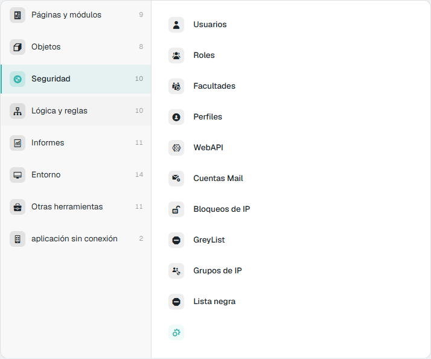
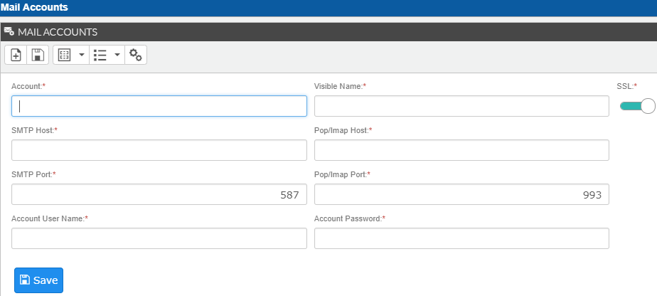
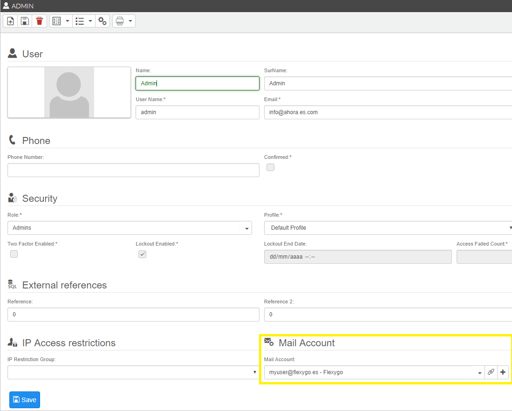
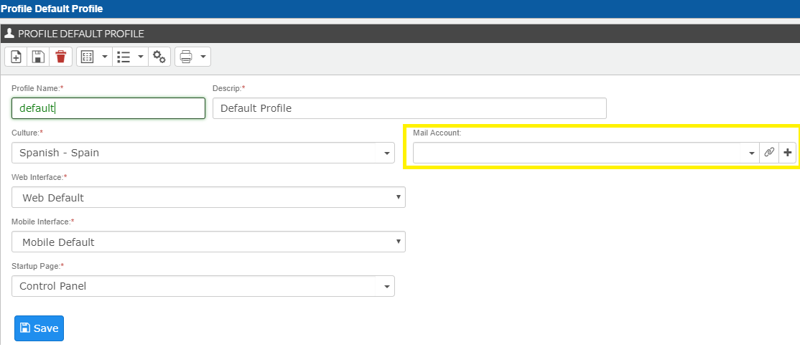
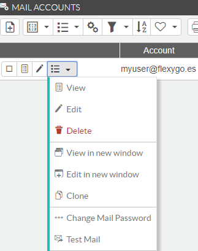
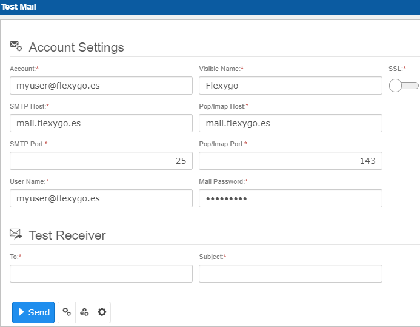
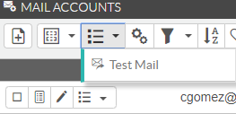
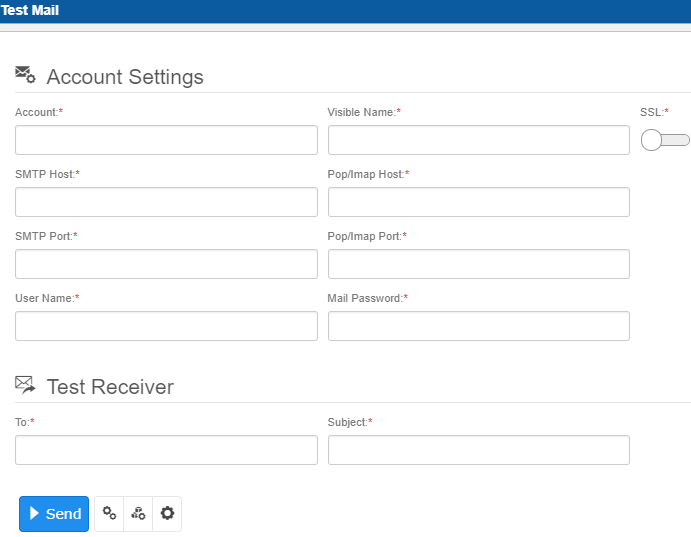
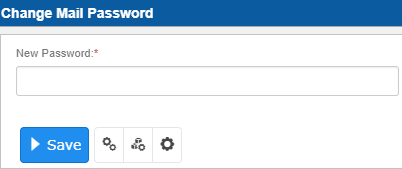
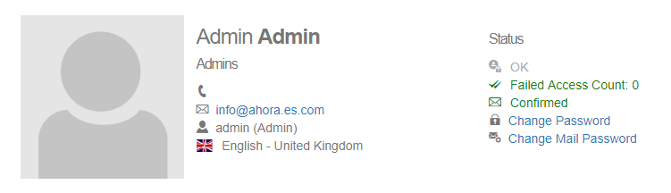

# Ajustes de cuenta de email

Configura cuentas de correo para usuarios y perfiles sobrescribiendo la configuración SMTP de la sección `MailSettings` del `appsettings.json` del **Backend**.  
Si configuras una cuenta de correo para un usuario, se usará esa configuración para enviar los correos.  
Si la configuras para un perfil, se usará la del perfil.  
Si ambos están relacionados, prevalece la configuración del usuario.  
Si no existe ninguna configuración personalizada, la aplicación usará la configuración SMTP de `MailSettings` (ver [Referencia: appsettings.json](../../1Deployment/2ConfigWizard/AppSettingsReference.md)).

## Create Mail Account

Puedes gestionar la configuración de cuentas de correo desde el panel de control → área **Seguridad** → *Cuentas Mail* (en la skin flexy2022: *Admin Work Area > Security > Mail Accounts*).

Completa la información del servidor de correo y los datos de la cuenta para enviar correos con una configuración específica.

## Link Mail Account

Puedes vincular configuraciones de correo a usuarios desde el panel de control → área **Seguridad** → *Usuarios* (en la skin flexy2022: *Admin Work Area > Security > Users*).

También puedes vincular configuraciones de correo a perfiles desde el panel de control → área **Seguridad** → *Perfiles* (en la skin flexy2022: *Admin Work Area > Security > Profiles*).

## Testing Mail Account

Tienes dos opciones para probar una configuración de correo:

1. Probar la configuración desde una cuenta de correo específica o completando manualmente los datos de la cuenta.

2. Probar la configuración de correo asociada a un **usuario concreto** enviando un correo de prueba.

También puedes probar cualquier configuración desde el proceso de colección enviando un correo de prueba:

## Change Mail Account Password

Como administrador, puedes cambiar la contraseña de la cuenta de correo de cualquier usuario.

Cualquier usuario que tenga una cuenta de correo asociada puede cambiar su contraseña desde su panel de control.

