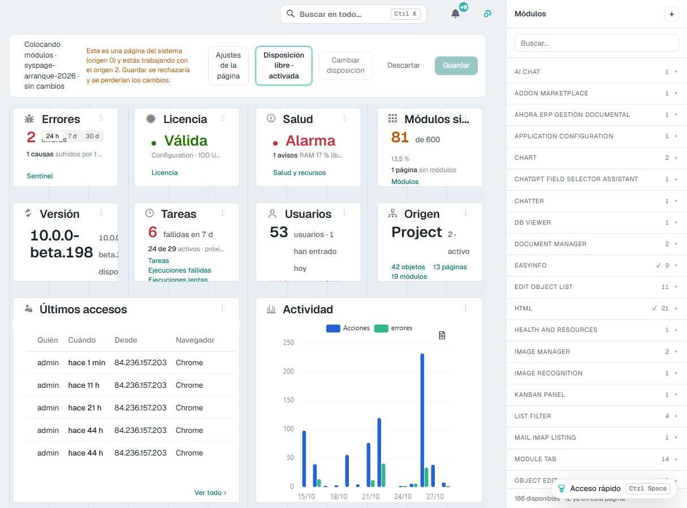
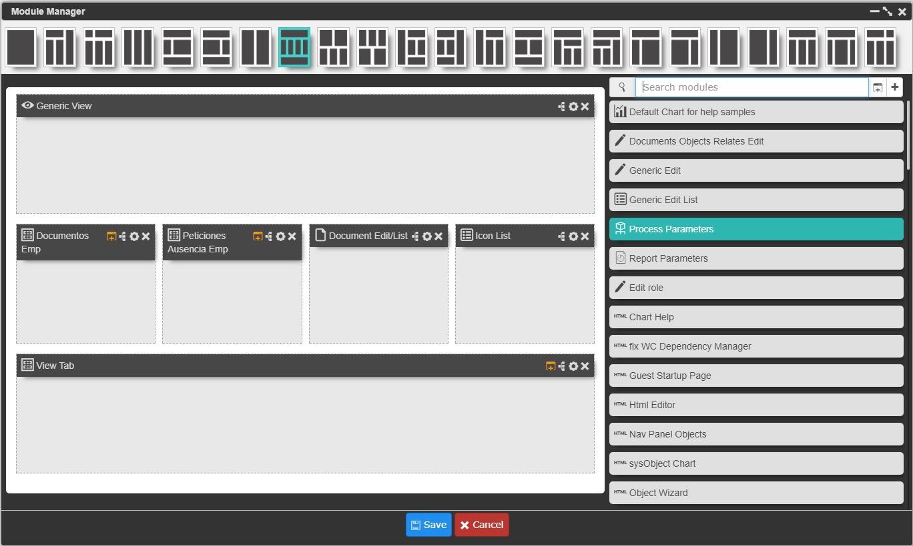
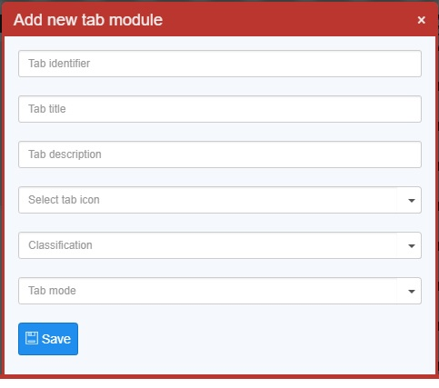
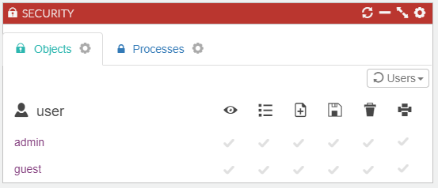
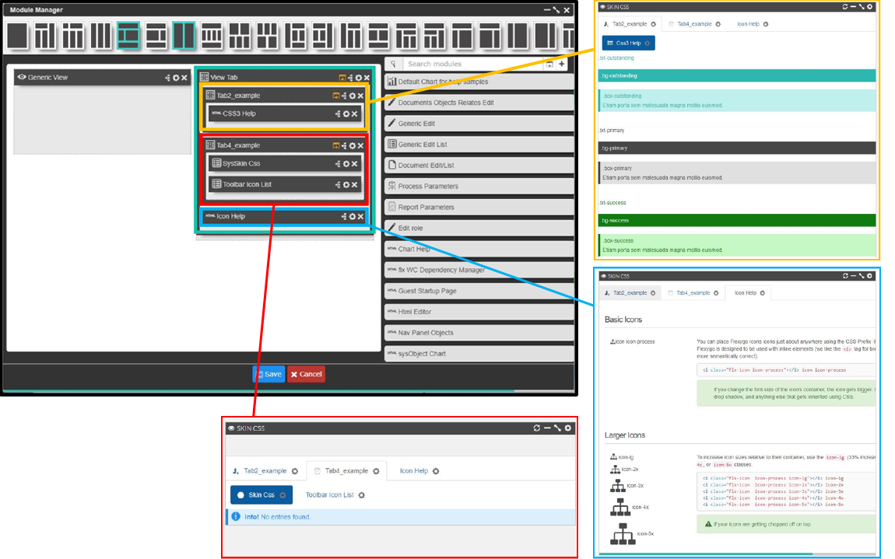

# Module Management

Each page has a layout where it is possible to add different modules related to the page object information.

## Skin 2026: arranging the modules on the page itself

In skin 2026, with **development mode** on, modules are arranged directly on the page, without opening the module manager:

1. Open the page and press **Ctrl Shift M**, or open **Quick access** (the pill at the bottom right, **Ctrl Space**) and, under **Page**, choose **Place modules**.
2. The **Placing modules** bar appears at the top, with the page name and its zones. Drag the modules between zones and change their order; the **Modules** panel lets you search the existing modules, add them or **Create a new module**. Each module has its menu to configure it, see its security and events or remove it from the page.
3. With **Change layout** you choose another layout, and with **Free layout** each module gets its own place and size on a 12-column grid.
4. **Save** writes the changes; **Discard** undoes them. The bar warns about what is worth knowing before saving: modules without a zone in the new layout move to the first one, a system page (origin 0) cannot be saved while working with another origin, and saving a generic page creates a new page.

The page configuration opens with the **Page settings** button of the same bar, next to the tools to arrange the modules.

<figure markdown="span">
  
  <figcaption>Placing modules: the bar at the top and, on the right, the <b>Modules</b> panel (Spanish interface)</figcaption>
</figure>

## Skin 2026: letting each user order the modules

You can let each user arrange a page's modules to their liking. It is switched on page by page, and it is off by default:

1. Open the page, press **Ctrl Shift M** and, in the **Placing modules** bar, open **Page settings**.
2. Tick **Users can reorder** and save.

From then on, each user can:

- **move** a module by dragging it by its header, to another zone or to another place in the same one; on a page with **Free layout**, to another cell of the grid;
- **pin** a module in its place with the pin in its header, so the others move around it;
- **go back to your arrangement** with the line that shows at the foot of the page as soon as they have moved something.

What they cannot do: change the modules' size, show or hide them, or add or remove any. That stays yours.

Each change is saved as soon as the user drops the module, for that user only. The zone, the order, whether the module is folded or pinned and, on a free-layout page, its cell are saved. If you later switch the option off, everyone sees your arrangement again, and what each user had saved is kept in case you switch it back on.

It only works in skin 2026, and on the main page: not inside dialogs. At mobile width there is nothing to order, because the modules stack; a free-layout page can be ordered from 1280 px wide. While you are placing modules, each user's order is paused.

How the user sees it: [Ordering a page's modules](../Administration/Skin2026.md#7-ordering-a-pages-modules).

## Skin flexy2022: Page config and Module Manager

In the flexy2022 skin, it is necessary to access the page, click the Page config tab to the right of the screen and access the Module Manager. In the _image 1_ it is possible to visualize the different layout possibilities that exist for dividing the screen. 

On a second level there are two columns.On the left whe can see the different placeholders according to the selected layout above. In right column, there is list with all available existing modules. It also has a search engine to easyly find allready created modules. The search engine has two icons, The first one quickly generatea a tab-type module and athe second icon gives us the possibility to create new types of modules.

Tabs are nothing more than modules classified as tabulators. With them, it is possible to nest multiple modules inside facilitating a more compact access and visualization of different sections. The user can generate a new tab from the module management window (the first icon in the search box). There are two types of tabs: The button tabulator and the default tabulator that can be seen in the following image.

Watch the following video on our YouTube channel for additional information.

    <iframe src="https://www.youtube.com/embed/-VYdJIDVIG8" title="YouTube video player" frameborder="0" allow="accelerometer; autoplay; clipboard-write; encrypted-media; gyroscope; picture-in-picture" allowfullscreen=""></iframe>

