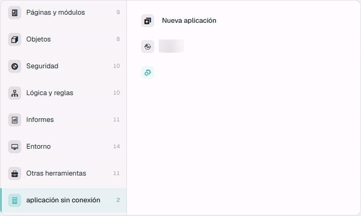
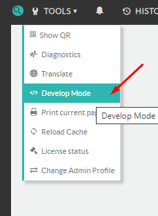
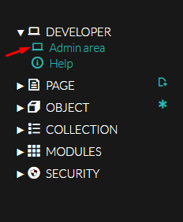
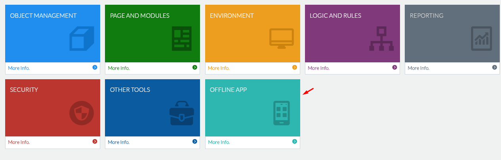
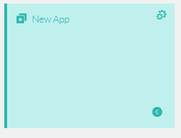

# Offline App description

**flexygo** low code allows you to design applications for mobile devices, so that users can work even when they are offline.

It allows generating an App that will be installed on the mobile device and will connect to **flexygo** through the Web API, allowing offline work and data synchronization when the connection is available. Performing bi-directional data synchronizations between the device and the API will update both the data and the working environment.

## Accessing Offline Apps environment

In skin 2026, with an administrator user:

1.  Turn on **development mode** (**Develop Mode**, at the bottom of the side menu).
2.  Open the [control panel](../Administration/ControlPanel.md) (side menu → **Administration** → **Control panel**) and choose the **Offline app** area.
3.  From there you reach the already designed apps (**Offline Apps**) or **New App** to design and configure a new offline application. The **App offline** shortcut of the control panel also leads to the list of apps.

Each app opens in a screen organised in sections (objects, menus, pages, code and resources, and synchronisation), with the emulator always in sight. See [Design environment](DesignEnvironment.md).

<figure markdown="span">
  
  <figcaption>The offline app area in the control panel: <b>New app</b> and the apps already created (Spanish interface)</figcaption>
</figure>

### flexy2022 skin

Access to the Offline Apps section is done as follows:

1.  With an administrator user (admin), and within the Tools section we will click on the Develop Mode option
    
    
    
2.  Then, within the Developer option we will access the Admin Area section where we will find Offline App section
    
    

3.  Then within the Developer option we will access the Admin Area section
    
    
    
4.  From which we can access the already designed Apps or a "New App" Menu to design and configure a new offline application
    
    
    

We therefore have the option of editing existing templates or creating new templates.