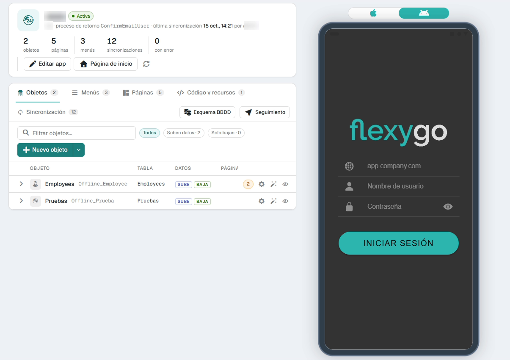
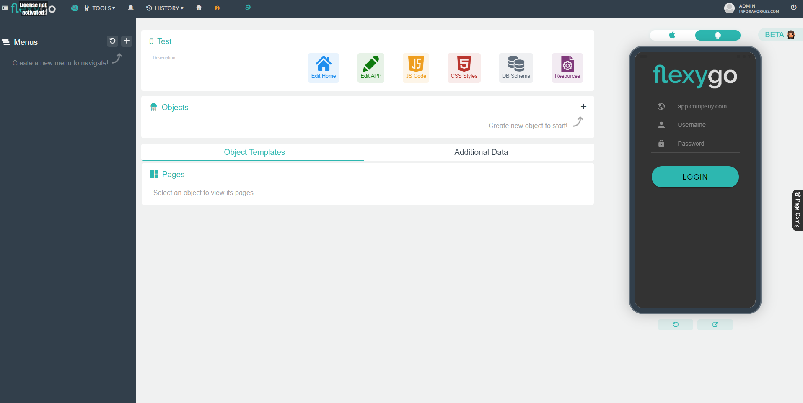
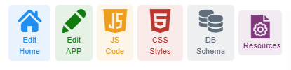
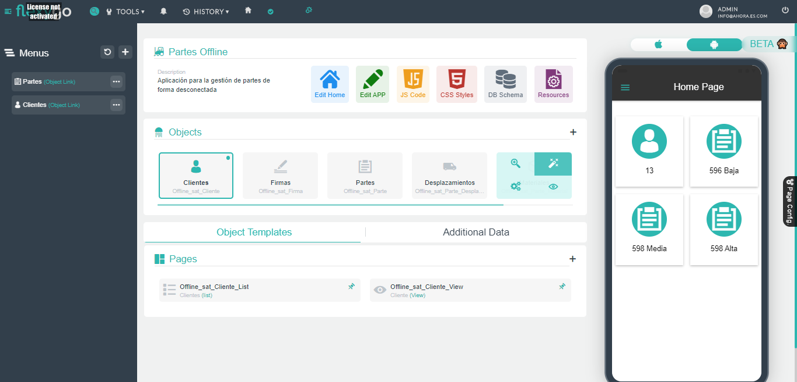

# Design environment

Once the application is saved, we will familiarize ourselves with the design environment of the application.

## Skin 2026

In skin 2026 the app opens in a single screen. At the top, a band with the app and its numbers (objects, pages, menus, synchronisations and how many with errors, last synchronisation) and the **Edit app** and **Home page** buttons; if the app sends data without a return process, it warns about it. Below, a card with these sections, each one as a table:

*   **Objects**: the offline objects of the app. Each row unfolds to its pages and SQL views. **New object** opens the object wizard; its arrow offers **Based on an online object**, which copies an object the app already has online. **DB schema** and **Tracking** are also in this section.
*   **Menus**: the menus that will appear on the device.
*   **Pages**: the list and view pages of the app, with **New page**.
*   **Code and resources**: JavaScript scripts, CSS styles and static resources (images, documents…).
*   **Synchronisation**: the history of what the devices have sent and received, with **Retry** for the failed sends (see [Skin 2026 new features](../Administration/Skin2026.md#5-offline-app-synchronizations-retrying-and-correcting-what-was-sent)).

The **emulator** is always in sight, alongside, to see how the application looks on a device.

<figure markdown="span">
  
  <figcaption>An offline app: its figures, the sections and the emulator (Spanish interface)</figcaption>
</figure>

The option to link an existing object to the app no longer exists: objects are created with the wizard or by copying an online one.
{: .flx-info-card }

## flexy2022 skin

This environment is basically divided into 6 areas we will explain bellow.

## Work areas

### Menus

To create and design the menus that will appear on the device.

### App additional info

From this section we can modify the basic data of the App, modify and design the home page and incorporate other resources like:

*   Design the home page
*   Add JavaScript code
*   Add our own CSS classes
*   Check the DB schema that will be sent to our mobile device
*   Include some additional resource file like images or documents

### Objects

From this section we can modify create or modify our offline objects. we can create new ones or base them on allready existing online objects.

### Object Pages

Design list and view template pages using HTML5 and Ionic framework for any of our already created objects

### Object Views

Extend object information using complex data views

### Emulator

From this section we can emulate the display and operation of the application, and experiment what the result will be on IOS or Android devices.

