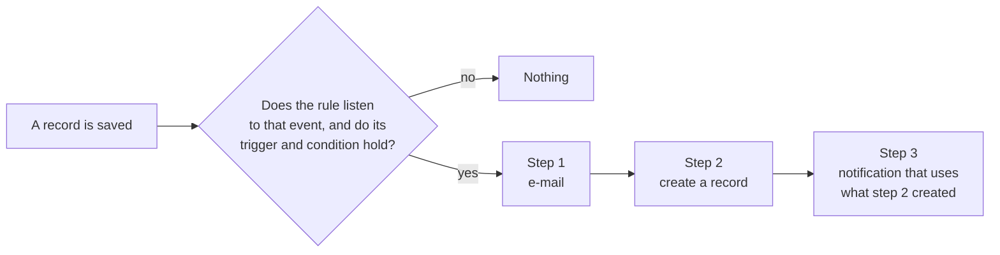
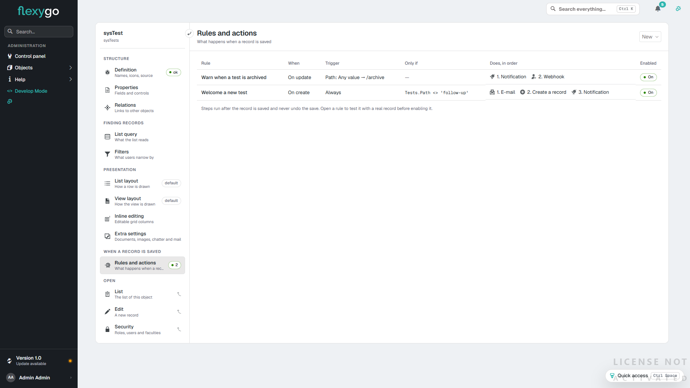
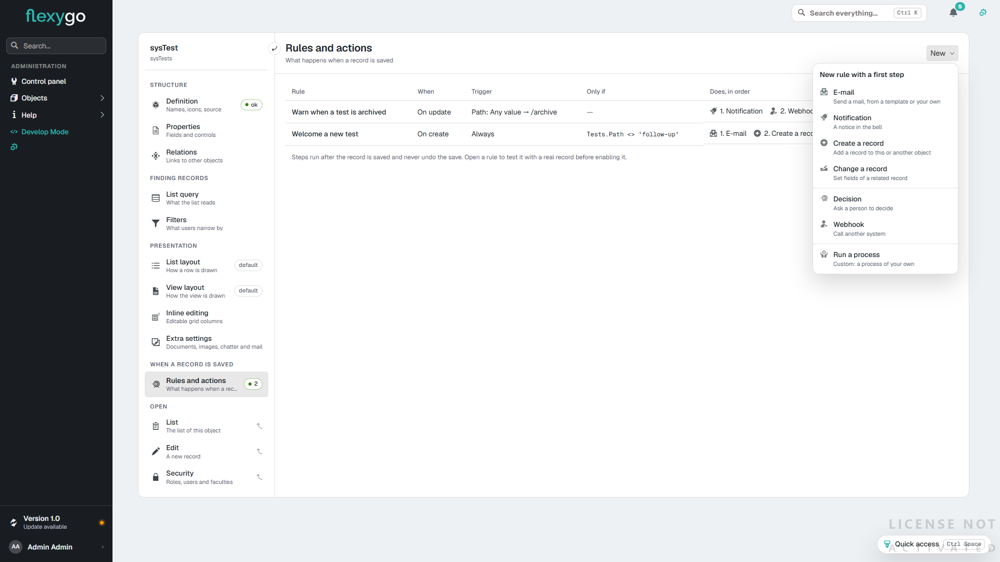
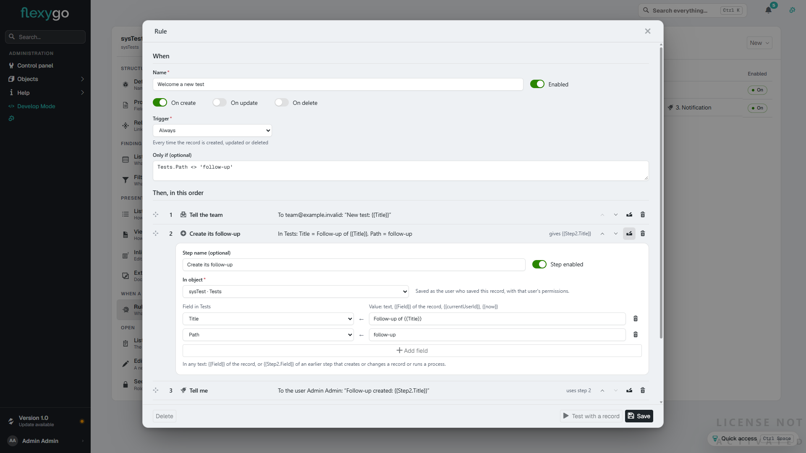
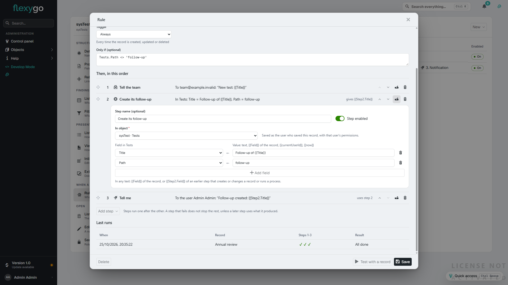
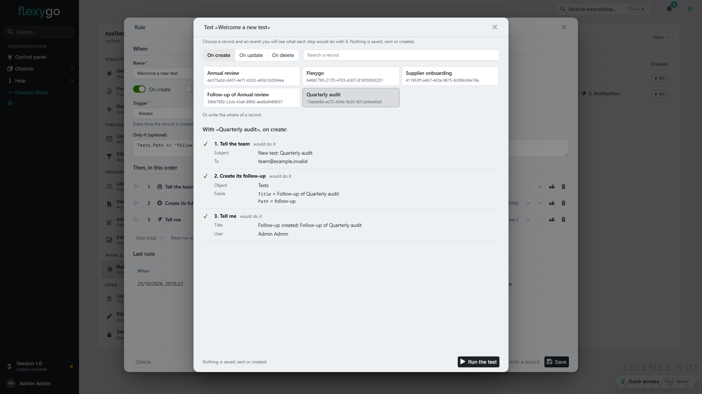
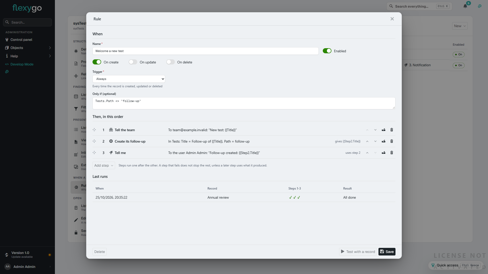

# Actions on save 10.0+

When a record is created, updated or deleted, Flexygo can do things for you **without programming**: send an e-mail, notify someone in the bell, create or change another record, ask for a decision, call another system or, when what you need is not in the list, run a process of your own.

Everything is configured with **rules**. A rule says **when** (on create, on update or on delete, with a trigger and an optional condition) and **what it does**, as **steps** that run in order.

Want to try it in ten minutes? [Try it: a rule with three steps](ActionsOnSaveTryIt.md).

**Where it is configured**: in skin2026, in the **object workbench**, section **Rules and actions** (at the end of the rail, in the group *When a record is saved*). Decisions and outgoing webhooks also keep their own screens, in both skins: see [Approvals, human tasks and outgoing webhooks](ApprovalsAndWebhooks.md).

!!! info "Steps are configured in skin2026"
    Rules **run** the same in both skins, but steps are **configured** from skin2026. In flexy2022 only decisions and webhooks are configured, with their own screens; for the other steps (e-mail, notification, create or change a record, process), switch the profile to 2026.

The list shows each rule in a row: when it runs, its trigger, its condition, the steps it does in order and whether it is enabled. The **On / Off** switch turns it on or off without opening it.

!!! note "They never undo the save"
    Steps run **after** the record is saved. If a step fails, the record is saved and stays saved; the failure is kept in the rule's **last runs**.

---

## 1. Creating a rule

The **New ▾** button of the section opens the list of step types. Choose the first one and the form of a new rule opens with that step already in it, so a one-step rule is a single screen.

The types are grouped:

- **The ones you only configure**: e-mail, notification, create a record and change a record.
- **The ones that wait or go outside**: decision (waits for a person to decide) and webhook (calls another system).
- **The custom one**: run a process. It is the only door to the project's own code.

The form of the rule has three parts: **When**, **Then, in this order** (its steps) and **Last runs**.

---

## 2. When it runs

| Field | What it is |
|---|---|
| **Name** | The name of the rule, as whoever maintains it will read it. |
| **Enabled** | A disabled rule does not run, but it can still be **tested** (§5). |
| **On create / On update / On delete** | The events it listens to. At least one. |
| **Trigger** | *Always*: every time. *When a field changes*: only if the chosen field has a new value. *When a field changes to a value*: only if the field goes to a value, optionally from another one (*From*; empty means any value). |
| **Only if** (optional) | One more condition over the record, in SQL, like the `where` of a list: `Offers.Amount > 1000`. |

The trigger covers the most common case without SQL, «when the offer becomes *Accepted*»: *Trigger* = *When a field changes to a value*, *Field* = *Status*, *To* = *Accepted*. The *To* box suggests the values the field holds today.

---

## 3. The steps

Steps run **one after the other**, in the order of the list. Reorder them by dragging the row or with its arrows, edit one with the pencil (the step's form opens under its row) and remove it with the bin. **Add step ▾** adds another.

| Step | What you configure | When it happens | Where you follow it |
|---|---|---|---|
| **E-mail** | Template (optional), subject, to (addresses or `{{Field}}`), also to a role and a user, and the HTML body | Queued at once; sent within a minute, with retries | The mail outbox |
| **Notification** | Title, message and who (role or user) | At once | The bell, with the record linked |
| **Create a record** | The object and its fields: field ← value | At once, as the user who saved | The new record and its audit |
| **Change a record** | The object, **which record** (a `where` over its table) and the fields to set | At once, as the user who saved | The changed record and its audit |
| **Decision** | Title, for whom, priority, due time, options | Opens the task at once and **waits** for a person | The decisions inbox |
| **Webhook** | URL, method, what it sends (the record, its keys or a template) and the secret | Queued at once; **goes outside** within a minute, with retries | The webhook's deliveries |
| **Run a process** | The process and its parameters | At once, on the record, as the user who saved | Whatever the process does; its error, in *Last runs* |

Any text of a step can use **`{{Field}}`** of the record that was saved, and also `{{currentUserId}}` or `{{now}}`. In the body of an e-mail, the record's values go in **as text**: a `<` or a link shows as it is; HTML fields go in as they are.

!!! warning "Required fields when creating a record"
    The *Create a record* form warns when the target object has a required field, with no default, that the step gives no value. That record could not be created, and the step would fail every time.

!!! note "Records are saved as the user who saved"
    Creating, changing and running a process happen **with the permissions of the user who saved the record**: their security, their defaults, their audit and the other object's rules apply as if they had done it.

---

## 4. Data between steps, and failures

A step that **creates or changes a record** or **runs a process** leaves its values to the steps after it: **`{{Step2.Title}}`** is the *Title* field of the record step 2 created. The step's row says so (*gives {{Step2.Title}}*), and so does the row of the step that uses it (*uses step 2*).

- A step **cannot use** one that comes after it, nor one that leaves nothing (an e-mail, a notification). The form does not save the rule and says why.
- **If a step fails, the others go on**, except those that use what it produced: those are **skipped**, because running them with an empty value would be worse.
- **No loops**: a step that saves a record may fire the rules of that other object, but a chain stops at **three steps inside one another**, and a step never runs inside itself.

---

## 5. Testing with a record

**Test with a record** (at the foot of the form) shows what each step would do with a real record **without doing anything**: it saves nothing, sends nothing and creates nothing. If the rule has unsaved changes, it is saved before the test. It also works with the rule disabled, which is exactly when you need it.

Choose the event (*On create*, *On update*, *On delete*) and a record from the list, which you can search; or write the `where` of one.

Each step comes with all its values **resolved**: the subject with the record's title, users and roles **by their name**, and what it uses from an earlier step already filled in (*Follow-up created: Follow-up of Quarterly audit*). A value an earlier step only knows once it runs (the number of a new record) is shown as such. A step that would fail says so, with the reason, and the ones that depend on it show as skipped.

!!! note "The trigger is not checked in a test"
    A test has no «value before», so if the rule is *When a field changes*, the test reminds you: *in a real save it runs only if Status changes to Accepted*.

---

## 6. Last runs

Each time a rule runs it leaves one row per step: done, failed or skipped, with its message. The form shows the latest in **Last runs**: when, on which record, one mark per step (✓ done, ✕ failed, – skipped) and the result.

What has its own queue does not count as a failure of the rule: an e-mail that was queued and then does not go out (it is retried), or a webhook that was queued and then fails (see its deliveries).

---

## 7. For developers

| What | Where |
|---|---|
| Rules | Table `Objects_Rules`: events (`OnInsert`, `OnUpdate`, `OnDelete`), `TriggerType` (`always`, `changed`, `changedto`), `TriggerField/From/To`, `Condition`, `Enabled` |
| Steps | Table `Objects_Actions`, one row per step with `StepOrder` and `ActionType`; their field = value pairs, in `Objects_Actions_Fields` |
| Step types | Table `Objects_Actions_Types`, with the class that runs it (`Handler`). A new type is a row and a class that implements `IObjectAction` |
| Runs | Table `Objects_Rules_Log` (`done`, `failed`, `skipped`) |

Rules, like the rest of the configuration, travel with their origin: a rule created with origin 0 is part of the product.
